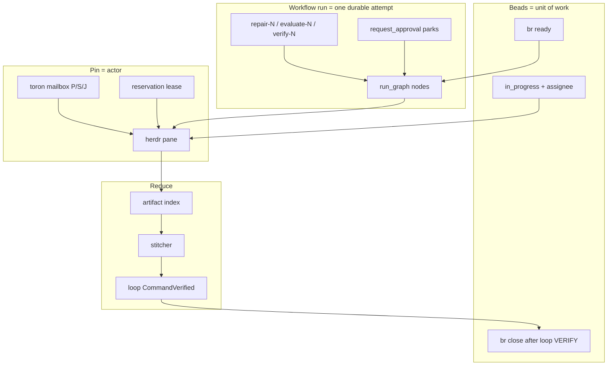
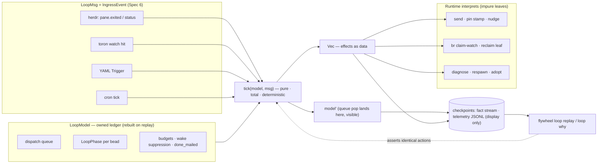
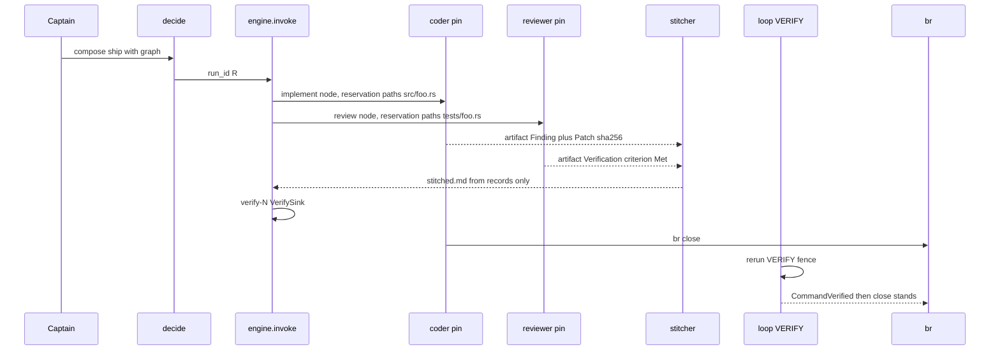
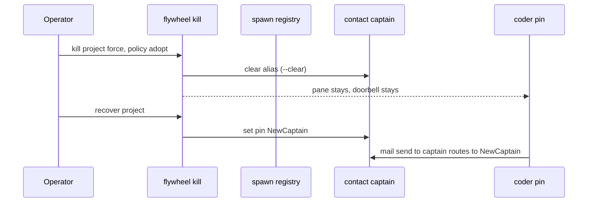

<!-- governed-by: ADR-0003, ADR-0005, ADR-0011, ADR-0015, ADR-0019, ADR-0020, ADR-0022, ADR-0024 -->
---
status: accepted
date: 2026-08-27
decision-makers: Captain (bangedorrunt)
consulted: Jido (agentjido/jido) + Puppetmaster (professorpalmer/Puppetmaster) study 2026-08-27; ADR-0024 Atomic-tree revision; Round-1 adversarial review + Elm-reducer fold; Round-2 verification pass (same day, §12)
informed: flywheel maintainers; skill owners (toron, flywheel, runtime-adaptation, br)
---

# ADR-0025: Adopt Graph-Only Dispatch, Artifact Reduce, and Pin Supervision

**Status:** Accepted (2026-08-27; revised same day after Round-1 review; acceptance recorded 2026-08-31)
**Date:** 2026-08-27
**Decision-makers:** Captain (bangedorrunt)
**Extends:** [ADR-0005](0005-orchestration-layer.md) (workflow engine, DAG, triggers), [ADR-0011](0011-coalition-orchestration.md) (steer + collab layers, reservations), [ADR-0015](0015-flywheel-toron-integration-contract.md) (one-way dep, one mail surface), [ADR-0019](0019-bead-verified-execution-and-principle-playbooks.md) (legal close, VERIFY, no worktrees), [ADR-0020](0020-nostr-two-plane-cli-and-crew-steering.md) (planes P/S/J/N/W), [ADR-0022](0022-phase-native-orchestration.md) (Phase, one durable rail), [ADR-0024](0024-graph-first-repair-loops-bead-workflow.md) (graph canonical, typed runtime failure, unrolled repair), flywheel [ADR-0001](../../../flywheel/docs/decisions/0001-event-driven-agent-collaboration-spine.md) (event spine, `LoopAction`)
**Amends:** none of the frozen surfaces. Completes the overlay ADR-0024 deferred: lease reclaim, typed artifacts, parent-death policy, plane tripwires as structure, ingress unification, launch idempotency.
**Does not amend:** ADR-0024 Spec 0–2 (Wave 2+ of this record is **gated**, not authored, here). ADR-0019 VerdictKind / legal-close table. ADR-0022 five-value Phase. Frozen MCP tools (40). Kind registry (ADR-0014). One-way dep. Worktree ban. Identity grammar (ADR-0018). Plane nouns `channel|job|react|presence|watch`. Atomic reservation conflict-check.
**Tracker:** beads. Never pull requests.

> **Scope:** steal three invariants from Jido and Puppetmaster onto the spine we already run. Do not clone either project. Do not add a fourth sequencer.
>
> 1. The graph is the only dispatcher of workflow work (Puppetmaster v1.22.37; our ADR-0024).
> 2. Follow-up and reduce read typed artifacts, never transcripts (Puppetmaster WHY.md).
> 3. Pins are actors under a parent-death policy; pane death reclaims leases (Jido `on_parent_death` + Puppetmaster task leases).
>
> **Out of scope:** a Jido-in-Rust crate; a behavior-tree engine; CloudEvents as a new protocol; cost routing; named-cell sqlite beside Resonate; engine `br close`; bead = workflow run; worktrees; new MCP tools; new Nostr kinds.

---

## 1. TL;DR

Jido is a library for building agents as OTP processes. Puppetmaster is a supervisor over existing coding-agent CLIs. We are the second kind, plus Schnorr identity, a beads work ledger, and Resonate durability. The captain's note (event trigger, FSM vs direct, behavior trees, DAG, configurable strategies, plan-based orch, lifecycle hooks, parent-child, signal routing) is Jido's feature list. Treat it as a pattern catalog. Adding those as new crates would fight ADR-0005's "one engine" and ADR-0022's "one rail."

`LoopAction` in `flywheel/src/durable.rs` is already Jido's directive idea. `run_graph` already exists. Planes already exist. VERIFY already refuses worker self-close. The holes are enforcement: `pane.exited` diagnoses and does not reclaim the bead; reduce is a kind-9 paragraph; the loop planner mutates its input (`&mut` queue) so there is no single model to replay; captain kill has no orphan/adopt policy; plane rules live in skills; compose can mint a second crew after crash; Direct vs DAG is a vibe, not a selector contract.

Six ships, in this order. Wave 1 ships immediately (no prerequisite); Waves 2–5 gate on ADR-0024 Wave 1 (Spec 0). Direct `spawn + send` / `steer --direct` stays the cheap path and never requires a graph.

```
  Wave 1  lease reclaim on pane_exited    (no 0024 dependency — ships first)
       ▼
  ADR-0024 W1 (gate for Waves 2–5 only)
       │  graph canonical, typed {ok:false,kind}, unrolled repair, evidence approvals
       ▼
  Wave 2  typed artifacts + stitcher reduce
       ▼
  Wave 3  typed loop SM + Elm reducer tick (LoopModel × LoopMsg → LoopAction)
       ▼
  Wave 4a parent-death policy
       ▼
  Wave 4b plane tripwires (private-by-default)
       ▼
  Wave 5  one ingress enum + launch idempotency by run_id
```

---

## 2. Layer picture



Three identities stay distinct:

| Identity | Owner | Closer / terminal |
| :--- | :--- | :--- |
| Bead | `br` | `br close` after loop VERIFY (`CommandVerified` is loop-only) |
| Workflow run | Resonate promise + kind-46012 | engine terminal `{status}`; never `br close` |
| Pin | spawn registry + npub | `kill` / `on_captain_death` / `recover` = adopt |

### Vocabulary

This record pulls words from three systems (ours, Jido, Puppetmaster). Pin each word to one meaning so review and implementation do not drift. Where a term is borrowed, the origin is named once; the **our-stack meaning governs**.

| Term | Meaning here | Home / origin |
| :--- | :--- | :--- |
| Actor | pin + pane + mailbox; address = pin, isolation = reservation | Spec 1; OTP actor model adapted |
| Pin | adjective+noun mail identity backed by an npub; the actor's address | ADR-0018 grammar |
| Pane | herdr surface hosting one harness; death is observable (`pane.exited`) | herdr |
| Captain | the project's registered orchestrator pin (`captain` alias fold) | bd-captain-alias-0g8a |
| Crew | pins spawned under one workspace/project | spawn registry |
| Bead | unit of work in `br`; status transitions belong to `br` alone | beads |
| Workflow run | one durable attempt (Resonate promise + kind-46012); proves a close, never is one | ADR-0005/0024 |
| Node | one `run_graph` vertex (post-desugar, every step is a node) | ADR-0024 W1 |
| Plane | wire class P (gift-wrap) / S (kind-9 room) / J (job 43001–43006) / N (presence) / W (watch) | ADR-0020 |
| Tripwire | fail-closed check on a hazardous plane direction (secret→public, job-assign→private) | Spec 5 |
| IngressEvent | the one Msg type: herdr event, watch hit, YAML trigger, cron tick | Spec 6; Jido sensor analog |
| LoopModel | the loop's owned serializable ledger: queue, budgets, wake suppression, per-bead phase | Spec 3; `loops.json` v2 |
| tick | the total reducer `tick(&LoopModel, &LoopMsg) -> (LoopModel, Vec<LoopAction>)` | Spec 3; Elm `update` |
| LoopAction | effect-as-data the runtime interprets (Send, PinStamp, Diagnose, Respawn, Reclaim, …) | Spec 1/3; Jido directive |
| LoopPhase | closed enum of loop-owned bead states; illegal transitions unrepresentable | Spec 3; **not** Phase |
| Phase | ADR-0022 orchestrator vocabulary for agent jobs (five values) | ADR-0022; never one enum with LoopPhase |
| LoopSnapshot | uniform status projection (per-bead phase, verdict, budgets) for `flywheel status` | Spec 3; Jido `Strategy.Snapshot` |
| Claim-watch | LoopPhase where a dispatched bead awaits detected `br close` | existing loop |
| Artifact | typed worker output: path, sha256, kind, four statuses, bead/run/node ids | Spec 2; PM artifact |
| Stitcher | reduce over ArtifactRecords only; writes `stitched.md`; never reads transcripts | Spec 2; PM stitcher |
| Admission | accepting a claim as evidence: only `IndependentlySupported` / criterion `Met` from the embedding — never self-rating | Spec 2; PM ARTIFACT_STATUS |
| Reclaim | revert a dead/stale claim to open, audit comment first | Spec 1; PM lease expiry |
| Adopt | rebind the captain alias to a new orchestrator pin | Spec 4; Jido `AdoptChild` |
| Replay | re-drive a recorded fact sequence through `tick`; must reproduce identical actions | Spec 3 |
| Map / Reduce | map = graph fan-out (waves, parallel, coalition); reduce = stitcher over artifacts, never a transcript fold | §2; PM pattern |

---

## 3. Context and Problem Statement

### 3.1 What we studied

On 2026-08-27 we read Jido (Elixir OTP agent framework: `cmd/2`, Direct vs FSM strategies, CloudEvents signals, directives, parent/child with `on_parent_death`, sensors, pods, the Elm/Redux core loop) and Puppetmaster (Python supervisor of Cursor/Claude/Codex/Hermes adapters: job/task DAG, leases, typed artifacts, stitcher, "workers do not share transcripts", v1.22.37 "the graph is the only dispatcher"). Comparison artifact: `~/.agent/diagrams/stack-vs-jido-puppetmaster.html`.

### 3.2 What already exists (do not rebuild)

| Piece | Location | Job |
| :--- | :--- | :--- |
| DAG scheduler | `crates/toron-workflow/src/engine/control_flow.rs` `run_graph` | Wave dispatch, `needs:` edges, Resonate replay. ADR-0024 makes this the only sequencing path. |
| Direct cheap path | `flywheel spawn` + `send`; `steer --direct` | One agent, one brief. Jido Strategy.Direct equivalent. |
| Strategy selector | `flywheel/src/decide.rs` | loop-work / steer / compose / coalition / cron. Do not add a per-agent Strategy protocol. |
| Loop directives | `flywheel/src/durable.rs` `LoopAction` | `Send`, `PinStamp`, `DispatchImmediate`, `Blocked`, `Nudge`, `Diagnose`, `Respawn`, `Wait`. Pure over injected state. |
| Event path | `durable.rs` `pane.exited` → `LoopAction::Diagnose` | Self-heal diagnose/respawn. Does **not** unclaim the bead. |
| Loop control state | `flywheel/src/state.rs` `loops.json` v2 | event_cursor, escalation tiers, respawn budgets; deterministic `ctx.now()` timestamps; JSONL event log + checkpoints. The seed of Wave 3's `LoopModel`. |
| Planes | ADR-0020 | kind 9 room, 1059/14 letter, 43001 job, 20001 presence, `watch` doorbell. Rules live in skills. |
| Legal close | ADR-0019 + loop `__loop-run-verify` | Worker mail `[id] done` is courtesy. Loop is reporter of record. |
| File-first | flywheel skill dirt policy / bd-tdjaz | Findings over ~20 lines go to a file; the post carries path. No typed schema, no sha256 index. |
| Triggers | `crates/toron-workflow/src/schema.rs` `Trigger` | 7 variants. Host wiring exists (`WorkflowHost` + `TriggerNotifySink`). |
| Reservations | ADR-0011 | intent/held/released. Corruption floor. Never removed. |
| Captain alias | bd-captain-alias-0g8a | `captain` folds to the orchestrator pin. No death policy, no clear. |

### 3.3 Measured gaps

| Gap | Evidence | Consequence |
| :--- | :--- | :--- |
| Dead pane parks work | `pane.exited` emits `Diagnose`, not reclaim. `br ready` excludes `in_progress`. | A crashed coder hides the bead until a human reclaims. Beads protocol already says swarm claims stale after 2h without `updated_at`; that rule is not code. |
| Reduce is prose | Kind-9 / mail body is the working set. No `ArtifactRecord`. | Model switch rebills a transcript. Stitch cannot hash. Worker confidence can be mistaken for admission. |
| Loop model is scattered | `plan_actions(states, queue: &mut Vec<String>, nudge, digests, wake_suppressed)` pops the queue *inside* the planner (`durable.rs:3440`) | No single `LoopModel`; the state delta is invisible; the "pure" planner mutates its input; no replay harness exists to interrogate a past decision. |
| Loop states are strings | `plan_actions` matches `s.status.as_str()` (`working` / `blocked` / `unknown` / else). | Verify-before-claim and Complete-while-WaveGate are representable. |
| Captain death | `flywheel kill --force` stops panes. No `on_captain_death`. `recover` is unnamed adopt. No `captain` alias clear exists. | Crews go deaf or run unowned. |
| Plane rules are prose | Skill text. Gift-wrap of crew-visible work is a social error. | Misroute is invisible until a human notices. |
| Launch is not idempotent | Compose/spawn after crash can mint a second crew. Puppetmaster v1.22.17 added `job_ref` launch idempotency for this. | Duplicate 43001, duplicate panes, duplicate reservations. |
| DAG unused until 0024 W1 | Builtins and compose emit `steps:`. | Parallelism and named repair stay theoretical. This ADR does not re-spec that; it **gates** on it. |

### 3.4 Problem statement

> How do we absorb Jido's cmd/directive split, FSM-as-illegal-states, Elm reducer core, parent-death policy, and sensor ingress, plus Puppetmaster's artifact reduce, lease reclaim, and graph-only dispatch, onto flywheel × toron × beads, without a new engine, without new kinds or MCP tools, and without collapsing bead, run, and pin into one identity?

---

## 4. Decision Drivers

1. **Subtract before you add.** Every note item maps onto an existing home. New crates are a failure of mapping.
2. **ADR-0024 Wave 1 is the graph ship.** This record does not re-argue desugar, `{ok:false,kind}`, or unrolled repair. Waves 2–5 will not merge until that park-safe `to_graph` proof is green. Wave 1 (reclaim) has no technical dependency on it.
3. **Prove-it-works.** Host receipts beat worker claims (Puppetmaster; our loop VERIFY). Worker self-rating is stored and never admitted.
4. **Boundary discipline.** Engine never imports flywheel, never shells VERIFY, never `br close`. Artifacts are flywheel state. Schema types may live in toron-workflow only if they are engine-visible node outputs (paths), not stitcher logic.
5. **Make operations idempotent.** Spawn/compose keyed by `run_id` converges.
6. **Type-system discipline.** Illegal loop transitions unrepresentable. Illegal plane use fails at lint or send time, not in a postmortem.
7. **Never block on the human for an observable fact.** Pane gone is observable. Do not wait for a reclaim comment if `pane_exited` already named the assignee.
8. **Frozen surfaces stay frozen.** No 41st tool. No new kind. No worktrees.
9. **Direct stays cheap.** A one-shot must not require a DAG, an artifact index, or a parent-death policy.
10. **Fail in the safe direction.** A classifier's miss must never be able to broadcast (private-by-default); a planner's purity must be witnessed by replay, not by a textual grep.

---

## 5. Considered Options

### Option A — Steal invariants onto the existing spine (CHOSEN)

Keep three layers. Finish 0024 W1 (for Waves 2+). Then reclaim, artifacts, typed loop SM + reducer tick, parent-death + plane tripwires, ingress + idempotent launch. Direct path remains.

### Option B — Clone Jido as a Rust agent runtime

Agents become in-process FSMs with signals and directives. Rejected. Our workers are external harnesses (pi, omp, opencode, grok, …) in herdr panes. OTP parent/child is the wrong isolation model for a shared git tree and `.beads/` single-writer. Schnorr identity is the address, not a BEAM pid.

### Option C — Replace flywheel with Puppetmaster

Rejected. Puppetmaster has no cryptographic identity, no two-plane mail, no beads legal-close, no Resonate, no atomic reservations. It is a cousin for CLI supervision, not a replacement. We take leases, artifacts, stitcher, launch idempotency.

### Option D — Add a behavior-tree engine and a Strategy protocol on every pin

Rejected. Sequence / selector / parallel / decorator are DAG recipes (`needs:`, branch, `run_graph` wave, `Action::Retry`). `flywheel decide` is the strategy selector. A per-pin Strategy protocol duplicates `decide.rs` and ADR-0022 Phase.

### Option E — Status quo (skills carry the rules)

Rejected. Dead-pane parked beads, transcript reduce, captain-kill orphans, and an un-replayable planner are reliability defects. Encoding lessons in structure (ADR-0019 principle) is the point of this record.

---

## 6. Decision Outcome

Chosen option: **A**.

### Spec 0 — Prerequisite gate (not implemented here)

ADR-0024 Wave 1 must be green before any wave of this record **from Wave 2 on** starts:

- `steps:` desugars; `run_workflow` always calls `run_graph`
- `request_approval` / `delay` / `spawn` still park on the graph path
- `{ok:false, kind?, retryable, resumable, disposition}` at the runner boundary
- unrolled repair is a YAML recipe, not `on_error: repair`
- approvals carry artifact **paths**

Proof required: desugared SIGNOFF still parks; a 2-cycle repair succeeds on cycle 2 without the engine calling `br` or a shell.

**Wave 1 (lease reclaim) is exempt from this gate.** It touches only the `durable.rs` planner/leaves and `br`/toron surfaces; it has no interaction with the graph, run_id/node_id shapes, or artifact-path approvals. Dead-pane-parked beads is a production defect today (§3.3) and its fix is not hostage to the graph ship.

### Spec 1 — Actor model (Wave 1 of this ADR)

An actor is the triple **pin + pane + mailbox**. Address is the pin (adjective+noun). Messages are kind 9 / 14 / 43001. Isolation is the reservation, not shared memory. Supervisor is the loop plus `recover`.

**Immediate reclaim (pane gone):**

On herdr `pane.exited` (already mapped in `durable.rs` to `LoopAction::Diagnose`):

0. **Suppress while a heal is still possible.** `Reclaim` fires only once the respawn budget is exhausted or herdr no longer lists the pane. Diagnose (immediate) → Respawn (next tick, budgeted) runs first; reclaiming under a live heal attempt would race the respawn and strand a bead mid-restart. Test both orderings (exit → respawn attempt; respawn attempt → exit).
1. Resolve pin from spawn registry / `agent-names.json`.
2. List `in_progress` beads with `assignee` = that herdr name.
3. If a live reservation with `reason` = bead id still belongs to that pin, release it (existing `release_file_reservations_by_reason`).
4. Emit new `LoopAction::Reclaim { bead_id, pin, herdr_name, reason: "pane_exited" }`.
5. Execution site: `br comments add` audit line, then `br update --status open` (clear assignee). Do not `br close`. Do not forge VERIFY.

**Stale reclaim (pane listed, silent):**

Leave the 2-hour swarm / 1-business-day human thresholds from the beads protocol. Encode them as a loop tick, not a skill:

- Swarm assignee + `updated_at` older than **7200s** + no active reservation + no `working` herdr status → `Reclaim` after the audit comment.
- Human / unclear assignee: **86400s** (one day), same checks.
- Any live reservation, recent comment, or dirty files named in the last comment: **not** abandoned.

`plan_actions` stays pure. `Reclaim` is data. The execution leaf talks to `br` and toron.

### Spec 2 — Artifact reduce (Wave 2)

Workers do not share transcripts. They write artifacts. Reduce reads artifacts.

Minimum schema (JSON on disk, flywheel state dir):

```text
{flywheel_state}/{project}/artifacts/{run_id}/{node_id}.json
```

```rust
// flywheel/src/artifact.rs  (governed-by: ADR-0025)
pub struct ArtifactRecord {
    pub path: PathBuf,           // the durable file the worker wrote
    pub sha256: String,          // hex of file bytes
    pub kind: ArtifactKind,      // Finding | Patch | Verification | Decision | Receipt
    pub execution_status: ExecutionStatus, // Unknown | Running | Completed | Failed | Degraded
    pub criterion_status: CriterionStatus, // Unknown | Unmet | Met | NotApplicable
    pub grounding_status: GroundingStatus, // Unknown | Ungrounded | Cited | Grounded
    pub claim_support_status: ClaimSupportStatus,
    // Unknown | Unsupported | WorkerAsserted | IndependentlySupported
    pub worker_self_rating: Option<f32>, // stored; NEVER used for admission
    pub bead_id: Option<String>,
    pub run_id: String,
    pub node_id: Option<String>,
    pub pin: String,
}
```

Admission rules (Puppetmaster ARTIFACT_STATUS, adapted — all four status vocabularies, none dropped):

- Worker JSON that sets `claim_support_status: independently_supported` is coerced to `WorkerAsserted`.
- Gist / memory / stitcher admission keys off `IndependentlySupported` or `criterion_status: Met` from the **embedding** (VERIFY sink, review gate), never off `worker_self_rating`.
- `grounding_status` is writer-set (`Cited` when `path`+`sha256` are present and the payload references them; `Ungrounded` otherwise). It is displayed and the stitcher flags `Ungrounded` records loudly without dropping them; it is not an admission input — admission stays with claim-support/criterion.
- Kind-9 / mail body for findings over 20 lines: summary + `path` + `sha256` prefix (12 hex chars). Engine does not dump stdout into the next prompt (ADR-0024 already).

CLI: `flywheel artifacts <run_id> [--json]`. Stitcher: `flywheel artifacts stitch <run_id>` writes `stitched.md` from records only. No new MCP tool.

Direct spawn-send without a run_id writes a single artifact under `ad-hoc/{timestamp}-{pin}/` or skips the index. Skipping is allowed on the cheap path; a `--run-id` flag opts in.

### Spec 3 — Typed loop state machine + Elm reducer tick (Wave 3)

`plan_actions` already returns `Vec<LoopAction>`. Keep that purity. Add variants `Reclaim` (Spec 1), `Adopt { from_pin, to_pin }`, `ReleaseReservation { reason }`. Do not put herdr or `br` IO inside `plan_actions`.

**Elm reducer fold** (Jido `core-loop`, applied to the loop): the planner becomes a total, deterministic reducer — one Model, one Msg, effects as data:

```rust
// flywheel/src/durable.rs  (governed-by: ADR-0025)
pub fn tick(model: &LoopModel, msg: &LoopMsg) -> (LoopModel, Vec<LoopAction>)
```

- `LoopModel` is the **owned** ledger only — undispatched queue, wake suppression, diagnose/respawn budgets, escalation tiers, per-bead `LoopPhase`, `done_mailed`, `event_cursor`. This is today's `loops.json` v2 control state (`state.rs`) consolidated into one serializable struct. br owns bead status, toron owns reservations, herdr owns panes: the Model is a supervisor's ledger, never a replica of the world.
- `LoopMsg` is injected facts. **Wave 5's `IngressEvent` is `LoopMsg`** — typed once, used everywhere; Waves 3 and 5 share one seam, not two.
- The `&mut Vec<String>` queue parameter (`plan_actions`, `durable.rs:3440`) is removed in this wave: the FIFO pop becomes part of the returned `model'` where it is visible, diffable, and replayable. `plan_actions` survives as an internal helper of `tick`.
- **Replay is the honest purity witness.** The old textual check ("no `br`/herdr calls in `plan_actions`") passes today despite the `&mut` mutation. Be precise about the corpus: today's JSONL event log records **outputs only** (`EventKind`: Spawn/Send/Checkpoint/…, `state.rs:52`); what makes replay possible is the **checkpoint stream** — polls, digests, and queue state are checkpointed effects (`durable.rs` header), so the facts exist. Wave 3 therefore carries a correctness requirement, not a convenience: every `LoopMsg` driven into `tick` must be journaled (kind + payload) so `flywheel loop replay <project>` can re-drive the fact stream and assert an identical action sequence; `flywheel loop why <seq>` prints the `(msg, state-delta, actions)` triple (JSONL telemetry is display for `why`, never a replay source). `LoopModel` persistence follows today's rule: Msg-producing effects are checkpointed (`ctx.run`), `tick` re-executes deterministically on replay, and only cross-invocation control fields (`event_cursor`, budgets, escalation) persist in `loops.json` — the Model is rebuilt, never a second source of truth.
- **`LoopSnapshot`** (Jido `Strategy.Snapshot` analog): a uniform `{ per-bead phase, verdict, budgets remaining }` struct that `flywheel status` renders — the carrier for the deferred delivery-verdict ADR (§12).

The reducer dataflow, end to end (replay closes the loop):



Do not steal Redux middleware chains, Elm subscriptions machinery, or loop-owned agent state. The single-writer rule stands.

Replace string status matching with a closed enum for **loop-owned** bead dispatch (the `--work` SM). Pane herdr statuses (`idle`/`working`/`blocked`) remain harness facts; the loop SM is the bead lifecycle the loop is allowed to occupy:

```text
Idle ──dispatch──► Dispatched ──claim seen──► ClaimWatch
                      │                          │
                      │ pane_exited              │ pane_exited
                      ▼                          ▼
                   Reclaim ──────────────────► Idle
ClaimWatch ──br close──► Verify ──CommandVerified──► Complete
                │              │
                │ reopen       │ WaveGate
                ▼              ▼
            ClaimWatch      WaveHeld ──lower wave closed──► Idle
blocked ──► Blocked (mail T0–T3; not a bead close)
```

Illegal (must not compile as a `LoopAction` sequence, enforced by a transition function + tests):

- `Verify` without a detected `br close`
- `Complete` while `WaitReason::WaveGate`
- `Complete` without `CommandVerified` (loop-only)
- `Dispatch` to `working` without `--force` (existing send rule)
- `Reclaim` of a bead with a live reservation held by a **different** pin

Jido FSM belongs here and on the domain machines we already have (channel open→closed→purged, job 43001–43006, reservation intent→held→released). It does not belong as a Strategy on every pin.

### Spec 4 — Parent-death policy (Wave 4a)

Logical hierarchy, not nested OTP. Parent and children are herdr peers. The relationship is spawn registry + captain alias.

```text
on_captain_death: stop | continue | adopt
```

| Policy | Default | Behavior |
| :--- | :--- | :--- |
| `stop` | yes | `kill` captain also kills spawned pins of that project. Captain alias cleared. |
| `continue` | opt-in | Crews stay. Doorbell stays. Captain alias **cleared** until a new captain is set. `emit_to_parent` analog is `mail send --to captain`, which fails loud until re-bound (existing whois). |
| `adopt` | `recover` / explicit | New pin takes captain alias (`toron contact captain --pin`). Spawn registry `mail_identity` unchanged. Equivalent to Jido `AdoptChild`. |

Config: project flywheel config key `on_captain_death`, default `stop`. `flywheel recover <project>` is `adopt` of the live orchestrator pin. `flywheel kill <project> --force` honors the policy; `--reap-crews` forces `stop` regardless.

Two mechanisms this policy needs that do not exist today (named now so Wave 4a cannot ship without them):

- **Captain-alias clearing.** No `--clear`/unset exists on `toron contact captain`. Wave 4a adds `toron contact captain --clear <project>` (toron Skill Sync Contract applies: Command enum, AGENTS.md, SKILL.md; tool count unchanged — CLI noun only, catalog only if the CLI catalog grows).
- **`stop` vs the `--force-working` gate.** `cmd_kill(force, force_working)` today refuses working pins without `--force-working`. Under policy `stop`, killing the captain IS the explicit order for that captain's crews: `stop` implies `--force-working` for pins the spawn registry attributes to that captain. `--reap-crews` remains the unconditional override; unrelated working pins still require the flag exactly as today.

Do not import Jido pods, InstanceManager hibernate/thaw, or BEAM supervision trees.

### Spec 5 — Plane tripwires (Wave 4b)

Encode ADR-0020 rules as fail-closed tripwires on the two *hazardous* directions. Skills stay as the human/agent crib; the tripwires are the mechanic.

**The wire default is the sender's, not a classifier's.** Addressed delivery stays private exactly as today: `flywheel send` delivers a pane prompt with gift-wrapped completion mail (`cmd_send`, task-id threading); `toron mail send` is gift-wrap (NIP-17). Public is an explicit act: `--plane s` on flywheel send, or `toron channel post` (a channel post is inherently public). A body-classifier must never be able to *broadcast* — its false-negative direction (a secret that does not match the pattern) is the dominant risk, and under a classifier-driven default that miss lands in kind 9, the crew-public room. Private-by-default makes the miss harmless: worst case, a public-ish message stays private, which is the safe direction.

**Tripwires (fail loud, named remedy; both fire even on explicit `--plane`):**

1. **Secret → public.** `channel post` (or `--plane s`) whose body matches `(?i)(nsec1|ncryptsec|TORON_KEY_PASSPHRASE|-----BEGIN .*PRIVATE KEY-----)`, or which carries `--importance high` + `ack_required` to a single recipient, errors: `plane_error: secrets use mail send`. Escape hatch for false positives (a public token *name* in docs): `--unsafe-plane` on the same command, audited to stderr JSON. **`--raw` is NOT the escape**: it already means "send verbatim, skip profile conditioning" (`main.rs:309`, test `raw_flag_bypasses_conditioning`) and must never bypass a tripwire.
2. **Job-assign → private.** a gift-wrap delivery of a work-assign body (`@Name` mention **and** `p` tag set, or `dispatch_job`, or `toron job`) errors: `plane_error: work assignment uses the job plane (43001)`. Remedy names `toron job` / `dispatch_job`. Scope: the gift-wrap paths (`toron mail send`, flywheel's mail components) — `flywheel send`'s pane-prompt delivery is addressed and not a kind-9/gift-wrap wire choice. Loop- and stage-generated sends are correct by construction (they pick the plane at the source); the tripwire guards ad-hoc sends.

**Dispatch-surface priority** (unchanged, for when multiple surfaces could deliver): job (43001) if the body assigns work and `p` is set → doorbell if the pane must wake → kind 9 if the crew must see it → gift-wrap for secret/1:1/ack. Fixed order, not user-tunable in Wave 4b.

| Class | Wire | Command | Tripwire |
| :--- | :--- | :--- | :--- |
| Work assign | 43001–43006 | `toron job` / `dispatch_job` | gift-wrap of an `@mention`+`p` body = error |
| Crew-visible | kind 9 | `toron channel post` / `--plane s` | secret-pattern body = error |
| Secret / 1:1 / ack | 1059 / rumor 14 | `toron mail send` (default) | none — private is always allowed |
| Wake | `watch` + herdr `agent.prompt` | doorbell | treating kind 9 as a push |
| Presence | 20001 | `toron presence` | using presence as a job |

Misuse fails loud at `flywheel send` / `toron channel post` / `toron mail send` with a named remedy (the missing-`p` mention error is the pattern). No new kind. No CloudEvents envelope. `--plane p|s|j` is the explicit override, audited to stderr JSON; `--unsafe-plane` overrides a tripwire and is audited louder.

Configurable "strategies" in the captain's note means **which `decide` primitive** and **which plane class the sender explicitly chooses**, not a classifier that decides publicity for you.

### Spec 6 — One ingress + launch idempotency (Wave 5)

Jido sensors are the right shape: external world → typed signal → one router. We already have the sources. Unify the type, do not add a bus.

```rust
// flywheel or toron-workflow embedding  (governed-by: ADR-0025)
pub enum IngressEvent {
    Herdr(HerdrEvent),          // pane_agent_status_changed, pane_exited, …
    Watch(WatchHit),            // toron watch --once
    WorkflowTrigger(Trigger),   // existing YAML Trigger
    CronTick { name: String },
}
```

Three adapters feed one `handle_ingress`. WorkflowHost's trigger loop stays the YAML path. Loop event subscribe stays the herdr path. Doorbell stays `toron watch`. The unification is the enum + tests that a `pane_exited` and a `message_posted` cannot bypass `handle_ingress`. **`IngressEvent` is `LoopMsg` from Spec 3** — one Msg type drives both the workflow host and the loop reducer.

**Launch idempotency:** `spawn` and `workflow compose --run` take a durable key:

- compose: the engine honors a redelivered `run_id` by replaying the recorded execution — steps execute exactly once, output identical (ADR-0022 W4 gate 2, test-proven in `steer_chain_redelivery_replays_recorded_run`, `main.rs:5531`). **Compose does not accept one today**: it mints `fw-composed-{now_iso()}` per invocation (`main.rs:20669`), so a re-run dispatches a second crew. Wave 5 adds the stable key at the CLI boundary (derive from `--idempotency-key` / bead id), reusing the proven engine contract; **fail closed** if a second crew would be spawned.
- spawn: key `(project, bead_id | run_id, profile)`. Second spawn with the same key returns the existing pin + pane id. New flag `--idempotency-key` for ad-hoc; bead dispatch uses the bead id.
- **A dead pane is a miss.** An idempotent hit on a dead or unlisted pane respawns under the same key (registry row survives, pane id replaced). Returning a dead pin forever would convert idempotency into a stuck state — and crash-resume, the case this spec exists for, is precisely the dead-pane case.

Puppetmaster `job_ref` / `monitor_with` is the prior art. We already have Resonate ids; we must not mint a second pane for the same id.

### Spec 7 — Direct vs graph (standing rule, all waves)

| Situation | Path |
| :--- | :--- |
| One agent, one brief, no crash-resume required | `spawn` + `send` or `steer --direct` |
| Beads exist, unattended | `loop-mode run --work` |
| Multi-step with fan-out, repair, or approval | compose / catalog workflow through `engine.invoke` (graph) |
| Recurring | cron YAML (distinct type, ADR-0012) |
| Shared files | coalition (ADR-0011) |

`flywheel decide` remains the only selector. Behavior trees, if ever, are a builtin graph recipe (`sequence`, `selector` as `branch`, `parallel` as a wave, `retry` as decorator). Not an engine. Not Wave 1–5 of this ADR.

### Mapping of the captain's note

| Note item | Lands in | Does not land as |
| :--- | :--- | :--- |
| Event trigger | Spec 6 `IngressEvent` | CloudEvents crate |
| FSM | Spec 3 loop SM + existing domain machines | per-agent Strategy.FSM |
| Elm/Redux | Spec 3 `tick(LoopModel, LoopMsg)` + `loop replay` | loop-owned agent state; middleware chains |
| Direct execution | Spec 7 cheap path | forcing DAG on one-shots |
| Behavior trees | later graph recipes | BT engine |
| DAG workflow | ADR-0024 (gate) | second sequencer |
| Multi-agent orch | spawn / coalition / debate / compose (exists) | in-process SpawnAgent |
| Configurable strategies | `decide.rs` + Spec 5 explicit plane choice | Strategy protocol on pins |
| Plan-based orch | ADR-0022 Phase + 0024 artifact-gated approvals | planner that is a second orchestrator |
| Lifecycle hooks | Spec 1 reclaim, Spec 4 death, existing recover/doorbell | plugin middleware chain |
| Parent-child | Spec 4 | OTP supervision of panes |
| Signal routing | Spec 5 | jido_signal trie |

---

## 7. Scenarios

### S1 — Happy map-reduce (graph path)

Two disjoint files, one bead, compose `repair-until-verified` after 0024 W1.



Pass: both nodes concurrent (disjoint reservations). Reduce never reads pane scrollback. Close without CommandVerified is reopened.

### S2 — Pane death mid-claim (Wave 1)

```mermaid
sequenceDiagram
  participant H as herdr
  participant Loop as plan_actions
  participant Exec as loop leaf
  participant BR as br
  participant T as toron reserve

  H-->>Loop: pane.exited coder pane
  Loop-->>Exec: Diagnose now, Respawn next tick (budgeted)
  Loop-->>Loop: respawn budget exhausted or pane unlisted
  Loop-->>Exec: Reclaim bead-8xca pin DustySparrow
  Exec->>T: release by reason bead-8xca
  Exec->>BR: comment reclaim pane_exited
  Exec->>BR: status open, assignee cleared
  Loop-->>Exec: later poll, bead is ready, Dispatch new pin
```

Pass: `br ready` shows the bead on the next tick. No second closer. Reservation not left held by a dead pin. Reclaim never fires while a respawn attempt is still live.

Fail if: Diagnose-only (today) and the bead stays `in_progress`; or Reclaim races a Respawn that would have healed the pane.

### S3 — Stale claim, pane still listed (Wave 1)

Given: assignee `flywheel-toron-coder`, `updated_at` 3 hours ago, herdr status `idle`, no reservation, no comments in 3 hours.

Loop tick emits `Reclaim` (swarm threshold 7200s). Audit comment first. Then open.

Given: same but reservation still `held` by that pin. **Not** abandoned. Renew or Diagnose, do not Reclaim.

### S4 — Captain kill with adopt (Wave 4a)



`stop` (default): crews die with the captain (`--force-working` implied for that captain's registry pins).
`continue`: crews live, `mail send --to captain` fails loud until rebound.

### S5 — Plane tripwires (Wave 4b)

Agent runs `toron channel post` with a body containing `ncryptsec1…`:

Post fails: `plane_error: secrets use mail send`. Remedy names `toron mail send`. `--unsafe-plane` overrides (audited) for a false positive such as a public token name in docs.

Agent gift-wraps a work-assign brief (`@DustySparrow` + `p` tag):

Send fails: `plane_error: work assignment uses the job plane (43001)`. Remedy names `toron job`.

Plain `flywheel send` of an ordinary crew-visible message ("tests green on bead-8xca"): succeeds, gift-wrapped, unchanged from today. Private is never an error; the tripwires only block the two hazardous directions.

### S6 — Crash-resume does not mint a second crew (Wave 5)

Compose `--run` starts run_id `R`, spawns coder, process killed. Same command with same `R`:

- Resonate replays to the parked node
- spawn key `(project, R, coder)` returns existing pin
- if the pane died before the retry, the same key **respawns** (dead pane = miss, Spec 6); pane count still 1
- no second pane, no second 43001

Fail if: a new pin appears in `agent-names.json`, or the retry returns a dead pane id.

### S7 — Direct path stays cheap (standing)

`flywheel spawn --profile coder` then `send --to Pin "fix the typo"`:

- no workflow run
- no artifact index required
- no parent-death policy invoked
- reservation still required before edit (ADR-0011 is not optional)

---

## 8. Implementation Plan

Waves are sequential (Wave 4a and 4b may land in either order once Wave 3 is green; they share no code). An agent implements one wave per bead epic. `// governed-by: ADR-0025` at every new/changed file that enforces a spec here. ADR-0024 files keep `ADR-0024`.

### Wave 1 — Lease reclaim

* **Affected paths (flywheel):**
  - `src/durable.rs` — add `LoopAction::Reclaim { … }`; `pane.exited` emits Diagnose immediately, Reclaim only after the Spec 1 step-0 suppression clears (respawn budget exhausted or pane unlisted); new `plan_reclaim(now, beads, panes, reservations) -> Vec<LoopAction>` (standalone until Wave 3, then a Msg handler inside `tick` — not a second entry point)
  - `src/durable.rs` execution leaf beside Diagnose/Respawn — `br comments add`, `br update --status open`, `toron reserve` release-by-reason
  - tests in `durable.rs` `#[cfg(test)]` next to existing `plan_actions_*`, including both respawn-race orderings (Spec 1 step 0)
* **Affected paths (toron):** none required if release-by-reason already works. Include one live smoke (dead-holder release) anyway.
* **Dependencies:** none. Ships independently of ADR-0024 W1 (Spec 0 exemption).
* **Patterns to follow:** `LoopAction` as data; Diagnose/Respawn execution site; reclaim audit comment shape already in AGENTS.md ("reclaim: previous in_progress …").
* **Patterns to avoid:** reclaim inside `plan_actions` via `br` CLI; `br close` on death; reclaim when another pin holds the reservation (HARD); reclaim while a respawn attempt is live.
* **Configuration:** `FLYWHEEL_RECLAIM_SWARM_SECS` default `7200`; `FLYWHEEL_RECLAIM_HUMAN_SECS` default `86400`. Constants, overridable.
* **Migration:** none. In-flight `in_progress` beads with dead panes reclaim on the next loop tick after deploy.

### Wave 2 — Artifacts

* **Affected paths (flywheel):**
  - `src/artifact.rs` — new types + coerce + sha256
  - `src/cli.rs` / command enum — `artifacts` / `artifacts stitch` (Skill Sync, §8 below; **no** new MCP tool)
  - dispatch/reap sites that already expect file-first output (`pane.rs`, compose reap) — write `ArtifactRecord`
  - state dir under existing `~/.local/state/flywheel/`
* **Patterns to follow:** file-first protocol; loop VERIFY as independent support; Puppetmaster split of confidence vs status (all four statuses, not a calibrated probability).
* **Patterns to avoid:** admitting on `worker_self_rating`; prompt-stuffing artifact bytes into the next node; a 41st MCP tool; storing secrets in artifact JSON.
* **Configuration:** none required. Paths derived from existing flywheel state root.
* **Migration:** old kind-9-only runs remain valid. Index is additive.

### Wave 3 — Typed loop SM + Elm reducer tick

* **Affected paths (flywheel):**
  - `src/durable.rs` — `LoopPhase` enum, `transition(from, event) -> Result<LoopPhase, IllegalTransition>`, `plan_actions` matches on `LoopPhase` for bead-owned work; keep herdr status as input facts
  - reducer fold — `LoopModel` + `LoopMsg` structs, `tick(model, msg) -> (model', actions)` as the one total entry point, `&mut Vec<String>` queue parameter removed (pop moves into `model'`), `plan_actions` demoted to internal helper, `LoopSnapshot` for status rendering
  - `src/cli.rs` / command enum — `flywheel loop replay <project>` / `flywheel loop why <seq>` (Skill Sync, §8 below)
* **Patterns to follow:** existing `WaitReason::WaveGate`; the `plan_actions_*` no-herdr test family (20+) as the refactor safety net; `loops.json` v2 fields as the seed of `LoopModel`; Resonate `ctx.now()` deterministic timestamps.
* **Patterns to avoid:** putting Phase (ADR-0022 job phase) and LoopPhase in one enum — different vocabularies. Redux middleware chains. Loop-owned agent state (single-writer rule: br owns beads, toron owns reservations, herdr owns panes).
* **Tests:** table-driven illegal transitions from Spec 3; differential replay — a recorded JSONL fact sequence re-driven through `tick` produces an identical action sequence.

### Wave 4a — Parent-death policy

* **Affected paths (flywheel):**
  - `src/config.rs` — `on_captain_death`
  - `src/main.rs` kill / recover — honor policy (`stop` implies `--force-working` for that captain's registry pins); `--reap-crews`
* **Affected paths (toron, required this cut):**
  - `crates/toron-cli/src/cli.rs` — `contact captain --clear <project>` (Spec 4); toron Skill Sync Contract applies (Command enum, AGENTS.md, SKILL.md; catalog only if the CLI catalog grows)
* **Patterns to follow:** missing-`p` mention error (named remedy); captain alias fold.
* **Patterns to avoid:** treating `continue` as "captain alias still works"; a kill that silently strands crews the registry cannot attribute.

### Wave 4b — Plane tripwires

* **Affected paths (flywheel):**
  - `src/plane_route.rs` — pure tripwire classifiers (secret-pattern, job-assign) + dispatch-surface priority order
  - send / mail shim / channel post wrappers — call the classifier, fail loud, `--plane`/`--unsafe-plane` overrides audited to stderr JSON
* **Affected paths (toron, optional):** channel post / mail send fail-loud on the same tripwires. Prefer flywheel wrappers first so toron standalone peer mode gains no required flag.
* **Patterns to follow:** missing-`p` mention error (named remedy).
* **Patterns to avoid:** a body classifier that decides the *default* wire (publicity is the sender's explicit act — Spec 5); user-tunable priority numbers; loosening the private default.

### Wave 5 — Ingress + idempotent launch

* **Affected paths:**
  - `flywheel/src/ingress.rs` — `IngressEvent` + `handle_ingress` (this enum **is** `LoopMsg` from Spec 3)
  - wire herdr subscribe, doorbell, WorkflowHost notify into it (adapters, not a rewrite of those loops)
  - `spawn` / compose `--run` — idempotency key; spawn registry lookup before `agent_start`
  - dead-pane rule: idempotent hit on a dead/unlisted pane respawns under the same key (Spec 6)
* **Patterns to follow:** Resonate run_id; spawn registry pin uniqueness.
* **Patterns to avoid:** a new event bus crate; skipping reservation acquire because the key existed; returning a dead pane id from an idempotent hit.

### Skill Sync (when CLI grows)

Waves 2, 3, and 4a add flywheel CLI nouns (`artifacts`, `loop replay|why`). Update **all four** flywheel sync targets: Command enum (`src/main.rs`), **`robot_capabilities` JSON** (`--robot-capabilities`), flywheel AGENTS.md, `~/.agents/skills/flywheel/SKILL.md`. Wave 4a adds one toron CLI noun (`contact captain --clear`) — the toron Skill Sync Contract applies (Command enum, AGENTS.md header/surface, SKILL.md, tool-count unchanged at 40; `toron catalog` only if the CLI catalog grows). Wave 4b adds no nouns.

---

## 9. Verification

Wave 1

- [ ] `pane.exited` for an `in_progress` assignee emits `LoopAction::Reclaim` in a unit test with no herdr.
- [ ] Reclaim is suppressed while respawn budget remains; both orderings tested (exit → respawn attempt; respawn attempt → exit).
- [ ] Execution leaf comments then sets status `open`; test fixture bead reappears in a mocked `ready` set.
- [ ] Reclaim is skipped when a **different** pin holds the reservation (HARD).
- [ ] Swarm stale: `updated_at` + 7201s, idle, no reservation → Reclaim. 7199s → no Reclaim.
- [ ] Human assignee uses 86400s, not 7200s.
- [ ] `rg "br close" flywheel/src/durable.rs` on the Reclaim leaf returns no match.

Wave 2

- [ ] `ArtifactRecord` serde round-trip; worker `independently_supported` stores as `WorkerAsserted`.
- [ ] `grounding_status` round-trips; stitch flags `Ungrounded` records loudly without dropping them.
- [ ] `flywheel artifacts stitch` on a fixture directory with two JSON records writes `stitched.md` containing both sha256 prefixes and **zero** raw transcript fields.
- [ ] Kind-9 helper rejects bodies over 20 lines without a path (existing file-first, now tied to the record).
- [ ] No new `#[tool(name =` in `crates/toron-mcp`.
- [ ] `flywheel artifacts` appears in Command enum + `robot_capabilities` + flywheel SKILL.md CLI surface.

Wave 3

- [ ] Transition table test: `Verify` without close event returns `IllegalTransition`.
- [ ] `Complete` + `WaitReason::WaveGate` returns `IllegalTransition`.
- [ ] `tick` takes `&LoopModel` and returns `model'` — the `&mut Vec<String>` queue parameter no longer exists (compile-level witness).
- [ ] Differential replay: a recorded JSONL fact sequence re-driven through `tick` produces an identical action sequence.
- [ ] `loop replay` / `loop why` in Command enum + `robot_capabilities` + SKILL.md.
- [ ] `plan_actions`/`tick` still has no `br` / herdr client calls (existing purity, now redundant with replay).

Wave 4a

- [ ] Default `on_captain_death` is `stop`; config parse for all three values.
- [ ] `stop` implies `--force-working` for pins the spawn registry attributes to that captain; unrelated working pins still refuse without the flag.
- [ ] `recover` sets captain alias to the recovering pin; `toron contact captain --clear` exists and clears (integration or mocked contact).
- [ ] `continue` leaves a child pane listed after captain kill in a mocked registry.

Wave 4b

- [ ] Default wire regression: `flywheel send` without `--plane` delivers the pane prompt + gift-wrapped completion mail, unchanged from today; `toron mail send` stays gift-wrap.
- [ ] Tripwire: `channel post` (or `--plane s`) with a secret-pattern body errors with a named remedy; `--unsafe-plane` overrides and is audited; `--raw` does NOT bypass (test).
- [ ] Tripwire: gift-wrap of an `@mention`+`p` job body errors; remedy names `toron job`.
- [ ] Tripwires fire even on explicit `--plane` (only `--unsafe-plane` escapes, audited).
- [ ] No new Nostr kind in `docs/decisions/0014-kind-registry-specification.md`.

Wave 5

- [ ] `IngressEvent` has a test that both a synthetic `pane_exited` and a `Trigger::MessagePosted` go through `handle_ingress`.
- [ ] Second `spawn` with the same `(project, run_id, profile)` returns the first pin; pane count stays 1.
- [ ] Dead-pane idempotency: kill the pane, re-spawn same key → new pane id, same registry row, pane count stays 1.
- [ ] Second `compose --run` with the same run_id does not call `agent_start` again (mock).

Cross-cutting

- [ ] `docs/decisions/_scripts/verify-adr-links.sh` still passes after `// governed-by: ADR-0025` lands on new files.
- [ ] `cargo test -p toron-cli --bin toron flag_conformance` still green (`--as`, `--project`).
- [ ] Skill Sync completeness: `robot_capabilities` JSON updated wherever a Command enum noun was added.
- [ ] Direct path scenario S7: spawn+send test does not require `artifacts/` to exist.
- [ ] ADR-0024 W1 proof is recorded green in 0024 More Information before Wave 2 of this ADR is started.

---

## 10. Pros and Cons of the Options

### Option A — Steal invariants (chosen)

* Good, because every note item has a home without a fourth sequencer
* Good, because reclaim and idempotent launch close two production reliability holes (parked beads, duplicate crews)
* Good, because artifacts make VERIFY and approvals evidence-bearing (aligns with ADR-0024 Spec 4)
* Good, because the Elm reducer fold makes loop decisions replayable — incidents become regression tests, not archaeology
* Good, because Direct stays cheap
* Neutral, because six waves plus a 0024 gate is a long ladder; each wave is independently useful (Wave 1 explicitly ungated)
* Bad, because the secret-pattern tripwire can false-positive (a public token name in docs). Mitigation: `--unsafe-plane` override, audited. The false-negative direction (a secret that does not match the pattern) is safe by construction: unmatched bodies default to private and are never broadcast — publicity is the sender's explicit act, not a classifier's decision
* Bad, because artifact schema is another JSON contract to keep honest. Mitigation: one struct, coerce on read, no calibrated probability field

### Option B — Clone Jido

* Good, because FSM + directives + sensors are a complete in-process story
* Bad, because workers are not BEAM processes; herdr panes and Schnorr pins would be second-class
* Bad, because a new runtime inverts "subtract before you add" and fights ADR-0005 one engine
* Bad, because parent-child OTP ≠ reservation isolation on a shared git tree

### Option C — Replace with Puppetmaster

* Good, because leases, artifacts, stitcher, launch idempotency are proven in their tree
* Bad, because it has no Schnorr, no planes, no beads legal-close, no Resonate, no atomic 30031
* Bad, because worktrees (their isolation story) are banned here

### Option D — BT engine + Strategy protocol

* Good, because the captain's note names those words
* Bad, because Sequence/Selector/Parallel/Decorator are already `needs:` / `branch` / graph wave / `Retry`
* Bad, because `decide.rs` already selects the orchestration primitive

### Option E — Status quo

* Good, because zero implementation cost
* Bad, because dead panes hide beads today
* Bad, because reduce stays a transcript
* Bad, because captain death is undefined
* Bad, because the planner mutates its input and no replay harness can interrogate a past decision

---

## 11. Consequences

* Good, because reliability defects become tests (reclaim, illegal transition, idempotent spawn, respawn-race orderings)
* Good, because trustworthiness is structural: worker cannot admit, loop still closes, engine still cannot `br close`, plane misses fail private
* Good, because the captain's note is answered without a vocabulary explosion
* Bad, because flywheel CLI grows (`artifacts`, `loop replay|why`, maybe kill flags). Skill Sync is mandatory on those waves
* Bad, because plane tripwires will surprise authors who channel-post secrets or gift-wrap job briefs. Document in toron + flywheel skills in the same cut as Wave 4b
* Neutral, because cost routing, BT recipes, and a kill-and-resume **demo command** (Puppetmaster `crash-demo`) wait for a later ADR. The Wave 5 idempotency + dead-pane tests are the crash-resume proof; a public demo binary is optional follow-up
* Risk: starting Wave 2+ before ADR-0024 park-safe `to_graph` lands. Mitigation: Verification cross-cutting checkbox; beads for Waves 2–5 depend on the 0024 W1 epic. Wave 1 is exempt (Spec 0)
* Risk: reclaim races a still-shutting-down pane that will respawn. Resolved structurally in Spec 1 step 0 (Reclaim fires only after the respawn budget is exhausted or the pane is unlisted); both orderings are §9 checkboxes, not prose
* Risk: the Wave 3 reducer refactor touches the hot planner. Mitigation: the 20+ `plan_actions_*` no-herdr tests are the safety net, and the replay corpus turns any drift into a differential failure before it turns into an incident

---

## 12. More Information

**Sources (2026-08-27):**

- Jido: README, `guides/{strategies,orchestration,signals,directives,runtime,sensors,core-loop,errors}.md`, `lib/jido/agent/strategy.ex`, `lib/jido/agent_server/signal_router.ex`, `lib/jido/agent_server/error_policy.ex`
- Puppetmaster: README, `docs/{ARCHITECTURE,WHY,COMPARISON,CELL,ARTIFACT_STATUS,MODEL_ROUTING,CONCURRENT_SESSIONS}.md`, CHANGELOG v1.22.37 / v1.22.17, `puppetmaster/{liveness,delivery,working_set,artifact_status}.py`
- Local: ADR-0005, 0011, 0015, 0019, 0020, 0022, 0024; `flywheel/src/durable.rs` `LoopAction` / `plan_actions` (`:3440`, `&mut` queue) / `pane.exited` (`:3663`); `flywheel/src/state.rs` `loops.json` v2; `crates/toron-workflow/src/schema.rs` `Trigger` / `Action`; toron CLI surface (no `contact captain --clear` today)

**Round-1 adversarial review (2026-08-27, applied same day):** plane default inverted to private-by-default with fail-closed tripwires (was: classifier-routed publicity — the false-negative direction could broadcast secrets); reclaim/respawn race moved from Consequences prose into Spec 1 step 0 with §9 checkboxes; Wave 1 ungated from ADR-0024 (no technical dependency; production defect fixed first); Wave 4 split 4a/4b so the parent-death policy is not hostage to plane-table design; dead-pane idempotency rule added (Spec 6 — returning a dead pin forever converts idempotency into a stuck state); `grounding_status` added to `ArtifactRecord` (was silently dropped from the cited four-status split); captain-alias `--clear` mechanism + kill/`--force-working` interaction defined (Spec 4 — neither existed); Skill Sync completed with `robot_capabilities`; Spec 3 folded with the Elm reducer `tick(LoopModel, LoopMsg)` — the `&mut Vec<String>` queue at `durable.rs:3440` was the purity violation the old textual check could not see — plus `loop replay` / `loop why` and `LoopSnapshot`.

**Round-2 verification pass (2026-08-27, fresh eyes, every "already exists today" claim re-proven against code):** four defects found and fixed. (1) Spec 6 claimed compose run_id idempotency was "already the durable-execution contract" — half fabricated: the engine redelivery property is test-proven (ADR-0022 W4 gate 2), but compose mints `fw-composed-{now_iso()}` per invocation (`main.rs:20669`) and accepts no stable key; now stated as the Wave 5 gap it is. (2) Spec 3's replay bullet overclaimed the JSONL event log as a replay corpus — `EventKind` records outputs only (`state.rs:52`); the corpus is the checkpoint stream, Msg-journaling is now a Wave 3 correctness requirement, and the `LoopModel`-vs-Resonate persistence rule is explicit (Model rebuilt on replay; only cross-invocation control fields persist). (3) Spec 5 overloaded `--raw` as the tripwire escape — `--raw` already means "verbatim, skip conditioning" (`main.rs:309`), so the overload would have silently bypassed the secret tripwire; replaced with dedicated audited `--unsafe-plane`, with the no-bypass as a §9 test. (4) Spec 5's default-wire and tripwire-2 wording was mechanism-imprecise about `flywheel send` (pane prompt + gift-wrapped completion mail, not a gift-wrap wire); reworded to the proven mechanism. Also: Wave 1's `plan_reclaim` is now explicitly folded into `tick` at Wave 3 (no second planner entry point).

**Revisit if:**

- ADR-0024 Wave 1 fails the park proof (do not compensate by adding a second sequencer here)
- Reclaim false-positives exceed 2 per week on live projects (raise thresholds or require `--reclaim`)
- A plane tripwire false-positive blocks legitimate work more than once a week (widen `--unsafe-plane` auditing, do not loosen the private default)
- A behavior-tree recipe is written twice by hand (then add the builtin graph recipe, still not an engine)
- Replay drift is observed on a live project (that is a determinism bug in `tick`; fix the model, never the replay)

**Related later ADRs (explicitly not this one):**

- **Recoverable-failure classification → funded-adapter reroute** — now [ADR-0026](0026-failure-taxonomy-funded-preflight-fallback-chains-mail-health-escalation.md) (proposed 2026-08-28; extends ADR-0024's kind set with `billing`, funded preflight, bounded fallback chains, and bounded mail-health escalation; gates on nothing). Motivating incident: on 2026-08-27 a `402 Insufficient Balance` killed two study agents mid-task and the work simply stopped.
- **Liveness heartbeat + conservative delivery verdict** (Puppetmaster `liveness.py`/`delivery.py`: orchestrator heartbeat pid+host+time; one operator verdict `PENDING|BLOCKED|DEGRADED|DELIVERED` over raw status + stale tasks + unverified claims). Carrier is Wave 3's `LoopSnapshot`; deferred with it.
- Cheapest-sufficient model routing; `flywheel workflow connect` live run tree; kill-and-resume demo command; BT builtin recipe; calibrated `predicted_independent_gate_pass_probability`.

**Companion visual:** `~/.agent/diagrams/stack-vs-jido-puppetmaster.html` (evaluation, not normative). This ADR is the normative record.


---

## Acceptance record (2026-08-31, with recorded deviations)

All seven specs have shipped surface in flywheel at `c96a7ae` (doorbell-tick bind). Accepted WITH these recorded deviations — the honest-costume rule: a flip without naming deviations is a lie.

- **Spec 1 (actor model):** shipped — pins + panes + mailbox addressing; reservation isolation.
- **Spec 2 (artifact reduce):** shipped — `flywheel/src/artifact.rs` `ArtifactRecord` + stitcher (records only, never transcripts); `flywheel artifacts {list,stitch}`.
- **Spec 3 (typed loop + Elm tick):** shipped — `durable.rs` `tick(&LoopModel, &LoopMsg)`, `LoopPhase` closed enum, `loops.json` v3 with `mail_health`, replay compares action SEQUENCES (not counts) from the journaled queue; doorbell bound to its own `doorbell_tick::tick` with journal (bd-yw4s, `c96a7ae`). **Deviation (wave-2, bd-nsb3):** the loop's heal/route_event/watch_sends still merge around `tick`, and the plane-P sweep + refresh still use the legacy queue helpers — both documented remainders, same pure classify rules.
- **Spec 4 (parent-death):** shipped — `on_captain_death` stop|continue|adopt with alias clearing + rebind.
- **Spec 5 (plane tripwires):** shipped — `check_send_plane_tripwires` (send) + direct `check_job_tripwire` in mail send; channel post is toron-owned (no flywheel wrapper to wire).
- **Spec 6 (one ingress + idempotency):** shipped as a **typed seam**, not an enum merge — `IngressEvent` maps to `LoopMsg` via `ingress_to_loop_msg` at the `handle_ingress` boundary (bd-0or2); compose/`profile run` carry the stable idempotency key (ADR-0025 W5). Deviation recorded: two enums, one seam, per bd-0or2 and the ADR-0025 open-mode cost rule (ADR-0002/0025: Direct must not pay for swarm).
- **Spec 7 (Direct vs graph):** held — Direct never requires a graph; open-mode has no dispatcher.

`LoopAction::InvokeGraph` is NOT restored: the graph vehicle is a subprocess `workflow run --execute --mode pane` at dispatch time (GS-005 §9), loud-typed via `VehicleOutcome`. This is a deliberate amendment to Spec 3's action vocabulary, recorded here.
