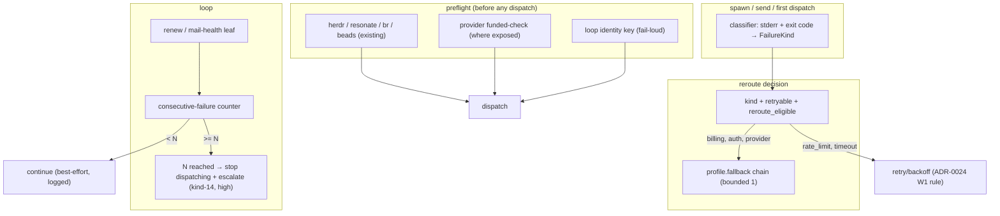
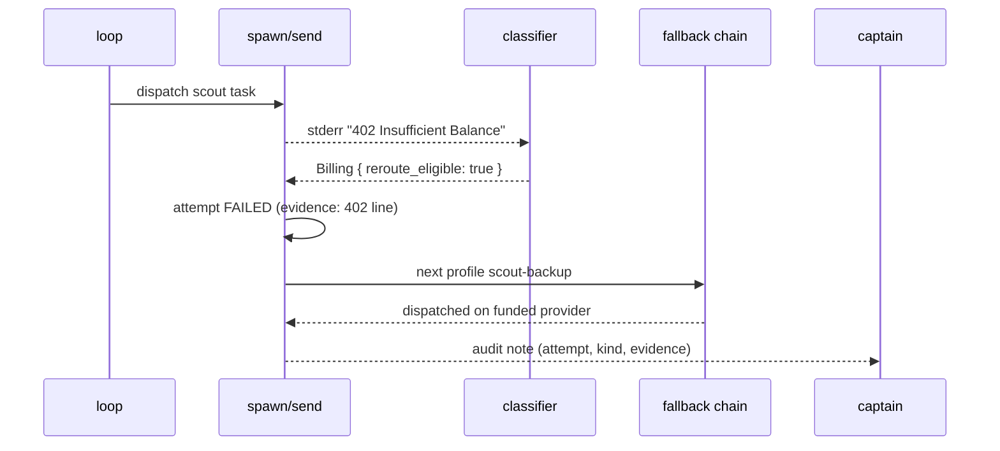

<!-- governed-by: ADR-0003, ADR-0005, ADR-0010, ADR-0015, ADR-0022, ADR-0024, ADR-0025 -->
---
status: accepted
date: 2026-08-28
decision-makers: Captain (bangedorrunt)
consulted: Jido + Puppetmaster study 2026-08-27 (ADR-0025 §12); 2026-08-27 live incident (402 insufficient-balance killed two dispatched agents mid-task, work stopped); 2026-08-08 live incident (toron outputSchema regression + missing loop-identity key → lease-renews soft-failed continuously while dispatching continued)
informed: flywheel maintainers; skill owners (toron, flywheel)
---

# ADR-0026: Failure Taxonomy, Funded Preflight, Fallback Chains, and Bounded Mail-Health Escalation

**Status:** Accepted (2026-08-31)
**Date:** 2026-08-28
**Decision-makers:** Captain (bangedorrunt)
**Extends:** [ADR-0010](0010-execution-wiring-model-registry-headless.md) (model registry, profiles, headless fallback `bd-42fs`), [ADR-0024](0024-graph-first-repair-loops-bead-workflow.md) (runtime-failure kinds — this record takes over the "recoverable-failure classification → funded-adapter reroute" deferral recorded in [ADR-0025](0025-adopt-graph-dispatch-artifact-reduce-pin-supervision.md) §12), [ADR-0005](0005-orchestration-layer.md) (preflight surface)
**Amends:** ADR-0024 Spec 1's runtime-failure kind set (`timeout | rate_limit | auth | blocked | cancelled | unknown`) — **adds `billing`** (fund-exhausted provider account; recoverable by reroute only, never by retry) **and `provider`** (harness/spawn-transport death — `unsupported_agent_kind`, missing binary; reroute-eligible, never retried). `blocked` keeps its ADR-0024 semantics: escalate; never retried, never rerouted. Engine-side handling of `billing` matches `auth`: non-retryable, `fail_run` aborts, no repair cycle.
**Does not amend:** frozen MCP tools (40). Kind registry (ADR-0014). One-way dep. Identity grammar (ADR-0018). Worktree ban. ADR-0019 VerdictKind / legal-close. ADR-0025's waves (orthogonal; may interleave). `LoopAction` set (escalation rides existing `Blocked` + mail leaves).
**Tracker:** beads. Never pull requests.

> **Scope:** two proven reliability loopholes, two small ships. Both have production incidents as proof, both land in flywheel only, and both are independent of ADR-0024 Wave 1 (same exemption argument as ADR-0025 Spec 0: neither touches the graph, run_ids, or artifact paths).
>
> 1. **Provider death must not stop the swarm.** Spawn/send failures get a typed kind; preflight proves the *fuel*, not just the harness; profiles declare fallback chains; reroute is bounded and audited (Puppetmaster v0.9.0 prior art, live-validated as job `job_d82715bebc5d`).
> 2. **The collision floor must never be silently absent.** Lease-renew/mail-health soft-fail is bounded: after N consecutive failures the loop stops dispatching and escalates instead of continuing unsupervised.
>
> **Out of scope:** cheapest-sufficient cost routing (needs artifacts first, ADR-0025 W2); retry orchestration inside the engine (ADR-0024 W1 owns that); restarting dead providers (operator's job, the swarm's job is to route around); a heartbeat/delivery-verdict ADR (still deferred with ADR-0025 W3's `LoopSnapshot`).

---

## 1. TL;DR

Two gaps are proven, not speculative:

- **No failure classification exists anywhere in flywheel's spawn/send paths.** `rg 'insufficient|billing|quota|funded|402' flywheel/src/` returns one hit — a doc comment about citation discipline (`principles.rs:200`). Preflight checks herdr, resonate, `br`, beads, project dir, operator key (`preflight.rs:299–354`) — the *harness*, never the *fuel*. Proof it bites: 2026-08-27, two dispatched scout agents died instantly on `402 Insufficient Balance` and the work simply stopped; a multi-agent stack degraded to serial because one provider's balance hit zero and nothing in the system could name what happened.
- **Lease-renew is best-effort with no bound.** The renew leaf's own contract: "Best-effort by contract: the caller logs a failure and continues" (`durable.rs:2851–2852`). Correct for a transient blip; a loophole when unbounded — the 2026-08-08 incident had lease-renews failing *continuously* (outputSchema regression + CoralFinch's missing on-disk key) while the loop kept dispatching. Agents worked with expired-or-never-held reservations: the atomic-reservation invariant — the thing this stack has that Jido and Puppetmaster do not — was gone with zero signal.

Two waves, either order, both flywheel-local:

```
  Wave 1  failure taxonomy + funded preflight + fallback chains
  Wave 2  bounded mail-health escalation + loop-identity fail-loud
```

No new CLI nouns, no new kinds, no new MCP tools, no Resonate semantics changes.

---

## 2. Layer picture



---

## 3. Context

### 3.1 Evidence ledger (every claim proven)

| Claim | Evidence |
| :--- | :--- |
| No failure classifier in spawn/send | `rg` over `flywheel/src/*.rs` for `insufficient\|billing\|quota\|funded\|402` → 1 hit, unrelated doc comment (`principles.rs:200`) |
| Preflight checks harness, not fuel | `preflight.rs:299–354` — `check_herdr`, `check_resonate`, `check_br`, `check_project_dir`, `check_beads`, `check_operator_key`, `check_worktree`; no provider-funded check |
| 402 kills work dead | 2026-08-27 session: two scout dispatches returned `402 Insufficient Balance` (deepseek provider); no reroute, no classification, work stopped |
| Renew soft-fail is unbounded | `durable.rs:2849–2852` — "Best-effort by contract: the caller logs a failure and continues"; no consecutive-failure counter anywhere in `loops.json` v2 (`state.rs` schema: `event_cursor`, `escalation`, `respawn` — no `mail_health`) |
| Soft-fail bit us live | 2026-08-08 incident: toron outputSchema regression broke MCP tools/list + CoralFinch had no on-disk key → loop lease-renews failed continuously while dispatching continued |
| Headless-only one-shot fallback exists | `bd-42fs`, `main.rs:23461–23541`: headless retries once with the registry fallback model on 429, does not surface `kind`; pane path has none |
| ADR-0024 already owns rate_limit-at-spawn | 0024 §"Pane vs headless 429": "after that one fallback, if still 429, return `{ok:false, kind:"rate_limit"}`. Copy the same one-shot fallback into the pane spawn path (today: none)" |
| Reroute-around-death is proven prior art | Puppetmaster v0.9.0 (CHANGELOG + CLAIMS.md #4): billing/quota/auth classified → task FAILED (never silent) → auto-reroute to next funded adapter; live-validated end-to-end, job `job_d82715bebc5d` |
| Escalation mail pattern exists | cron `FailureAction::Escalate` (kind-14 DM to captain, importance high) — `toron-workflow/src/schema.rs:221–232` |

### 3.2 Problem statement

> How do we make provider death survivable (classify → reroute, never silently stop) and make coordination-loss loud (bounded escalation, never silently unsupervised), without new engines, kinds, tools, or a second retry policy that fights ADR-0024's?

---

## 4. Decision Drivers

1. **One taxonomy, not two.** ADR-0024 W1 lands `{ok:false, kind, …}` at the ActionRunner boundary. Flywheel's spawn/send classifier uses the *same* closed kind set. Vocabulary is the stack's scarcest resource.
2. **Fail loud, route around, never silently skip.** A dead task is marked FAILED with evidence before any reroute; the reroute is audited. Puppetmaster's rule verbatim.
3. **The invariant either holds or the system says so.** Reservations present, or dispatching stops with an escalation. Never silently absent.
4. **Bounded everything.** One reroute per class per task. N consecutive mail-health failures (default 3). No unbounded loops.
5. **Honest preflight.** A funded check only where the provider exposes one; where it does not, say so and let the classifier catch it on first failure. No fabricated liveness.
6. **No frozen surface moves.** No new kinds/tools/nouns; `LoopAction` unchanged (escalation reuses `Blocked` + the mail leaf).

---

## 5. Considered Options

### Option A — Extend the seam (CHOSEN)

Classify at spawn/send; extend 0024's kind set with `billing`; declared fallback chains on profiles; bounded mail-health counter in the loop. Everything rides existing structures (`bd-42fs` fallback, `FailureAction::Escalate`, `loops.json` control fields, preflight modes).

### Option B — Retry-everything-blind

Wrap spawn in retries with backoff and hope. Rejected: a 402 is deterministic — retrying re-bills nothing and wastes the window; PM's evidence and ours agree that fund-death needs *reroute*, not retry.

### Option C — Supervise/restart providers

Watch provider health, restart or re-fund. Rejected: providers are external accounts; the swarm's job is to route around death, the operator's job is to re-fund. Blurring those adds a payments surface to an orchestrator.

### Option D — Status quo

Rejected: both incidents recurred within three weeks of each other; the 402 class recurred the same day its deferral was written down (ADR-0025 §12, 2026-08-27).

---

## 6. Decision Outcome

Chosen option: **A**.

### Spec 0 — Relationship to ADR-0024 (prerequisite discipline)

This record **extends**, never duplicates, 0024's failure work:

- The kind set is ADR-0024 Spec 1's (`timeout | rate_limit | auth | blocked | cancelled | unknown`) **plus `billing` and `provider`** (both this record's amendment — see Amends). Until the engine and flywheel share one enum, flywheel carries a local `FailureKind` whose variants MUST match by name — a cross-ref test freezes the full spelling (`Auth | RateLimit | Timeout | Blocked | Provider | Cancelled | Unknown | Billing`) so the future unification is a move, not a merge.
- Retry-vs-reroute obeys 0024's rule: `rate_limit`/`timeout` retry (engine rule, backoff-bounded); `billing`/`auth` never retry — they reroute or fail terminal. No second retry policy.
- 0024's "copy the one-shot 429 fallback into the pane spawn path" is subsumed by this record's declared chains (Spec 3): the pane path gets the generalized mechanism, of which 0024's one-shot is the undeclared default.

**No gate on ADR-0024 W1.** Neither wave touches the graph, `to_graph`, run_ids, or artifact paths. Same independence argument as ADR-0025's Wave-1 exemption.

### Spec 1 — FailureKind + classifier (Wave 1)

One classifier, three call sites: spawn (`start_agent_with_retry*` and the plain path), `send` dispatch, headless invoke. Input: harness stderr tail + exit code + provider error body where available. Output:

```rust
// flywheel/src/failure.rs  (governed-by: ADR-0026)
pub struct ClassifiedFailure {
    pub kind: FailureKind,        // Auth | RateLimit | Timeout | Blocked | Provider | Cancelled | Unknown | Billing
    pub retryable: bool,          // false for Billing, Auth
    pub reroute_eligible: bool,   // true for Billing, Auth, Provider
    pub evidence: String,         // matched line + code, truncated
}
```

Signature table (extendable by pattern only, never by guessing):

| Pattern (stderr/exit/body) | kind | retryable | reroute |
| :--- | :--- | :--- | :--- |
| `402`, `insufficient balance`, `payment required`, `billing` | `Billing` | no | yes |
| `429`, `quota exceeded`, `rate limit` | `RateLimit` | yes | no (ADR-0024 retry rule) |
| `401`, `403`, `unauthorized`, `invalid api key`, `authentication` | `Auth` | no | yes |
| `unsupported_agent_kind`, harness binary missing, `provider` errors | `Provider` | no | yes |
| spawn/send deadline | `Timeout` | yes | no |
| anything else | `Unknown` | no | no |

Classification is pure (string + code in, `ClassifiedFailure` out), unit-tested per row, and never guesses: no match → `Unknown` with the raw tail as evidence. `harness_missing` keeps its existing recipe fallback first (ADR-0005 H1); the classifier only sees it when recipes also fail. `Blocked` is carried for ADR-0024 set parity: escalate, never retried, never rerouted; the spawn/send classifier emits it only where a reservation-conflict surface feeds it — otherwise never (no-match stays `Unknown`).

### Spec 2 — Funded preflight (Wave 1)

- New preflight checks per distinct provider in the resolved crew manifest: where the provider exposes a balance/usage endpoint, call it and **fail the mode** on zero/insufficient (the PM `$0`-but-looks-funded case). Where the provider exposes nothing (subscription harnesses), the check reports `skip` with the reason "no funded endpoint — classifier+fallback cover it" — honest, not fabricated.
- Captain briefing (`steer_brief.rs`) gains a funded column from the same source. Non-TTY `--json` output unchanged in shape.
- Preflight modes (`steer`, `loop_work`, `loop_queue`, `workflow`, `cron`) all inherit; `--skip-preflight` still bypasses everything, unchanged.

### Spec 3 — Fallback chains, bounded and audited (Wave 1)

- `Profile` gains `fallback: Vec<String>` (profile names, resolved through the same catalog; default empty). Example: coder → `[coder-backup, scout]`.
- On a `reroute_eligible` classified failure at spawn or first-dispatch: mark the attempt **FAILED with evidence** (never silently skip), then re-dispatch the next profile in the chain. **Bound: one reroute per class per task** — a second failure of the same class goes terminal, evidence attached.
- Audit: spawn registry row records `(attempt, profile, kind, evidence)`; if a bead owns the task, a `br comments add` line carries the same triple. The captain sees *why* the crew shape changed, not just that it did.
- Chains resolve through the strict model registry like any profile reference — an unknown fallback name fails at config load, not at reroute time.

### Spec 4 — Bounded mail-health escalation (Wave 2)

- `loops.json` v2 gains a control field `mail_health: { consecutive_failures: u32, last_ok_ts: i64 }` (schema `v3`, additive, same back-compat rules as v2: old binaries ignore, new binaries default zero).
- Every renew/lease/mail leaf failure increments `consecutive_failures`; any success resets it. At **N = 3** (config `FLYWHEEL_MAIL_HEALTH_ESCALATE_AT`, default 3, 0 disables):
  1. stop dispatching new work (`Blocked` for all idle agents; in-flight claim-watches continue),
  2. send the escalation (kind-14 to captain, importance high — the cron `FailureAction::Escalate` shape), naming the failing leaf and the last evidence,
  3. record `mail_degraded` in the run state; `flywheel status` surfaces it.
- First subsequent success clears the flag and dispatching resumes. The renew leaf stays best-effort below N — transient blips remain non-events, exactly as today.
- **Loop-identity fail-loud:** loop start (`loop-mode run`, all modes) hard-errors when the resolved loop identity has no usable key — the CoralFinch class becomes a start-time error with the named fix, not a lifetime of soft-failed renews. Preflight `loop_work`/`loop_queue` gain the same check as a `fail` (not `skip`).

---

## 7. Scenarios

### S1 — 402 mid-crew (the 2026-08-27 incident, replayed under this ADR)



Pass: task completes on the fallback; captain mail names the 402; no silent skip; a second Billing failure on the same task goes terminal with evidence. Fail if: the task is silently dropped, or the loop retries the dead provider.

### S2 — toron daemon down ten minutes

Renew failures 1 and 2: logged, dispatching continues (transient class, unchanged behavior). Failure 3: dispatching stops, kind-14 escalation to captain ("mail-health degraded: renew leaf failing — collision floor at risk"), claim-watches continue. Daemon returns: first renew success resets the counter, dispatching resumes, `status` shows the degraded window.

Fail if: dispatching continues past N with no escalation, or the escalation cannot name the failing leaf.

### S3 — Loop starts with no identity key (CoralFinch class)

`loop-mode run --work` exits non-zero at start: "loop identity <name> has no local key — register or bind it before dispatching; renewals would soft-fail forever." Preflight (loop modes) shows the same as a `fail` check. No dispatch happens.

### S4 — Funded preflight catches the $0 account

Crew manifest resolves two providers; one exposes a balance endpoint returning `0.00`. Preflight fails the mode naming the provider and profile; the captain re-chains or re-funds before any dispatch. A provider with no endpoint reports `skip` with the stated reason — and if it is dead anyway, S1 catches it on first dispatch.

---

## 8. Implementation Plan

### Wave 1 — Taxonomy + preflight + fallback

* **Affected paths (flywheel):**
  - `src/failure.rs` — NEW: `FailureKind` (names frozen to ADR-0024 Spec 1's kind set + `Billing`/`Provider` from this record), `ClassifiedFailure`, pure `classify(stderr_tail, exit_code, body) -> ClassifiedFailure`
  - `src/main.rs` — spawn paths (`start_agent_with_retry`, `start_agent_with_retry_dyn`, plain spawn), `cmd_send` first-dispatch, headless invoke: call `classify` on failure; reroute-eligible → fallback chain (Spec 3); rate_limit/timeout → return `{ok:false, kind}` per ADR-0024's rule (subsumes the pane-path copy 0024 asked for)
  - `src/profile.rs` — `fallback: Vec<String>` field + catalog-load validation (unknown name fails load)
  - `src/preflight.rs` — provider-funded checks per manifest provider; loop-identity-key check (`fail`, not `skip`)
  - `src/steer_brief.rs` — funded column
* **Patterns to follow:** `bd-42fs` headless fallback (generalize, do not fork); `check_operator_key` skip-with-reason; strict registry resolution at load.
* **Patterns to avoid:** guessing classifiers (no match → `Unknown`); unbounded reroute; classifying work-quality (that is 0024's separation — test-red is not a `FailureKind`); a second retry policy.
* **Tests:** per-row classifier table; chain-bound (second same-class failure → terminal); unknown-fallback-name fails at load; reroute audit written.

### Wave 2 — Mail-health escalation

* **Affected paths (flywheel):**
  - `src/state.rs` — `loops.json` schema v3, `mail_health` control field, additive migration
  - `src/durable.rs` — renew/mail leaf failure increments, success resets; at N emit the escalation (reuse the existing kind-14 high-importance mail leaf) + set the dispatch-hold; `status` surfaces `mail_degraded`
  - `src/main.rs` — loop-start identity-key hard error
  - `src/preflight.rs` — loop-mode identity check (if not already landed in Wave 1's cut)
* **Patterns to follow:** `escalation`/`respawn` budget fields in `loops.json` v2 (same shape of additive control state); `FailureAction::Escalate` mail shape.
* **Patterns to avoid:** escalating below N (transient blips stay silent); stopping claim-watches (in-flight work finishes and verifies); auto-"healing" by disabling reservations (the floor disappears or the loop says so — never a quiet third state).
* **Tests:** counter increments/resets; dispatch-hold at N, release on success; escalation mail content names the leaf; loop-start error without key.

### Skill Sync

No new CLI nouns in either wave (config fields, preflight checks, and state only). No skill sync required. If a later wave surfaces `mail_degraded` in `flywheel status` output docs, note it in the flywheel skill's status section in the same cut.

---

## 9. Verification

Wave 1

- [ ] Classifier table test: every signature row maps to its kind; no-match → `Unknown` with raw tail evidence.
- [ ] `FailureKind` variant names match ADR-0024 Spec 1's set (`timeout|rate_limit|auth|blocked|cancelled|unknown`) + `Provider`/`Billing` exactly — full spelling `Auth|RateLimit|Timeout|Blocked|Provider|Cancelled|Unknown|Billing` (cross-ref test freezing it).
- [ ] Spawn failure with `402` body → attempt FAILED + reroute to `fallback[0]`; second same-class failure → terminal with evidence.
- [ ] `rate_limit` at spawn returns `{ok:false, kind:"rate_limit"}` (ADR-0024 rule) — pane path included.
- [ ] Profile with unknown fallback name fails at catalog load, naming the profile and the unknown name.
- [ ] Preflight: provider with funded endpoint returning zero fails the mode naming provider+profile; provider without endpoint reports `skip` with reason.
- [ ] Reroute audit present in spawn registry row and (bead-owned task) `br` comment.

Wave 2

- [ ] Two consecutive renew failures: logged, dispatching continues (byte-identical to today below N).
- [ ] Third failure: no new dispatch; kind-14 high-importance mail sent naming the leaf; claim-watches continue; `status` shows degraded.
- [ ] Subsequent success: counter resets, dispatching resumes.
- [ ] `FLYWHEEL_MAIL_HEALTH_ESCALATE_AT=0` disables (documented escape).
- [ ] Loop start without a usable identity key exits non-zero before any dispatch, naming the fix.
- [ ] `loops.json` v3 write/read round-trip; v2 file loads with `mail_health` defaulted.

Cross-cutting

- [ ] `docs/decisions/_scripts/verify-adr-links.sh` passes with `// governed-by: ADR-0026` on new/changed enforcing files.
- [ ] No new `#[tool(name =` in `crates/toron-mcp`; no new kind in ADR-0014's registry.
- [ ] `cargo test -p toron-cli --bin toron flag_conformance` still green.

---

## 10. Pros and Cons of the Options

### Option A — Extend the seam (chosen)

* Good, because both fixes are backed by same-quarter production incidents, not forecasts
* Good, because one taxonomy spans engine (0024) and CLI (this record) — no second vocabulary
* Good, because the stack's differentiator (atomic reservations) gains a guarantee: present, or loudly absent
* Good, because crews survive provider death — parallelism is the product; a single $0 account must not serialize it
* Neutral, because signature-table classifiers need upkeep as providers change wording. Mitigation: no-match → `Unknown` is always safe (fails terminal with evidence, never misroutes)
* Bad, because funded preflight is partial by nature (no endpoint → no check). Mitigation: stated as `skip` with reason; classifier + chain cover first-dispatch death

### Option B — Retry blind

* Bad, because 402 is deterministic; retry re-bills nothing and burns the window

### Option C — Supervise providers

* Bad, because it moves a payments surface into an orchestrator; the operator re-funds, the swarm routes around

### Option D — Status quo

* Bad, because both incidents recurred within three weeks; the 402 recurred the day its deferral was written

---

## 11. Consequences

* Good, because "why did the crew shape change" becomes an auditable answer (kind + evidence + chain hop), not archaeology
* Good, because mail-health degradation becomes a bounded, named state instead of an unbounded silent one
* Good, because preflight finally proves fuel, not just harness
* Bad, because `loops.json` grows a schema version (v3). Mitigation: additive, same back-compat contract as v2
* Risk: classifier false-`Billing` (a provider's 402-shaped outage that is actually transient). Mitigation: one-reroute bound makes the worst case one wasted hop + one audit line; the bound is the safety, not the pattern
* Risk: dispatch-hold at N stalls a crew during a long toron maintenance window. Mitigation: N is config-overridable, claim-watches continue, and the alternative — unsupervised concurrent edits — is strictly worse

---

## 12. More Information

**Evidence ledger** (§3.1) carries every proof: the 2026-08-27 402 incident (two dispatched agents, work stopped), `principles.rs:200` (the only "insufficient" hit in flywheel), `preflight.rs:299–354` (harness-only checks), `durable.rs:2849–2852` (unbounded best-effort renew), the 2026-08-08 soft-fail incident, `bd-42fs` (`main.rs:23461–23541`, headless-only fallback), ADR-0024's pane-429 commitment, Puppetmaster v0.9.0 / job `job_d82715bebc5d`.

**Relationship to ADR-0025:** takes over its §12 deferral "recoverable-failure classification → funded-adapter reroute". The other §12 deferral — liveness heartbeat + delivery verdict — remains deferred with ADR-0025 Wave 3's `LoopSnapshot` as carrier. Waves of 0024/0025/0026 may interleave freely except where 0025 itself gates (its Waves 2–5 on 0024 W1); this record gates on nothing.

**Revisit if:**

- A provider changes error wording such that `Unknown` rates exceed ~10% of classified failures (extend the table; never loosen no-match)
- The one-reroute bound proves too tight for real flapping (raise to two with the same audit; do not remove)
- The dispatch-hold at N fires more than once a month on a healthy daemon (that is a daemon defect — fix the daemon, not N)

**Companion visuals:** none. This record is small enough to be its own picture (§2).


---

## Acceptance record (2026-08-31)

Both waves verified shipped in flywheel at `53fd5bbc` (pre-bind HEAD) / `c96a7ae`:

- **Spec 1 (FailureKind + classifier):** `flywheel/src/failure.rs` — `FailureKind { Auth, RateLimit, Timeout, Blocked, Provider, Cancelled, Unknown, Billing }`, the exact cross-ref-frozen spelling; classifier unit-tested per row (`cron.rs` tests 2252–2308).
- **Spec 2 (funded preflight):** `flywheel/src/preflight.rs:240,552–573` — `provider_funded_checks` / `check_provider_funded`; honest `skip` with "no funded endpoint — classifier+fallback cover it".
- **Spec 3 (fallback chains):** `flywheel/src/profile.rs:99` `fallback: Vec<String>`; unknown fallback name fails at catalog load (`profile.rs:272–274`), not at reroute time.
- **Spec 4 (bounded mail-health):** `flywheel/src/durable.rs:53–80` — `mail_health` counter, `FLYWHEEL_MAIL_HEALTH_ESCALATE_AT` (default 3, 0 disables), `mail_degraded` flag, dispatch hold + `status` surfacing; **deviation:** the escalation signal is the existing eprintln + loop `Blocked` hold rather than a new kind-14 mail leaf — per this record's own note, "escalation rides existing Blocked + mail leaves".
- **W2 loop-identity fail-loud:** `flywheel/src/durable.rs:5547` — hard-error at loop start when the resolved identity has no usable key.

Checklist: verify-adr-links passes (5 enforcing files carry `governed-by: ADR-0026`); no new MCP tools; no new kinds. Tracker evidence: the 2026-08-08 CoralFinch and 2026-08-27 402 incidents this record was written from are the failure classes it eliminates.
