<!-- governed-by: ADR-0003, ADR-0005, ADR-0014, ADR-0015, ADR-0018, ADR-0020, ADR-0024, ADR-0025, ADR-0026 -->
---
status: accepted
date: 2026-08-31
decision-makers: Captain (bangedorrunt)
consulted: GS-012 restudy HEADs flywheel bde4daae7329 / toron 66811f38a332 / beads 4531075c87f5; Tick Law second walk vs 1c442d4b; previous Proposed texts withdrawn (Grok Bot clone; house-style consolidate)
informed: flywheel × toron × beads maintainers; Wheelhouse
---

# ADR-0027: One Workspace Tick — Control Plane as Elm/Redux on Doorbell + 30013

**Status:** Accepted (2026-09-01, captain word ordered full implementation). Not locked as ship until slices green, but status is accepted per 2026-09-01 word.
**Date:** 2026-08-31
**Decision-makers:** Captain (bangedorrunt)
**Extends:** [ADR-0003](0003-nostr-mailbox-fabric.md), [ADR-0005](0005-orchestration-layer.md), [ADR-0014](0014-kind-registry-specification.md), [ADR-0015](0015-flywheel-toron-integration-contract.md), [ADR-0018](0018-agent-identity-naming-grammar.md), [ADR-0020](0020-nostr-two-plane-cli-and-crew-steering.md), [ADR-0024](0024-graph-first-repair-loops-bead-workflow.md), [ADR-0025](0025-adopt-graph-dispatch-artifact-reduce-pin-supervision.md), [ADR-0026](0026-failure-taxonomy-funded-preflight-fallback-chains-mail-health-escalation.md)
**Amends:** ADR-0020 only in this sense: MCP grows only as the same verb as CLI when an agent cannot tick without it. Not a tool dump. Not a Grok Bot catalog.
**Does not amend:** two captains stay split; two planes stay two planes; one-way dep flywheel → toron; beads remain the work graph; doorbell remains in-process wake; kind **30013 remains the agent profile**; Tick Law remains the control-plane law and **is held on the live path** (doorbell dispatcher + `swarm_loop` both call `workspace::tick` only; slice reducers are `pub(crate)`); factory ships do not merge without the captain's word. ADR-0024 stays **Accepted** (this record does not rewrite it). ADR-0019 stays **Proposed**.
**Does not wire:** Grok Bot / Firstmate into flywheel. This ADR invents a control plane on *our* nouns. It does not connect the products and does not copy the orchestrator.
**Tracker:** beads. Never pull requests as the log.

> **Scope:** one workspace Model, one Msg union, one `tick`, effects as data (`Cmd`). Keep doorbell and 30013. Put `corr` / standing-vs-tasked / durable receipts / role-binding / human-gate / live watch **in the Model and in tick**. Fold leftover bypasses into Msgs. Do not mint a second doorbell, a wake kind, a second profile, extra `--mode`, factory.db inside toron, or flywheel→Firstmate RPC.

Grounded at live `main` (2026-08-31): flywheel `bde4daae73293106e5acc618cb1b357b8a0c4f24` (4 commits since `1c442d4b`: heal-inside-tick `0dc7f37c`, beads close `c2f54ce0`, Branch YAML `ae334344`, AGENTS docs `bde4daae`), toron `66811f38a332aaaeb5533319b6bcce52d3cbf4a9` (Branch guard sees step outputs; flattened `steps_<name>_<key>`, not mustache), beads `4531075c87f501c4c070b8351957f725d7d488f7` (unchanged; commit-level walk only — no file:line parity is claimed for beads evidence). One flywheel commit has landed since grounding: `924d410` (TUI hacker-night theme; zero control-plane surface touched — all §3.6 file:line evidence re-verified at `924d410`). Newer HEAD wins. This ADR is counsel. Leftovers named below are seams the design must sit on, not bugs this text ships.

---

## 0. Changelog vs previous Proposed

A mailbox-feature dump was withdrawn; this record does not absorb it.

| Prior text | What it was | Fate |
| --- | --- | --- |
| Diagrams revision (~32917 bytes, HEAD `1c442d4b` / `62676b50`) | Copied Grok Bot's orchestrator onto toron: MCP names as the product surface, human gates as cards, skills as markdown recipes, standing-vs-tasked as a prompt convention, receipts as a SQLite table bolted on beside two reducers, waves that grow facades, "no merge of LoopMsg into doorbell" | **Withdrawn.** Captain: beat it, do not clone it. |
| House-style consolidate `1a3f90e1` (~59591 bytes, same HEADs as this record) | Kept E1–E9 and leftover 14, 0026 section bones. Still pointed a locking reader at companion walks; still carried freeze-count tourism; still listed Grok Bot MCP names in a refuse-table that read like a translation surface; one scenario still alluded to the withdrawn mailbox-feature dump. Diagrams were a restyle of earlier mermaid, not a rewrite from live types. | **Superseded by this steer.** Same HEADs, same leftover 14, same E-spine. Companion-walk pointers gone. Grok Bot is a short refuse, not a catalog. Every diagram rewritten as-is vs to-be from current functions/types. Body stands alone. |

**Tick Law movement since the withdrawn diagrams revision (not finished):**

- `0dc7f37c` (bd-blyz): `self_heal_step` now runs **inside** the `LoopMsg::Tick` arm (`durable.rs:478–521`). The loop-side heal **for-loop** is gone. Heal is still **not a Msg**. Leftover `heal_actions` vec is now reclaim-only and still pre-seeds `actions` before tick (`6087`, `6763`, reclaim `6261–6281`).
- Post-tick filter (`6956–6962`) **now mutilates tick output** — it drops tick-produced `LoopAction::Diagnose{reason:pane_exited}`. At `1c442d4b` this filter was a no-op vs heal-in-tick.
- `c2f54ce0`: beads close of bd-blyz. Zero Rust.
- `ae334344` (bd-rd4d): repair playbook YAML only (`builtin_workflows.rs:1253–1268`). Not flywheel tick.
- `bde4daae`: AGENTS Tick Law docs. Docs lie about seq why, journal path, and one reducer. Docs-only.
- toron `66811f38`: Branch guard sees step outputs in `control_flow.rs` only. Subject said `{{steps.*.done}}`; code is flattened `steps_<name>_<key>` (hyphens→underscores), not mustache. No tests in the commit.
- Already true and stays true: live doorbell already binds `doorbell_tick::tick`. Dual reducer is `--once` + tests, not the live dispatcher. Unknown does not default idle.

**Do not claim:** heal-inside-tick finished Tick Law. It did not.

This steer does not lock, does not ship, and does not implement slices.

---

## 1. TL;DR

Doorbell already is in-process wake. Kind 30013 already is the agent profile. We already journal doorbell Msg+Actions. Grok Bot has **no replay of control-plane Msgs**. That is the beat, not a tool catalog. We will not mint Grok Bot's tool catalog.

**Decision (chosen):** one `WorkspaceModel`, one `Msg` union, `tick(model, msg) -> (model, Vec<Cmd>)` where `Cmd` is data. Assignment is tags + sqlite **inside the Model**. Role binding is 30013 + whois, not a second profile. Human decision is a Msg, not a widget. Presence 20001 is inject truth. Live watch is a Cmd subscription that yields Msgs. Skills/playbooks are beads + `VerifySink`. Waiter is a Cmd, not a pane assumption.

Tick Law **is held on the live path** at current `main` (doorbell + `swarm_loop` → `workspace::tick` only). Historical note at grounding HEAD `bde4daae`: two Models, two ticks, two Action enums, no `Cmd` type; live loop only constructed `LoopMsg::Tick`. That is no longer the live entry. Slice reducers remain private composition. Heal lives on `LoopModel.heal_states` (ActiveLoop persist). Cmd apply is exhaustive at the doorbell handler; swarm I/O still via `to_loop_action`.

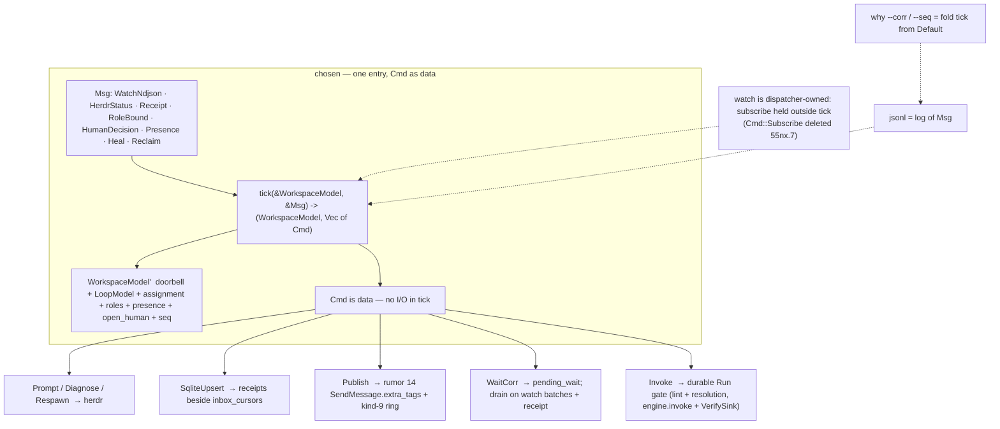

> **2026-09-04 implementation note (GS-016):** the diagram above is the
> accepted to-be design; the live Cmd surface has since been honed —
> `Cmd::Subscribe` deleted (the dispatcher-owned watch IS the
> subscription, 55nx.7), `Cmd::WriteNcryptsec` deleted (zfnx.4, exfil
> path), and `Cmd::Invoke` landed as the WIRED playbook vehicle (effect
> layer routes through the durable Run gate: playbook lint + resolution,
> `engine.invoke` + `VerifySink` downstream). `WaitCorr` parks in
> `pending_wait` and drains on watch batches only (GS-016: never the 1s
> sweep). History below is preserved as grounding, not live truth.

---

## 2. Layer picture

As-is: two nervous systems. `cmd_internal_doorbell` owns `DoorbellModel` + `doorbell_tick::tick`. `swarm_loop` owns `LoopModel` + `durable::tick`, and still emits `LoopAction`s around that tick. To-be: one entry. Today's two ticks become private slice reducers.

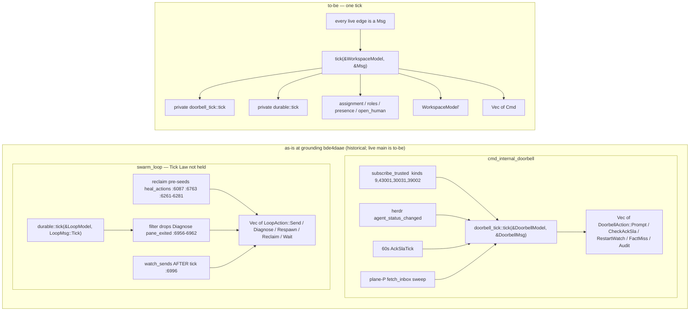

---

## 3. Context

### 3.1 Evidence ledger

Every claim below is a current function or type at the grounded HEADs. Prior walks (doorbell delivery, costume-vs-honest Elm, leftover re-score) are folded here so a locking reader does not open them.

| Claim | Evidence |
| :--- | :--- |
| Two ticks, two Models, two Action enums, no `Cmd` | `doorbell_tick.rs:87` `tick(&DoorbellModel, &DoorbellMsg) -> (DoorbellModel, Vec<DoorbellAction>)`; `durable.rs:394` `tick(&LoopModel, &LoopMsg) -> (LoopModel, Vec<LoopAction>)`. `DoorbellModel` `:63–70`. `LoopModel` `:309–335`. `DoorbellAction` `:40–60`. `LoopAction` `:3939–3987`. |
| Live loop only constructs `LoopMsg::Tick` | Producer `swarm_loop` `durable.rs:6946`. Other arms (`Herdr`, `BrClose`, `WaveGate`, `CommandVerified`, `Dispatch`, `Reclaim`) exist on `LoopMsg` `:337–370`. **No `LoopMsg::Heal`.** |
| `self_heal_step` folded into Tick arm, not a Msg | `durable.rs:478–521` mutates `next.heal_states`, emits `Diagnose` / `Respawn` / `Blocked`. |
| `watch_sends` still after tick | Alloc `:5729`; fill `claim_watch_step` `:6441–6493`; append `:6996`. Tick comment `:568–574` still says claim-watch is DELIBERATELY loop-side. |
| Reclaim pre-seeds leftover `heal_actions` | `:6087`, `:6763`, reclaim `:6261–6281`. |
| Post-tick strip mutilates tick output | `:6956–6962` drops `LoopAction::Diagnose{reason:pane_exited}`. |
| `apply_events_to_states` twice | loop `:5891` + tick `:523`. |
| Double `bell_model = Default` | `main.rs:7747` then `:7819`. First `doorbell_refresh_status` discarded. |
| Status pre-insert kills drain | live `HerdrStatus` `:8006`; refresh `:8444`. Tick reads `from` already equal `to` (`doorbell_tick.rs:128–132`). |
| WatchDied discards model' | `main.rs:8055` `let (_, tick_actions) = tick(...)`. |
| Dual reducer lives on `--once` / tests | `apply_watch_line` def `doorbell.rs:1240`; `apply_status_change` `:1267`; `--once` `:1287–1296` via `main.rs:7623`; tests `:1537+`. Live dispatcher calls `doorbell_tick::tick`. |
| No live `DoorbellMsg::Fact` | arm `doorbell_tick.rs:145–150`; adapter swallows `Err` into `()` `main.rs:10853–10860`; `captain_fact_inject` talks to herdr directly. |
| `doorbell why` is grep, not replay | CLI `main.rs:1406–1412` (no seq); grep `:7480–7556`; actual path `doorbell.rs:1303–1306` `state_dir/journals/doorbell-journal-{workspace}.jsonl`. AGENTS at `bde4daae` claims `doorbell/<ws_hash>.jsonl` and a seq arg. |
| Branch early-exit is toron `run_branch` | flywheel YAML `builtin_workflows.rs:1253–1268`; toron `control_flow.rs:402,570–622`. Flattened `steps_<name>_<key>`, not mustache. |
| `FetchInbox` never emitted | enum `doorbell_tick.rs:45`; only stringified `:340`; zero `DoorbellAction::FetchInbox {` constructors. Inbox sweep is dispatcher I/O. |
| `heal_states` not on `ActiveLoop` | `ActiveLoop` `state.rs:163–188` has `per_bead_phase` + `dispatch_pending`, **no** `heal_states`. Loop-local map `durable.rs:5672`; `apply_diagnose_outcome` after tick `:7472`. |
| `extra_tags` exists; CLI/MCP send ignore it | `SendMessage.extra_tags` `messaging.rs:79,97–101,1280–1282`. CLI/MCP pass `Vec::new()`. |
| Kind **30013** is the profile; **30015 does not exist** | `kinds.rs:9–10,23–24`. Range 30010–30014 then 30031. |
| Kind **20001** published; doorbell does not ring; loop does not consume | `presence.rs` + bus `PresenceBroker` 60s TTL. Classify: presence is None. Inject reads herdr pane status. |
| `receipt_cache` is process `HashMap` | `mailbox/mod.rs:84`; `messaging.rs:1124–1172`. `message_reads` + `inbox_cursors` are SQLite (rebuild-volatile). |
| `toron watch` is 1s sqlite snapshot | `plane.rs:1298–1400`. Dispatcher already has in-process `subscribe_trusted` (`main.rs:7669`). |
| No `toron wait --corr` | `wait_for_readback` `plane.rs:685–733` is channel-post `--wait-ack` only. |
| `whois captain` is the only role-style alias | `identity.rs:299–306,660–733`. `aliases.rs` is project-slug (ADR-0017), not role binding. |
| `VerifySink` is the graph door | `engine/sinks.rs:50–80`. Missing sink → `{ok:false, error:"verify sink missing"}`. |
| Gift-wrap is sealed; ring is kind-9 | rumor 14 (+ `extra_tags`) → 1059 per recipient → kind-9 `toron-kind=mail-delivered` (no subject, no body). Encrypted 1059 is invisible to plane-S watch. |
| Unknown does not default idle | `route_or_queue` `doorbell_tick.rs:173–177` `unwrap_or("unknown")`. `should_inject` `doorbell.rs:74–76` is `idle\|done\|blocked` only. Missing key queues. |
| Tick functions themselves are pure | `doorbell_tick.rs:86–87` "no I/O, no &mut". `durable.rs` tick takes `&LoopModel`. Costume is the live producers around them. |

### 3.2 Problem statement

> How do we put a real control plane (one tick, assignment as data, durable receipts, role binding, human decision as Msg, live watch, waiter) onto doorbell + 30013 + `SendMessage.extra_tags` + durable sqlite + 20001 + `VerifySink`, **without** cloning Grok Bot's orchestrator, **without** a second doorbell / wake kind / second profile / extra `--mode` / factory.db-in-toron / flywheel→Firstmate RPC, and **without** leaving two reducers as the live path?

### 3.3 Costume Elm vs honest Elm

The tree *can* do Elm. The operator doors put a costume on top.

**Honest in the small.** `doorbell_tick::tick` is pure, total, no I/O. `durable::tick` is the same shape. `classify` / `parse_watch_ndjson` / `parse_inbox_item` are pure. `WorkflowEngine::invoke` plus `fail_run` is real bind: a graph stays a graph. `VerifySink` is the verify door. PinBudget 3/30 is an honest drop. Live doorbell bind is real: AckSlaTick `main.rs:7834`, WatchNdjson `:7908`, HerdrStatus `:8011` and refresh `:8450`, WatchDied `:8055`, InboxRows sweep `:8549`/`:8646`.

**Costume in the large.** Live `swarm_loop` constructs only `LoopMsg::Tick` and dumps `states` / `digests` / `events` into the Msg — poll I/O smuggled as a message. Other `LoopMsg` arms exist so the Elm story looks complete; they do not drive the live reducer. Heal ran inside the Tick arm (`self_heal_step`) and is still not a Msg. Reclaim pre-seeds `heal_actions` before tick. `watch_sends` append after tick. The Diagnose filter throws away tick output. `apply_diagnose_outcome` mutates a loop-local `heal_states` the `ActiveLoop` file does not persist. `--once` and tests still call `apply_watch_line`. Facts never become `DoorbellMsg::Fact`. `doorbell why` greps a pin substring; it does not fold tick. Branch early-exit is toron `run_branch`, not flywheel tick. Calling any of that Tick Law is a category error.

Grok Bot cannot replay a control-plane log because it has none. We already journal Msg+Actions (`doorbell.rs:1309–1326`; loop `journal_loop_msg` `durable.rs:6954`) and then refuse to fold them. That is the beat we are leaving on the table.

### 3.4 Grok Bot is the thing to beat, not copy

We will not mint Grok Bot's tool catalog.

Grok Bot has no replay of control-plane Msgs. It treats the orchestrator as a growing list of tools, parks humans on UI cards, and ships skills as markdown recipes. A withdrawn Proposed copied that shape onto toron. This record does not. Quiet is not English in a prompt. Human decision is a Msg (`HumanDecision { corr, verdict }`) — mail may carry the question; the mailbox does not mint a token. Playbooks are data on beads; the door is `engine.invoke` + `VerifySink`. Receipts are a sqlite store written by Cmd, cached in Model — not a process `HashMap` and not a chat journal. Cron + standing wake already exist (ADR-0012); there is no routine noun to mint. Secrets are a Cmd that writes ncryptsec, never a rumor. Two captains stay split; do not wire Firstmate. MCP grows only as the same verb as CLI when an agent cannot tick without it.

### 3.5 Nouns we already have (toron `66811f38`)

| noun | where | gap |
| --- | --- | --- |
| `SendMessage.extra_tags` | `messaging.rs:79,97–101,1280–1282` | vehicle exists; CLI/MCP send pass `Vec::new()` |
| kind **30013** `AGENT_PROFILE` | `kinds.rs:9–10,23–24` | **30015 does not exist** |
| kind **20001** presence | `presence.rs` + `PresenceBroker` 60s TTL | ephemeral; doorbell classify does not ring; loop does not consume |
| `receipt_cache` HashMap | `mailbox/mod.rs:84`; `messaging.rs:1124–1172` | dies with the walker. `message_reads` + `inbox_cursors` are SQLite (rebuild-volatile) |
| `toron watch` | `plane.rs:1298–1400` | **1s sqlite snapshot**, not live REQ. Dispatcher already has `subscribe_trusted` |
| `wait_for_readback` | `plane.rs:685–733` | channel-post `--wait-ack` only. **No `toron wait --corr`** |
| whois / `whois captain` | `identity.rs:299–306,660–733` | captain is the only role-style alias |
| `VerifySink` | `engine/sinks.rs:50–80` | graph door. Missing sink → `{ok:false, error:"verify sink missing"}` |
| Branch `step_outputs` | `control_flow.rs:402,570–622` | evalexpr `steps_verify_1_ok`, not mustache |

### 3.6 Full as-is: two ticks, leftover 14, send path

Tick signatures (quoted):

```
pub fn tick(model: &DoorbellModel, msg: &DoorbellMsg) -> (DoorbellModel, Vec<DoorbellAction>)
  doorbell_tick.rs:87

pub fn tick(model: &LoopModel, msg: &LoopMsg) -> (LoopModel, Vec<LoopAction>)
  durable.rs:394
```

**DoorbellMsg** (`doorbell_tick.rs:14–34`): `WatchNdjson`, `InboxItems`, `InboxRows`, `HerdrStatus`, `Fact`, `AckSlaTick`, `WatchDied`.

**LoopMsg** (`durable.rs:337–370`): `Herdr`, `BrClose`, `WaveGate`, `CommandVerified`, `Dispatch`, `Reclaim`, `Tick { states, digests, nudge, wake_suppressed, events }`. **No Heal.**

Tick Law: every control-plane state change is `tick(Model, Msg) -> (Model, Vec<Cmd>)`. Effects as data. One reducer path. **Verdict at grounding `bde4daae`: not held. Verdict on live `main` (2026-09-02): held on the live path** (doorbell dispatcher + `swarm_loop` call `workspace::tick` only; slice reducers `pub(crate)`). Leftover table below is the grounding snapshot, not a live score.

| # | leftover | file:line | tick vs bypass |
| --- | --- | --- | --- |
| 1 | Two Models / two ticks / two Action enums — not one reducer | `doorbell_tick.rs:87`; `durable.rs:394` | **bypass of the law itself** |
| 2 | `watch_sends` claim-watch still appended after `durable::tick`. Tick comment still says DELIBERATELY loop-side | `src_durable.rs:6996` (alloc `5729`; fill `6441–6493`; comment `568–574`) | **bypass** |
| 3 | Reclaim still pre-seeds leftover `heal_actions` before tick | `6087`, `6763`, reclaim `6261–6281` | **bypass** |
| 4 | Post-tick filter drops tick's `pane_exited` Diagnose — NOW mutilates tick output (was a no-op before heal-in-tick) | `6956–6962` | **bypass of tick output** |
| 5 | `apply_events_to_states` twice | loop `5891` + tick `523` | **bypass** (double-apply) |
| 6 | Double `bell_model = Default` wipes first refresh | `main.rs:7747` then `:7819` | **bypass** — first refresh discarded |
| 7 | `statuses.insert(to)` before `HerdrStatus` tick → drain dead | live Status `8006`, refresh `8444` | **bypass** — `from==to` so drain never fires |
| 8 | WatchDied discards model' | `main.rs:8055` `let (_, tick_actions) = tick(...)` | **bypass** |
| 9 | `--once` / tests still use `apply_watch_line`; `apply_status_change` tests-only | def `doorbell.rs:1240`, `:1267`; `--once` `:1287–1296` via `main.rs:7623`; tests `:1537+` | live dispatcher: **tick**. `--once` + tests: **bypass** |
| 10 | `captain_fact_inject` + fact-adapter still swallows Err; no live `DoorbellMsg::Fact` | adapter `main.rs:10853–10860`; inject `:10780`; tick arm `doorbell_tick.rs:145–150` | **bypass** — facts never enter doorbell tick |
| 11 | `doorbell why` greps journal (no tick replay, no seq); AGENTS path/seq wrong | CLI `main.rs:1406–1412` (no seq); grep `:7480–7556`; actual path `doorbell.rs:1303–1306` `state_dir/journals/doorbell-journal-{workspace}.jsonl` vs claimed `doorbell/<ws_hash>.jsonl` | **bypass** of replay |
| 12 | Repair Branch early-exit is playbook/toron `run_branch`, not flywheel tick | flywheel YAML `builtin_workflows.rs:1253–1268`; toron `control_flow.rs:402,570–622` | **neither tick** — workflow graph |
| 13 | `FetchInbox` never emitted by any tick arm | enum `doorbell_tick.rs:45`; only stringified `:340`; zero `DoorbellAction::FetchInbox {` constructors | **dead Cmd** — inbox sweep is dispatcher I/O, not a tick effect |
| 14 | `heal_states` not in `ActiveLoop`; crash-safe claim is false. `apply_diagnose_outcome` mutates loop-local heal_states after tick | `ActiveLoop` `state.rs:163–188` (has `per_bead_phase` + `dispatch_pending`, **no** `heal_states`); loop-local map `durable.rs:5672`; mutate after tick `:7472` | **bypass** — heal Model' is not the durable file |

**What folded (do not overclaim):** `self_heal_step` inside the Tick arm. Live doorbell already binds `doorbell_tick::tick`. `doorbell_refresh_status` is a tick caller, not a second reducer — and is broken by the pre-insert.

Gift-wrap send path (1059 sealed; kind-9 `mail-delivered` is the ring). As-is `SendMessage.extra_tags` is ignored by CLI/MCP send. To-be the same vehicle carries `corr` / `wake` into tick.

```mermaid
flowchart TB
  subgraph wrapNow["as-is send — extra_tags exist, unused"]
    rumorNow["rumor kind 14 + SendMessage.extra_tags = Vec::new()"] --> wrapNow1059["kind 1059 gift-wrap per recipient"]
    rumorNow --> ringNow["kind 9 toron-kind=mail-delivered"]
    wrapNow1059 -.->|invisible to plane-S| drop1059["subscribe_trusted never sees 1059"]
    ringNow --> subNow["subscribe_trusted kinds 9 / 43001 / 30031 / 39002"]
    subNow --> dNow["doorbell_tick::tick  DoorbellMsg::WatchNdjson"]
    dNow --> parseNow["parse_watch_ndjson + route_or_queue"]
    parseNow -->|statuses idle or done or blocked| promptNow["DoorbellAction::Prompt"]
    parseNow -->|working or unknown| qNow["DoorbellModel.queues LWW"]
  end
  subgraph wrapLater["to-be send — extra_tags are assignment"]
    rumorLater["rumor kind 14 + extra_tags corr wake priority audience"] --> wrapLater1059["kind 1059 still sealed"]
    rumorLater --> ringLater["kind 9 mail-delivered still the ring"]
    ringLater --> mLater["Msg::WatchNdjson"]
    mLater --> tLater["tick"]
    tLater --> asgLater["WorkspaceModel.assignment[corr]"]
    tLater --> sqlLater["Cmd::SqliteUpsert  receipts next to inbox_cursors"]
  end
```

Identity triangle as-is vs to-be (spawn / ADR-0018 pin / 30013):

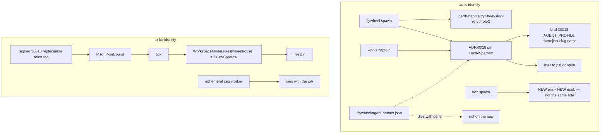

Receipts / presence / planes as-is vs to-be:

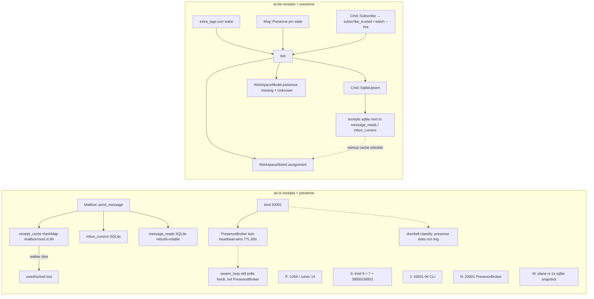

---

## 4. Decision Drivers

1. **One tick is the law, not a costume.** Every live control-plane change is `tick(WorkspaceModel, Msg) -> (WorkspaceModel, Vec<Cmd>)`. Dual reducer on the live path is a bug. `--once` and tests may call tick; they must not keep a second producer.
2. **Invent on nouns we already have.** Doorbell, 30013, `SendMessage.extra_tags`, durable sqlite (`message_reads` / `inbox_cursors`), 20001 `PresenceBroker`, `VerifySink`. Prefer no 30015. No second doorbell, wake kind, second profile, extra `--mode`.
3. **Beat Grok Bot, do not clone it.** Replay is the beat (we journal; they do not). Refuse prose protocol, widgets, markdown skills, process-local receipts, Auto-review cards, a tool catalog, secrets in mail, cloud-agents as a merge path.
4. **Assignment outlives the pane.** `corr` is a tag. Receipts are sqlite written by Cmd, cached in Model. Standing empty is silence. Tasked empty is a result against `corr`. Chat journal is not the backlog. Do not put factory.db inside toron.
5. **Two captains stay split.** Flywheel never calls Firstmate. Human talks to Firstmate; the tree talks to a spawned captain pane. `audience=human` addresses one orchestrator pin. Broadcast-to-human is a hard error.
6. **Unknown stays unknown.** Do not default idle. Inject reads presence in Model, not herdr-only gossip. Interrupt is operator/user; never onto the human pin.
7. **MCP grows only as the same verb as CLI when an agent cannot tick without it.** A missing MCP name is not a reason to mint a Grok Bot tool.
8. **Beads remain the work graph.** Playbooks enter through `engine.invoke` + `VerifySink`. Branch stays in toron `run_branch` unless it returns a Msg. ADR-0024 stays Accepted. ADR-0019 stays Proposed.
9. **This record is Proposed.** Leftovers named in §3.6 are Slice 1 work, not "documented therefore done." Do not lock. Do not ship. Do not implement from this scout.

---

## 5. Considered Options / Alternatives

### Option A — One `WorkspaceModel`, one Msg, one tick (CHOSEN)

Compose `DoorbellModel` + `LoopModel` + assignment + roles + presence + open_human under one entry. Today's two `tick` functions become private slice reducers. `Cmd` is data. Leftover bypasses fold into Msgs. Assignment rides `extra_tags` + durable sqlite receipts (store) cached in Model. Role binding prefers 30013 `role=` tags + whois aliases. Human decision is a Msg. Presence 20001 is inject truth. Live watch is `Cmd::Subscribe`. Waiter is `Cmd::WaitCorr`. MCP later, same-verb-only.

### Option B — Copy Grok Bot (previous Proposed / diagrams revision) — rejected

Tool catalog as the product surface, cards, recipes, prompt conventions, two reducers left in place, waves that grow facades. Captain said beat it, not clone it. Rejected.

### Option C — Two reducers forever ("no merge of LoopMsg into doorbell") — rejected

That was Option B's escape hatch. It leaves two nervous systems. Open-mode Direct stays cheap by **not constructing** the doorbell slice, not by forbidding a workspace entry. Slice reducers under one tick is the honest composition.

### Option D — Mint a wake kind / second doorbell / second profile / extra `--mode` — rejected

Doorbell already is in-process wake. 30013 already is the charter. Compose has no `mode`. A second nervous system is how Tick Law dies. 30015 only if 30013 would have to lie about the charter (prefer not).

### Option E — Put factory.db inside toron, or flywheel→Firstmate RPC — rejected

Factory is Grok Ship assignment. Toron is the mailbox. Beads is the graph. Two captains stay split. Connecting products couples outages and secrets.

### Option F — Status quo — rejected

Heal-inside-tick moved a for-loop. Fourteen leftovers remain. AGENTS at `bde4daae` overclaims a law the code does not obey. Dead walkers still lose `receipt_cache`. Roles still die with the pane.

---

## 6. Decision Outcome

Chosen: **Option A**. Specs E1–E9. Each names the as-is type/function and the to-be Msg/Cmd. Every diagram is redrawn from those names.

### E1. Control flow — one `WorkspaceModel`, one Msg, one tick, `Cmd` as data

**As-is.** Two reducers. Live loop only sends `LoopMsg::Tick` (other LoopMsg arms are costume). No `Cmd` type. Effects are `DoorbellAction` and `LoopAction`. Dual reducer (`apply_watch_line` / `apply_status_change` / `apply_diagnose_outcome` / `watch_sends` append) is forbidden on the live path and still happens.

**To-be.** One `WorkspaceModel` — an honest named composition, not a god object that pretends mail-wake and swarm-heal are the same domain:

```
WorkspaceModel {
  doorbell: DoorbellModel,     // queues, statuses, SelfIndex  — already exists
  swarm:    LoopModel,         // phases, heal_states, dispatch_pending, mail_health — already exists
  assignment: Assignment,      // corr → Receipt { state, wake, due_at, result_path }
  roles:    BTreeMap<Role, Pin>,
  presence: BTreeMap<Pin, Presence>,  // missing = Unknown
  open_human: BTreeMap<Corr, Question>,  // at most one
  seq: u64,
}
```

One `Msg` union covering mail / watch / status / heal / reclaim / receipt / role / human-decision / presence. One entry:

```
tick(model: &WorkspaceModel, msg: &Msg) -> (WorkspaceModel, Vec<Cmd>)
```

`Cmd` is data: herdr prompt, sqlite upsert, publish kind, subscribe, wait, `engine.invoke`, write ncryptsec, diagnose / respawn / reclaim, restart watch, fetch inbox, check Ack-SLA, loud miss. Today's `DoorbellAction` / `LoopAction` collapse into that enum.

Today's two `tick` functions become **private slice reducers** called only from `WorkspaceModel::tick`. Tests may keep helpers that call tick, not a second reducer. `--once` must call tick. `LoopMsg::Tick` dumping `states`/`digests`/`events` into the Msg is I/O smuggled as a message — poll is a Cmd whose result re-enters as `HerdrStatus` / `InboxRows` / `Presence`. Cadence `Tick` is a clock, not a world-dump.

Fold leftover bypasses into Msgs: `Heal { name, status, exited }`, `Reclaim { … }`, `ClaimWatch { name }`, `Fact { summary }` on the live path, `FetchInbox` as a real Cmd the effect layer runs and whose rows re-enter as `InboxRows`.

Replay is a property of this purity: the journal is the log of `Msg`. `why --corr` / `why --seq` starts from `Default` (or a snapshot), folds each Msg, asserts the Cmd sequence. Not pin-substring grep. Seq is `WorkspaceModel.seq`. Path is `state_dir/journals/doorbell-journal-{workspace}.jsonl`. Loop journals the same way. Grok Bot cannot do this; we already write the log and then refuse to fold it.

Replay determinism requires a clock in the Model: wall-clock reads (`AckSlaTick` SLA math, `due_at` stamps, presence TTL expiry) enter tick **only as Msg payload** (e.g. `Tick { now }`), never via direct `Instant::now()` inside the reducer. Otherwise `why --seq` folds produce different Cmd sequences than the live run and the acceptance test flakes. This is an existing habit to formalize, not a new mechanism.

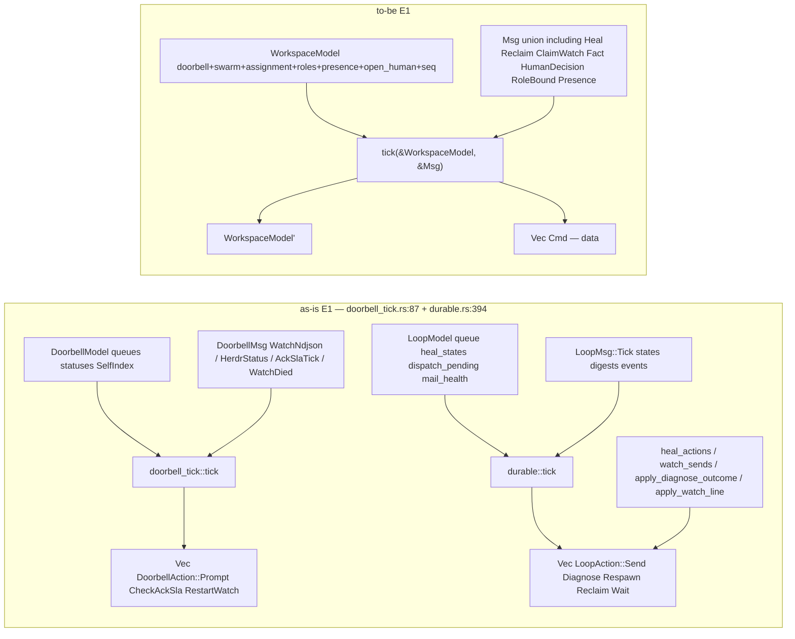

### E2. Data flow — mail / corr / receipts / journal

**As-is.** Task identity is English in kind-14 / kind-9. Canonical id of a send is the rumor id (`messaging.rs`), never the wrap id. `thread_id` is optional free-form. `receipt_cache` is a process `HashMap`. SLA "has ack?" consults that map. `inbox_cursors` and `message_reads` are SQLite and reset on index rebuild. Kind-9 `mail-delivered` is the ring because 1059 is sealed. Journal stores doorbell Msg+Actions; `doorbell why` greps a pin substring and has no seq.

**To-be.** `corr` / `wake` / `priority` / `audience` / `result_path` ride existing `SendMessage.extra_tags` (never on the 1059 envelope). Receipts leave the HashMap and become SQLite next to `message_reads` / `inbox_cursors`, keyed by `corr`. The sqlite table is the durable store the `Cmd::SqliteUpsert` writes; the in-memory `WorkspaceModel.assignment` is a cache of it, rebuilt on process start from the table (not folded from the journal). Kind-9 `mail-delivered` stays the ring until receipts replace the SLA line. The journal is the log of `Msg`; `why` folds tick by seq / corr. Slice 1 acceptance pins this direction; the alternative (rows re-derived from journal fold at startup) is rejected here so replay never mutates the receipts store.

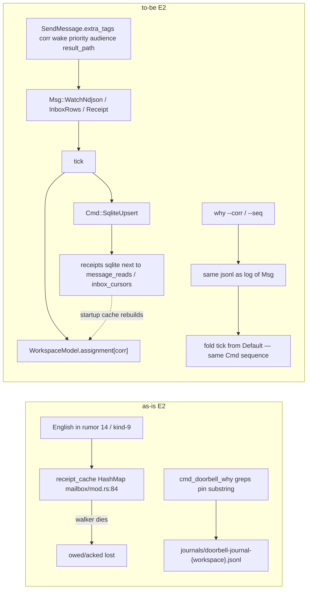

### E3. Assignment workflow — standing vs tasked inside the Model

**As-is.** Quiet is "importance=normal plus don't-inject-while-working." No `corr` tag convention. Empty standing and empty tasked look the same: nothing. Fan-out to a human pin is just another `to[]`. Beads are the work graph; chat is treated as the backlog when a walker dies.

**To-be.** Standing empty = no Cmd to the human pin. Tasked empty = Cmd that records a result against `corr` (one-line body, `result_path` for the file). Default tasked priority is queue. `interrupt` is operator/user only, never onto the human pin. `audience=human` addresses one orchestrator pin; broadcast-to-human is a hard error. Beads remain the work graph. Do not put factory.db inside toron.

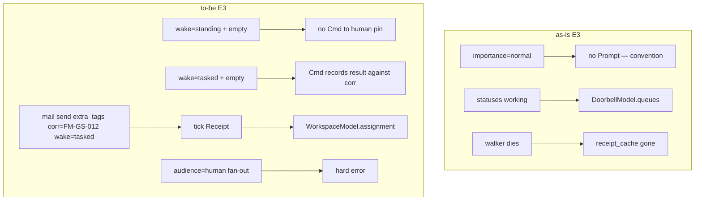

### E4. Identity / role — 30013 + whois, not a second profile

**As-is.** 30013 is the charter (`d` = `project-slug:name`). Seq ≥ 2 is a new pin + new npub (`naming.rs`). `whois captain` is the only role-style alias. Spawn registry + `.flywheel/agent-names.json` dies with the pane. **30015 does not exist.**

**To-be.** Prefer `role=` tags / whois aliases on 30013. Binding is a field in Model, updated by a Msg from a signed replaceable event (`Msg::RoleBound { role, pin }`). Seq workers stay ephemeral. No auto-spawn. Only mint **30015** if a profile event cannot be the live map without lying about the charter. Do not mint a second profile kind. Mail `to: role:wheelhouse` resolves through Model, not a guess. Open `corr`s inherit onto the next pin of that role.

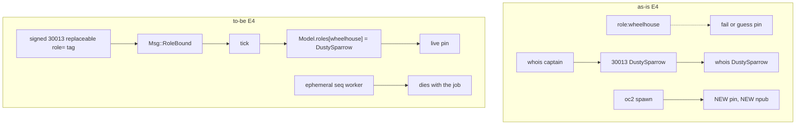

### E5. Human decision is a Msg, not a widget

**As-is.** Workflow 46011/46012 already park a durable promise; flywheel `workflow approve` sends mail; the pane drainer scans inbox. Any agent can theoretically send high+ack to the captain pin. There is no `HumanDecision` Msg. The mailbox is transport, not a gate — and that is already the right instinct, badly wired.

**To-be.** `HumanDecision { corr, verdict }` enters tick. Mail may carry the question to the orchestrator pin as a Cmd (`audience=human`, one recipient). The mailbox does not mint a UI token. One open decision per corr in Model. Secrets: never a rumor; a Cmd that writes ncryptsec. Receive-side tripwire stays an ingest Cmd result (`denied`). Grok Bot parks this on a card; we will not.

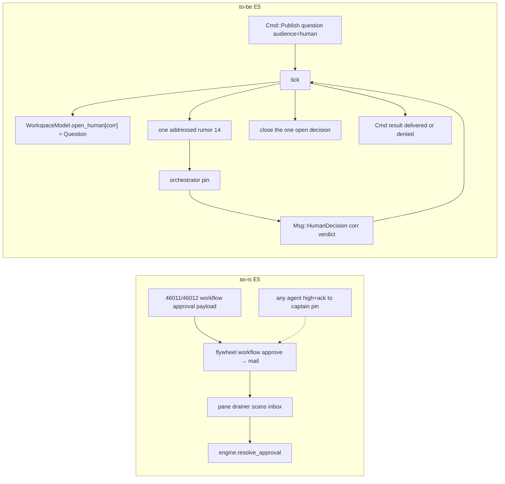

### E6. Presence 20001 is inject truth in Model

**As-is.** `should_inject` is `idle | done | blocked` only (`doorbell.rs:74–76`). Missing status is `"unknown"` (`doorbell_tick.rs:173–177`) — unknown **queues**, it does not default idle. Kind 20001 is published; doorbell classify does not ring on it; the loop does not consume it. Doorbell inject reads herdr pane status (`DoorbellMsg::HerdrStatus`), not mailbox `PresenceBroker`.

**To-be.** Unknown stays unknown. Do not default idle. Doorbell inject reads presence (20001 in Model), not herdr-only gossip. Herdr stays the process that types. Standing wakes consult presence; tasked wakes queue on `working`; `interrupt` is the only barge-in, and never onto the human pin. `Msg::Presence { pin, state }` updates the map; missing key is Unknown.

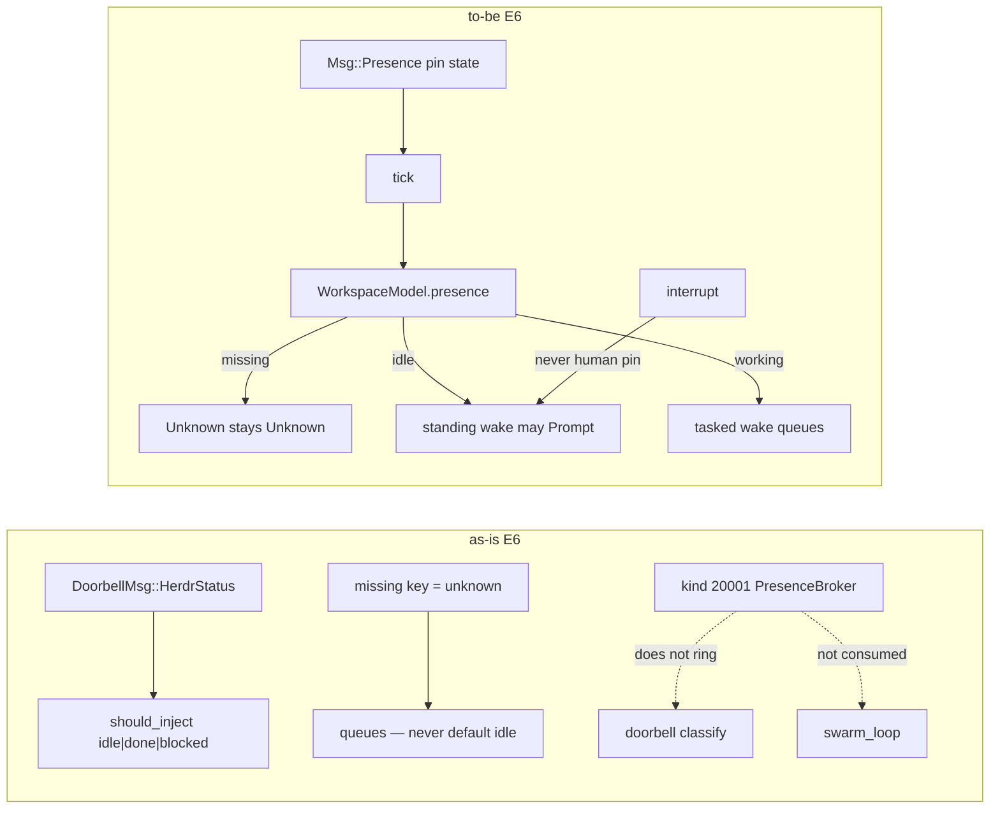

### E7. Live watch is a Cmd subscription that yields Msgs

**As-is.** CLI `toron watch` is a 1s sqlite snapshot (`plane.rs:1298–1400`). Dispatcher already has in-process `subscribe_trusted` (`main.rs:7669`) for kinds 9, 43001, 30031, 39002. Fallback spawns the snapshot child. Encrypted 1059 is not on that filter; mail-delivered kind-9 is. `FetchInbox` is a dead `DoorbellAction` variant; the plane-P sweep is dispatcher I/O.

**To-be.** Promote `subscribe_trusted` to `toron watch --live`. Every line is `Msg::WatchNdjson` (the unified Msg). No second doorbell. Doorbell's Cmd is `Subscribe`; the effect layer yields Msgs. Other waiters use the same subscription. Keep the snapshot path as a debug `--once`, not as the live source. `FetchInbox` is a real Cmd whose rows re-enter as `InboxRows`.

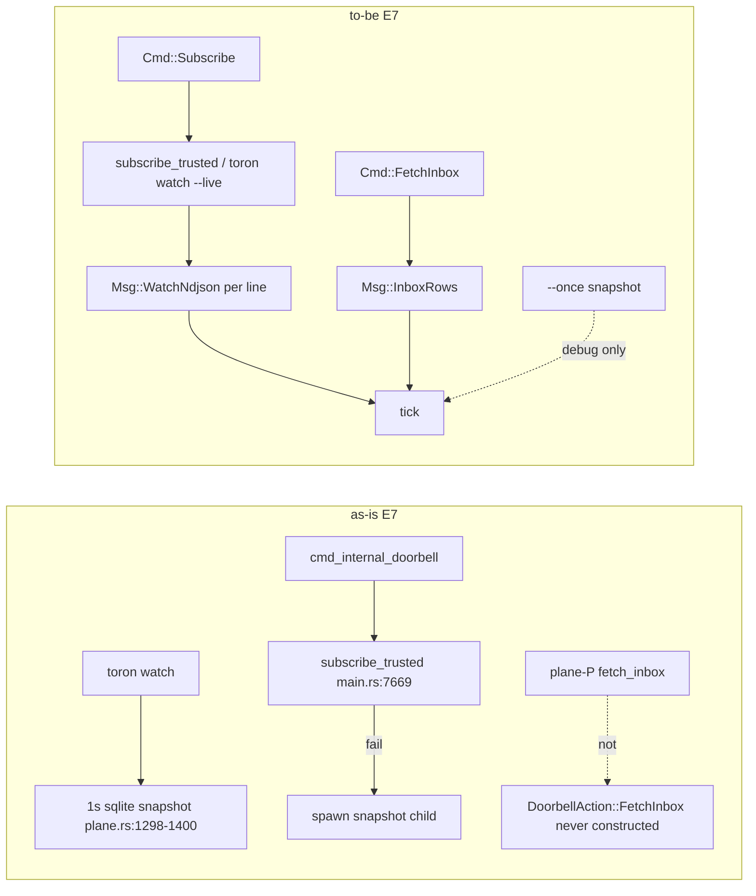

### E8. Skills / playbooks are data on beads + `VerifySink`, not markdown side channels

**As-is.** Repair Branch early-exit landed: flywheel playbook YAML `builtin_workflows.rs:1253–1268` + toron `run_branch` `control_flow.rs` (bd-rd4d). Guard language is evalexpr over flattened `steps_<name>_<key>` (hyphens→underscores), not mustache `{{steps.*.done}}`. Evaluated by the **workflow engine**, not `durable::tick` / `doorbell_tick::tick`. Calling it Tick Law is a category error. Modes still threaten to paste argv. `VerifySink` is already the verify door (`engine/sinks.rs:50–80`). ADR-0024 is **Accepted**; this ADR does not rewrite it. README 0024 still says early-exit is "future" — doc lag.

**To-be.** Modes do not paste argv. `engine.invoke` + `VerifySink` is the graph door. No extra `--mode`. No 37 decide rows. No factory.db inside toron. No flywheel→Firstmate RPC. Two captains stay split. Branch early-exit stays in toron-workflow `run_branch` — do not pretend it is flywheel tick. If it becomes control-plane, it is a `Msg::EngineReturned { corr, outputs }` into `WorkspaceModel` **after** the engine returns, not a second graph inside tick. Facts already have a Msg arm; fold leftover 10 instead of minting a diary.

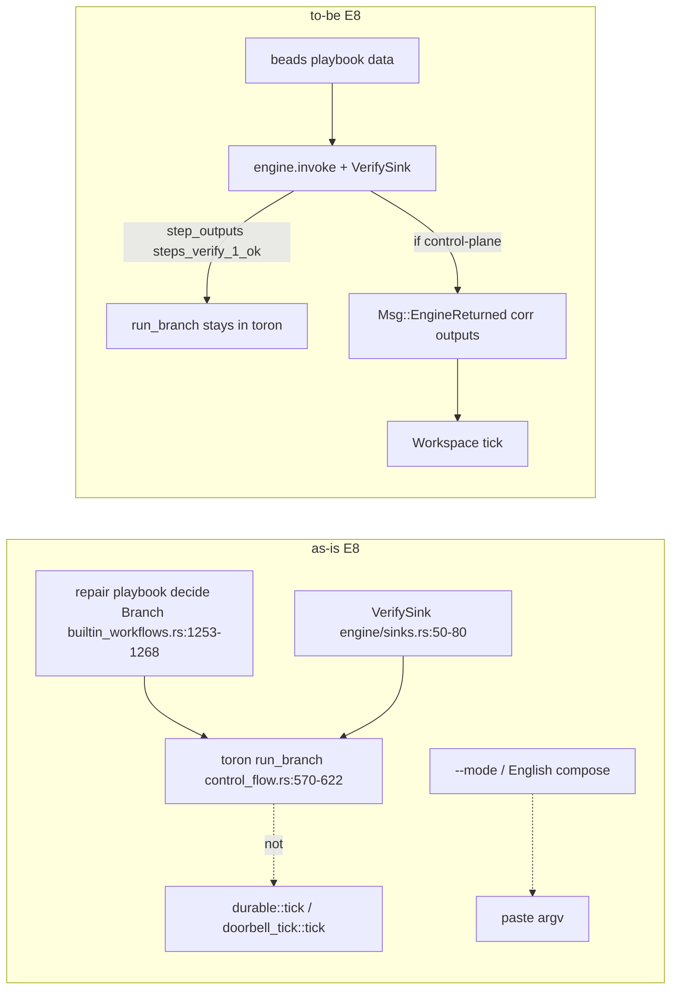

### E9. Waiter is a Cmd, not a pane assumption

**As-is.** No `toron wait --corr`. Panes are assumed always-on herdr. Closest is `wait_for_readback` (50ms poll of kind-9 for channel `--wait-ack`).

**To-be.** `toron wait --corr` is subscribe-until-receipt, implemented as the same live watch (E7) + Model receipt (E2/E3), not a `thread.sleep` and not a Grok Bot waiter clone with a new MCP name. MCP grows only as the same verb as CLI when an agent cannot tick without it. `Cmd::WaitCorr { corr }` parks the caller; the receipt Msg unparks.

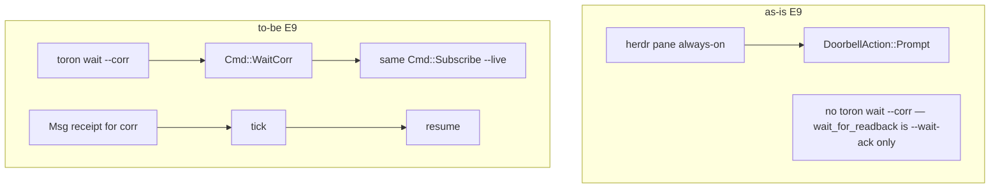

---

## 7. Fold-into-tick slices + acceptance

Each slice is a factory **ship** only after the captain promotes this ADR (or a slice). Scouts stay reports. This scout does **not** implement them. These are not MCP facade waves.

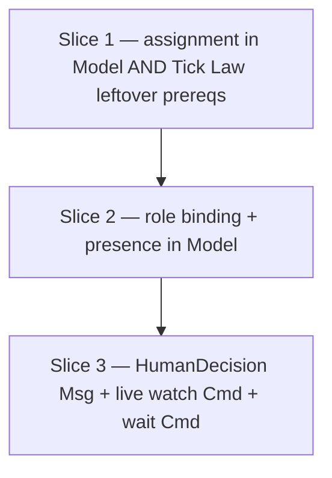

No Slice 4 "MCP facades." No Slice 5 "facts / routines / skills." Facts are leftover 10 (fold `DoorbellMsg::Fact` onto the live path). Skills are E8. Routines are dropped.

### Slice 1 — Assignment bus in Model AND leftover Tick Law bypasses that are prerequisites

Assignment is useless on a live path that still strips tick output and wipes `bell_model`. Slice 1 is both.

**In Model:** `corr` + `wake` tags on send; durable receipts as sqlite store cached in Model; `Cmd::WaitCorr` (CLI `toron wait --corr`; MCP not in this slice).

**Fold (prerequisites — the live path must not lie before assignment rides it):**

- `watch_sends` after tick → `Msg::ClaimWatch` (or a Tick arm that is honest; delete the "DELIBERATELY loop-side" comment)
- leftover `heal_actions` / reclaim pre-seed → `Msg::Reclaim` into tick, then `actions = tick(...)` only
- Diagnose strip (`6956–6962`) → delete; tick output is the plan
- `apply_events_to_states` once (tick only)
- double `bell_model` (`7747`/`7819`) → one model for the dispatcher lifetime
- `statuses.insert(to)` before HerdrStatus → stop; let tick see `from`
- WatchDied keep model'
- `DoorbellMsg::Fact` on the live captain path; adapter must not swallow Err into `()`
- `FetchInbox` actually emitted (or delete the variant); inbox sweep is a Cmd whose rows re-enter as `InboxRows`
- `heal_states` onto `ActiveLoop` (or stop claiming crash-safe); `apply_diagnose_outcome` is a Msg result into tick, not a loop-local mutate at `7472`

`--once` / tests: helpers may call tick; they must not keep a second reducer as the `--once` production path.

**Acceptance (when a later ship lands, not now):** send a tasked mail with `corr=FM-GS-012`; kill the walker; a new process still sees owed/acked; empty tasked still writes a result against that corr; standing empty produces no captain-pane Cmd; a source-scan test that every live dispatcher event constructs a Msg; no live `watch_sends` append; no Diagnose filter of tick output; `why --corr` replays by seq from `journals/doorbell-journal-{workspace}.jsonl`.

### Slice 2 — Role binding + presence as Model fields

Whois aliases for persistent roles. Binding `role → live pin` (30013 tags, or 30015 iff needed). `Msg::RoleBound`. `Msg::Presence`. Unknown never idle. Inject reads 20001 in Model.

**Acceptance:** `toron mail send --to role:wheelhouse` resolves after pane death to the next pin of that role; open `corr`s inherit; `whois wheelhouse` prints charter + live pin; a missing presence does not inject.

### Slice 3 — Human decision Msg + live watch Cmd + wait Cmd

`HumanDecision` Msg. `--live` watch. `toron wait --corr` as the same subscription + receipt. MCP only if an agent cannot tick without the same verb.

**Acceptance:** one open decision per corr; mailbox mints no token; `toron watch --live` delivers without a 1s snapshot; `toron wait --corr` returns when the receipt lands in Model. (Invariant 10 — secrets never in a rumor — is enforced globally by the tripwire/denied ingest path, not re-tested here.)

---

## 8. Invariants

1. Two captains stay split. Flywheel never calls Firstmate.
2. One `tick` is the only state transition for a live workspace. Dual reducer on the live path is a bug.
3. Effects are data (`Cmd`). No I/O inside `tick`.
4. 30013 is the only profile document. Binding is not a second bio. 30015 only if 30013 cannot bind without lying.
5. Tasked work has a `corr` that outlives the pane. Standing empty is silence. Tasked empty is a result against `corr`.
6. Default tasked priority is queue. Interrupt is operator/user. Never interrupt the human pin.
7. `audience=human` addresses one orchestrator pin. Broadcast-to-human is a hard error.
8. Receipts are sqlite written by Cmd and cached in Model; replay never mutates the store. Chat journal is not the backlog.
9. Unknown presence is unknown. Never default idle.
10. Secrets never in mail, including plane P. Secret Cmd writes ncryptsec. Tripwire is `denied`, not a widget.
11. One open `HumanDecision` per corr. Mailbox is not the gate and does not mint a token.
12. Journal is the log of Msg. `why` is replay by seq / corr, not grep. Path is `state_dir/journals/doorbell-journal-{workspace}.jsonl`.
13. Beads close work. Toron carries assignment. Neither is the human chat.
14. Playbooks enter through `engine.invoke` + `VerifySink`. Branch stays in `run_branch` unless it returns a Msg. The workflow engine sits **outside** the control plane by construction; invariant 2 governs workspace state transitions, not graph step execution.
15. MCP is a facade of an existing CLI verb, or it does not exist. A missing MCP name is not a reason to mint a Grok Bot tool.
16. One-way dep: toron never imports flywheel.
17. Factory ships do not merge on red CI or without the captain's word.
18. Tick Law leftovers named in §3.6 are not "documented therefore done."
19. Two live tick owners, one tick function (bd-55nx.3 cut A): the doorbell dispatcher owns the assignment cache (seeded once via rebuild_assignment_from_receipts); swarm_loop holds no assignment in RAM — receipts sqlite is the shared truth. WaitCorr/HumanDecision stay doorbell-only.

---

## 9. Reuse / mint / do-not-mint

### 9.1 Reuse (do not duplicate)

| Existing noun at HEAD | Stays as |
| --- | --- |
| `doorbell_tick::tick` + `classify` | private doorbell slice of Workspace tick |
| `durable::tick` | private swarm slice of Workspace tick |
| in-process `subscribe_trusted` | live watch source to promote to `--live` |
| kind 30013 | agent profile / charter / preferred role binding vehicle |
| ADR-0018 pin + grammar | public identity + herdr handle |
| `whois` + `whois captain` | first role alias; pattern to copy onto other roles |
| kind 20001 + `PresenceBroker` | presence (inject truth, in Model) |
| kind 9 + `toron-kind=` | metadata rings until receipts replace the SLA line |
| 43001–43006 | jobs (tags ride `extra_tags` / job builder) |
| 46011/46012 | workflow approval **payload**; decision is a Msg |
| `inbox_cursors` / `message_reads` | cursor + read projections; receipts sit next to them |
| `SendMessage.extra_tags` | vehicle for `corr` / `wake` / `priority` / `audience` / `result_path` |
| doorbell + loop journals | become the Msg log (fix path/seq/replay) |
| beads | work graph |
| `engine.invoke` + `VerifySink` | graph door |
| `run_branch` step_outputs | repair early-exit (toron, not flywheel tick) |
| ncryptsec | keys |
| cron (ADR-0012) | standing schedules — not a routine MCP |

### 9.2 Mint (only where reuse fails)

**Types (flywheel):** `WorkspaceModel`, unified `Msg`, `Cmd`. Not a second doorbell.

**Tags (no new kind):** `corr`, `wake`, `priority`, `audience`, `result_path` on rumor 14 and job 43001/43004, via `extra_tags`.

**Maybe one kind:** **30015 role-binding** (`d` = `{project}/{role}`), **iff** 30013 cannot hold the live pin without mixing charter and binding. Prefer 30013 `role=` tags + whois aliases first. Prefer no 30015.

**SQLite:** `receipts` table next to `message_reads` / `inbox_cursors`. Projection of Model, not a bolt-on cache.

**CLI (verbs, not a catalog):** `toron wait --corr`, `toron why --corr` (replay), `toron watch --live`, `toron role pin` (whois alias write), `toron receipt get` (reads the receipts store). Task send is `mail send` + tags, not a parallel product.

**MCP:** none in Slice 1. Later, only the same verb as CLI, and only when an agent cannot tick without it.

### 9.3 Do not mint

A wake kind. A second profile kind. A second doorbell. Extra `--mode`. 37 decide rows. Public replaceable acks. Flywheel→Firstmate RPC. Factory.db inside toron. A card/widget token. Auto-review on the mailbox. A routine noun (cron + standing wake exist). Peer-agents / cloud-agents as a merge path. Secrets in a rumor. An extra profile document. We will not mint Grok Bot's tool catalog.

---

## 10. Scenarios

Must-pass stories in Msg/Cmd terms. Fail the slice if any Fail-if clause hits. Not a ship now.

### S1 — Tasked mail with `corr` survives walker death

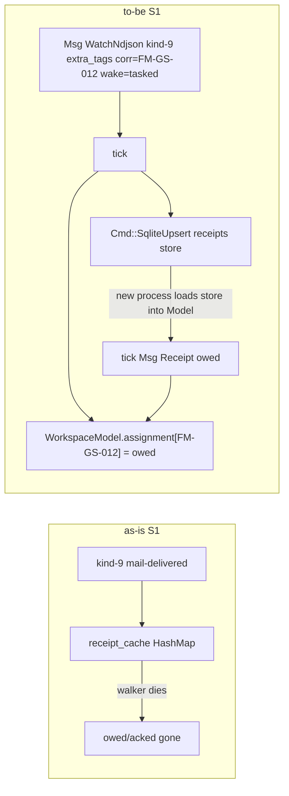

**Pass:** kill the walker; a new process still sees owed/acked for `corr=FM-GS-012`. Empty tasked still writes a result against that corr. **Fail if:** `receipt_cache` HashMap is the only store, or chat journal is treated as the cursor.

### S2 — Standing empty is silence; tasked empty is a result

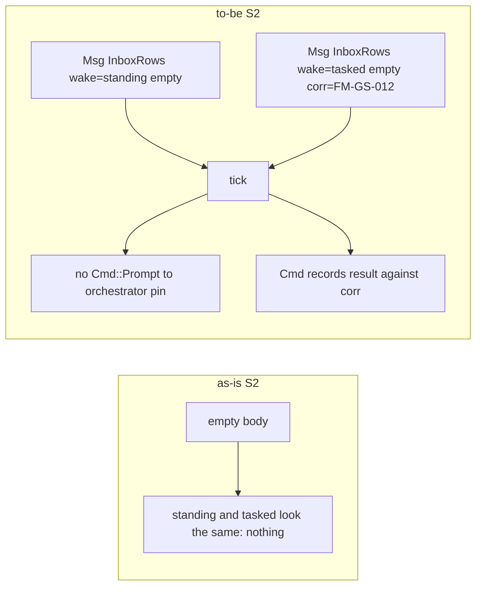

**Pass:** standing empty produces no captain-pane Cmd; tasked empty writes a one-line result + `result_path`. **Fail if:** empty standing pings the human, or empty tasked vanishes.

### S3 — `role:wheelhouse` resolves after pane death

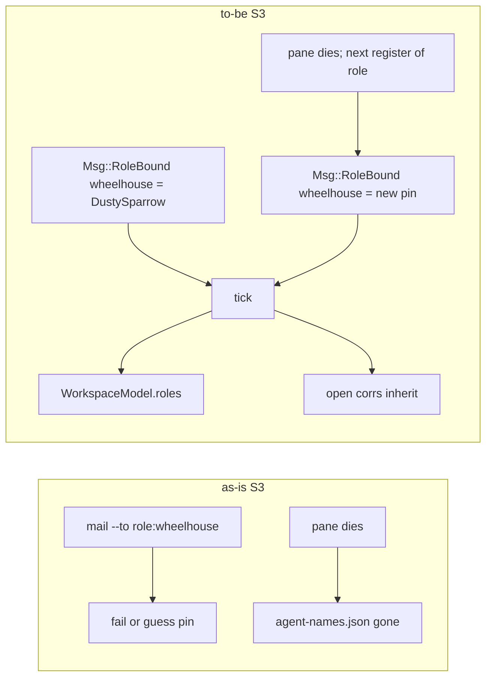

**Pass:** `toron mail send --to role:wheelhouse` resolves after pane death to the next pin of that role; `whois wheelhouse` prints charter + live pin. **Fail if:** seq≥2 is treated as the same identity, or auto-spawn fires on a miss.

### S4 — One `HumanDecision` per corr; mailbox mints no token

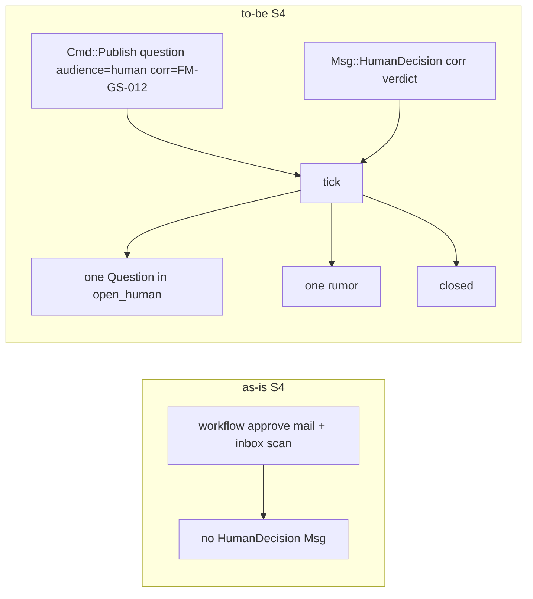

**Pass:** one open decision per corr; secrets never in a rumor (Cmd writes ncryptsec). **Fail if:** mailbox mints a card/token, or a second `HumanDecision` for the same corr is accepted, or an MCP human-gate name lands without a CLI verb.

### S5 — `toron wait --corr` unparks on receipt Msg

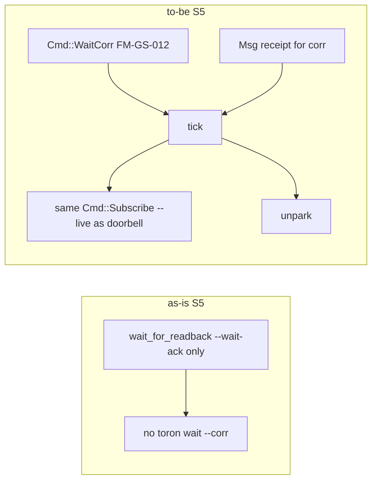

**Pass:** `toron wait --corr` returns when the receipt lands in Model; `toron watch --live` delivers without a 1s snapshot. **Fail if:** waiter is `thread.sleep`, or an MCP waiter lands without CLI `toron wait --corr`.

---

## 11. Consequences

**Positive**

- Replay is a property of the log. `why` becomes a proof, not archaeology. Grok Bot cannot do this; we already journal.
- Dead walkers do not lose the assignment (`corr` + sqlite receipts cached in Model).
- Roles outlive panes without a farm of seq identities and without a second profile kind.
- Doorbell and 30013 stay the nouns operators already learned.
- Dual reducer becomes illegal on the live path, which is Tick Law, not a new religion.
- New structure sits on live call sites (`extra_tags`, `subscribe_trusted`, 30013, whois, `message_reads`, `VerifySink`) instead of a parallel fabric or a tool catalog.

**Negative / cost**

- Unifying two ticks is a real refactor of `swarm_loop` and `cmd_internal_doorbell`. Slice 1 is larger than "add a corr tag."
- MCP grows only as the same verb as CLI when an agent cannot tick without it. Catalog discipline stays.
- A binding kind (if minted) is an ADR-0014 registry change. Renumber still forbidden; append only.
- `thread_id` and `corr` will be confused until CLI help is brutal.
- AGENTS.md at `bde4daae` overclaims the law. Docs must follow the fold, not lead it.

**Neutral**

- Beads unchanged as the work graph.
- Two captains unchanged.
- ADR-0024 remains Accepted. Branch early-exit stays in toron `run_branch`.
- ADR-0019 remains Proposed.
- Heal-inside-tick (`0dc7f37c`) remains a real but incomplete fold.

---

## 12. Alternatives recap / Pros-cons

Covered as named options in §5. Short form:

| Option | Verdict | Because |
| --- | --- | --- |
| A — one WorkspaceModel | **chosen** | Honest composition of doorbell + loop + assignment; leftover 14 become Msgs; replay is free once tick is the only producer |
| B — copy Grok Bot | rejected | Tool catalog, cards, recipes, two reducers left in place |
| C — two reducers forever | rejected | Leaves two nervous systems; costume Elm |
| D — mint wake kind / second doorbell / second profile / extra `--mode` | rejected | Nouns already exist; a second nervous system is how Tick Law dies |
| E — factory.db in toron / flywheel→Firstmate RPC | rejected | Two captains; three products stay three products |
| F — status quo | rejected | Fourteen leftovers; docs overclaim; dead walkers lose receipts |

Also rejected along the way: overload `thread_id` as `corr` (debate threads are not task ids); mailbox as the human gate; full NIP-29 admin / Buzz desktop (ADR-0020/0023); federated relays as the crew bus (ADR-0020 federation off until a two-host ADR); claim heal-inside-tick finished Tick Law; pretend Branch early-exit is flywheel tick.

---

## 13. Non-goals

- Wiring Grok Bot / Firstmate / this chat into flywheel or toron.
- Merging two captains or flattening planes into one inbox.
- Replacing doorbell, 30013, ADR-0018 pins, herdr, or beads.
- Calling leftover bugs fixed by accepting this ADR.
- Claiming Tick Law held at `bde4daae`.
- Rewriting ADR-0024 (Accepted) or locking ADR-0019 (still Proposed).
- Federated relays, NIP-29 desktop, NIP-34 Forge, worktrees, Graphite.
- Public replaceable ack kinds.
- Auto-spawn on role miss.
- Mailbox as secret store, as merge authority, or as a widget host.
- A Grok Bot feature list translated into MCP names.
- Implementing the slices in this scout.
- Minting a second doorbell, a wake kind, a second profile, extra `--mode`, factory.db inside toron, flywheel→Firstmate RPC.
- Absorbing a withdrawn mailbox-feature dump.

---

## 14. Open questions for the captain (not blockers for the text)

Product locks, not research. One decision at a time when locking.

1. **Slice 1 first?** Recommendation: yes — assignment in Model is useless on a live path that still strips tick output and wipes `bell_model`.
2. **Role binding on 30013 vs new 30015?** Recommendation: try 30013 `role=` tags + whois aliases first; mint 30015 only if the charter document would have to change every pane hop. Prefer no 30015.
3. **When, if ever, does MCP grow?** Recommendation: not in Slice 1. Grow `wait` as the same verb as `toron wait --corr` only when an MCP-only agent cannot tick without it.
4. **Receipts store direction (resolved in this revision, confirm at lock):** sqlite `receipts` is the durable store; `WorkspaceModel.assignment` is a startup cache rebuilt from the table. Journal replay never writes receipts. Recommendation: keep as written.

---

## 15. Acceptance of this ADR (captain word 2026-09-01)

Frontmatter `status: accepted` (2026-09-01, captain word ordered full implementation). README decisions table gains 0027. Kind registry updated only if 30015 is chosen. MCP catalog version bumps only when a same-as-CLI verb lands. A must-pass scenario exists for Slice 1 before Slice 2 starts. Tick Law leftovers in §3.6 are Slice 1 work, not a footnote.

**2026-09-01:** Status `proposed` → `accepted` per captain word. Full implementation ordered; slices ship as they go green. Changelog section 0 retained intact.
