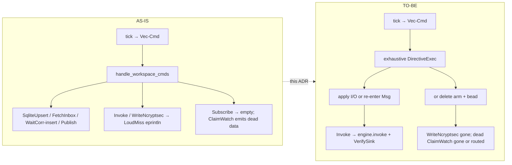
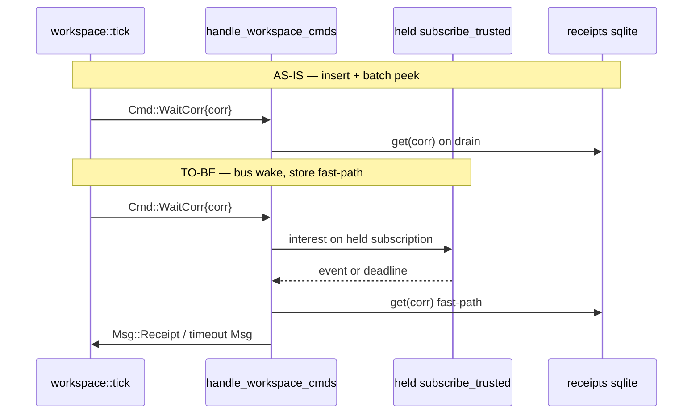
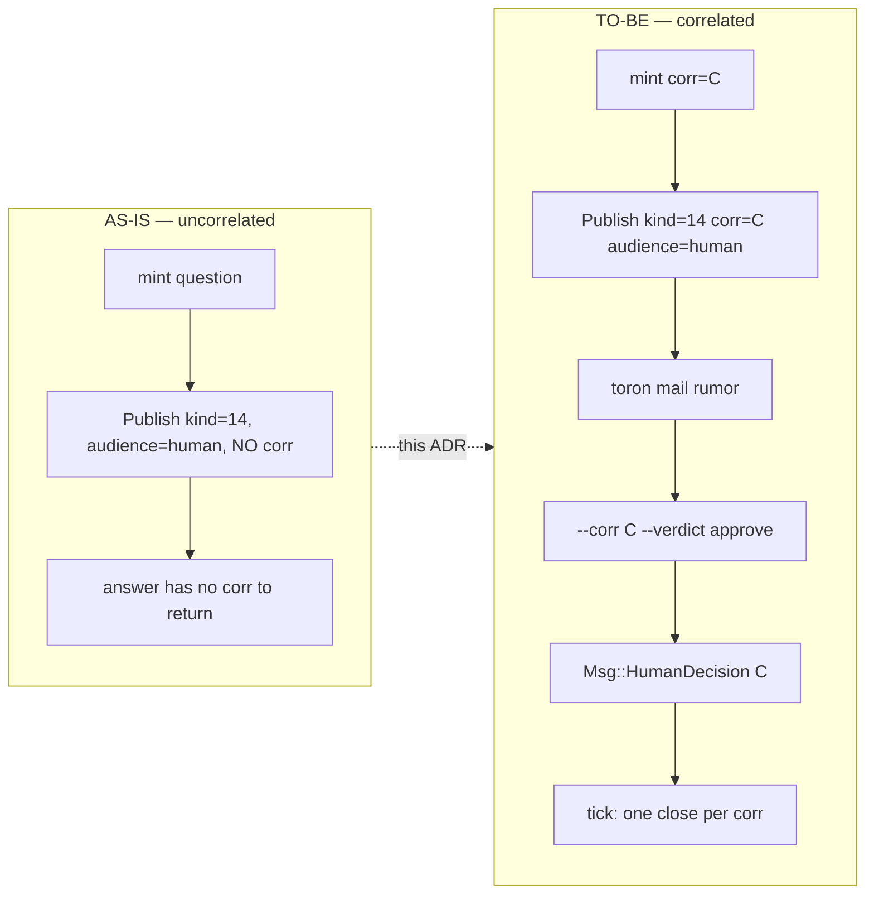

<!-- governed-by: ADR-0003, ADR-0015, ADR-0020, ADR-0024, ADR-0027 -->
---
status: accepted
date: 2026-09-03
decision-makers: Captain (bangedorrunt)
consulted: GS-015 STEER (Jido breakthroughs x Wheelhouse nouns, hold-ship diagnostic at flywheel 98aab3d / toron d373230a); open-mode review 2026-09-03 (Cmd holes, corr-plumbing gap, beads drift)
informed: flywheel x toron x beads maintainers; Wheelhouse
---

# ADR-0028: Behavior-First Contracts on Wheelhouse Nouns — Cmd Honesty, WaitCorr Parity, Assignment Ring Proof

**Status:** Accepted (2026-09-03, captain word: swarm-mode objective "study our flywheel x toron x beads stack and 0027 and 0028 and implement all stack beads" — acceptance + full implementation ordered; beads `bd-adr-0028-implementation-zfnx` + children dispatch as waves).
**Date:** 2026-09-03
**Extends:** [ADR-0027](0027-one-workspace-tick-control-plane.md) (one `WorkspaceModel`, one `Msg`, one `tick`, `Cmd` as data). This record does not relitigate ADR-0027; it finishes the seams ADR-0027 named.
**Amends:** ADR-0020 in the already-accepted sense (MCP grows only as the same verb as CLI when an agent cannot tick without it) by adding `verdict` to the CLI-only tag vocabulary; no new MCP tools in this record.
**Does not amend:** two captains stay split; two planes stay two planes (P private rumor-14/1059, S shared kind-9); one-way dep flywheel → toron-workflow → toron-core; beads remain the work graph; doorbell remains in-process wake; kind 30013 remains the agent profile; Tick Law remains the control-plane law. ADR-0019 stays Proposed. ADR-0024 stays Accepted.
**Does not wire:** Jido/OTP runtime, Grok Bot / Firstmate, Composer FSM, CloudEvents, Memory plugin, BEAM topology, ToolAdapter catalog, factory.db in toron, second doorbell, wake kind / 30015, supervisor heal.
**Tracker:** beads (epic + children under this ADR; bead ID is the mail `thread_id` / reservation `reason`).

> **Scope:** maximize Jido's behavior-first contracts (Agent-as-data, `cmd` purity, directives-as-effect-data, sensors-as-Msg-edges, await-as-bus-wake, HITL-as-Msg, strategy-as-named-nouns) on OUR nouns: `WorkspaceModel` + `workspace::tick` + `Cmd` executor + toron assignment bus + beads work graph. Every `Cmd` arm applies or is deleted. Assignment always enters from rumor-14 / InboxRows tags; kind-9 stays the ring. No second control plane.

Grounded at: flywheel `98aab3d5fdc6d5a50e09553db9c7c041c62ff63b` (2026-09-02), toron `d373230aefa0d1eb8180b24834db79c11c8aa9cd` (2026-09-02), beads drift noted (live HEAD carries 8 sync/recovery reverts above GS-015-cited `669875e6`; none touch the work-graph contract this ADR depends on — VERIFY single-line + P≤2 principles gate — so sequencing below is unaffected; newer HEAD wins).

## 1. Context and Problem Statement

How do we take Jido's real win — behavior-first contracts, not its BEAM runtime — and finish our control plane without forking it?

What we already are (verified at grounding HEADs):

- One tick: `WorkspaceModel` (`flywheel/src/workspace.rs:70`: doorbell + swarm + assignment + roles + presence + open_human + seq + pending_wait) × `Msg` union (`:87`: WatchNdjson, InboxRows, HerdrStatus, AckSlaTick, Receipt, RoleBound, Presence, HumanDecision, Heal, Reclaim, DiagnoseFailed, …) → `(WorkspaceModel, Vec<Cmd>)` via `workspace::tick` (`:564`). Pure, total, deterministic; clock enters only as Msg payload. Doorbell dispatcher and `swarm_loop` both call it (`flywheel/src/main.rs:8008, :8040, :8131, :8220, :8259, :8328`; `flywheel/src/durable.rs:6946`; live-dispatcher doc at `flywheel/src/doorbell.rs:1247`). Slice reducers stay private. Tick Law held on the live path.
- Effects as data: `Cmd` enum (`workspace.rs:174-255`: Prompt, FetchInbox, CheckAckSla, RestartWatch, Send/PinStamp/DispatchImmediate/Blocked/Nudge/Diagnose/Respawn/Reclaim/Wait, SqliteUpsert, Publish, Subscribe, WaitCorr, Invoke, WriteNcryptsec, LoudMiss/FactMiss/Audit). Doorbell side applied in `handle_workspace_cmds` (`main.rs:8560-8621`); swarm side via `Cmd::to_loop_action` in `swarm_loop`.
- Assignment bus: toron `SendMessage.extra_tags` vocabulary (`crates/toron-core/src/mailbox/send_tags.rs:134, :181-228`: corr, wake, priority, audience, result_path; unknown wake/priority/audience hard-error) → rumor-14 tags + InboxRows projection (`crates/toron-core/src/mailbox/messaging.rs:101, :256`) → `apply_assignment` in tick (`workspace.rs:397-457`) → `Cmd::SqliteUpsert` → durable `receipts` sqlite (`crates/toron-core/src/mailbox/receipts.rs:71`) with startup rebuild (`flywheel/src/main.rs:8694-8714`). Kind-9 is the ring, never the assignment vehicle (`kind9_is_ring_not_assignment` test at `workspace.rs:1277`).
- Watch kinds include identity/presence (`main.rs:8426`: `DOORBELL_WATCH_KINDS = "9,14,20001,30013,43001,30031,39002"`); 20001 presence and 30013 role= fold in tick (`workspace.rs:581-629`).
- Wait: toron `wait --corr` is subscribe-until-receipt sharing the live bus (`crates/toron-cli/src/plane.rs:1409-1491`: fast-path store `get`, else `subscribe_trusted` on kinds 9/14/1059/43001/43004, unpark on bus event or deadline — no 200ms poll). `watch --live` is the same `subscribe_trusted` source (`plane.rs:1496+`).
- Strategy is four nouns (stage / workflow / recipe / profile); Branch lives in toron `run_branch` (`crates/toron-workflow/src/engine/control_flow.rs:581`), never in tick. `VerifySink` is the verify door (`crates/toron-workflow/src/engine/mod.rs:132, :222`; flywheel `make_verify_sink` at `src/main.rs:27903`, attached in compose paths `:22721, :23197`).

What is still dishonest (the seams this ADR exists to close):

1. `handle_workspace_cmds` still `LoudMiss`-eprintlns `Invoke` and `WriteNcryptsec` (`main.rs:8591-8595`) while the enum claims they are real effects. `Subscribe` is an intentional no-op (`:8580-8584`) but `Msg::ClaimWatch → Cmd::Subscribe { filter: "claim-watch:…" }` (`workspace.rs:800-804`) emits data no executor reads — a dead Cmd normalizing placeholder culture.
2. `Cmd::WaitCorr` is `pending_wait.insert` + `drain_pending_wait_corrs` store-peek after each batch (`main.rs:8574-8575, :8619, :8623-8663`), not the bus subscribe-until toron already owns. `pending_wait` is unbounded; `open_human` rows carry `created_at: 0` (`workspace.rs:459-478`) — no SLA/timeout anywhere.
3. `publish_human_question` (`main.rs:8665-8692`) sends `sender "captain" → to ["captain"]` with exactly one extra tag (`audience=human`) and **no `corr` tag**. Everything downstream keys on `corr` (`apply_assignment`, `mint_human_question`, `open_human: BTreeMap<corr, Question>`). A human answer therefore has no `corr` to return as `Msg::HumanDecision { corr, verdict }`. The live HumanDecision producer is not thin — it is uncorrelated. No P4 acceptance can pass until `corr` (and usually `result_path`) rides Publish and the answer path returns exactly that `corr`. (Correlated gap: toron `SendTags` has no `verdict` member and CLI `mail send` has no `--verdict`; open bead `bd-mail-send-verdict-flag-kfo6` covers the toron half.)
4. Three writers share one lifecycle with no stated owner: tick inserts `owed`/`resulted` (`workspace.rs:440-456`), `Msg::Receipt` inserts (`:879-885`), toron transitions `owed→acked` (`messaging.rs:902, :947`) and `receipt set --state resulted` is explicit. No record says who mints `corr`, or that `thread_id` is never `corr`.
5. Presence-20001 folds room-adjacent content + `p` tag straight into `Model.presence` (`workspace.rs:581-603`) and `prompt_allowed`/`filter_prompts` (`:351-373`) gate Prompt on it, with no stated trust rule.
6. S1–S5 live proofs (tasked survives walker death; standing-empty silence; role rebind after pane death; one HumanDecision per corr; tasked unpark without poll) are unproven at grounding HEADs. `why --corr/--seq` fold-from-journal has no producer contract (journal path, retention bound, corr/seq filter bound).

## 2. Decision Drivers

- Tick Law honesty: every `Cmd` arm applies I/O, re-enters `Msg`/`tick`, or leaves the enum with a bead. Placeholder arms lie about the effect vocabulary.
- Mailbox-first assignment: E2/E3/E9 live or die on tags + sqlite + bus wake, not on prompt conventions.
- No second control plane: anything that reintroduces Branch-in-tick, Suspend-as-product, GenServer-mailbox API, or supervisor heal splits the captains and forks the bus.
- MCP freeze: same-verb-as-CLI only; tool count stays 40 (38 parity + 2 additive) unless an agent cannot tick without the verb.
- Auditability: journaled `Msg` is the trace; `why` folds tick from journal, never greps pin substring as truth.
- Bounded everything: unbounded `pending_wait` / `open_human` / journals are future OOM/disk incidents (cf. prior bounded-retention fixes `89a90af`, `39c6402`).
- Implementability by agents: each slice below names files, patterns, tests, and a single-line VERIFY so beads are dispatchable (non-empty single-line `verify`; P≤2 carries a `principle` citation).

## 3. Considered Options

- **Option A (chosen): incremental honesty + parity + proofs on our nouns.** Apply-or-delete Cmd arms; WaitCorr on the held bus subscription; assignment ring proof with stated corr authority and receipt ownership; HumanDecision corr plumbing end-to-end; presence trust rule; S-slice e2e harness before wiring; docs batch for sensor/memory/strategy/cron/action-schema vocabulary. No new runtime, no new kinds, no new MCP tools.
- **Option B (rejected): port Jido runtime concepts.** AgentServer/GenServer mailbox, Composer Workflow FSM / FanOutNode / HumanNode-Suspend, CloudEvents wire format, Memory plugin `:__memory__`, Strategy.tick LLM loops, Pods/InstanceManager topology, Phoenix.PubSub pid dispatch. Rejected: each forks Tick Law, the assignment bus, or the work graph; BEAM topology costumes hide heal behind supervisors instead of Msg/Cmd; CloudEvents forks 30013/20001 identity/presence; Suspend-as-product recreates Branch-in-tick.
- **Option C (rejected): docs-only vocabulary adoption.** Name Sensor edges / Model partitions / Directive=Cmd without touching executor holes. Rejected: leaves LoudMiss arms, uncorrelated Publish, and tri-writer receipts in place; vocabulary without honesty is costume.

## 4. Decision Outcome

Chosen option: **Option A**, sequenced so proofs and authority precede wiring (prevents wiring placeholders faster):

1. Authority + proofs first: corr mint authority + receipt state ownership (D), action-schema invariants at the Cmd/Msg boundary (C), S-slice harness + why-fold producer (H).
2. Wiring second: Invoke apply-or-delete (A) needs C; WaitCorr parity + bounds (E) needs D; HumanDecision corr plumbing (F) needs D (+ toron `--verdict` bead); presence trust (G) stands alone.
3. Docs last: sensor/memory/strategy/cron batch (I) after behavior lands so skills describe what the code does.

### Consequences

- Good, because Tick Law becomes checkable (exhaustive match, source guards, S-green) instead of asserted.
- Good, because assignment/HITL/wait all ride one bus + one store + one Model cache with a stated owner each.
- Good, because beads stay the work graph and `VerifySink` stays the verify door; no second playbook store, no MCP growth.
- Bad, because Publish corr-plumbing changes the human-question wire shape (adds `corr` tag); old tag-less human mails stay closable only via body-verdict fallback during migration.
- Bad, because bounding `pending_wait`/`open_human` introduces timeout LoudMiss/Timeout Msgs that need triage runbooks (kept minimal: deadline → timeout Msg, never silent drop).
- Neutral, because `Subscribe` stays a documented non-bus Cmd; its ClaimWatch producer is either routed or deleted (no behavior change either way).

## 5. Specs (normative)

### E1. Cmd executor completeness (DirectiveExec)

- `handle_workspace_cmds` (`flywheel/src/main.rs:8560`) + `swarm_loop` LoopAction apply are the DirectiveExec: exhaustive match over live `Cmd` arms, zero silent `_` for live arms, source guard fails CI on new unhandled arms.
- `Invoke { workflow, input }`: route to `engine.invoke` + `VerifySink` gated by a playbook bead, or delete the arm with a bead. Never a second tick entry; effect-layer only.
- `WriteNcryptsec`: **deleted** (not wired). Flywheel never writes ncryptsec secrets; keys belong to toron (`crates/toron-core/src/keys/`). A secret-writing Cmd beside rumor-14 is an exfil path.
- `Subscribe`: stays documented non-bus (live `subscribe_trusted` already held). Its producer `Msg::ClaimWatch → Cmd::Subscribe` is either routed to `swarm_loop` claim-watch or the Msg arm is deleted — no dead Cmds.
- `Prompt`/`CheckAckSla`/`RestartWatch` stay caller-applied (dispatcher), documented at the match.

### E2. WaitCorr parity + bounds (Await)

- `Cmd::WaitCorr { corr }` registers interest on the **already-held** doorbell `subscribe_trusted` (kinds `DOORBELL_WATCH_KINDS`); receipt event → `Msg::Receipt` through `tick`; deadline → timeout Msg. No second watch child, no 200ms-class poll, no wake kind / 30015.
- `pending_wait` bounded (TTL + cap; deadline path removes). `drain_pending_wait_corrs` store-peek stays only as the fast path after each wake, never as the wake itself.
- Acceptance mirrors toron `live_watch_wait_corr_unparks_on_receipt` (`plane.rs:1704`): tasked corr unparks on bus event without poll-loop peek; survives walker death via receipts sqlite.

### E3. Assignment ring + corr authority + receipt ownership

- Kind-9 stays the ring (wake / delivered), never the assignment vehicle. Assignment enters only from rumor-14 tags (`corr`/`wake`/`priority`/`audience`/`result_path`/`verdict`) via `WatchNdjson`-14 fold (`workspace.rs:654-674`) or `InboxRows` projection (`:698-739`).
- **Corr authority:** the sender mints `corr` (non-empty; `SendTags::parse` rejects empty). Tick never invents `corr`. **`thread_id` is never `corr`** (stated invariant + test).
- **Receipt ownership:** toron sqlite owns `owed→acked→resulted` (owed-on-send in `send_message`, `owed→acked` in `send_receipt`, `resulted` only via explicit `receipt set --state resulted`; acked idempotent, resulted never downgrades). Flywheel Model caches; `SqliteUpsert` writes through; startup `rebuild_assignment_from_receipts` restores. No Model-side state invention.
- Standing-empty stays silence (no Cmd, no assignment); tasked (+corr) records `owed` + `WaitCorr`; tasked-empty records result against `corr`. Audience=human fan-out and interrupt-onto-human stay hard errors (tick + `SendTags::validate_for_send` agree).

### E4. HumanDecision end-to-end (HITL as Msg)

- Audience=human mints at most one open question per corr (`mint_human_question` + `Cmd::Publish kind=14`); Publish carries **`corr`** (+ `result_path` where known). Human answer via `mail send --corr C --verdict approve|deny` (toron half: `bd-mail-send-verdict-flag-kfo6`) or body approve/deny fallback while `open_human` holds the corr.
- Exactly one `Msg::HumanDecision { corr, verdict }` closes one question; unknown/duplicate corr → LoudMiss (already tested). Mailbox mints no UI token, no card, no Suspend directive. Happy path needs no test-only pre-seed.
- Blocked on E3 (corr authority) + toron `--verdict` flag; sequenced after both.

### E5. Presence trust + inject gate

- State the trust rule for 20001→`Model.presence`→`prompt_allowed`/`filter_prompts`: which authors are inject truth, what forges to LoudMiss/Audit, how `Unknown` behaves (missing key = Unknown; `Unknown` never prompts). No behavior tuning beyond the rule + tests in this record.

### E6. S-slice proofs + why-fold producer (Thread = journal Msg)

- Live proofs S1–S5 run against grounding HEADs before wiring slices: tasked survives walker death; standing-empty silence; role rebind after pane death; one HumanDecision per corr (after E3+E4); tasked unpark without poll (after E2).
- `why --corr/--seq` folds `tick` from journal (never pin-substring grep as truth): producer contract names journal path, 5MiB/5k-style retention bound, and corr/seq filter bound; fold reproduces the `Vec<Cmd>` for the corr.

### E7. Vocabulary batch (docs-only): sensors, partitions, strategy outcomes, cron, action schema

- Sensor edges named in skills/AGENTS as Msg producers only (WatchNdjson, HerdrStatus, AckSla, Presence-20001, InboxSweep). No Sensor module/process per edge.
- Model partitions named (perception: presence/roles; assignment: corr/wake/pending_wait; swarm: heal/dispatch; human: open_human). No second Memory store beside Model + beads + receipts sqlite.
- Strategy stays four nouns; stage/recipe completions emit outcome atoms recorded by `VerifySink` + beads; Branch consumes outcomes in toron engine only — tick never branches on YAML.
- Cron/schedule equivalents stay Msg producers (`AckSlaTick`); standing wake tags stay; timers never bypass tick.
- Action-schema discipline at the Cmd/Msg boundary: per-arm invariant comments + unit/property tests (Publish/WaitCorr content shape; Invoke input shape when wired). Malformed tags stay hard-error. No Zoi/NimbleOptions port — Rust types on hand.

## 6. Explicit refuse list (with why)

1. OTP GenServer / AgentServer as the agent product — agent stays data; doorbell is last hop, not a mailbox framework; port fights Tick Law.
2. GenServer mailbox / `handle_call` control-plane API — Msg/Cmd only; call/response reintroduces hidden effects beside tick.
3. Markdown-skills side channels as capability store — fights beads + VerifySink; unaudited second playbook store.
4. CloudEvents wire format — keep Nostr kinds + toron envelopes; fork breaks 30013/20001.
5. Composer Workflow FSM / FanOutNode / HumanNode-Suspend as second control plane — recreates Branch-in-tick and Suspend-as-product; HITL is Msg, Branch is engine.
6. Directive.Spawn / child_spec / Pods / InstanceManager partitions as Rust product shape — two planes + herdr already exist; topology costumes hide heal behind supervisors instead of Msg/Cmd.
7. Strategy.tick LLM loops defining "agent" — AI stays optional edge; four nouns + beads own strategy.
8. Memory plugin `:__memory__` / Thread `:__thread__` reserved keys — Model + journals + beads + receipts sqlite already cover it; reserved keys invite a second store.
9. Phoenix.PubSub / pid dispatch as crew bus — plane-S watch + plane-P mailbox stay; pid dispatch bypasses doorbell kinds and presence.
10. Grok Bot / Firstmate RPC / 44-tool MCP dump / factory.db in toron / second doorbell / wake kind / 30015 — each skips tick, tags, or VerifySink.
11. `Process.sleep` await patterns — bus wake already preferred; sleep culture masks E9 failures and flakes S5.
12. OTP supervision trees as heal — heal is Msg/Cmd on Model; diagnose/respawn are herdr effects.
13. Flywheel writing ncryptsec secrets — keys belong to toron; secret-writing Cmd beside rumor-14 is an exfil path (E1 deletes, never wires).
14. `thread_id` coerced to `corr` — thread is the conversation key, corr is the assignment key; conflation dual-writes assignment (E3 forbids + tests).

## 7. Implementation Blueprint

- **Target zones (may change):** `flywheel/src/workspace.rs` (tick, Msg/Cmd, assignment/human/presence folds, guards); `flywheel/src/main.rs` (`handle_workspace_cmds`, `drain_pending_wait_corrs`, `try_tick_receipt`, `publish_human_question`, `rebuild_assignment_from_receipts`, `make_verify_sink` call sites); `flywheel/src/durable.rs` + `doorbell.rs` (slice behavior only through tick; no new reducers); `crates/toron-core/src/mailbox/send_tags.rs` + `messaging.rs` + CLI `plane.rs`/`cli.rs` (verdict tag; already half-covered by `bd-mail-send-verdict-flag-kfo6` — coordinate, do not duplicate); unit/e2e tests colocated with each slice; skills/AGENTS vocabulary batch.
- **Forbidden zones (must not touch without a new ADR):** kind registry (no new kinds incl. 30015); MCP tool names/count (40 frozen); 30013 profile shape; Git archive / projection / gift-wrap paths; beads schema beyond labels/verify/principles; supervisor/pid bus; any `unsafe` (workspace `#![forbid(unsafe_code)]`).
- **Blast radius:** E1A/E2/E3/E4 touch the live tick path — P0/P1 band, one slice per bead, exhaustive-match + S-green gates at close. E5/E6/E7 are normal band. Each bead reserves its file scope (`toron reserve acquire --reason <bead-id>`) and holds the `cargo` build slot for test runs.

## 8. Implementation Plan

- **Affected paths:** above §7 + `docs/catalog/toron-mcp.json` (regen only if CLI catalog lists send flags; `cargo test catalog_freshness` must stay green) + `~/.agents/skills/toron/SKILL.md` + `AGENTS.md` (Skill Sync Contract on CLI-surface change) + `docs/decisions/README.md` (this ADR's index row).
- **Dependencies:** none new. Rust edition 2024; rust-nostr 0.45 vocabulary (`Tag::parse`, `subscribe_trusted`) already in tree.
- **Patterns to follow:** pure `tick` + exhaustive `Cmd` apply (E1); subscribe-until with store fast-path (E2, mirror `plane.rs:1409`); tag-parse-at-boundary + hard-error unknowns (`send_tags.rs:178`); outcome atoms → `VerifySink` → beads (E7); journal-Msg fold for `why` (E6).
- **Patterns to avoid:** post-tick HashMap mutation outside tick (dual-writer hunt stays green); loop-local status maps beside `Model.doorbell.statuses`; `block_on` nesting; compat shims; silent-success stubs; `thread_id`-as-`corr`; UI-token HITL.
- **Migration steps:** land authority+schema+proofs (D, C, H) → wire Invoke/WaitCorr (A, E) → plumb Human corr (F, after toron `--verdict`) → trust rule (G) → vocabulary batch (I). Publish corr-tag is additive (old tag-less human mails keep body-verdict fallback one release, then fallback becomes LoudMiss).

### Verification (normative gates; each bead repeats its own single-line VERIFY)

- [ ] `cargo test --workspace` green (honest matrix note: e2e p1/p2/p4 gates per feature flags as in repo docs).
- [ ] `cargo clippy --workspace --all-targets -- -D warnings` green; `cargo fmt --check` green.
- [ ] `cargo test catalog_freshness` green; `toron catalog --json` regen only if CLI surface grew; MCP tool count still 40.
- [ ] Exhaustive-match guard: no silent `_` over live `Cmd` arms; source-guard test fails on new unhandled arm.
- [ ] `Invoke` LoudMiss gone (wired to `engine.invoke` + `VerifySink` behind playbook gate, or arm deleted with bead); `WriteNcryptsec` arm gone; dead `ClaimWatch→Subscribe` gone or routed.
- [ ] WaitCorr unparks on bus event without poll peek (S5-class test mirroring `live_watch_wait_corr_unparks_on_receipt`); `pending_wait` bounded (TTL + cap test).
- [ ] Kind-9 alone never inserts assignment; `thread_id`-as-`corr` test fails loud; tasked corr survives walker death via sqlite rebuild (S1/S2 green).
- [ ] One `HumanDecision` per corr over live mail path with `corr` tag (no test pre-seed); duplicate/unknown corr → LoudMiss (S4 green).
- [ ] `why --corr/--seq` fold from journal reproduces the `Vec<Cmd>`; pin-substring grep is never truth.
- [ ] Skills/AGENTS vocabulary matches E7; no Sensor module, no second Memory store, no tick-branch on YAML.

## Pros and Cons of the Options

### Option A — incremental honesty + parity + proofs (chosen)

- Good, because it finishes named seams on the live path without a rewrite or a second runtime.
- Good, because each slice is independently shippable behind existing gates (exhaustive match, catalog freshness, S-green).
- Bad, because corr-plumbing is a wire change with a migration tail (body-verdict fallback).
- Bad, because bounding waits/questions adds timeout Msgs operators must learn.

### Option B — Jido runtime port

- Good, because it reuses a documented framework's shape.
- Bad, because BEAM topology, Supervisor heal, and Composer FSM fight Tick Law, split captains, and fork the bus — the exact failure this stack spent GS-012–GS-015 removing.

### Option C — docs-only vocabulary

- Good, because it is cheap and cannot regress behavior.
- Bad, because LoudMiss arms, uncorrelated Publish, and tri-writer receipts keep lying while docs claim contracts.

## More Information

- Relation to open beads at grounding: `bd-mail-send-verdict-flag-kfo6` (toron `--verdict` half of E4 — depend on it, do not duplicate); `bd-mcp-inbox-assignment-tags-sdi1` (schema/wire agreement for InboxRows tags — E3-adjacent, keep separate); `bd-0pjf` (guard/force-release store split — out of scope, do not absorb).
- Revisit triggers: toron bus gains store-push receipts (simplifies E2 fast path); beads schema ships typed `wave`/outcome fields (simplifies E7 atoms); presence needs signed trust beyond the E5 rule (new ADR, not an extension here).
- Grounding file:line index is §1/§7; newer HEAD wins on conflict. Every architectural change in follow-ups carries as-is vs to-be mermaid grounded in current functions/types (captain rule).

// governed-by: ADR-0028
