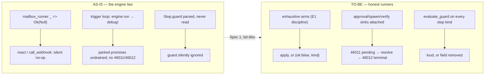
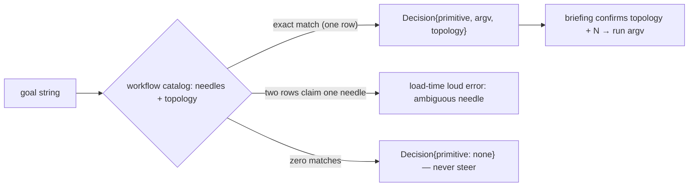

<!-- governed-by: ADR-0024, ADR-0026, ADR-0027, ADR-0028, ADR-0014, ADR-0003 -->
---
status: proposed
date: 2026-09-11
decision-makers: Captain (bangedorrunt)
consulted: Jido study 2026-09-11 (jido.run v3, github.com/agentjido/jido + jido_action 2.3.2); grilling interview 2026-09-11 (five decision rounds, transcript in flywheel session); stack audit 2026-09-11 (25 verified defects: 24 audited + 1 found at close, flywheel `docs/learnings/jido-port-grilling-2026-09-11.md`); review pass 2026-09-12 (adr-skill checklist + docs/skill impact scan)
informed: flywheel x toron x beads maintainers
---

# ADR-0032: Workflow-Engine Honesty Gate and Jido Action Contracts — Per-Step Turn Receipts, Closed-Enum Schema Tables, Catalog-Driven Decide

**Status:** Proposed (2026-09-11). Acceptance = captain word on this file.
**Extends:** [ADR-0024](0024-graph-first-repair-loops-bead-workflow.md) (finishes its unlanded Wave-1 seams: ActionRunner kind classification, ApprovalSink/SpawnSink drain, kind-46011/46012 publication), [ADR-0026](0026-failure-taxonomy-funded-preflight-fallback-chains-mail-health-escalation.md) (kind set is closed; this record adds NO kind and NO retry policy), [ADR-0028](0028-jido-behavior-first-on-wheelhouse-nouns.md) (extends Option A — behavior-first contracts on our nouns — from the flywheel control plane to the toron-workflow engine surface; re-affirms the §6 refuse list). Relation to flywheel ADRs (no links — other repo): flywheel ADR-0007 (catalog slots, agent-native CLI) owns the `decide_trigger` field this record's router compiles from; flywheel ADR-0008 (compose mental model) is unchanged — compose tokens and the compose grammar are untouched; flywheel ADR-0011 (session conductor) keeps the arrive→briefing contract, only briefing's *internal* topology source changes (it reads the router instead of a private map).
**Amends:** nothing. ADR-0028 E7 ("no Zoi/NimbleOptions port — Rust types on hand") governs the flywheel `Cmd`/`Msg` boundary and stands; the schema tables below govern the *workflow YAML/engine* boundary, a different surface parsing dynamic data.
**Does not amend:** one-way dep; kind registry (ADR-0014; zero new kinds — 46011/46012 already exist); MCP tool count; Tick Law (Branch stays engine-side; tick never branches); beads as the work graph; `thread_id` ≠ `corr`; FailureKind spelling `Auth|RateLimit|Timeout|Blocked|Provider|Cancelled|Unknown|Billing` (ADR-0026 Spec 0 cross-ref freeze).
**Does not wire:** Jido/OTP runtime (AgentServer, supervision trees, Pods), CloudEvents, Splode-as-dependency, Zoi/NimbleOptions ports, Flow/Topology DSLs, v3 Turn-as-shipped (this record adapts its commit-before-effects *idea*, not its code).
**Tracker:** beads, two waves. Wave 1: `bd-i6kc` (toron engine honesty gate), `bd-himk` (flywheel decide router) + `bd-40d1` (flywheel run-ledger truth) — parallel lanes. Wave 2: `bd-htoo` (toron contracts epic: schema tables + Turn receipts + lease compensation, blocked on bd-i6kc), `bd-3pti` (toron reduce action, blocked on bd-i6kc), docs-sync bead (filed on acceptance; §8). Bead id = mail `thread_id` / reservation `reason`.

> **Scope:** the engine stops lying (every silent no-op is wired or deleted, parked promises drain, failures carry the ADR-0024/0026 kind), then gains Jido's action contract — per-variant schema tables validated at parse/lint + invoke, per-step commit-receipt-before-dispatch keyed on `corr`, lease-shaped undo on `fail_run` — and flywheel's `decide` becomes a router over the workflow catalog instead of a keyword ladder. No new runtime, no new kinds, no new tools, no second retry policy.

## 1. Context and Problem Statement

How do we get Jido's real win — structured, honest, composable actions — into an engine that currently ships silent `Ok(Null)` arms, undrained parked promises, and a decision layer with two divergent copies, without forking the taxonomy ADR-0024/0026 already froze?

Verified at HEAD 2026-09-11 (full inventory with file:line in flywheel `docs/learnings/jido-port-grilling-2026-09-11.md`; the six load-bearing):

1. `toron-mcp/src/workflow_host.rs:193` — `mailbox_runner` catch-all `_ => Ok(Null)`: `react` and `call_webhook` succeed doing nothing; the CallWebhook docstring claims an SSRF guard that does not exist (`schema.rs:591`).
2. `toron-mcp/src/workflow_host.rs:556` — the production trigger loop drops `engine.run` outcomes to `debug!`, never reads approval/spawn/verify sinks, never publishes 46011/46012: every parked approval/spawn promise accumulates undrained in prod. ADR-0024 W1 names draining this sink and remains unlanded.
3. `toron-workflow/src/engine/control_flow.rs:207` — linear `Step.guard` is parsed by lint and never read by the engine.
4. `toron-workflow/src/schema.rs:651` — `Spawn.no_claim_timeout` serde-defaults to 0 = wait forever, contradicting the documented 600.
5. flywheel live failure 2026-09-11: the briefing classifier's own argv (`captain-audit --execute --mode headless`) died in 1.8s (`harness exited 1`, `failed_step: synthesize`), wrote zero artifacts, and `workflow history` recorded the run `done` under project `workflow`.
6. `flywheel/src/decide.rs` — a 25-row first-match-wins keyword ladder; `briefing.rs:97` keeps a second primitive→topology map that already diverges; `wave_shaped` over-fires on any `swarm` substring; unmatched goals silently become `steer` runs; `decide.rs:922` references a nonexistent `code-review` stage.

Jido ground truth (v2.3.2 shipped; v3 is a noindex preview page — nothing in this record builds on preview-only APIs): its value is the action contract (per-action input/output schemas, Splode error classes with centrally-derived `retryable?`, opt-in compensation with supervised undo, Exec defaults with per-call override) and catalog semantics (canonical merge, ambiguity errors). Its runtime is plain OTP — already superseded on this stack by `workspace::tick` (ADR-0027/0028 E1), herdr panes, Resonate durable functions, and the receipts store. Jido's own durability is *weaker* than toron's (at-most-once timers, opt-in persistence): a runtime port would be a regression, exactly as ADR-0028 Option B ruled.

## 2. Decision Drivers

1. **Honesty before contracts.** Schema tables and Turn receipts on top of `Ok(Null)` runners bake the lie into the contract. Jido's discipline is fail-loud-at-the-boundary; the engine must earn that before wearing it.
2. **One taxonomy, not two.** Runtime failure kinds stay ADR-0024/0026's frozen set with its retry-vs-reroute table. Jido's `invalid`/`config` classes are parse/lint-time concerns, not runtime kinds. No Splode dependency; no second retry policy (per-step Turn receipts are idempotency, not retry).
3. **Closed surfaces win.** The 14-variant Action enum is the catalog. An open registry turns every dispatch into a lookup with a miss path — "miss = quiet nothing" is the exact shipped bug class (defect 1). The compiler, not a registry, forces new actions through all six sites.
4. **Reuse the corr spine.** ADR-0028 E3 already fixed corr authority (sender mints, never empty) and receipt ownership (sqlite `owed→acked→resulted`, monotonic). Per-step Turn = effects gain the same spine. Zero new kinds (46011/46012 exist).
5. **Bounded everything, loud everything.** Silent degradations (`{{inputs.*}}` → `'0'`, foreach → `[]`, parallel → 1, guard-error → else) are consumed as truth by automation. Boundary validation deletes the beads-lifecycle `trigger_until` alias hack that exists only to route around one of them.
6. **Implementable by agents**: every wave slice names files, tests, and a single-line VERIFY so beads are dispatchable (non-empty single-line verify; P≤2 principles citation).

## 3. Considered Options

- **Option A (chosen): honesty gate, then contracts on our nouns.** Wave 1: wire-or-delete every silent arm; drain approval/spawn sinks + publish 46011/46012 from `toron-mcp`; honor-or-remove linear `Step.guard`; fix `no_claim_timeout` default; loud cyclic-graph error; `call_workflow` input-binding parity; CLI run wiring. Flywheel: catalog-driven decide router + ledger-status truth. Wave 2: per-variant schema tables; per-step commit-receipt-before-dispatch keyed on corr; lease-shaped compensation.
- **Option B (rejected): port Jido runtime (AgentServer/GenServer, supervision, Pods).** Re-affirms ADR-0028 §6: forks Tick Law, the assignment bus, and the work graph; BEAM topology hides heal behind supervisors; and Jido's persistence/timers are strictly weaker than Resonate + receipts here.
- **Option C (rejected): contracts first, honesty opportunistically.** Schema tables validated at an invoke boundary whose runners lie produce validated lies. Rejected on driver 1.
- **Option D (rejected): open action registry (Jido Catalog.register! shape).** Dynamic authoring surface: workflow validity becomes environment-dependent; every dispatch gains an unregistered-name miss path to design; Rust trait-object dispatch loses exhaustive-match compile checks — the check whose absence produced defect 1.

## 4. Decision Outcome

Chosen: **Option A**, two waves, two repos, parallelizable at wave 1.

### Consequences

- Good, because every action outcome becomes trustworthy evidence (`{ok, kind}`) — the substrate the router, Turn receipts, and compensation all read.
- Good, because routing duplication (decide vs briefing) becomes unrepresentable: one catalog row = one route, load-time ambiguity errors.
- Good, because schema tables delete the silent-degradation class and the beads-lifecycle `trigger_*` alias hack with it.
- Bad, because `react`/`call_webhook` removal (if chosen) is a YAML-surface break with a one-release deprecation window (Spec 1 migration).
- Bad, because `no_claim_timeout: 600` changes existing spawn-await runs that silently relied on the 0-default wait-forever.
- Bad, because unmatched goals now return an explicit `none` — operator muscle memory that expected the silent steer fallback sees a no-match decision instead.
- Neutral, because `verify` is receipted like any effect; verify re-runs are bounded by corr dedupe.

### Spec 1 — Engine honesty gate (Wave 1, toron; completes ADR-0024 W1)

- `mailbox_runner` (workflow_host.rs:86): delete the `_ => Ok(Null)` catch-all; each routed action applies or the arm returns `{ok:false, error:"unwired action <name>", kind:"provider"}`. `react` wires to the Mailbox react path or is removed from the enum with a bead; `call_webhook` either ships an SSRF-guarded client (reuse the guard spec the docstring promised: scheme+host allowlist, IPv4-mapped-IPv6 covered) or is deleted from the enum. No fictional docstrings (E1 discipline: every arm applies or is deleted).
- Trigger loop (workflow_host.rs:556): attach `ApprovalSink`/`SpawnSink`/`VerifySink`; on park publish kind-46011 pending (run_id, promise_id, message); subscribe resolutions → `resolve_approval`/`resolve_spawn`/`reject_spawn`; every terminal (fail_run, complete, timeout) publishes kind-46012 via `build_workflow_run_terminal`. Parked-undrained becomes impossible by construction.
- `control_flow.rs:207`: linear `Step.guard` evaluates (same bounded `evaluate_guard` as graph nodes) or the field is removed from `Step` and lint. Choose per-bead; silently-ignored is forbidden.
- `schema.rs:651`: `no_claim_timeout` serde default = 600 (matches `CronSpecPolicy::default_no_claim_timeout` and docs); 0 stays the explicit "no timeout" spelling.
- `control_flow.rs:931`: `run_graph` on an empty ready-set with unfinished nodes → hard error naming the stuck nodes (lint stays the first gate; the engine stops being the second liar).
- `control_flow.rs:767`: `run_call_workflow` child trigger wraps inputs through `bind_input_defaults` — `{{inputs.x}}` resolves identically in `invoke` and `call_workflow` paths (parity test).
- `toron-cli/src/workflow.rs:79`: `workflow run` either carries resolvers (approval resolve CLI exists: `receipt`/human decision path) or refuses approval/spawn-await workflows at lint with the named remedy (`workflow invoke` under a host that wires sinks). Parking forever with a noop runner is deleted.
- Kind classification: every runner error path returns `{ok:false, kind, ...}` per ADR-0024 Spec 1 (kinds frozen per ADR-0026; `rate_limit|timeout` retryable, `auth|billing` terminal-reroute, `blocked` escalate, no-match `unknown`). Graph fail_run's hardcoded `max_attempts=3` reads the enclosing Retry config. After all sites classify, the ADR-0024 "default-flip" bead may land — one line, as promised there.
- Silent degradations go loud: foreach non-list → step error `kind:invalid-input`; parallel non-numeric → same; (flywheel) `{{inputs.*}}` resolving to `'0'` in `run_branch` → error naming the undeclared ref — this deletes the beads-lifecycle `trigger_until`/`trigger_gate_before_implement` alias hack (#21 in the findings file).
- **Migration (enum removals):** if `react`/`call_webhook` are deleted rather than wired, lint emits a deprecation warning naming each for one release before parse-time removal; inventory existing users first (`grep -rl 'action: react\|action: call_webhook' .toron/workflows/`). **Migration (`no_claim_timeout`):** workflows relying on the accidental 0-default must spell `no_claim_timeout: 0`; lint warns for one release on spawn-await steps missing the field.



### Spec 2 — Catalog-driven decide router (Wave 1, flywheel)

- `decide_trigger` fields on `workflow list --json` rows become the one routing table. `decide()` compiles its matcher from the workflow catalog (exact substring needles, declared per workflow, lint-checked for duplicates/ambiguity — Jido Catalog semantics: two workflows claiming one needle = load-time loud error, not first-match-wins).
- `briefing.rs` stops owning a topology map; it reads decide's. The `babysit-bead` divergence class becomes unrepresentable.
- Needles + topology are **flywheel catalog-tier metadata** (the same tier that lints profiles/stages and serves `workflow list --json`), NOT fields on toron-workflow's `Workflow` struct — the engine stays routing-neutral and the one-way dep stays clean. `topology_for_primitive`'s `_ => "swarm"` bucket and `briefing.rs`'s private map are deleted; topology is whatever the catalog row declares, and a primitive with no row is a load-time error, not a silent swarm.
- Unmatched goal → explicit no-match decision (`{primitive:"none", reason:"no catalog needle matched"}`); the silent `steer` fallback is deleted. `wave_shaped` substring sniffing is deleted (a wave-shaped goal names the token or matches a needle).
- Fix while there: `decide.rs:922` `code-review` → `ce-review`; `stage_prompt()` resolves the project tier; headless leaf failure returns `Err` (or a typed failure the run records as failed); `workflow history` records the real terminal status + correct project; failed runs write artifacts.



### Spec 3 — Per-variant schema tables (Wave 2, toron)

- Each `Action` variant gains `input_schema()` (and where meaningful, `output_schema()`) returning a JSON-Schema literal, co-located in `schema.rs`. `parse_workflow` validates action fields against the table (parse-time loud); `lint.rs::check_action` reads the same tables (authoring-time loud); the invoke boundary validates rendered params (run-time loud). One source, three gates — the Jido action contract without Zoi/NimbleOptions and without an open registry.
- Template refs (`{{...}}`) validate as `string` slots; a ref that cannot resolve at render time errors naming the step + slot instead of rendering verbatim (the silent-degradation rule, finished).
- New-action checklist collapses to: enum variant + schema table + runner arm + dispatch arm + lint arm — compiler-checked at every site.

### Spec 4 — Per-step Turn receipts (Wave 2, toron)

- Effectful runner arms (send_message, send_dm, dispatch_job, spawn, verify, webhook-if-kept) execute as: **validate rendered action → mint/stamp `corr` → write receipt `owed` (corr PK) → dispatch carrying `corr` → outcomes transition the existing receipt** (`owed→acked→resulted`, monotonic, per ADR-0028 E3). Resume after crash reads the receipt: `owed` with a live dispatch = dedupe, never re-fire; no dispatch = re-fire once. The corr is the idempotency key; the receipts store is the journal; Resonate stays the durablility substrate. This is commit-before-effects (v3 Turn's idea) at the only boundary that can hold it — the step, not the run.
- No new kind, no new store, no second retry policy. A parked await (approval, spawn-claim) sits between turns; the run is a sequence of turns, each independently crash-safe.

### Spec 5 — Lease-shaped compensation (Wave 2, toron + flywheel)

- On `fail_run` of an effectful step, the embedding runs the fixed undo: `release_file_reservations_by_reason(agent, project, bead)` + kind-14 captain mail (run_id, corr, kind, evidence) + `br comments add` on the owning bead when known. Nothing else.
- No general `on_error` undo DSL, no per-action compensating steps: undo authored per workflow is undo that silently fails (Jido wraps compensation failure as `compensated:false` precisely because it cannot guarantee it). Lease cleanup is the one undo with an existing, operator-signed, idempotent primitive. Rejected-for-now is a recorded non-goal, revisitable by ADR.
- Layering: the engine never calls `br` and never runs the undo — `fail_run` returns the typed terminal and the **embedding** (flywheel) executes the fixed undo list as effects (Cmd-shaped, ADR-0027), preserving ADR-0024's engine/tracker separation.

```mermaid
sequenceDiagram
  participant E as engine step (turn)
  participant R as receipts sqlite (corr PK)
  participant B as bus (nostr effect)
  E->>E: validate rendered action
  E->>R: mint/stamp corr, write owed
  E->>B: dispatch effect carrying corr
  Note over E,B: crash here ⇒ resume reads owed: dispatch live = dedupe, never re-fire; no dispatch = re-fire once
  B-->>R: owed → acked → resulted (monotonic, ADR-0028 E3)
  E->>E: next turn (parked awaits sit between turns)
```

## 5. Explicit refuse list (with why) — this record

1. **Jido/OTP runtime port** — re-affirms ADR-0028 Option B; panes + tick + Resonate supersede it, and Jido's timers/persistence are weaker.
2. **Open action registry** — dynamic authoring surface, miss-path lies, loses exhaustive-match compile checks (§3 Option D).
3. **Whole-run Turn** — cannot buffer effects behind a 20-minute parked await; two-phase per-run semantics fight Resonate resume (§4 Spec 4).
4. **Splode (or any error-framework dependency)** — the kind set is frozen Rust (ADR-0026); `invalid`/`config` live at parse/lint; `to_map` transport is a serde derive away.
5. **General `on_error` undo DSL** — Spec 5's refusal; undo that can silently fail multiplies the lie surface this record exists to close.
6. **LLM decide** — nondeterministic routing at every session start; the catalog router is deterministic and lintable.
7. **New kinds / new MCP tools / new CLI nouns** — ADR-0014 + MCP freeze; 46011/46012 and receipts cover Spec 4 entirely.
8. **v3-only APIs** (Jido.Flow, Topology, serialized Turns) — preview, unpublished on Hex; nothing here builds on them.

## 6. Implementation Blueprint

- **Wave 1 target zones (toron):** `crates/toron-mcp/src/workflow_host.rs` (runner arms, sink wiring, 46011/46012 publication), `crates/toron-workflow/src/engine/control_flow.rs` (guard, cyclic, inputs parity, retry bound, loud degradations), `crates/toron-workflow/src/schema.rs` (no_claim_timeout default), `crates/toron-workflow/src/lint.rs` (stale delay advisory, foreach/parallel checks), `crates/toron-cli/src/workflow.rs` (refuse-or-wire noop parking). **Wave 1 target zones (flywheel):** `src/decide.rs`, `src/briefing.rs` (router, one truth, no-match loud, ce-review fix), `src/main.rs` (stage_prompt tier, leaf failure, history truth, artifacts), `src/workflow_catalog.rs` (absorb_pipeline CallWorkflow).
- **Wave 2 target zones (toron):** `crates/toron-workflow/src/schema.rs` (schema tables), `engine/template.rs` (ref-resolution loudness), `engine/control_flow.rs` + `crates/toron-mcp/src/workflow_host.rs` (Turn receipts in runner arms); flywheel: compensation plumbing in the embedding.
- **Forbidden zones (unchanged):** kind registry; MCP tool names/count; FailureKind spelling; `workspace.rs` tick law surfaces; gift-wrap/archive paths; any `unsafe`.
- **Patterns to follow:** E1 apply-or-delete; tag-parse-at-boundary hard errors (send_tags.rs:178); receipts monotonic transitions; lint-first engine-second honesty; single-source tables (schema.rs) fanned to three gates.
- **Patterns to avoid:** catch-all `_` arms over live actions; `Ok(Null)`-shaped success; environment-dependent workflow validity; defaults contradicting docs; alias hacks around silent degradation.
- **Sequencing:** Wave 1 slices are independent (toron lane, flywheel lane) — dispatch as parallel beads, `wave-1` labels; Wave 2 depends on Wave 1's kind-honest runners (receipt commit needs honest `{ok:false, kind}`), `wave-2` labels.
- **Dependencies:** none new. Schema tables are JSON-Schema literals co-located in `schema.rs`; no serde-schema/Zoi/splode crate. Rust edition 2024 unchanged. CLI surface unchanged (no catalog regen unless a wave grows it; `cargo test catalog_freshness` gates).

## 7. Verification

Wave 1 (toron):
- [ ] Test: `react`/`call_webhook` (or their wired replacements) return honest `{ok:true,...}`/`{ok:false,kind}` — no `Ok(Null)` path; source guard fails on a new catch-all arm over the Action enum.
- [ ] E2E: workflow with `request_approval` publishes 46011, resolves on approval event, publishes 46012 terminal — exercised through `toron-mcp`'s trigger loop, not engine tests only.
- [ ] Linear `Step.guard: false` skips the step; `guard` syntax error fails loud (or field removed + lint rejects).
- [ ] `spawn` without `no_claim_timeout` times out at 600 in a test; explicit 0 waits.
- [ ] Cyclic graph direct to `run`/`invoke` errors naming the cycle.
- [ ] `call_workflow` child resolves `{{inputs.x}}` (parity test with `invoke`).
- [ ] Every runner error carries `kind` ∈ frozen set; no-match = `unknown` with evidence.

Wave 1 (flywheel):
- [ ] `workflow history` shows `failed` + correct project for a failing run; artifacts exist for failed runs.
- [ ] `decide("review this diff")` routes via catalog needles; two workflows claiming one needle fail at load; unmatched goal returns explicit `none` (never steer); `babysit-bead` topology identical across decide and briefing (single table).
- [ ] Headless leaf failure marks the run failed (not `done`), `on_error: continue` records the typed failure.
- [ ] `flywheel decide "<garbage>" --json` returns `{"primitive":"none", "reason":"no catalog needle matched"}` (never steer), exit 0.

Wave 2:
- [ ] Schema-table violation fails at parse (YAML), lint (authoring), invoke (rendered) with step+slot named; unresolvable template ref errors instead of rendering verbatim; beads-lifecycle `trigger_*` alias guards deleted, early-exit still fires.
- [ ] Crash-injection test: dispatch fired + crash before outcome → resume dedupes on `corr` (one kind-9 post, one 43001) ; no dispatch → re-fires once.
- [ ] `fail_run` mid-wave releases reservations by bead reason, mails captain with corr+kind, comments the bead; undo absent when no bead owns the run (stated, not silent).
- [ ] `reduce` action (`bd-3pti`): all/any/count/sum/join unit-tested over parallel and foreach outputs; non-list `over`, unknown `op`, missing `key` path, `join` without `template` each fail `kind:invalid-input`.
- [ ] `cargo test --workspace` + `catalog_freshness` + `flag_conformance` green; no new kinds in ADR-0014 registry; MCP tool count unchanged.

## 8. Skill Sync and docs impact (land per wave; §8 items are acceptance gates)

| Surface | Change on acceptance |
| :--- | :--- |
| `~/.agents/skills/toron/SKILL.md` | Workflow + @mention action list (L146): `react`/`call_webhook` wired-or-removed, add `reduce`; sentence on failure kinds + loud degradations; 46011/46012 now actually published from the trigger loop (doc stops being ahead of code). |
| `~/.agents/skills/toron/references/workflow-engine.md` | MANDATORY authoring doc: action table updates; linear `Step.guard` semantics (evaluates or removed); `no_claim_timeout` default 600 + explicit-0 spelling; schema-table validation errors; loud non-list/unknown-op; approval section becomes true in prod; Jido-vocabulary glossary (Instruction=Step, Plan=graph, Exec=run path, Catalog=workflow list). |
| `~/.agents/skills/flywheel/SKILL.md` | §1 Classify-then-run: router semantics (catalog needles, explicit `none`, no `wave_shaped` sniffing, multi-lane note rewritten); "Table lives in `src/decide.rs`" → "table lives in the workflow catalog"; workflows are agent-native row gains `topology` attribute. |
| flywheel repo `AGENTS.md` | CATALOGS section + the briefing→run table reflect router output; workflow-list row description. |
| flywheel `docs/agent-instructions/workflow-composition.md`, `docs/workflow-authoring.md` | Routing-needs declaration, schema-table authoring errors, `reduce` examples, linear-guard semantics. |
| flywheel `references/QUICK-REFERENCE.md`, `references/GLOSSARY.md` | decide/router entries; Jido glossary terms. |
| flywheel `integrations/prompts/*.tpl` | Only `/open-mode` briefing wording likely; regen templates after any `.tpl` touch (standing rule). |
| flywheel `docs/agent-instructions/loop.md`, `orchestration.md` | **User-dirty at review time (uncommitted edits) — coordinate before touching; do not clobber.** |
| flywheel `docs/learnings/jido-port-grilling-2026-09-11.md` | Status pointers updated: ADR-0032 accepted. |
| toron `docs/decisions/README.md` | 0032 index row (added at rev 2, status updated on acceptance). |
| toron `docs/catalog/toron-mcp.json` | Regen ONLY if CLI surface grows — none planned; `catalog_freshness` gates. |

Docs batch lands AFTER the wave it documents (0028 §I pattern); the Jido vocabulary glossary is docs-only and may land immediately.

## Pros and Cons of the Options

### Option A — honesty gate then contracts (chosen)
- Good: each wave independently shippable behind existing gates; Wave 1 deletes the lie class that blocks all automation trust; Wave 2 reuses receipts/corr (zero new surface).
- Bad: Wave 1 is repair work before visible features; `call_webhook` may die (feature removal needs a deprecation note in skills).
- Neutral: schema tables add ~14 literals to maintain — mechanically checked, cheap.

### Option C — contracts first (rejected)
- Good: faster visible progress.
- Bad: validates lies; schema tables at an invoke boundary whose runners `Ok(Null)` produce validated no-ops.

### Option D — open registry (rejected)
- Good: third parties extend without recompiling.
- Bad: environment-dependent validity; loses the compile check whose absence shipped defect 1; overturns frozen-surface philosophy.

## More Information

- Full defect inventory (25 items, file:line, severity) + live captain-audit failure evidence + Jido concept map: flywheel `docs/learnings/jido-port-grilling-2026-09-11.md` (bead bd-zvp0, closed).
- Grilling decisions (2026-09-11, captain): contracts+commit-before-effects; per-step turns + corr keys; catalog-driven router; closed enum + schema tables; lease-shaped undo; two-wave parallel; ADR+beads deliverable.
- Revisit triggers: Jido v3 ships non-preview (re-evaluate Turn/Flow shapes only); a third-party action author appears (revisit Option D with a signing story); Resonate gains native idempotency keys (Spec 4 simplifies).

// governed-by: ADR-0032
