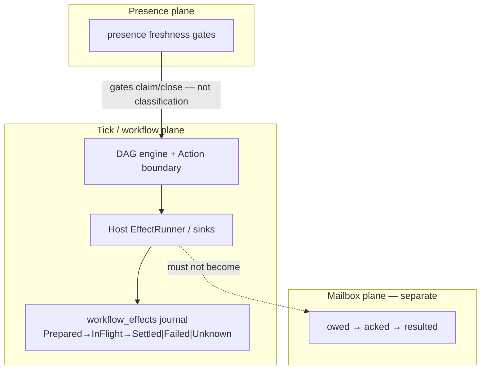
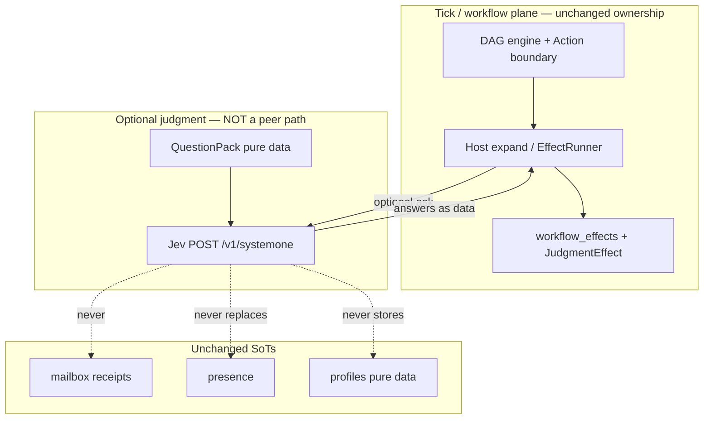

<!-- governed-by: ADR-0027, ADR-0028, ADR-0030, ADR-0032, flywheel ADR-0014 (Proposed), beads ADR-0001, GS-054, GS-055 -->
---
status: proposed
date: 2026-09-19
decision-makers: Captain (bangedorrunt) — Proposed only; HOLD merge until captain ship word
consulted: |
  GS-054 System One / Jev scout; TypeSafe how-to-build-with-system-one + jev-1.13 jaggedness;
  ADR-0032 workflow-engine honesty (Accepted); Firstmate lock GS-055 (toron ADR only —
  no chiebukuro PR); flywheel ADR-0014 Proposed; beads ADR-0006 Proposed
informed: flywheel × toron × beads maintainers; Shipwright (chiebukuro compile-vs-gate)
---

# ADR-0033: System One / Jev relative to workflow honesty, presence, and mail (Proposed)

| Field | Value |
|-------|-------|
| **Status** | **Proposed** — 2026-09-19. **HOLD merge** until captain ship word. **No W1/W2/W3 implementation** in this change set. |
| **Decision-makers** | Captain (bangedorrunt) |
| **Extends** | [ADR-0027](0027-one-workspace-tick-control-plane.md) (effects as data; Tick Law), [ADR-0028](0028-jido-behavior-first-on-wheelhouse-nouns.md) (refuse AgentServer/OTP), [ADR-0030](0030-presence-gated-chokepoints.md) (presence gates), [ADR-0032](0032-workflow-engine-honesty-jido-contracts.md) (effect journal; Spec 7), [flywheel ADR-0014](../../flywheel/docs/decisions/0014-jev-system-one-judgment-adapter.md) (Proposed — judgment adapter) |
| **Does not amend** | One-way `flywheel → toron-workflow → toron-core`; frozen MCP tool count; frozen kind registry; mailbox receipt semantics; presence as SoT; profiles as pure data; beads sole close |
| **Does not wire** | AgentServer / OTP / Pods / Flow topology; Redis cluster "for Jev"; new MCP `jev_*`; Jev inside pure tick; dual SoT |
| **Governs** (on acceptance) | How System One sits relative to honesty plane, presence, and mail: optional judgment in **host/effects** plane only — never a peer control path |
| **Tracker** | GS-055; companion flywheel ADR-0014 / beads ADR-0006; GS-054 W1–W3 HOLD |
| **Verification** | Captain word on this file; no code wedge in this PR |

**Decision in one sentence:** System One / Jev may supply optional calibrated judgments (Choice / Score / Noul) only through the **host / effects plane** that already journals workflow effects — never as a peer path beside Tick Law, never as presence, never as mailbox authority, never via AgentServer/OTP — while **profiles remain pure data** and ADR-0032 honesty (intent before dispatch, visible unknown, no invent-Settled) continues to bind.

---

## 1. Why this ADR exists

ADR-0032 locked workflow-engine honesty: effect journal ≠ mailbox receipts; intent before dispatch; unknown external outcome is explicit; Jido AgentServer/OTP refused.

GS-054 proposed inserting TypeSafe Jev as a **decision primitive**, not a runtime. Without an explicit toron placement rule, fashion imports risk:

- treating Jev as a second conductor beside `workspace::tick`,
- smuggling HTTP into pure workflow evaluation,
- inventing Redis/OTP "cache" for classifier calls,
- exposing `jev_*` MCP tools that bypass Tick Msg / effect journal,
- confusing judgment effects with mailbox `owed→acked→resulted`.

This ADR places System One **relative to** honesty, presence, and mail. Implementation remains HOLD (GS-054 W1–W3).

---

## 2. Tip baselines (GS-055)

| Repo | HEAD | Notes |
|------|------|-------|
| **toron** `main` | `a1359edcb8b4152fbffd8ccb235a1e4873c3a2b1` | ADR-0032 Accepted on tip |
| **flywheel** `main` | `8914910e45afb5c4c392db90dfd601d68348b42b` | ADR-0014 Proposed companion |
| **beads** `main` | `3fb001bbf07896d239078a22cce204d1da70b2c2` | ADR-0006 Proposed companion |

---

## 3. As-is vs to-be

### 3.1 As-is

Judgments today are either pure decide (flywheel) or LLM prose hope (agent). No calibrated optional leaf on the host expand path.

### 3.2 To-be (Proposed)

---

## 4. Decision details

### 4.1 Placement rule

| Layer | May call Jev? | Rule |
|-------|---------------|------|
| Pure `workspace::tick` / engine evaluate | **No** | Keep Elm purity; no HTTP |
| Host EffectRunner / flywheel doorbell expand / workflow_host | **Yes (optional)** | Same plane as other effects; journal required on honesty path |
| Mailbox transport / receipt store | **No** | Receipts stay message lifecycle |
| Presence freshness | **No as presence** | Optional Score "is wake material?" only at host boundary — presence SoT unchanged |
| MCP tool surface | **No new tools** | Adapter is library/effect fed by Tick Msg — MCP freeze stands |
| Profile resolution | **No as SoT** | Profiles remain pure data (ADR-0005 / flywheel ADR-0013) |

### 4.2 Honesty binding (ADR-0032 Spec 7)

1. **Intent before dispatch** — preparing a JudgmentEffect records pack id + state digest before POST when honesty requires.
2. **Visible unknown** — timeout / 429 / indeterminate → Unknown or escalate; never invent Settled.
3. **Journal ≠ mailbox** — judgment rows live in workflow/effect journal (or flywheel effect journal), linkable to corr when useful, never implied by `owed→acked→resulted`.
4. **Code composes** — thresholds, weights, Cmd construction stay in host code (TypeSafe AI-powered software architecture).

### 4.3 Presence and mail

- **Presence:** Jev is not a presence oracle. ADR-0030 gates remain deterministic freshness checks. A host-boundary Noul/Score for "is this wake material enough to classify?" is allowed later; it does not update presence SoT.
- **Mail:** Optional triage Noul pack on body text runs **at host** after envelope unwrap; results become Msg/effect data. Idempotency, guard, and receipts stay deterministic.

### 4.4 Profiles

Profiles and QuestionPacks are **pure data**. Do not store bindings, fallback chains, or profile catalogs in TypeSafe. Optional later: Score "does this profile fit the steer?" — code still selects binding via ADR-0013 rebind rules.

### 4.5 Explicit REJECT (toron-facing, folds GS-054 thesis 4)

1. **AgentServer / OTP / Pods / Jido Flow** "to host the classifier".
2. **Redis / cluster cache** invent-green for Jev.
3. **Peer path** — Jev as alternate conductor beside Tick.
4. **New MCP** `jev_*` without Tick feed.
5. **Mailbox receipts as judgment proof**.
6. **Presence replaced by model**.
7. **Profiles / ADR-0032 data moved into remote model state**.
8. **Funnel / dual SoT / casual kinds** (GS-053 HOLD).
9. **Auto beads close** from Noul (beads ADR-0006).

---

## 5. Relationship to Tick Law / effect journal / beads / profiles

| Concern | Contract |
|---------|----------|
| Tick Law | Unchanged; Jev is host leaf only |
| Effect journal | JudgmentEffect (or equivalent) under ADR-0032 lifecycle |
| beads | Sole close unchanged; advisory triage only |
| Profiles | Pure data; QuestionPacks rhyme with profile catalog discipline |
| flywheel ADR-0014 | Owns DecisionReady enricher shape; this ADR owns toron placement |

---

## 6. Open questions

1. Does JudgmentEffect live in `workflow_effects` tables vs flywheel-only journal for first wedge?
2. Should toron-mcp ever call Jev directly, or only via flywheel host inject?
3. Egress policy for mail body slices on AU Tailnet?
4. Pin `jev-1.13.0` for honesty-gated packs?

---

## 7. Consequences

### Positive

- Clear non-peer placement stops AgentServer fashion.
- Honesty plane stays single; judgments become auditable effects.
- Aligns with TypeSafe "code owns control flow".

### Negative

- Host code grows optional adapter surface.
- Key custody and spend policy still captain-open.

### Neutral

- No implementation in this PR; W1–W3 HOLD.

---

## 8. Acceptance

Captain marks **Accepted**. Until then: **Proposed**, **HOLD merge**, no AgentServer/OTP/Jev code, no new MCP.

---

## 9. Sources

- GS-054 / GS-055 reports under `/home/box/agent-data/grok-ship/reports/`
- https://docs.typesafe.ai/concepts/how-to-build-with-system-one.md
- https://docs.typesafe.ai/model-jaggedness/jev-1.13.md
- ADR-0032 tip text (Accepted)
