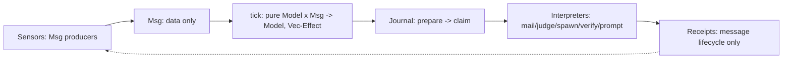
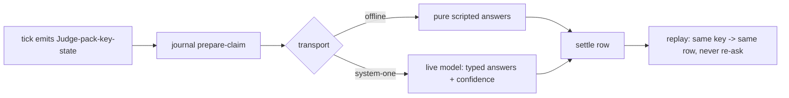
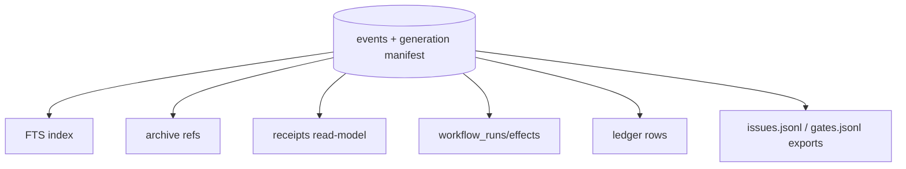

<!-- governed-by: ADR-0019, ADR-0027, ADR-0028, ADR-0031, ADR-0032, ADR-0003 -->
---
status: proposed
date: 2026-09-21
decision-makers: bangedorrunt
consulted: PatientElm Elm/effects study (bd-fp4u, .lavish/elm-effects-redesign.html); toron/flywheel/beads explore reports 2026-09-21; effect-oriented skill (rust.md, patterns.md); TypeSafe System-One docs (llms.txt 2026-09-21)
informed: flywheel x toron x beads maintainers
---

# ADR-0035: Elm Kernel Law and Judgment Plane Across toron, flywheel, and beads

**Status:** Proposed — awaiting operator word. Research bead bd-fp4u; implementation epic bd-vhmn.

**Decision in one sentence:** Every decision core in toron, flywheel, and beads becomes one Model, one Msg union, and one pure `tick(&Model, &Msg) -> (Model, Vec<Effect>)` with effects journaled before execution, and semantic judgment becomes a first-class journaled `Judge` effect served by versioned question packs (Jev/System-One pattern) instead of stringly prompts and substring classifiers.

**Extends:**

- [ADR-0019](0019-bead-verified-execution-and-principle-playbooks.md): the 21 principles become lint/type/preflight enforcement; playbook_lint gains the kernel-law rules.
- [ADR-0027](0027-one-workspace-tick-control-plane.md): one tick per plane; this ADR ports the pattern to every core, not just the workspace.
- [ADR-0028](0028-jido-behavior-first-on-wheelhouse-nouns.md): corr authority, receipt ownership, Cmd honesty; unchanged, referenced normatively.
- [ADR-0031](0031-herdr-runtime-study-elm-cores-superlogical-proof-seams.md): the Elm-core definition (one Model, one Msg, pure tick, clock-as-Msg, platform split, test constructors) becomes mandatory for all new/extracted cores.
- [ADR-0032](0032-workflow-engine-honesty-jido-contracts.md): boundary partition, closed enums, journal-before-execution, reconcile; unchanged, extended to all interpreters plus the new Judge effect.
- [ADR-0034](0034-effect-oriented-toron-companion.md): the Rust effect idioms (Result/?, trait-injected Clock/Store/Rng, tower stack, RAII, fakes) become the implementation mechanics.

**Amends:** nothing yet. If accepted, it narrows ADR-0024's generic retry (effect-safety qualification already in ADR-0032 stands) and promotes `ask_judgment` from additive tool to kernel effect (tool name/shape frozen per ADR-0033; only its architectural status changes).

**Does not amend:** the one-way dependency `flywheel → toron-workflow → toron-core`; the frozen kind registry (ADR-0014); the frozen MCP parity names/shapes; the frozen runtime `FailureKind` spellings; `thread_id ≠ corr`; beads as the work graph; `br gate report`/`br close` ownership; the worktree stance.

**Does not wire:** a new Nostr kind; a new MCP tool; a second runtime (no OTP/Jido port); a whole-run transaction; rollback of completed side effects; an LLM in the tick path (judgment is an interpreted effect, never inline inference).

**Tracker:** epic bd-vhmn. Per-wave child beads filed at acceptance (clock, runner, journal-holes, stringly-types, stores, watch, parsers, wake, env-globals, catalog, beads-ledger, journal-threads, remote-mail, unbounded-delay). Bead id remains mail `thread_id` and reservation `reason`.

---

## 1. Scope and fixed point

Goals:

1. **One kernel law everywhere:** each decision core (reservations, receipts, wake routing, loop phases, beads holds/close, cron catchup, dispatch) is Model/Msg/Effect/tick with import-fence, determinism, and model-paths tests. Copy `toron-core/src/dispatch_core.rs`.
2. **One effect path:** every effectful leaf passes the exhaustive `partition()`; async `EffectRunner` only; `Enforced` journal mode on all live arms. Copy `toron-workflow/src/engine/boundary.rs`.
3. **Judgment as data:** semantic calls (route triage, wake priority, dispatchability, verify adjudication, guardrails) go through versioned question packs via the existing `ask_judgment` door, journaled and replayed by `effect_key`. Code owns workflow; the model supplies common sense.
4. **One storage truth:** a single event log with a generation manifest; index, archive refs, receipts, workflow effects, ledger rows, and JSONL exports are all projections. Flush appends events, never rewrites a snapshot.
5. **One wake decision:** a single `Wake` table plus a pure `GateDecision` (Inject/Digest/Queue/Drop) with one `why` projection, replacing four caches and seven gates.
6. **Branded types at boundaries:** `Corr`, `ThreadId`, `EffectKey`, `RunId`, `NodePath`, `JobId`, `ChannelId`, `Pin` newtypes; enums over strings; parse at the boundary, trust internal types.

The fixed point is **replayable decisions with journaled effects and calibrated judgment, under at-least-once externals with explicit reconciliation**. It is not exactly-once execution, not rollback, not "a green tick means business completion."

### 1.1 Non-goals

- No big-bang rewrite: each wave ships independently; wave 1 alone pays off.
- No new kinds/tools: packs are data rows, not protocol; additives still need ADR-0033.
- No LLM inside `tick`: any semantic need becomes a `Judge` effect interpreted outside the reducer.
- No silent-success stubs, compat shims, nested `block_on`, or second buses introduced during migration.
- No prover-grade verification: BFS/DFS model-paths plus the six-scenario interpreter matrix, not model checking.

---

## 2. Context (evidence, with file pointers)

The 2026-09-21 study (bd-fp4u) read all three repos. Findings that force this decision:

| # | Finding | Evidence |
|---|---------|----------|
| 1 | Clock read inside reducers breaks replay | `toron-core/src/mailbox/receipts.rs:280,293,329` (`Utc::now` in transitions); `mailbox/envelope.rs:199`; `mailbox/messaging.rs:346,551,3855`; `index/workflow_effects.rs:42-47`; `toron-cli/src/catalog.rs:48-66` |
| 2 | Sync `ActionRunner: Fn()->Result<Value>` forces a thread-hop bridge | `toron-mcp/src/workflow_host.rs:58-72` (`block_on_async`) + 12 call sites; `toron-cli/src/workflow.rs:80,115` |
| 3 | `Recording` mode performs then tags `bypassed`; `Delay` returns `Null` past the output contract; compat leaf has no journal | `toron-workflow/src/engine/control_flow.rs:549-571,658-663` |
| 4 | Stringly second vocabularies beside real enums | `control_flow.rs:388-397` (`disposition_for_kind -> String`); kind parsed from `serde_json::Value`; all ids `String`; `mailbox/ids.rs:46-58` skips validation |
| 5 | Seven stores, no declared source | InProcessBus, RelayBus, EventStore, SQLite index, GitArchive, receipts sqlite, workflow_effects sqlite, ChannelStore `Mutex`, DispatchPool mirror, CronRegistry closures; daemon-vs-embedded split `toron-cli/src/mailbox_source.rs:47,204,216` |
| 6 | `watch` is a 1s snapshot beside `subscribe_trusted` | `toron-cli/src/plane.rs:1298-1400` vs `cli/main.rs:7669` |
| 7 | Permissive parsers hide bugs | `mailbox/unwrap.rs:52-59` (unknown policy → `Auto`); substring error classifier `engine/boundary.rs:561-597`; silent `None` in `nonneg_secs` |
| 8 | Four wake caches + per-poll amnesia, no single `why` | flywheel `workspace.rs` (`pending_wait`/`rering`/`presented`/`digest_queue`) vs `doorbell-core` queues/budgets; `durable.rs:2856` flood_seen reset |
| 9 | Env and globals inside pure modules | `mailbox/reservations.rs:82` static; `toron-workflow/src/engine/mod.rs:67` `OnceLock` + `RESONATE_URL` + TCP probe; `mcp/tools/mod.rs:644` counter; `workspace.rs:321,538` env reads |
| 10 | Catalog count drift + hand-mirrored shapes | 40 vs 41 vs 38+25 comments; `ToJson` mirrors non-`Serialize` core structs |
| 11 | beads sqlite vs full-snapshot JSONL races; `q`/draft debt | parallel closes dropped by full-snapshot export; `src/sync/`, `src/cli/commands/q.rs`, `Status::Custom` |
| 12 | Per-leaf thread+runtime journal blocking | flywheel `src/effect_journal.rs:47` `block_on_journal` |
| 13 | Remote mail leaves are runnable but unjournaled; T-ladder climbs forever on remote | `effect_journal.rs:487` `mail_plane() -> None` on `[mail.toron] url` |
| 14 | Unbounded `delay` (old 270s cap removed) | engine durable `ctx.sleep` with no bound |

Already-pure cores to clone, not redesign: `dispatch_core.rs` (Model/Msg/tick + fence + determinism + paths tests); `engine/boundary.rs` (exhaustive partition, exactly-once invoke, stable effect keys); `engine/control_flow.rs` (one RetryCoordinator, one guard evaluator, VerifySink-first); `mailbox/receipts.rs` (monotonic machine, non-empty corr); `mailbox/judgment.rs` + `mcp/src/tools/judgment.rs` (`ask_judgment`: effect_key + pack_id + state in, typed answers + journaled JudgmentEffect out, idempotent replay, offline vs system-one); flywheel `workspace.rs` + `doorbell-core` (tick, clock-as-payload, Idle-only prompt, honest `unknown`); beads `verify.rs`/`hold.rs`/`coordination.rs`.

---

## 3. Decision drivers

- **Replayability:** a decision log must reproduce byte-identical effects (dispatch_core's determinism test is the bar).
- **No double-perform:** durable replay must never re-fire an external call (stable effect keys excluding attempt; journal-before-execution).
- **Loud failure:** unknown parsers, unresolvable bins, uncovered sinks, and ambiguous errors fail closed with a reason, never a default.
- **One truth per fact:** receipts ≠ effects (ADR-0032 §31 stands and is enforced by type, not prose).
- **Calibrated judgment:** semantic routing needs probabilities + confidence with code-owned thresholds, not prompt strings (TypeSafe Choice/Score/Noul pattern).
- **Shippable waves:** each wave ends in a runnable check; no flag-day cutover except the storage reader switch (dual-write + rebuild-verify first).

---

## 4. Considered options

- **Option A — incremental waves per core (chosen).** Extract pure cores, enforce the journal, add packs, unify storage, unify wake, delete legacy. Each wave independently verifiable.
- **Option B — big-bang rewrite of the three repos around a new kernel.** Rejected: unbounded blast radius, no shippable midpoint, violates `outcome-oriented-execution` and the live fleet's need for continuity.
- **Option C — prose-only: document the law, enforce in review.** Rejected: the incident record (silent bypasses, dropped closes, deaf-but-healthy daemon) shows prose rules fail; only tool-enforced gates held.

### Pros and cons

**Option A**

- Good, because each wave has a VERIFY fence and can land without the others.
- Good, because it clones proven in-repo patterns instead of importing a framework.
- Bad, because transitional duality (old + new paths) persists for several waves and needs tripwire tests.
- Neutral, because per-leaf journal writes add sqlite load until the single-executor lands (measure in wave 2).

**Option B**

- Good, because a clean slate has no duality period.
- Bad, because it strands the live fleet, invalidates the frozen registries' test coverage, and cannot be verified incrementally.

**Option C**

- Good, because it is cheap to write.
- Bad, because unenforced laws already failed (see §2 findings 3, 7, 11).

---

## 5. Decision outcome

Chosen option: **Option A**, because the drivers demand enforcement (rejects C) and continuity (rejects B).

### Consequences

- Good, because every core gains replay tests; flake triage becomes log-diffing.
- Good, because judgment calls become versioned data with confidence telemetry instead of prompt archaeology.
- Good, because storage races (dropped parallel closes) disappear by construction.
- Bad, because waves 1–2 touch hot paths (receipts, runner) and need careful dual-write/review.
- Bad, because live judgment costs tokens; mitigated by offline-default packs and confidence-gated escalation.
- Neutral, because line count grows first (newtypes, cores, packs) then shrinks at wave 6 (legacy deletion).

---

## 6. Spec 1 — the kernel law (mandatory)

Every decision core ships:

```rust
// governed-by: ADR-0035
pub struct Model { /* plain data, no handles, no locks */ }
pub enum Msg { /* data only; clock/nonce/rows arrive as fields */ }
pub enum Effect { /* closed; every variant has an interpreter */ }
pub fn tick(model: &Model, msg: &Msg) -> (Model, Vec<Effect>);
```

Rules:

1. No I/O across the tick boundary: no clock, rng, env, fs, net, spawn, or sleep in the core file.
2. Named pure predicates only (`can_admit = AgentFree AND GlobalCapacity`); no inline boolean soup.
3. Actions carry data, never closures; resolvers (`ProfileResolver`, sinks) are injected at the host, defaulting to fail-closed `{ok:false}`.
4. `machine_config()` JSON accompanies each core for the visualizer (follow dispatch_core).
5. Tests per core: import-fence (ban `tokio`, `nostr`, `sqlx`, `std::env`, `std::time::SystemTime` in the core file), determinism (same Msg log → byte-identical Effects), BFS/DFS model-paths with stated invariants.
6. Platform code lives in `platform/<os>.rs`; no `#[cfg(target_os)]` in cores.
7. New cores: `reservations_core`, `receipts_core`, `wake_core` (with `GateDecision`), `loop_core`, beads `hold_core`/`close_core`, `cron_core`. Hosts (`reservations.rs`, `brain.rs`, `durable.rs`, beads `sync/`) become interpreters.



---

## 7. Spec 2 — effects and resilience

1. `Effect` enums are closed and exhaustive; adding a variant without an interpreter is a compile error. `partition()`-style functions are `const fn` where possible.
2. Delete the sync `ActionRunner` and its `block_on` bridge; async `EffectRunner` only. `Delay` returns a typed `Unit`, never `Null`. Compat paths route through the same partition.
3. `EffectJournalMode::Enforced` on every live arm; `Recording` only on dry arms (`run` without `--execute`, `cron run` without `--live`). An effectful leaf with no injected runner refuses; an uncovered sink reports its own typed failure.
4. Resilience wraps interpreters outside-in (effect-oriented patterns reference):
   `Timeout(inner, per-attempt)` → `Retry(cap + backoff + jitter, idempotent-only)` → `RateLimit/Bulkhead` → `CircuitBreaker` → `Fallback(outer)`.
5. No unbounded waits: every remote call carries a timeout, every retry loop a cap, every queue a bound, every `delay` a max (reintroduce an explicit cap with a named constant).
6. Six-scenario matrix per remote interpreter with deterministic fakes: success, classified failure (retry), unclassified failure (escalate), hang (timeout), storm (breaker), slow tail (hedge). Millisecond runtimes; no real sleeps or network in unit tests.
7. Flywheel's per-leaf thread+runtime journal (`effect_journal.rs:47`) becomes a single journal executor channel; measure under wave-swarm fanout before/after.
8. Remote-mail rule: either carry `corr == effect_key` over the daemon wire or fail-closed remote workflow sends — never runnable-but-unjournaled. Until then the T-ladder treats unreadable reads as never-ack and says so loudly.

---

## 8. Spec 3 — the judgment plane (Jev/System-One pattern)

`ask_judgment` (frozen name/shape per ADR-0033; status promoted by this ADR) is the only judgment door:

```rust
ask_judgment(effect_key, pack_id, pack_version, state, transport /* offline | system-one */, timeout)
  -> { answers, confidence, usage, fallback_flag, escalated, record }
```

1. **Packs are data, versioned.** `Pack { id, version, questions: [Choice|Score|Noul], state_schema }`. Flywheel resolves `pack_id`; unknown pack is a typed error, never a guess. Journal rows gain `pack_version` + `state_hash`. Replay on `effect_key` returns the stored row, never re-asks.
2. **State is named JSON**: source text, identities, relationships, policies, current facts. Question IDs are for code; full meaning stays inline in the question. One narrow judgment per question; split independently useful dimensions.
3. **Fan-out in one call**: independent + speculative questions batch together; code consumes applicable answers. A second call only when an earlier answer selects new evidence or options.
4. **Confidence discipline**: Choice/Score confidence is distribution concentration, not permission to act. Noul near 0.5 routes to human review. Thresholds are tuned on project data with consequences in mind; changing a weight or display filter never re-runs inference.
5. **First five packs**: `route-triage.choice` (primitive + per-risk Nouls; replaces substring triggers), `wake-priority.score` (urgency + actionability + interrupt Noul → composite Inject/Digest/Queue), `dispatchable.noul` (beads VERIFY/PRINCIPLES sufficiency, feeds triage ranking), `verify-citation.choice` (evidence supports claim; low confidence → human), `hazard-guardrail.noul+score` (screens every LLM-bound prompt; pass/review/block in code).
6. **Offline transport is hermetic and seeded**: scripted answers per pack for unit tests (fail-twice-then-succeed, hang, storm). System-one transport reaches the live model API with usage journaled.
7. Labeled outcomes become classical ML features later (composite-scoring pattern); judgment never owns control flow — tick emits `Judge`, the interpreter answers, the next Msg continues.



---

## 9. Spec 4 — storage: one log, many projections

```sql
CREATE TABLE events(
  generation INTEGER NOT NULL,
  event_id   TEXT PRIMARY KEY,
  kind       TEXT NOT NULL,
  payload    BLOB NOT NULL,
  ts_us      INTEGER NOT NULL);
```

1. `events` + a generation manifest is the source of truth in toron and in beads (separate tables, same pattern).
2. Projections rebuilt from `events`: FTS index, archive refs, receipts read-model, `workflow_runs/effects`, ledger rows, `issues.jsonl`/`gates.jsonl` exports. Rebuild is a tested command (`doctor reconstruct` pattern).
3. Flush appends events and advances the manifest; exports are commutative by construction. The full-snapshot rewrite (and its dropped-parallel-close race) is deleted.
4. beads `q` writes `status:draft` explicitly; `ready` excludes `draft` by construction; `doctor` expires stale drafts instead of carrying them.
5. Daemon-vs-embedded becomes one selector (daemon URL → durable XDG root), failing loud; the guard reads the same store the daemon writes.
6. Migration: dual-write events alongside current tables for one wave, rebuild-verify, then switch readers. Git archive remains a rebuild source throughout.



---

## 10. Spec 5 — wake unity

1. One `Wake` table: `queued → presented → acked | digested | expired`, with `flood_seen`/`sla_seen` persisted (no per-poll reset).
2. One pure function `wake_core::decide(model, msg) -> (model, Vec<Effect>, GateDecision)` where `GateDecision = Inject{pin,line} | Digest{pin,reason} | Queue{wake} | Drop{reason}`. It absorbs `prompt_allowed`, `inject_gate`, budgets, `has_route`, AckSla, and T-tiers.
3. One `why` projection over the decision + evidence. Seven gates, one explanation.
4. Daemon boot-gates on resolved `toron`/`herdr` binaries: `cli_unresolved` refuses hosting instead of degrading to standby-healthy. Resolved pair cached and reported in `/health`.
5. `watch` becomes a `Msg` (`FetchInbox`/`InboxRows`); the 1s snapshot child is deleted.

---

## 11. Spec 6 — types and parsers

1. Newtypes with boundary parsing: `Corr` (non-empty), `ThreadId`, `EffectKey`, `RunId`, `NodePath`, `JobId`, `ChannelId`, `Pin`, `MessageId` (close the `From<String>` hole; `FromStr` validation only).
2. `Disposition`/`FailureKind`/`ActionErrorCode` returned as enums; projected to strings at the edge. Delete `disposition_for_kind -> String` and kind-from-`Value` parsing.
3. Unknown inputs fail loud: `ContactPolicy::parse` unknown → typed error (never `Auto`); error classifier keeps its deliberate `unknown`-substring avoidance but gains typed provider codes at the boundary; `nonneg_secs` rejects negatives loudly.
4. Tag rules enforced by type: `t` = project slug only; jobs carry no `t`; presence never persisted; `thread_id` never accepted as `corr`.

---

## 12. Implementation plan (crew lanes)

**Affected paths.** toron: `crates/toron-core/src/{dispatch_core.rs,mailbox/{reservations,receipts,envelope,messaging,judgment,send_tags,ids,unwrap},index/{workflow_effects,writer,schema},nostr/}`, `crates/toron-workflow/src/engine/{boundary,control_flow,template,sinks}`, `crates/toron-mcp/src/{tools,workflow_host,server,catalog}`, `crates/toron-cli/src/{plane,workflow,mailbox_source,catalog,robot}`. flywheel: `src/{workspace,durable,effect_journal,decide,briefing,crew,models,state,agent_ref}`, `crates/doorbell-{core,rt,cli}/`. beads: `src/{verify,hold,coordination,sync,storage,model}`, `src/cli/commands/{q,lint,sync,create,close,gate}.rs`.

**Patterns to follow.** dispatch_core kernel shape + fence/determinism/paths tests; boundary partition + stable effect keys; receipts monotonic transitions; VerifySink-first; `tick` + `RunJournal Started→Running→terminal`; generation-manifest flush.

**Patterns to avoid.** I/O in cores; sync runners; `Recording` on live arms; stringly enums; snapshot exports; permissive defaults; env reads outside host constructors; second stores.

**Migration steps.** Waves 0–6 (each ends in its fence): 0 freeze + fences (`catalog_freshness` fixed per ADR-0033, import-fences added); 1 pure cores (receipts first, reservations second); 2 journal enforcement + async runner + tower stack + delay cap; 3 judge packs (registry, 5 packs, offline seeds, call-site rewiring); 4 storage truth (dual-write, rebuild-verify, reader switch, single mailbox selector); 5 wake unity (table, GateDecision, why, boot-gate, watch-as-Msg); 6 legacy deletion (react/call_webhook, legacy emit, snapshot watch, permissive parsers, sync runner remnants).

**Crew lanes for this dispatch.** Lane A (waves 0–1: fences + receipts_core + newtypes); Lane B (wave 2: runner deletion + Enforced + tower + delay cap + single journal executor); Lane C (wave 3: pack registry + offline seeds + route-triage and wake-priority wiring). Waves 4–6 as follow-up beads.

### Verification

- [ ] `mbx test catalog_freshness` green with additives listed explicitly (wave 0)
- [ ] `mbx test -p toron-core pure_cores` — fence + determinism + paths for every extracted core (wave 1)
- [ ] `mbx test -p toron-workflow engine_honesty` — no `bypassed` rows on live arms; `Delay` returns typed `Unit` (wave 2)
- [ ] `mbx test -p toron-core judgment_replay` — same `effect_key` twice performs once; offline seeds deterministic (wave 3)
- [ ] Parallel-close test: two lanes close concurrently, both survive export + import (wave 4)
- [ ] `bash scripts/e2e-doorbell-webhook.sh` + unresolved-bins-refuse-hosting test (wave 5)
- [ ] `mbx test --workspace --all-features` honest full matrix, zero `Recording` markers on live paths (wave 6)
- [ ] No `Utc::now`/`SystemTime::now`/`std::env::var` in any `*_core.rs` file (grep fence, all waves)
- [ ] No `block_on`, no sync `ActionRunner`, no snapshot `watch` child remaining (grep fence, wave 6)

---

## 13. Risks

- Journal-everything latency under fanout: mitigated by the single executor + before/after measurement.
- Judgment cost/quality: mitigated by offline-default packs, tuned thresholds, human escalation at Noul≈0.5.
- Storage cutover skew: mitigated by dual-write + rebuild-verify before the reader switch.
- Scope across three repos: mitigated by per-core shippable waves and tripwire tests during duality.

---

## 14. More information

- Parent study: bd-fp4u + `.lavish/elm-effects-redesign.html` (Lavish review session; comparison tables, code shapes, per-aspect current→target).
- Revisit triggers: measured journal latency regression >20% at wave-2; judgment misroute rate above tuned baseline; any new kind/tool proposal (routes via ADR-0033, not this record).
- Status changes append here with date stamps; supersession links both ways.
