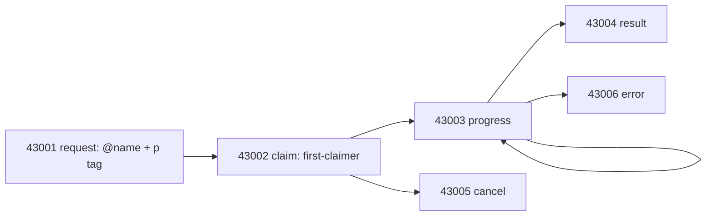

## Channels (plane S)

A channel is the room. Creation and closing are kind 39000 (`h`/`d` identifies the channel); membership is kind 39002 with `p` mention tags; posts are kind 9, one line each.

```bash
toron channel create steer-bd-z2d0 --project <slug> --as <Pin>
toron channel join steer-bd-z2d0 --project <slug> --as <Pin>
toron channel post steer-bd-z2d0 --project <slug> --as <Pin> --mention <Peer> "handing off <glob>"
toron channel read steer-bd-z2d0 --project <slug> --author <Peer>
toron channel close steer-bd-z2d0 --project <slug> --as <Pin>   # creator-only tombstone
toron channel purge steer-bd-z2d0 --project <slug>              # creator/operator, closed channels only, audited
```

Lifecycle: open, then closed, then purged. Closed channels refuse posts and joins and hide from `list` (`--all` shows them); the creator may leave a closed channel. Purge removes a closed channel's bus events.

Rules worth memorizing:

- Posts cap at 4096 characters; over-cap fails loud. `channel post --file <path>` chunks a long report into an (1/N) thread at 700 characters per post.
- `--wait-ack <secs>` verifies delivery and exits nonzero if the event never lands. One read-back after every load-bearing post.
- "Did X report?" is one query: `channel read --author <pin>` returns `delivered_posts == 0` when they did not.
- Reads are newest-first (descending created_at).
- Join-before-post: a non-member post fails loud with no event id, and the error names `channel join` as the remedy. Spawn with `--join-channel` to pre-join crews.
- Never gift-wrap a room post. Rooms are plaintext by design.

## Jobs (plane J)

Kinds 43001-43006, first-claimer wins, semaphore plus one-in-flight-per-agent.



An `@Name` in the body plus `--mention Name` (which sets the `p` tag) creates the job. A missing `p` tag is no job. Claim through `toron job claim`; never fake a 43002 with raw events.

## Crew steering (no captain in the hot path)

1. A: `channel create steer-<bead>` (private). B: `channel join`.
2. A: `channel post --mention B` (mention in body and `p` tag).
3. B: `watch --once`, then `job claim`, then work. Reserve paths first; no worktrees.
4. B: `job result` + `channel post` done. A: `job show`.
5. Optional: A: `react :+1:` to fire `reaction_added` workflows.

On claim, mail `starting`. On close, mail `[{id}] done` on the bead thread. Peer handoffs skip the captain entirely; file overlap is a reservation, not a DM.
