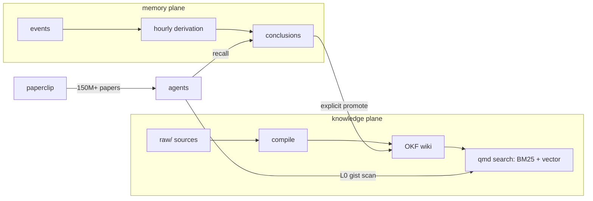

chiebukuro is the stack's brain. Two planes, kept authority-distinct:

- **Knowledge plane**: durable facts as a compiled wiki. OKF pages, BM25 + vector search, concepts extracted at compile time. Changed deliberately: ingest, compile, review, promote.
- **Memory plane**: episodic conversational memory. Peers, sessions, conclusions in SQLite, derived hourly, consolidated nightly by the Dreamer. Written constantly, promoted rarely.

A memory conclusion is not a wiki page. Promotion is explicit and reviewable (ADR-0033). Query both planes for full coverage; `chie qmd search --memory` spans both in one call and labels the source.

Binary: `chie`. MCP: 23 tools (16 knowledge + 7 memory) + 2 resources, over stdio (`chie mcp stdio`) or Streamable HTTP (`127.0.0.1:18081`; toron owns 18080).

## The four mandates

1. **Hierarchical retrieval (L0/L1)**: gist scan first, full fetch before answering. Never answer from a gist.
2. **Two planes, authority-distinct**: query both; never auto-promote.
3. **Chiebukuro-first**: research-flavored queries start at `chie qmd search --agent`; the web is the fallback, gated by a shell hook with the `bypass_chiebukuro` token.
4. **Academic routing**: arXiv/OpenAlex questions go to `paperclip`, always.

## Pages

| Page | Read when |
|---|---|
| [quick-start](./quick-start) | First index, first search |
| [knowledge-plane](./knowledge-plane) | Ingest, compile, retrieval protocol, promotion |
| [memory-plane](./memory-plane) | Events, derivation, Dreamer, recall |
| [health](./health) | Enforcement hooks, diagnostics, ops crib |
| [cli-reference](./cli-reference) | The command surface |
