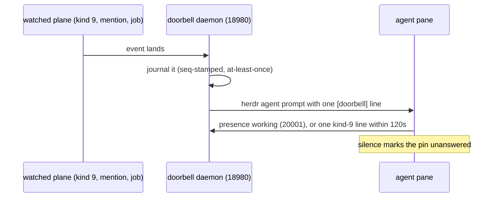

Nothing pushes into an agent's head; agents are woken. Wake is plane D, owned by a dedicated daemon, not by spawn: `doorbell-core` is a pure tick reducer, `doorbell-rt` wires brain, sensors, and sinks, and the `doorbell` daemon listens on a UDS plus `127.0.0.1:18980`. Spawn records a subscription row and defers to a healthy daemon; with no daemon, an embedded degraded mode runs locally. `flywheel kill` never touches the daemon.

## Honesty rules

- Wake stamps (`last_wake`) come only from real observations: herdr status or delivered prompt pins. Planned injects never forge them.
- One live workspace model per workspace; sends are doorbell-with-inbox; waiters park on `WaitCorr` until a receipt drains them (on ndjson and sweep).
- Budgets 5/30/3 are dispatcher-enforced.
- After `[doorbell]`, publish presence `working` or post one kind-9 line within 120 seconds, or the pin is `unanswered`.
- Journals (v2, rotated, seq-stamped) and subscriptions persist, so pending wakes survive crashes at-least-once.
- `flywheel doorbell why <project> <pin> --seq <n> --corr <id>` folds the tick from default and explains a named wake.

## Commands

| Need | Command |
|---|---|
| Lifecycle | `flywheel doorbell status\|start\|stop\|re-inject\|afk` |
| Why | `doorbell why <project> <pin> --seq <n> --corr <id>` |
| History | `doorbell events`, `doorbell digest` |
| Direct ring | `doorbell inject <project> <pin> "<line>"` (ratcheted, budgeted, digest-visible) |
| Subscriptions | `doorbell subscribe\|subscriptions\|unsubscribe` |
| Cross-workspace | `doorbell subscribe --workspace wA --pin P --extra wB` (scope printed, never implicit) |
| Always-on | `flywheel daemon start` (flywheel + doorbell daemons in one command); `doorbell install` persists across reboots (launchd/systemd, idempotent) |

Cross-project wake is a captain hold: `br hold --kind captain --corr external:<proj>:<bead> <your-bead>` rings once when the foreign bead closes; you still resolve the hold.

A foreign owner on port 18980 fails `doorbell start` loud ("answered by foreign owner, not child <pid>"). That is a port conflict, not corruption: stop the foreign holder or relocate the daemon.
