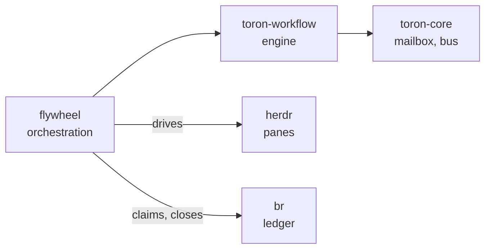

flywheel turns a directory of terminal agents into a supervised fleet. It owns the session door, classifies each goal into exactly one dispatch primitive, drives herdr panes, and runs durable loops that crash-resume with the same invocation.

Dependency direction is one way: flywheel depends on toron-workflow, toron-workflow on toron-core. Work is tracked in br; flywheel never forks its own tracker. Coordination rides toron; panes ride herdr.



## Concepts

| Noun | What it is | What it is not |
|---|---|---|
| **stage** | One named prompt. `send --stage ce-execute`. Catalog: `stage list`. | Not a runner. |
| **workflow** | An engine procedure: YAML steps or graph. A step may dispatch a stage to a role. | Not a topology. |
| **compose token** | A bare `--parts` name (`wave-swarm`, `repair-until-verified`, `beads-lifecycle`) that expands a compiled pipeline inline, in one engine run, one artifact trail. | Not every builtin; ordinary builtins run via `workflow run <name> --execute`. |
| **profile** | Role bound to harness + model + skills + preamble. `crew: auto` infers unique roles and packs to N (cap `crew.max`, default 5). | Not a compose token. |
| **topology** | How work is supervised: open, loop, swarm, coalition. Chosen by the briefing classifier. | Not chosen by you (P2). |

## When to use what

```
spawn a crew            spawn <p> --profile <role> --count N
planned feature         decide, then steer or loop-mode --work
ad-hoc                  spawn + send (or steer --direct)
two crews share files   coalition form
recurring               cron lint + cron start
peer's answer           collab
adversarial review      debate
plan approval           plan-review
stop everything         kill <p> --force
```

## State

Everything durable lands under `~/.local/state/flywheel/`: loops, runs, journals, doorbell subscriptions, facts, coalitions. Resonate (`http://localhost:8001`) backs durable execution. Delete state and the fleet forgets; the ledger in br is the only work history.

## Pages

| Page | Read when |
|---|---|
| [quick-start](./quick-start) | First fleet on this host |
| [session-door](./session-door) | Starting any session; choosing a vehicle |
| [spawn-and-send](./spawn-and-send) | Identities, profiles, model routing, dispatch semantics |
| [doorbell](./doorbell) | How agents get woken |
| [loop](./loop) | The durable `--work` runtime and wave gates |
| [workflows](./workflows) | Stages, compose grammar, cron, graduation |
| [fleet-ops](./fleet-ops) | Crew control, monitoring, intervention, teardown |
| [cli-reference](./cli-reference) | The command surface |
| [troubleshooting](./troubleshooting) | Named failures and their fixes |
