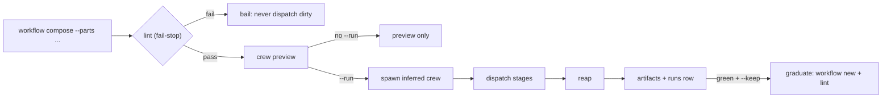

Three nouns, precisely: a **stage** is one named prompt (catalog: `stage list`). A **workflow** is an engine procedure, YAML steps or a graph. A **compose token** is a bare `--parts` name that expands a compiled workflow's steps inline, in one engine run, with one artifact trail. Stages referenced by spliced steps resolve from the stage catalog.

Ordinary builtins (`captain-audit` and friends) are not tokens: `workflow run <name> --execute` runs them. The `recipes` command is the legacy squad surface (spawn shapes), not compose; say "squad" for spawn shapes.

Every `workflow list --json` row carries `description`, `run` (the exact invocation), and `decide_trigger`, so selection works like a skill catalog.

## The --parts grammar

```bash
flywheel workflow compose "<target>" --parts wave-swarm --run --crew 3
flywheel workflow compose "<t>" --parts "role:coder ce-execute" --parts "retry(2):each:lane" --run
```

| Form | Meaning |
|---|---|
| bare stage | dispatch that stage |
| `role:stage` | dispatch to the agent with that role |
| `phase:stage` | per-harness plan mechanics (omp `--plan-yolo`, opencode `--agent plan`); unknown phases degrade loud as `phase_degraded` |
| `workflow:name` | splice a builtin's steps |
| compose token | expand `wave-swarm`, `repair-until-verified`, or `beads-lifecycle` |
| `each:` / `when:` / `retry(n):` / `parallel:` | operators over the parts |

`--base` seeds steps from an existing workflow. `--role-model ROLE=PROVIDER/MODEL` (repeatable) pins a role through the same strict registry as spawn. `--from-yaml` runs full YAML from a file or stdin.

## Tokens

| Token | Shape |
|---|---|
| `wave-swarm` | eight phases: GATE, DISPATCH, EXECUTE, OBSERVE, REVIEW, VERIFY, COMPOUND, SIGNOFF. REVIEW audits diffs pre-verify; COMPOUND captures learnings post-verify. |
| `repair-until-verified` | crew coder:1 + reviewer:1, loops until the VERIFY fence passes, never auto-balloons. |
| `beads-lifecycle` | grill, create, review1, review2, integrate, implement, verify, outer SIGNOFF; nests builtins via `call_workflow`; `inputs.until` early-exits SUCCESS after any phase. After integrate, hand off to wave-swarm, never merge. |

Legacy alias: `workflow run <token> --execute` still runs tokens; the preferred door is `workflow compose --parts <token> --run`.

## Run lifecycle



`workflow run` without `--execute` records control flow only; no pane dispatches, and a `runs/` row can still show completed. `--mode` defaults to `headless`; `flywheel steer` is `--execute --mode pane`. Interactive TTY runs brief before dispatch (crew counts, model menus, stage chain, go/no-go) and a confirmed pane count mutates the spawn plan; `--json`, `--yes`, or an explicit `--crew N` skips it, and non-TTY is byte-identical.

## Authoring and graduation

Ladder: `stage new`, `stage lint`, `stage promote`; `workflow new`, `workflow lint` (fail-stop), promote. A same-named catalog file overrides a builtin; never edit the builtin. Ephemeral compose stays out of the catalog: `--keep <n>` graduates a green run through `workflow new` + lint. `--agent`-authored YAML is lint-gated: a failing lint bails before any dispatch.

Cron: `flywheel cron lint` then `flywheel cron start` owns recurring ticks. `cron run <name>` is a 25-second dry-run by default; `--live` force-fires once through the durable-loop runner. Cron YAML authoring mirrors workflow YAML; the P4.3 manager ticks off the registry.

After verified work, capture the learning once: `flywheel workflow run ce-compound --execute --inputs '{"source":"<what>"}'`. It files learnings into `docs/learnings/`, which chiebukuro indexes.

Binary freshness: compose tokens, new stages, and new flags resolve from the installed binary. After landing workflow-surface changes, rebuild (`mbx +nightly-aarch64-apple-darwin install --path . --force`) and verify from a non-repo cwd.
