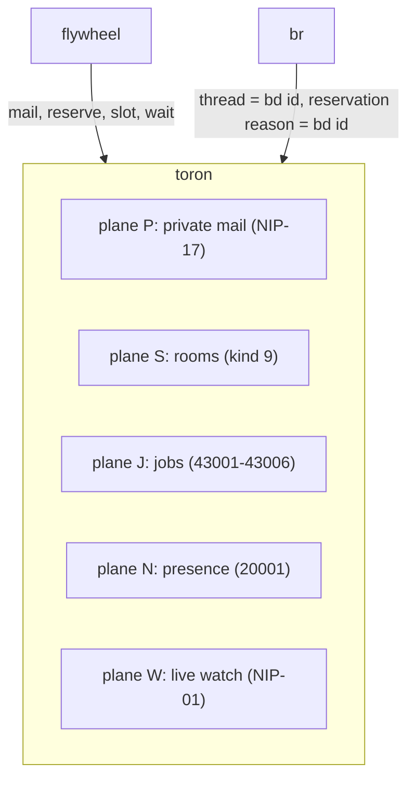

toron moves signed coordination between agents. Every message, reservation, job, and receipt is a cryptographically signed Nostr event, so coordination survives process death, works across machines, and needs no server of its own: relays default to an empty list (zero egress) and the local bus carries everything.

flywheel orchestrates on top. br addresses toron for reservations and done-mail. The MCP surface is frozen: the emitted catalog publishes 38 tools, all tagged `AM-Rust 38-tool surface`, plus 25 resources and 29 CLI verbs. New tools or event kinds need an ADR.

## Layers

| Concern | Owned by |
|---|---|
| Spawn, loop, steer, coalition, debate | flywheel |
| Peer mail, threads, reservations, contacts, proofs, build slots | toron |
| Workflow YAML engine, @mention jobs, durable approvals | toron (fabric); flywheel runs it |
| Beads | br |

`FLYWHEEL_MAIL=toron` wires flywheel to it. With `[mail.toron] url` set, a standalone `toron serve --mcp-http` runs; unset, the mailbox embeds in flywheel. `flywheel toron setup-mcp --flywheel` points flywheel and every harness at the same daemon (`127.0.0.1:18080`).

## Rules that hold everywhere

1. CLI first, MCP last. Read the tool schema before the first MCP call.
2. `--since last` is the crash-proof inbox cursor; raw `since_ts` must be RFC3339, never a unix integer.
3. `unread_only` is accepted and ignored everywhere.
4. `@Name` triggers a job only when the body has the mention and the CLI sets the `p` tag.
5. Nothing pushes; agents poll or get woken.

## Pages

| Page | Read when |
|---|---|
| [quick-start](./quick-start) | First daemon, keys, and project on a host |
| [identity](./identity) | Keys, passphrases, pins, roles, contacts, the captain alias |
| [planes](./planes) | The five wire surfaces and what belongs where |
| [mail](./mail) | Send, inbox, corr, receipts, tags, urgency |
| [channels-and-jobs](./channels-and-jobs) | Rooms, posts, the job lifecycle, crew steering |
| [reservations](./reservations) | File leases, conflicts, transfers, build slots |
| [workflow-engine](./workflow-engine) | YAML workflows and durable approvals |
| [daemon-ops](./daemon-ops) | Daemon lifecycle, doctor, reconstruction, federation |
| [backend](./backend) | The herdr client, pane primitives, agent_read sources |
| [cli-reference](./cli-reference) | The command surface |
| [troubleshooting](./troubleshooting) | Gotchas and failure modes |
| [buzz-parity](./buzz-parity) | Buzz×toron Landed/Adapt/Reject/Hold decisions (any harness) |
