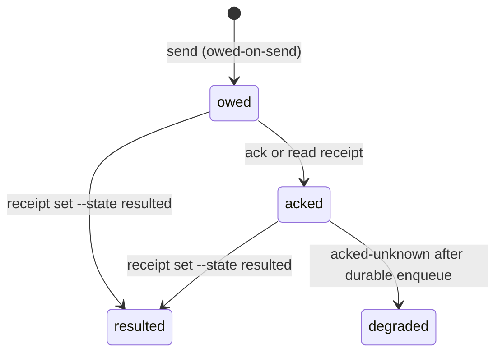

## Sending

```bash
toron mail send --project <slug> --as <Pin> --to captain \
  --subject "[bd-z2d0] done" --body "<REPORT>" --thread bd-z2d0 \
  --corr <corr> --wake tasked --result-path docs/guides/REPORT.md
```

| Flag | Semantics |
|---|---|
| `--thread` | Thread key. For work, always the bead id. |
| `--corr` | Correlation id. The sender mints it; the thread id is never the corr (conflation fails loud). |
| `--wake <kind>` | Wake hint riding `extra_tags` on rumor 14, never the encrypted 1059 envelope. |
| `--priority` | Normal or low ordering. |
| `--audience` | Audience narrowing tag. |
| `--result-path` | Where the deliverable landed; pairs with the file-first rule. |
| `--verdict approve\|deny` | Closes exactly one human decision per corr (ADR-0028 E4). |
| `--importance urgent` | Outer urgency tag, visible without decrypting, injected immediately. Spend it on file-conflict blocks, unanswered request-releases, wedges. Never on status or FYI. |
| `--resolve-bead <bead>` | Stamps the structural done-hold tag the flywheel dispatch guard matches (CLI-only; the guard matches the tag, not a subject line). |

Recipients are explicit: `reply_message` does not default to the sender (the flywheel facade fills the parent sender when omitted). `mail ack` and `mark_message_read` take the hex `message_id`, never an integer.

## Receiving

```bash
toron mail inbox --since last        # read + atomic high-water bump (crash-proof)
toron mail inbox --since_ts 2026-09-10T00:00:00Z
toron mail search "<fts query>"
toron mail thread <thread-id>
toron mail whois <project> <name>
```

`unread_only` is accepted everywhere and ignored. `since_ts` must be RFC3339; a unix integer errors rather than being silently misread. Act on `importance high|urgent` first. MCP `fetch_inbox` takes `agent_name`, `project_key`, optional `since_ts` (RFC3339), `include_bodies`, `limit`, `urgent_only`, `ack_overdue_only`, `thread_id`.

## Receipts

Every send owes a receipt. The store is durable SQLite with `corr` as primary key, next to `message_reads` and `inbox_cursors`, and the state machine is monotonic: never downgrades.



`degraded` means the answer path was lost after a durable enqueue. It is never resend-inviting: a duplicate beats silence. Transitions: `owed -> acked` happens in `send_receipt` (acks and reads); `resulted` is explicit via `toron receipt set --corr <id> --state resulted [--result-path <p>]`.

```bash
toron receipt get --corr <id>
toron receipt list --state owed
toron wait --corr <id>          # subscribe-until-receipt; TTL-bounded
```

`wait` expiry escalates as a wedge pattern instead of dropping silently, and the digest renders earliest-deadline first. Cron and timers are message producers; there is no separate wake kind.

## Required args (MCP parity)

- `send_message`: `sender_name`, `to` (array), `subject`, `body_md`, `project_key`; optional `thread_id`, `topic`, `importance`, `ack_required`.
- `reply_message`: same required set; pass `thread_id` to stay in-thread.
- `acknowledge_message` / `mark_message_read`: `agent_name`, `project_key`, `message_id` (hex string).

Nothing pushes. The rhythm is: poll `--since last` per work unit, or let the flywheel doorbell collapse `watch --live` plus inbox into one `[doorbell]` line.
