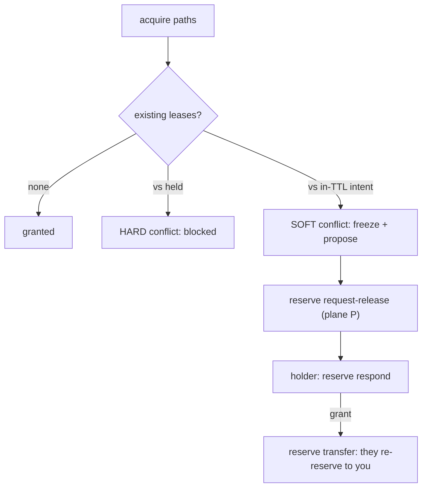

## File reservations

Reserve paths before editing. A reservation (kind 30031) has three states: `intent` (plan to edit, roughly a 5-minute TTL), `held` (the live lease; the default state of an acquisition), `released`.

```bash
toron reserve acquire --project <slug> --as <Pin> --paths 'crates/x/src/**' --reason bd-z2d0
toron reserve conflicts --project <slug> --paths 'crates/x/src/**'
toron reserve renew --project <slug> --as <Pin> --paths 'crates/x/src/**'
toron reserve release --project <slug> --as <Pin>
```

`--paths` takes one glob per flag; repeat the flag for multiple paths. `--reason` is the bead id, always: release-on-bead-close keys off it (`release_file_reservations_by_reason`, operator/loop; crews use `release_file_reservations`).

## Conflicts



- Acquire against a **held** lease is a hard conflict: blocked.
- Acquire against an in-TTL **intent** is a soft conflict: freeze and propose.
- `reserve conflicts` reports both classes.
- Force-release addresses a path (plus optional holder), never an event id: `force-release` or `flywheel mail force-unlock <project> --paths <path> [--holder <name>]`.
- Never commit on behalf of someone else. A grant is a `transfer` of the lease, not a favor.
- `renew` extends the stored absolute expiry; recomputing from now is a bug.
- The don't-sweep request is a **guard**, not a DM: `guard install|uninstall` puts the pre-commit hook in the repo (it never clobbers a user hook, and `TORON_GUARD_STRICT=0` is operator-only).

## Build slots

Build slots (kind 30032) serialize heavy builds across agents and crews:

```bash
toron slot acquire cargo --project <slug> --as <Pin>
mbx +nightly-aarch64-apple-darwin test
toron slot release cargo --project <slug> --as <Pin>
```

Acquire slot `cargo` before any `mbx ... test`. `renew` extends the lease. Slots work without `WORKTREES_ENABLED`. Advisory by default; `--exclusive` when a lane cannot tolerate a neighbor build.
