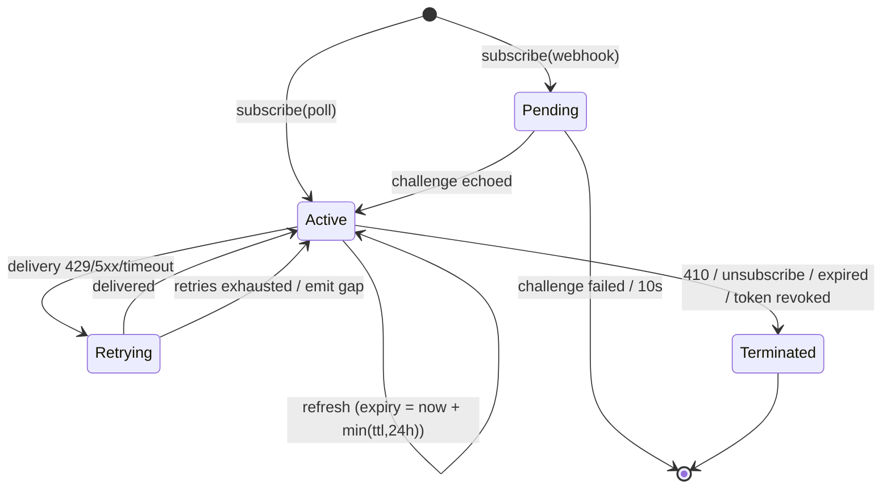
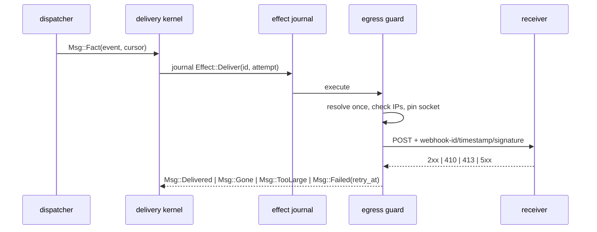

# toron MCP Events - Plan

**Target repo:** toron (with one flywheel unit, U8, in the sibling flywheel repo)

---

## Goal Capsule

- **Objective:** An operator or agent that has subscribed to a toron fact (addressed mail, a reservation conflict, an expired ack SLA, a role or policy change) is told within seconds by a signed push or a cursor poll. It no longer has to poll inbox tools. It learns explicitly when events were lost, and a stranger on or off the tailnet cannot subscribe, impersonate, or turn toron into an SSRF gun.
- **Means:** The MCP Events extension's protocol methods on the existing toron MCP server (KTD1), fed from the existing bus facts through the wake substrate (KTD3), with an operator-allowlisted, signed webhook egress (KTD5–KTD8).
- **Authority:** R-IDs win on behaviour. KTDs win on mechanism. ADR-0039 (proposed, written alongside this plan) records the architectural decision, and ADR-0033/0035/0036/0037 plus flywheel ADR-0012 D6 remain binding.
- **Stop conditions:**
  - Stop and ask if a unit would add an MCP tool (the 41-tool surface is frozen).
  - Stop and ask if a unit would add a Nostr kind, or put a webhook on any path other than the KTD5 guard.
  - Stop and ask if the doorbell would gain a second pane-prompt path.
- **Execution profile:** Five phases. P1–P3 are toron-only and land as separate PRs. P4 is flywheel. P5 (beads, chie publishers) is follow-up work and is not started by this plan.
- **Prerequisite:** rmcp 3.5.1 (PR `chore/rmcp-3.5.1`) is merged first. Under 3.4.0, handler `-32602` errors become HTTP 400, which events error paths would inherit.

---

## Product Contract

### Summary

toron advertises an `events` extension capability and serves `events/list`, `events/subscribe`, `events/unsubscribe` and `events/poll` as MCP protocol methods, not tools, so the frozen 41-tool surface is unchanged.
The event catalogue is derived only from facts already on the bus.
Subscriptions are durable, keyed by (principal, url, name, canonical args), and expire after at most 24 hours unless refreshed. Only the operator may hold a non-expiring one.
Push delivery is a Standard Webhooks-signed HTTPS POST to a callback that passed an operator allowlist (the Tailscale tailnet by default) and a verification challenge.
The doorbell becomes one subscriber feeding its existing single 5/30/3 pane path. beads and chie become publishers later.

### Problem Frame

Today a crew pin learns about mail, conflicts and SLA expiry in three ways: by polling `fetch_inbox`-style tools, through the doorbell's herdr prompts, or through the in-host `wake.sock` sidecar (ADR-0036).
None of these reach a consumer outside the host process tree with an authenticated, durable, resumable contract.
Harnesses reach toron only through executor (an MCP aggregator), which exposes `execute`/`skills`/`resume` rather than toron's protocol methods. So a harness-side MCP Events client cannot subscribe to toron through executor at all (see Appendix A).
The only egress primitive in the tree, `call_webhook`, is deliberately `Unsupported` because its SSRF contract is unmet (bd-i6kc, `crates/toron-workflow/src/engine/boundary.rs`). And `http_guard::is_private_ip` exists but has no caller.

### Actors

- A1. Operator: holds the operator key (`~/.config/toron/operator_nsec`, ADR-0038). Mints tokens, owns the callback allowlist, may hold non-expiring subscriptions.
- A2. Pin: a crew agent identity with exactly one key (ADR-0037). Authenticates with a per-pin bearer token.
- A3. Doorbell daemon (flywheel): local subscriber that turns events into at most 5/30/3 pane prompts.
- A4. Callback receiver: an HTTPS endpoint on the tailnet (`*.example-tailnet.ts.net`), for example a chie or beads daemon or a mobile relay.
- A5. Executor: the MCP aggregator in front of harnesses. It is a toron client for tools and does not consume events (Appendix A).

### Requirements

**Protocol surface**

- R1. toron advertises the events extension under `capabilities.extensions` and answers `events/list`, `events/subscribe`, `events/unsubscribe` and `events/poll` as JSON-RPC methods. `tools/list` still returns exactly 41 tools.
- R2. Every events method enforces the 2026-07-28 `_meta` contract: a missing `_meta` returns HTTP 400 / `-32602`. A handler error (bad args, unknown event name, authz denial) returns HTTP 200 with a JSON-RPC error body.
- R3. `events/list` returns the catalogue (R4) with each event's name, description, argument schema and payload schema, filtered to what the caller's principal may subscribe to.

**Event catalogue**

- R4. The catalogue contains only events derived from existing bus facts. Nothing in this plan adds a Nostr kind or a new wire vocabulary:
  - `mail.addressed`: a gift-wrapped (1059) or addressed kind-9 post whose recipient resolves to the subscriber's pin.
  - `reservation.conflict`: an acquire refused, a request-release, or a revocation touching the subscriber's leases.
  - `ack_sla_expired`: the existing `ack-sla-expired` wake.
  - `role.changed`: a 30013 `role=` binding added or removed.
  - `policy.changed`: a contact-policy change on the subscriber's pin.
  - `gap`: synthetic, emitted per R11.
- R5. The default payload is a hint plus counts (event id, name, project, sender pin, correlation id, timestamp), never a message body or subject (flywheel ADR-0012 D6 webhook row). A full payload is an operator-granted per-subscription opt-in.

**Subscriptions**

- R6. A subscription is identified by (principal, delivery url or `poll`, event name, canonical args). Re-subscribing with the same identity is an idempotent refresh that extends expiry and returns the same subscription id and secret.
- R7. TTL is capped at 24 hours. A client must refresh before expiry, and expired subscriptions stop delivering and are swept. Only an operator principal may request no expiry.
- R8. Subscriptions survive daemon restart. Delivery resumes from each subscription's durable cursor.

**Callback security**

- R9. A webhook URL is accepted only if:
  - it is `https`, with no userinfo and no non-default port unless allowlisted;
  - its host matches the operator allowlist (default `*.example-tailnet.ts.net` and `toron.example-tailnet.ts.net`-style service names);
  - every resolved address is either public or inside an allowlisted CIDR (default `100.64.0.0/10` and `fd7a:115c:a1e0::/48`).
  
  Loopback, link-local, RFC1918 and metadata addresses stay refused unless explicitly allowlisted. The connection goes to the checked IP, never to a re-resolved name, and redirects are not followed.
- R10. A webhook subscription becomes active only after the callback echoes a one-time verification challenge. Every delivery is signed per Standard Webhooks (`webhook-id`, `webhook-timestamp`, `webhook-signature: v1,…`) with a per-subscription `whsec_` secret returned once at subscribe.
- R11. Failed deliveries are retried on a bounded schedule:
  - HTTP 410 terminates the subscription with no retry.
  - HTTP 413 drops that event with no retry and records the drop.
  - Exhausted retries, queue overflow, wake-sidecar shed, or relay lag produce one `gap` event that carries the resume cursor, so loss is never silent.

**Identity and authz**

- R12. Every events request carries a bearer token that maps to exactly one principal (a pin or the operator). Tokens are operator-minted, scoped and revocable. Authorisation follows the D6 matrix as mapped in KTD9.
- R13. Tools keep working without a bearer token during P1–P3, so executor and existing harnesses are not broken. Requiring tokens for tools is follow-up work.

**Consumers**

- R14. The doorbell consumes toron events as a subscriber and still produces at most one pane-prompt path, budgeted 5/30/3 per pin. Events and its existing wake input are deduplicated by event id and never ring twice.
- R15. beads and chie can later publish their own facts into the same catalogue mechanism without changing the protocol methods. This plan only reserves the namespace (`beads.*`, `chie.*`).

### Acceptance Examples

- AE1. Covers R2. Given rmcp 3.5.1, when `events/subscribe` names an unknown event, the response is HTTP 200 with JSON-RPC error `-32602`. When the same request omits `_meta`, the response is HTTP 400 `-32602`.
- AE2. Covers R6, R7. Given pin `CrimsonHeron` subscribed to `mail.addressed` at `https://chie.example-tailnet.ts.net/hooks/toron` with TTL 24h, when it re-subscribes 20h later with identical args, the subscription id and secret are unchanged and expiry moves to now+24h. When it requests no expiry, the call is denied.
- AE3. Covers R9. A callback `https://evil.example/x` that resolves to `100.101.1.2` is refused because the host is not allowlisted. A callback `https://mikasa.example-tailnet.ts.net/x` that resolves to `100.101.1.2` is accepted. When DNS rebinds that host to `169.254.169.254` between check and connect, no connection is made to it.
- AE4. Covers R11. Given a receiver returning 503 then 200, the event is delivered once on retry with the same `webhook-id`. Given a receiver returning 410, the subscription is terminated and no further POST is made.
- AE5. Covers R11. Given the subscriber's queue overflows, the next delivery is a `gap` event with `resync_from` set. A poll from that cursor returns the missed events that are still in the store.
- AE6. Covers R14. Given an addressed mail to a pin with an active doorbell subscription and the existing wake.sock input, exactly one pane prompt is sent, and the fourth prompt inside 30 minutes is digested.

### Scope Boundaries

- No new MCP tools and no new Nostr kinds (ADR-0033 freeze; AGENTS.md "wave 1: no new tools").
- No change to Tailscale configuration. The allowlist is toron config, and `tailscale serve` for `svc:toron` stays as is.
- Harnesses keep reaching toron's tools only through executor. Per ADR-0039 D8 (2026-11-20), an events bridge or a native events client reaches toron directly for `events/*` only, with its pin's token.
- `events/stream` is in scope per ADR-0039 D7 (amendment 2026-11-20) as unit U3b.

### Deferred to Follow-Up Work

- `readOnlyHint` on `acknowledge_message` / `mark_message_read`, and consistent `ttlMs`/`cacheScope` on toron results (deliberately excluded from the rmcp bump PR).
- Requiring bearer tokens on tool calls (R13), which needs executor configured with a token.
- beads and chie publishers (P5, R15).
- Lifting `call_webhook` out of `Unsupported` by reusing the KTD5 egress guard (bd-i6kc).
- Executor forwarding events to harnesses (upstream executor feature).

### Outstanding Questions

These are blocking for the named unit only:

- Q1 (U2): Token custody. Should per-pin tokens live under `~/.config/toron/tokens/<pin>` (0600, next to `operator_nsec`), or be derived from the pin key by signing (NIP-98-style)? The default assumption is opaque random tokens stored hashed in the durable root, with the plaintext shown once.
- Q2 (U6): Should toron add `elm-effect-rs` as a dependency so it can use its `Schedule` (exponential/capped/jitter/recurs exist in `elm-effect/src/schedule.rs`), or mirror the same pure policy inside toron? The default assumption is to mirror it (KTD8). toron has no elm-effect dependency today.
- Q3 (U8): Should doorbell consume events by `events/poll` on loopback (the default), or by webhook to a doorbell HTTPS listener, which would need a loopback allowlist carve-out?
- Q4 (Appendix A): The mcp-events plugins installed in opencode/Grok/pi on 2026-10-08 cannot reach toron through executor. Keep them for other event-capable servers, or remove them?

---

## Planning Contract

### Key Technical Decisions

- KTD1. Events are protocol methods, not tools. They are implemented through rmcp 3.5.1's `on_custom_request` and advertised through `ServerCapabilities.extensions` (a `BTreeMap<String, JsonObject>` in rmcp 3.5.1). This keeps `tools/list` at 41 and needs no ADR-0033 tool-addition procedure. ADR-0039 records why a protocol-method surface is not a "new tool". (session-settled: user-directed — chosen over adding subscribe/unsubscribe tools: the 41-tool surface is frozen.) Governs R1.
- KTD2. Use the MCP Events extension shape of the community draft as implemented in pi-mcp-events (method names, `gap`/`terminated` envelopes, subscription identity) rather than inventing toron-specific methods. The box port's strict mock server is the conformance reference (`mcp-events-ports/mock-server`, outside this repo).
- KTD3. One dispatcher feeds every subscription. The daemon holds one `subscribe_trusted(Filter)` over the catalogue's kinds, reusing the ADR-0036 wake substrate's cursor/`eose`/`shed` semantics, and classifies each fact into catalogue events in a pure function. No second bus and no SQLite polling (ADR-0036, ADR-0028).
- KTD4. A per-subscription delivery machine follows the ADR-0035 Elm kernel: `tick(&Model,&Msg)->(Model,Vec<Effect>)`. Msgs are fact matched, delivery result, clock, refresh and unsubscribe. Effects are `Deliver`, `Verify`, `EmitGap` and `Terminate`, and each is journaled before execution. Wall-clock enters only as a Msg.
- KTD5. One egress guard serves all toron HTTP callbacks:
  1. Parse and validate the URL.
  2. Match the host allowlist.
  3. Resolve once.
  4. Check every address with `http_guard::is_private_ip` plus an allowlist-CIDR carve-out.
  5. Connect to the checked socket address with SNI and Host set to the original name.
  6. Never follow redirects.
  7. Bound the body size and timeouts.
  8. Redact headers and secrets from logs.
  
  It lives in toron-core beside `http_guard` so bd-i6kc can reuse it later. (session-settled: user-directed — chosen over disabling the private-IP guard: allowlist, don't disable.) Governs R9.
- KTD6. Signing and verification follow Standard Webhooks:
  - HMAC-SHA256 over `id.timestamp.body`;
  - `whsec_` base64 secret per subscription;
  - the timestamp in seconds;
  - a verification challenge POST of `{type:"verification", challenge}` that must be echoed within 10s before activation.
  
  Governs R10.
- KTD7. The subscription store is a new SQLite table in the existing durable root (`ToronPaths` data dir, sqlx), keyed by `(principal, delivery, name, args_hash)`. `args_hash` is SHA-256 of RFC 8785-canonicalised args. Rows carry expiry, cursor, state, a hashed secret reference and attempt counters. Governs R6–R8.
- KTD8. The retry policy is a pure value with the same algebra as elm-effect-rs `Schedule`: exponential base 5s, capped at 30 min, jittered, up to 8 attempts, at most about 6h end to end. It has a `given` predicate that excludes 410 and 413. If Q2 resolves to "depend", swap in `elm_effect::Schedule` without changing the policy. Governs R11.
- KTD9. Bearer tokens map onto D6 (flywheel ADR-0012):

  | Principal | Allowed |
  |---|---|
  | Pin token ("local" column) | `events/list`; own-pin poll subscriptions; webhook subscriptions only to allowlisted callbacks, own pin and project scope only, TTL ≤24h |
  | Operator token | Everything, plus cross-pin or cross-project scope, full-payload opt-in, no-expiry, and token mint/revoke |

  Webhook sinks for pins are permitted because the operator allowlist is the D6 "operator-approved host allowlist". This is the one deliberate reading of D6 and is recorded in ADR-0039. Governs R12.
- KTD10. Tokens apply only to `events/*` in P1–P3. Tailscale serve proxies `svc:toron` to `127.0.0.1:18080`, so source IP cannot distinguish tailnet from local callers. The token, not the address, is the authority. Governs R13.
- KTD11. The doorbell subscribes over `events/poll` on loopback (Q3 default) and routes events into its existing classify, Brain and `PinBudget` path. During migration it drops its own wake.sock input for kinds covered by the subscription, and dedupes by bus event id. Governs R14.

### High-Level Technical Design

Component flow (directional):

```mermaid
flowchart LR
  BUS[(toron bus\nRelayBus + store)] -->|subscribe_trusted(Filter)| DISP[Events dispatcher\nclassify fact -> catalogue event]
  DISP --> SM{{Per-subscription\nElm delivery machine}}
  STORE[(subscriptions table\nprincipal,url,name,args_hash)] <--> SM
  SM -->|Effect::Deliver| EG[Egress guard\nallowlist + checked-IP connect]
  EG -->|signed POST| RCV[Tailnet receiver\n*.example-tailnet.ts.net]
  SM -->|cursor| POLL[events/poll]
  POLL --> DB[doorbell\nclassify -> Brain -> PinBudget 5/30/3]
  DB -->|one pane prompt| PANE[herdr pane]
  MCP[toron-mcp\non_custom_request events/*] --> STORE
  AUTH[bearer -> principal -> D6] --> MCP
```

Subscription lifecycle:



Webhook delivery sequence:



### Assumptions

- The MCP Events draft method names and envelopes as used by pi-mcp-events are stable enough to implement. They are versioned under the capability key so a later spec rename is additive.
- rmcp's streamable-HTTP transport places the request's `http::request::Parts` in `RequestContext` extensions so the bearer header is readable in `on_custom_request`. This is to be confirmed in U2. If it is not, a tower layer extracts the principal before rmcp.
- Executor will keep calling toron tools without a token (R13).
- The 24h `lookback` and store retention are long enough that a `gap` resume from cursor normally recovers missed events.

### Sequencing

P0 (rmcp 3.5.1; the lockfile already resolves it) → P1 (U1–U3, then U3b `events/stream` and U7 gap) → P1.5 (ADR-0039 D8 harness bridges, U10–U12, plus U8 doorbell as subscriber) → P2 (U4–U6 webhook egress) → P5 (follow-up). U9 (docs and catalog) lands with each phase. Webhook moved after the bridges (2026-11-20) because no current consumer needs it before poll and stream.

Amendment units (2026-11-20):

- **U3b `events/stream`:** SSE over Streamable HTTP. It shares U3's cursor and kernel, sends `active`, `event`, `heartbeat` and `terminated`, and is routed by subscription id. It is witnessed by a client that reconnects with the last cursor after a drop and loses nothing.
- **U10 Claude channel bridge (flywheel):** a stdio MCP server declaring the `claude/channel` capability. It streams toron events for its pin and emits `notifications/claude/channel` with the hint. It is gated by a live test on a throwaway Claude seat.
- **U11 pi/omp:** configure the installed pi-mcp-events extension against toron, mint the pin token at spawn, and verify on omp.
- **U12 opencode native:** register toron's events endpoint in the seat's opencode config at spawn, so its native client streams. The bd-f888z `session.prompt` route stays as the doorbell fallback, deduped by event id.

---

## Implementation Units

### U1. Events capability and catalogue

**Goal:** Advertise the events extension and serve `events/list` from a pure catalogue derived from bus facts.
**Requirements:** R1, R2, R3, R4, R5. KTD1, KTD2.
**Dependencies:** rmcp 3.5.1 merged.
**Files:**
- `crates/toron-mcp/src/server.rs` (capabilities, `on_custom_request` routing)
- new `crates/toron-mcp/src/events/mod.rs`
- new `crates/toron-core/src/events/catalogue.rs`
- tests in `crates/toron-mcp/tests/events_list.rs` and `crates/toron-core/src/events/catalogue.rs`
**Approach:**
1. Define catalogue entries (name, kinds or toron-kind tags, arg schema, payload schema) as data.
2. Write the classifier as a pure fact → `Option<CatalogueEvent>` function, reusing `WAKE_KINDS` and the `toron-kind` tags in `mailbox/messaging.rs` and `mailbox/reservations.rs`.
3. Route `events/*` in `on_custom_request`. Unknown `events/*` methods return a JSON-RPC method-not-found error in the body.

**Patterns to follow:** the `catalog` CLI contract (ADR-0002 D3), `WakeSubscribe::filter`, and the output-schema tests near `crates/toron-mcp/src/tools/mod.rs`.
**Test scenarios:**
- The capability advertisement (initialize result, or the 2026-07-28 stateless discovery response) includes `extensions` with the events key and version.
- `tools/list` still returns 41 tools. Extend the existing count assertion.
- `events/list` returns the six names with valid JSON Schemas.
- Classifier: kind-1059 addressed to pin A maps to `mail.addressed` for A and to nothing for B.
- Classifier: a `toron-kind ack-sla-expired` post maps to `ack_sla_expired`.
- Classifier: a kind-9 chatter post with no addressing maps to nothing.
- Covers AE1: an unknown event name in subscribe returns HTTP 200 and `-32602`. A missing `_meta` returns 400.
**Verification:** Catalogue tests pass, the tool count is unchanged, and `catalog_freshness` is regenerated with an additive extensions section.

### U2. Principals and bearer tokens

**Goal:** Every `events/*` call resolves to exactly one principal by bearer token.
**Requirements:** R12, R13. KTD9, KTD10.
**Dependencies:** U1.
**Files:**
- new `crates/toron-core/src/events/principal.rs`
- `crates/toron-cli/src/cli.rs` (a CLI-only `toron events token mint|list|revoke`, operator-signed, following the CLI-only noun pattern of `ack-sla`)
- `crates/toron-mcp/src/events/mod.rs`
- tests in `crates/toron-core/src/events/principal.rs` and `crates/toron-mcp/tests/events_auth.rs`
**Approach:**
1. Tokens are random 32-byte values. Store only a SHA-256 hash, with the principal, scope, created and revoked fields, in the durable root.
2. Show the plaintext once at mint.
3. Minting requires the operator key (ADR-0038 resolution).
4. Read the `Authorization` header from request parts (see Assumptions).

**Test scenarios:**
- A valid pin token resolves to `Principal::Pin`.
- The operator token resolves to `Principal::Operator`.
- A missing or unknown token on `events/subscribe` returns a 200 body error (unauthorized), not HTTP 401, so the events methods keep the rmcp error contract.
- A revoked token is refused on the next call, and its subscriptions move to Terminated in U3.
- A tool call without a token still succeeds (R13 regression).
- Minting without an operator key fails loudly.
**Verification:** The auth tests pass, and the D6 table in ADR-0039 matches the enforced checks in one table-driven test.

### U3. Subscription store, subscribe/unsubscribe/poll

**Goal:** Durable subscriptions with refresh, TTL and cursor poll.
**Requirements:** R6, R7, R8. KTD7, KTD3, KTD4.
**Dependencies:** U1, U2.
**Files:**
- new `crates/toron-core/src/events/store.rs` (sqlx migration in the existing migrations location)
- new `crates/toron-core/src/events/dispatcher.rs`
- new `crates/toron-core/src/events/kernel.rs`
- `crates/toron-cli/src/serve.rs` or the existing serve wiring that starts the wake server
- tests in `crates/toron-core/tests/events_store.rs` and `crates/toron-core/src/events/kernel.rs`
**Approach:**
1. Canonicalise args (RFC 8785) and hash them.
2. Upsert on identity.
3. Cap TTL at min(requested, 24h) for pins. The operator may pass `ttl: null`.
4. Run a 60s sweep tick that expires rows.
5. The dispatcher holds one `subscribe_trusted` and fans out to the kernel per subscription.
6. `events/poll` returns events after the cursor, up to a limit, plus the next cursor.

**Patterns to follow:** `bus/wake.rs` (cursor, `eose`, `shed`, `SubscriberStats`), `bus/ttl.rs`, and the ADR-0035 kernel modules under `crates/toron-core/src/dispatch_core.rs`.
**Test scenarios:**
- Covers AE2: identical re-subscribe returns the same id and extends expiry.
- Different args create a distinct subscription.
- A pin requesting no expiry is denied. The operator is allowed.
- A pin requesting 48h is capped to 24h, and the result reports the effective expiry.
- After a daemon restart (reopen the store), the subscription and cursor persist.
- An expired subscription stops returning events on poll, and the poll reports the terminated state.
- Unsubscribing an unknown id is idempotent and succeeds.
- Unsubscribing another principal's id is denied.
- Kernel: a `Msg::Clock` past expiry emits `Effect::Terminate`, and the effect is journaled before execution.
- Integration: publish an addressed mail on an in-process bus, then a poll from the cursor returns one `mail.addressed` with a hint-only payload (R5).
**Verification:** The store and kernel tests pass. A live smoke on a spare port shows poll returning a real addressed mail.

### U4. Egress guard

**Goal:** A single SSRF-safe outbound HTTP primitive.
**Requirements:** R9. KTD5.
**Dependencies:** none (can land in parallel with U1–U3).
**Files:**
- new `crates/toron-core/src/bus/egress.rs`
- `crates/toron-core/src/bus/http_guard.rs` (add the allowlist-CIDR carve-out helper)
- `crates/toron-core/src/config/mod.rs` (`[events.callbacks] allow_hosts`, `allow_cidrs`, `max_body_bytes`, `connect_timeout_ms`)
- tests in `crates/toron-core/src/bus/egress.rs`
**Approach:**
1. Use a reqwest client with redirects disabled and a pinned resolve override per request, using the checked `SocketAddr`.
2. Require https, with no userinfo.
3. The defaults allowlist only `*.example-tailnet.ts.net`, `100.64.0.0/10` and `fd7a:115c:a1e0::/48`.
4. A non-allowlisted private address is refused even when the host matches.

**Test scenarios:**
- Covers AE3: a host outside the allowlist is refused.
- A tailnet host resolving into `100.64/10` is allowed.
- A tailnet host resolving to `169.254.169.254` or `127.0.0.1` is refused.
- IPv4-mapped IPv6 loopback is refused.
- `http://` is refused, and `https://user@host` is refused.
- A 30x response is returned as a failure and not followed.
- A rebinding resolver that returns an allowed IP for the check and a disallowed IP after is still connected only to the checked IP. Test this with a stub resolver.
- A response body over the cap is truncated or aborted.
- Logs never contain the signature header or secret.
**Verification:** The guard tests pass, and `http_guard::is_private_ip` gains its first non-test caller.

### U5. Verification challenge and Standard Webhooks signing

**Goal:** Webhook subscriptions activate only after the challenge, and every POST is signed.
**Requirements:** R10. KTD6.
**Dependencies:** U3, U4.
**Files:**
- new `crates/toron-core/src/events/webhook.rs`
- `crates/toron-core/src/events/kernel.rs`
- tests in `crates/toron-core/src/events/webhook.rs`
**Approach:**
1. Generate a `whsec_` secret at first subscribe and return it once. Refreshes return the same secret (R6).
2. Use the Standard Webhooks test vectors for the signature.
3. Send the challenge through the U4 guard.

**Test scenarios:**
- The signature matches the published Standard Webhooks test vector.
- The `webhook-id` is stable across retries of the same event.
- A challenge that is echoed correctly activates the subscription.
- A wrong echo, a non-2xx response, or a timeout over 10s leaves the subscription Pending, and subscribe returns an error body.
- A refresh does not re-challenge an Active subscription unless the URL changed. A changed URL is a different identity, per R6.
**Verification:** The tests pass. A receiver using the official standardwebhooks verifier accepts toron's deliveries in the live smoke.

### U6. Retry schedule and failure semantics

**Goal:** Bounded retries, terminal 410, non-retried 413.
**Requirements:** R11. KTD8, KTD4.
**Dependencies:** U5.
**Files:**
- new `crates/toron-core/src/events/retry.rs`
- `crates/toron-core/src/events/kernel.rs`
- tests in `crates/toron-core/src/events/retry.rs`
**Approach:** Make the policy a pure `decide(attempt, outcome) -> Option<delay>` function. Timers enter as clock Msgs. Jitter uses a seeded RNG in tests.
**Test scenarios:**
- Covers AE4: 503 then 200 delivers once on the second attempt.
- 410 moves to Terminated with exactly one POST.
- 413 drops the event with no retry, records the drop, and the next event still delivers.
- 429 with `Retry-After` honours it within the cap.
- After 8 failures, a `gap` is queued and the subscription stays Active.
- A delay sequence with a fixed seed matches the expected capped exponential.
**Verification:** The tests pass. No retry loop runs outside the kernel. Check this by grepping that no `sleep` is in the events modules.

### U7. Gap and loss surfacing

**Goal:** Every loss path produces exactly one `gap` with a resume cursor.
**Requirements:** R11. KTD3.
**Dependencies:** U3, U6.
**Files:**
- `crates/toron-core/src/events/dispatcher.rs`
- `crates/toron-core/src/bus/relay_bus.rs` (expose `lag_skips` deltas to the dispatcher)
- tests in `crates/toron-core/tests/events_gap.rs`
**Approach:** Map three sources to `gap`:
- the dispatcher's own per-subscription queue overflow;
- a RelayBus `RecvError::Lagged` (`lag_skips` delta);
- exhausted retries from U6.

herdr `events_lost` (toron#7, `BackendEvent::EventsLost`) is a pane-backend signal, not a bus fact. It is not a catalogue source until pane facts are in the catalogue (follow-up).
**Test scenarios:**
- Covers AE5: overflowing a subscriber queue yields one `gap{resync_from}`, and a poll from it returns the missed stored events.
- A simulated lag skip yields a `gap` on every active subscription.
- Two consecutive overflows without a successful delivery coalesce into one gap.
**Verification:** The gap tests pass. `health` reports per-subscription drop counters.

### U8. Doorbell as subscriber (flywheel repo)

**Goal:** The doorbell receives toron events through `events/poll` and keeps exactly one pane-prompt path.
**Requirements:** R14. KTD11.
**Dependencies:** U3, U7.
**Files:**
- `../flywheel/crates/doorbell-rt/src/subscribe.rs`
- `../flywheel/crates/doorbell-rt/src/brain.rs`
- `../flywheel/crates/doorbell-rt/src/sinks.rs`
- `../flywheel/docs/guides/doorbell.mdx`
- tests in `../flywheel/crates/doorbell-rt/tests/`
**Approach:**
1. Add a toron-events source behind a config flag.
2. Translate events into the existing classify input.
3. Dedupe by bus event id across the wake.sock and events sources.
4. Keep `PinBudget::take_allowed` as the only gate before `herdr agent.prompt`.

**Test scenarios:**
- Covers AE6: the same addressed mail arriving through both sources rings once.
- A fourth prompt within 30 minutes is digested.
- A `gap` event triggers a cursor replay and no prompt storm, because a replay batch collapses to a digest.
- With the flag off, behaviour is byte-identical to today (characterisation test).
**Verification:** The flywheel tests pass. A live smoke on a test workspace shows one prompt per addressed mail.
**Execution note:** Add characterisation coverage of the current doorbell prompt path before wiring the new source.

### U9. Docs, catalog and skill sync

**Goal:** The surface is documented, and the skill sync contract stays honest.
**Requirements:** R1, R12.
**Dependencies:** lands alongside U1, U2, U4 and U8.
**Files:**
- `AGENTS.md` (Skill Sync Contract: the tool count stays 41, add the events extension line)
- `docs/decisions/README.md` (index ADR-0039)
- `docs/guides/` (a new events guide)
- the catalog fixture used by `catalog_freshness`
**Approach:** Keep "no live bead id in published strings". Document token mint, the allowlist config and the Standard Webhooks verification snippet.
**Test expectation:** none. The catalog freshness test covers the generated part.
**Verification:** `catalog_freshness` passes, and the doc links resolve.

---

## Verification Contract

- Run all cargo commands through `mbx` (repo toolchain wrapper):
  - `mbx build --workspace --locked`
  - `mbx test --workspace --locked`
  - `mbx test --workspace --all-features --locked`
  - `mbx clippy --workspace --all-targets --locked -- -D warnings`
  - `mbx fmt --check`
- Named gates that must stay green: `all_tools_declare_output_schema`, `output_schemas_encode_toron_shapes`, `catalog_freshness`, and the 41-tool count assertion.
- Live smoke for each toron phase. Run a branch-built `toron serve --mcp-http 127.0.0.1:<spare>` with isolated `TORON_DATA_DIR`, `XDG_CONFIG_HOME`, `XDG_STATE_HOME` and a throwaway passphrase and operator key. Never touch the `com.toron.serve` daemon on :18080. Check:
  - `events/list` works;
  - subscribe, poll, refresh and unsubscribe work;
  - a webhook to a tailnet test receiver passes the challenge and signature verification;
  - 410 terminates;
  - unknown events return 200 errors;
  - missing `_meta` returns 400.
- flywheel (U8): the repo's own test and clippy gates, plus the doorbell characterisation test.

## Definition of Done

- Every R1–R14 is covered by at least one passing test or a live smoke step. R15 is reserved namespace only.
- `tools/list` = 41 and no new Nostr kinds. `catalog_freshness` is regenerated additively.
- ADR-0039 moves from proposed to accepted by operator word before P2 merges.
- No `call_webhook` behaviour change (bd-i6kc stays open but now has a reusable guard).
- Per unit: its Verification line holds and its tests are in the diff.
- Cleanup: no abandoned spike code, feature flags only where named (U8), and no stray debug logging of payloads or secrets.

---

## Risk Analysis & Mitigation

| Risk | Mitigation |
|---|---|
| The MCP Events draft changes method or envelope names | Version under the capability key. Keep the shape in one module (U1). Use the box mock server as the conformance test |
| Allowlisting the tailnet re-opens SSRF into tailnet services | Use a host allowlist and CIDR together, with https only, a checked-IP connect, no redirects and a body cap. Pin webhooks are limited to own-pin scope with a hint-only payload (R5) |
| Doorbell double-rings during migration | Dedupe by event id behind a flag, plus a characterisation test (U8) |
| Executor clients assume tool-only toron, and tokens break them | Tokens apply to `events/*` only (KTD10) |
| A bearer token leaks through logs or executor | Store hashed only and redact in the guard. Tokens are not used by executor in this plan |
| Store growth from abandoned subscriptions | The 24h cap plus a 60s sweep. The operator's no-expiry rows are listed by `toron events token list`/doctor |

## Alternative Approaches Considered

- **Subscribe/unsubscribe as MCP tools:** Rejected because it breaks the frozen 41 and needs the ADR-0033 procedure. Clients would also treat it as a model-invoked action rather than client plumbing.
- **Extend wake.sock over TCP/Tailscale instead of MCP:** Rejected because it adds a second network protocol with no auth or signing, and MCP clients cannot use it.
- **Deliver through Nostr DMs (NIP-17) only:** Deferred. D6 already lists DM sinks as operator-only. Webhooks reach non-Nostr consumers (chie, beads, mobile).

---

## Appendix

### A. Executor and the rmcp 400 fallback (read-only findings, 2026-10-08)

- Executor (executor.sh v2, "MCP gateway") fronts toron for opencode, Grok and pi at `https://mcp.example-tailnet.ts.net/mcp`. It is OAuth-protected: an unauthenticated `initialize` returned 401 with `resource_metadata`. It was not probed further, and no credentials were used.
- Per its docs, clients see only `execute`, `skills` and `resume` (Grok doctor reported 9 tools on this instance). toron tools are invoked inside executor's sandbox as `tools.<namespace>.<tool>()`, from a catalogue executor indexed when the integration was added.
- Unknown-tool 400: executor cannot originate it for toron tools. It relays what toron returns. Under rmcp 3.4.0, a toron call that executor believes exists but toron does not (a stale index after a rename, or a model-typed path) gets HTTP 400 `-32602`. A typical MCP client SDK surfaces that as a transport error rather than a tool error, which can look like a fallback or reconnect. rmcp 3.5.1 (#1322) turns it into a JSON-RPC error in a 200 body. This is unverified end to end because the executor endpoint needs auth.
- Live baseline (2026-10-08, branch `chore/rmcp-3.5.1` on 127.0.0.1:18090 vs the 3.4.0 daemon on :18080). With SEP-2243 headers set:
  - An unknown tool returns 200 `-32602` on 3.5.1 and 400 on 3.4.0.
  - A missing `_meta` returns 400 `-32602` on both.
  - `tools/list` returns 41 tools with byte-identical names and schemas on both, and `ttlMs: 0, cacheScope: public`.
  - Requests without `Mcp-Method` get 400 `-32020`. Executor's client must send it, so a stale executor may also produce 400s here.
- Schema and caching: executor negotiates 2025-11-25 with harnesses, so toron's 2026-07-28 `ttlMs`/`cacheScope` hints never reach harnesses. Executor's own catalogue index is the effective cache. Re-index executor's toron integration after any toron tool-surface change. Whether executor preserves `structuredContent`/`outputSchema` in `describe` output is unverified.
- Events: executor does not proxy custom protocol methods, so `events/*` is reachable only by direct toron clients (doorbell, chie, beads, operator tools), not by harnesses through executor. This is why harness wake-ups stay on the doorbell pane path (R14).

### B. Code anchors

- `crates/toron-core/src/bus/mod.rs` (`Bus::subscribe`, `subscribe_trusted`, `Filter` re-export)
- `crates/toron-core/src/bus/wake.rs` (`WAKE_KINDS`, `WakeFrame::{Event,Eose,Heartbeat,Shed}`, `WakeSubscribe::filter`)
- `crates/toron-core/src/bus/relay_bus.rs` (`lag_skips`, F1.LAG-SWALLOW)
- `crates/toron-core/src/bus/http_guard.rs` (`is_private_ip`: blocks 100.64/10 and fc00::/7, unused today)
- `crates/toron-workflow/src/engine/boundary.rs` (`CallWebhook` Unsupported, bd-i6kc)
- `crates/toron-core/src/backend/herdr.rs` (`events_lost` → `BackendEvent::EventsLost`, toron#7)
- `crates/toron-mcp/src/server.rs` (capabilities builder, `get_info`, `legacy_session_mode(false)`, `json_response(true)`)
- `../flywheel/docs/decisions/0012-doorbell-plane-independent-runtime.md` (D6 threat table and authz matrix, 5/30/3)
- `../flywheel/crates/doorbell-rt/src/subscribe.rs` (subscription = identity × scope × filter × sink × budget)
- `../elm-effect-rs/crates/elm-effect/src/schedule.rs` (`exponential`, `capped`, `jitter`, `recurs`, `given`)
- rmcp 3.5.1: `handler/server.rs` `on_custom_request`, `model/capabilities.rs` `extensions`
