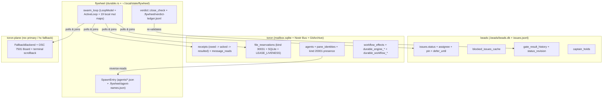
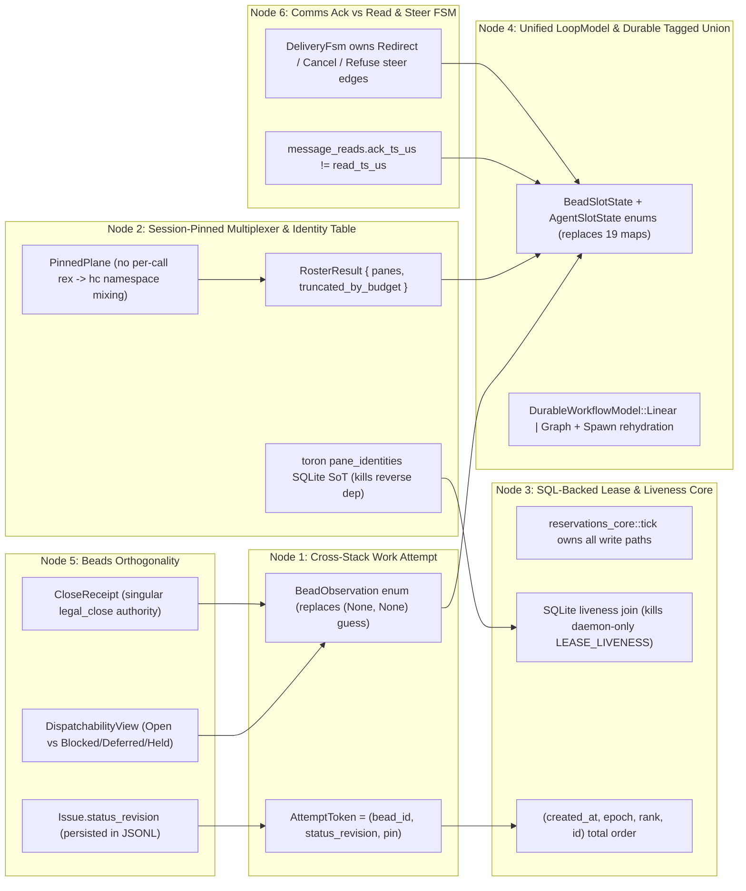

# Implicit State Machines Across `flywheel` × `toron` × `beads`

Under the stack's Effect Law ([effect-kernel.md](file:///Users/bangedorrunt/workspace/flywheel/docs/agent-instructions/effect-kernel.md), [0035-elm-kernel-law-and-judgment-plane.md](file:///Users/bangedorrunt/workspace/toron/docs/decisions/0035-elm-kernel-law-and-judgment-plane.md), [0018-elm-effect-is-the-core.md](file:///Users/bangedorrunt/workspace/flywheel/docs/decisions/0018-elm-effect-is-the-core.md)), an **explicit state machine** has:
1. **A closed sum-type (`enum`) state & message vocabulary** where illegal combinations are unrepresentable at compile time.
2. **A single pure transition function** `tick(&Model, &Msg) -> (Model, Vec<Effect>)` (or `step`) with compile-time import fences (`std` + `serde` only; no clock, env, locks, or I/O).
3. **One storage authority per fact**, with effects journaled before provider execution.

While several cores are now explicit ([`DeliveryFsm::step`](file:///Users/bangedorrunt/workspace/toron/crates/toron-core/src/delivery.rs#L406-L539), [`dispatch_core::tick`](file:///Users/bangedorrunt/workspace/toron/crates/toron-core/src/dispatch_core.rs#L131-L246), [`busy_owner::tick`](file:///Users/bangedorrunt/workspace/toron/crates/toron-core/src/busy_owner.rs#L121-L216), [`osc7501::fold`](file:///Users/bangedorrunt/workspace/toron/crates/toron-plane/src/osc7501.rs#L236-L310), [`tui::update::tick`](file:///Users/bangedorrunt/workspace/toron/crates/toron-cli/src/tui/update.rs#L26-L359)), the stack still contains **46 implicit state machines** across four layers:
- **Part I**: Cross-Stack Emergent State Machines (`flywheel × toron × beads`)
- **Part II**: `flywheel` Implicit State Machines
- **Part III**: `toron` Implicit State Machines
- **Part IV**: `beads` (`br`) Implicit State Machines

---

## Part I — Cross-Stack Distributed State Machines (`flywheel` × `toron` × `beads`)

No single database or process owns the composite lifecycle of a unit of work, an agent identity, a workflow run, or the transport plane. Instead, each tick reconstructs composite state by joining across SQLite, Nostr events, JSONL files, git history, and multiplexer panes.



### 1. The "Unit of Work" (Bead-Execution) Distributed State Machine

#### State Projections Joined Per Tick
| Layer | Store / Medium | State Representation | Code Locations |
|---|---|---|---|
| **Beads Issue** | `.beads/beads.db` (`issues`) + `.beads/issues.jsonl` | [`Status`](file:///Users/bangedorrunt/workspace/beads/src/model/mod.rs#L59-L108) (`Open`, `InProgress`, `Blocked`, `Deferred`, `Draft`, `Closed`, `Tombstone`, `Pinned`), `assignee`, `owner`, `pin`, `commit_sha`, `close_verdict`. | [mod.rs](file:///Users/bangedorrunt/workspace/beads/src/model/mod.rs#L59-L108) |
| **Beads Gate Ledger** | `.beads/beads.db` (`gate_result_history`) + `.beads/gates.jsonl` | Scoped PASS/FAIL verdicts (`command-verified`, `unit-test-verified`, `live-verified`, `reviewer-signed`, `worker-receipt`, `operator-directed`, `triage-verified`). | [verify.rs](file:///Users/bangedorrunt/workspace/beads/src/verify.rs#L6-L152), [close_policy.rs](file:///Users/bangedorrunt/workspace/beads/src/close_policy.rs#L1017-L1093) |
| **Beads Captain Hold** | `.beads/beads.db` (`captain_holds`) | [`CaptainHold`](file:///Users/bangedorrunt/workspace/beads/src/hold.rs#L12-L89) (`open`, `expires_at`, `released_at`, `resurfaced`). | [hold.rs](file:///Users/bangedorrunt/workspace/beads/src/hold.rs#L12-L89), [close.rs](file:///Users/bangedorrunt/workspace/beads/src/cli/commands/close.rs#L1631-L1649) |
| **Toron Reservations** | `bus_events` (kind `30031`) + SQLite `file_reservations` + `LEASE_LIVENESS` | [`EntryState`](file:///Users/bangedorrunt/workspace/toron/crates/toron-core/src/mailbox/reservations_core.rs#L27-L61) (`Held`, `Intent`), [`ReservationStatus`](file:///Users/bangedorrunt/workspace/toron/crates/toron-core/src/mailbox/reservations.rs#L1249-L1344) (`Held`, `Intent`, `Released`, `Revoked`), SQLite `status IN ('active','intent','released','revoked')`. | [reservations.rs](file:///Users/bangedorrunt/workspace/toron/crates/toron-core/src/mailbox/reservations.rs#L63-L158), [lease_liveness.rs](file:///Users/bangedorrunt/workspace/toron/crates/toron-core/src/mailbox/lease_liveness.rs#L24-L190) |
| **Toron Receipts** | `bus_events` (kind `30033`) + SQLite `receipts` | [`ReceiptState`](file:///Users/bangedorrunt/workspace/toron/crates/toron-core/src/mailbox/receipts_core.rs#L20-L156): `Owed -> Acked -> Resulted` + `Degraded`. | [receipts_core.rs](file:///Users/bangedorrunt/workspace/toron/crates/toron-core/src/mailbox/receipts_core.rs#L20-L156) |
| **Flywheel Loop Watch** | `.flywheel/claim-watch.json`, `.flywheel/verdict-ledger.jsonl`, `.flywheel/receipts/*`, in-memory maps | [`ClaimWatch`](file:///Users/bangedorrunt/workspace/flywheel/src/durable.rs#L211-L216), [`ClaimWatchAction`](file:///Users/bangedorrunt/workspace/flywheel/src/durable.rs#L4499-L4617), [`CloseCheck`](file:///Users/bangedorrunt/workspace/flywheel/src/verdict.rs#L1268-L1321), [`DispatchGuardDecision`](file:///Users/bangedorrunt/workspace/flywheel/src/durable.rs#L2523-L2588). | [durable.rs](file:///Users/bangedorrunt/workspace/flywheel/src/durable.rs#L2380-L2588), [verdict.rs](file:///Users/bangedorrunt/workspace/flywheel/src/verdict.rs#L1285-L1321) |

#### Concrete Split-Brain Bugs Across the Boundary
> [!WARNING]
> **1. [`claim_watch_step`](file:///Users/bangedorrunt/workspace/flywheel/src/durable.rs#L4519-L4611) `(None, None)` Blindness to `Blocked` / `Deferred` Transitions**
> `claim_watch_step` only queries `ready` (`Status::Open`) and `inprogress` (`Status::InProgress`). If a watched bead transitions to `Status::Blocked` or `Status::Deferred`, `(in_ready, claimed)` matches `(None, None)` at [durable.rs](file:///Users/bangedorrunt/workspace/flywheel/src/durable.rs#L4606-L4611) with the comment `// Bead is neither ready nor in-progress -> it was closed`, emitting `ClaimWatchAction::ReleaseReservations`.
> Next, [`verdict::close_check`](file:///Users/bangedorrunt/workspace/flywheel/src/verdict.rs#L1285-L1321) runs without checking `issue.status == Status::Closed`, sees no commit, and returns `CloseCheck::NoCommit`. [`reopen_unverified_close`](file:///Users/bangedorrunt/workspace/flywheel/src/cmd/internal.rs#L3724-L3808) runs `br reopen <id>`, which skips non-closed issues and **exits `0`** ([reopen.rs](file:///Users/bangedorrunt/workspace/beads/src/cli/commands/reopen.rs#L262-L270)). `flywheel` treats exit `0` as a reopen, mails a false `"unverified close reopened"` alert to the planner/captain, and revokes all file reservations for the blocked bead at [durable.rs](file:///Users/bangedorrunt/workspace/flywheel/src/durable.rs#L6890-L6896)!

- **2. Unconditional Lock Revocation & Wiped `ClaimWatch.agent` on Grace-Tick Beads**: In [durable.rs](file:///Users/bangedorrunt/workspace/flywheel/src/durable.rs#L6706-L6901), all three branches of `__close-check` (including `"missing"` grace-tick 1 and 2 re-insertion at [durable.rs](file:///Users/bangedorrunt/workspace/flywheel/src/durable.rs#L6808-L6826)) fall through unconditionally to line 6890 (`__release-bead-locks`), stripping the worker's file reservations while waiting for its receipt, and re-inserting `ClaimWatch` with `agent: String::new()` ([durable.rs](file:///Users/bangedorrunt/workspace/flywheel/src/durable.rs#L6812-L6817)).
- **3. Legal-Close Split-Brain Between `br close` and [`verdict::close_check`](file:///Users/bangedorrunt/workspace/flywheel/src/verdict.rs#L1285-L1321) (Close-Then-Reopen Loop)**:
  - `close_check` calls [`bead_from_br_show`](file:///Users/bangedorrunt/workspace/flywheel/src/verdict.rs#L645) (`require_verify = true`, hardcoding `blast: Blast::Normal` at line 695) instead of [`bead_from_br_show_for_close`](file:///Users/bangedorrunt/workspace/flywheel/src/verdict.rs#L662), and hardcodes `AcShape::Checkable` at lines 1304 and 1316.
  - Consequently, any **judgment-AC** bead legally closed in `br` with `ReviewerSigned` (the *only* legal verdict for `AcShape::Judgment` per [`legal_close`](file:///Users/bangedorrunt/workspace/flywheel/src/verdict.rs#L305)) is evaluated by `flywheel` as `AcShape::Checkable` (where `ReviewerSigned` is illegal) and **falsely reopened on the next tick**!
  - Conversely, any **High-blast** P2+ bead closed with `CommandVerified` or `WorkerReceipt` is evaluated with `blast: Blast::Normal` and passes `close_check` despite `Blast::High` requiring `UnitTestVerified` or `LiveVerified`.
- **4. Daemon vs. In-Process `LEASE_LIVENESS` Split-Brain**: [`LEASE_LIVENESS`](file:///Users/bangedorrunt/workspace/toron/crates/toron-core/src/mailbox/reservations.rs#L93-L113) is a process-local static installed **only** by `toron serve` ([server.rs](file:///Users/bangedorrunt/workspace/toron/crates/toron-mcp/src/server.rs#L502)). After 180s (`DEFAULT_RESERVATION_TTL_SECS`), `toron serve` extends leases for agents that poll their inbox ([reservations.rs](file:///Users/bangedorrunt/workspace/toron/crates/toron-core/src/mailbox/reservations.rs#L1318-L1324)), whereas `flywheel`'s default in-process `Mailbox` ([mail.rs](file:///Users/bangedorrunt/workspace/flywheel/src/mail.rs#L8-L16)) has `LEASE_LIVENESS == None` and sees those leases as **expired**, dispatching a second agent onto the same files!
- **5. Non-Atomic 5-Step Close Ceremony in [`land.rs`](file:///Users/bangedorrunt/workspace/beads/src/cli/commands/land.rs#L242-L295)**: `br land` commits `gate_result_history` (tx 1), commits `status = 'closed'` in `beads.db` (tx 2), optionally shells out to `toron reserve release-by-reason` (step 3), optionally flushes `.beads/issues.jsonl` (step 4), and prints instructions to commit and mail `captain` (step 5).
- **6. Four Uncoordinated Staleness Horizons**: `toron` lease TTL = **3m** (`180s`), `flywheel` resume cooldown = **15m** (`900s`), `toron` `force_release` gate = **30m** (`1800s`), `beads` `br coordination` stale/abandoned = **120m / 480m**.

---

### 2. The Agent Identity & Presence Distributed State Machine

- **1. Hidden Reverse Dependency (`toron-core` → `~/.local/state/flywheel/agents/*.json`) & `whois` vs. `resolve_pane_identity` Split-Brain**:
  - [`Mailbox::live_pin_pane_map`](file:///Users/bangedorrunt/workspace/toron/crates/toron-core/src/mailbox/identity.rs#L1955-L2089) directly reads Flywheel's `~/.local/state/flywheel/agents/<slug>.json` (`spawn_registry_bindings_for_slug`).
  - `whois` and `list_agents` use `live_pin_pane_map` (`pane_alive: true`), whereas [`resolve_pane_identity`](file:///Users/bangedorrunt/workspace/toron/crates/toron-core/src/mailbox/identity.rs#L1812-L1826) and [`cleanup_pane_identities`](file:///Users/bangedorrunt/workspace/toron/crates/toron-core/src/mailbox/identity.rs#L1836-L1853) do **not**, returning `NotFound` (`pane_alive: false`) for the same pane.
- **2. `hc` vs. `rex` Stamp Asymmetry (`pane_stamp` Always `None` on `rex`)**:
  - On `rex`, a block only has a single `label` string mapped to `tokens["toron_pin"]` ([superlogical.rs](file:///Users/bangedorrunt/workspace/toron/crates/toron-plane/src/backend/superlogical.rs#L710-L720)), leaving `toron_npub` absent. Because [`pane_stamp`](file:///Users/bangedorrunt/workspace/toron/crates/toron-core/src/mailbox/identity.rs#L1930-L1945) requires both `toron_pin` and `toron_npub`, `pane_stamp` is always `None` on `rex`, bypassing all `StampDivergence` checks in [`whois`](file:///Users/bangedorrunt/workspace/toron/crates/toron-core/src/mailbox/identity.rs#L1720-L1760).
- **3. `rex` 3-Second Scan Budget Cliff**:
  - [`SuperlogicalBackend::agent_list`](file:///Users/bangedorrunt/workspace/toron/crates/toron-plane/src/backend/superlogical.rs#L411-L440) spawns up to 2 `rex` CLI subprocesses per block under a shared 3-second wall-clock budget (`AGENT_STATUS_BUDGET = Duration::from_secs(3)` at [superlogical.rs](file:///Users/bangedorrunt/workspace/toron/crates/toron-plane/src/backend/superlogical.rs#L50)). Once cumulative CLI time exceeds 3s, [`scan_allows`](file:///Users/bangedorrunt/workspace/toron/crates/toron-plane/src/backend/superlogical.rs#L769-L771) returns `false` and **every remaining pane in the roster silently degrades to `AgentStatus::Unknown` (`interactive_ready: false`)**.
- **4. Ephemeral Presence (Kind `20001`) Process Isolation**:
  - Kind `20001` presence events live only in `InProcessBus` memory (never SQLite). Presence emitted in `flywheel` or `toron` CLI is invisible to `toron serve --mcp-http` and vice versa.

---

### 3. The Multiplexer Transport Fallback State Machine (`toron-plane`)

> [!CAUTION]
> **Stateless Per-Call `Policy::Read` Fallback Wipes `rex` Identities & Leases When `hc` Is Reachable**
> [`FallbackBackend::call`](file:///Users/bangedorrunt/workspace/toron/crates/toron-plane/src/backend/fallback.rs#L82-L94) does not pin the active multiplexer backend. On every `Policy::Read` call (`pane_list`, `agent_list`, `workspace_list`), if `SuperlogicalBackend` (`rex`) hits a transient `Timeout` (12s `REX_WAIT`), `Unavailable`, or `Io` error, `FallbackBackend` transparently serves that single read from `HcBackend` (`hc`).
> If [`cleanup_pane_identities`](file:///Users/bangedorrunt/workspace/toron/crates/toron-core/src/mailbox/identity.rs#L1836-L1853) or [`reap_ghost_leases`](file:///Users/bangedorrunt/workspace/toron/crates/toron-core/src/mailbox/reservations.rs#L1076-L1147) runs during a transient `rex` timeout while an `hc` server is running, `pane_list()` returns `hc`'s pane IDs (`hc:t*`), sees zero `rex` block IDs, and **deletes all `rex` pane-identity files and revokes every active `rex` agent's file reservations**!

- **`Policy::ColdCreate` (`workspace_create`) Fallback Strands `Policy::IdBound` Calls**: If `workspace_create` times out on `rex` and falls back to `hc` ([fallback.rs](file:///Users/bangedorrunt/workspace/toron/crates/toron-plane/src/backend/fallback.rs#L139-L143)), it returns an `hc` workspace ID. When `rex` recovers, subsequent `pane_create`/`pane_send` calls are `Policy::IdBound` ([fallback.rs](file:///Users/bangedorrunt/workspace/toron/crates/toron-plane/src/backend/fallback.rs#L59-L73)) and route strictly to `rex`, failing permanently with `NotFound`.

---

## Part II — `flywheel` Implicit State Machines

### 1. Agent / Crew / Pane Lifecycle Machines (`flywheel`)

1. **Three-Way Spawn Registry & Silent Identity Erasure in [`dedupe_spawn_entries`](file:///Users/bangedorrunt/workspace/flywheel/src/state.rs#L909-L931)**:
   - Stored across `~/.local/state/flywheel/agents/<canonical_key>.json`, legacy alias JSON files ([`fold_legacy_alias`](file:///Users/bangedorrunt/workspace/flywheel/src/state.rs#L715-L749)), and `<project>/.flywheel/agent-names.json` ([`hydrate_profiles_from_agent_names`](file:///Users/bangedorrunt/workspace/flywheel/src/state.rs#L871-L898)).
   - [`dedupe_spawn_entries`](file:///Users/bangedorrunt/workspace/flywheel/src/state.rs#L909-L931) requires **both** `pane_current && identity_current` (line 928) to keep an entry. If row 0 is `(P1, I1)`, row 1 is `(P2, I1)`, and row 2 is `(P2, I2)`, row 0 fails `identity_current` and row 1 fails `pane_current`—**silently erasing live identity `I1` on pane `P1`**!
   - [`mark_skills_injected`](file:///Users/bangedorrunt/workspace/flywheel/src/state.rs#L949-L971) performs an unlocked load-modify-save on the spawn registry, racing with concurrent `flywheel __send` and `register_pane` calls.
2. **Dead-Pane Reaping & Stale-Heartbeat Pages Disabled on Default `rex` Plane ([`pane_binding_may_clear`](file:///Users/bangedorrunt/workspace/flywheel/src/pane_keep.rs#L20-L30))**:
   - [`pane_binding_may_clear(backend, harness)`](file:///Users/bangedorrunt/workspace/flywheel/src/pane_keep.rs#L20-L30) checks `backend == "hc" && HC_INJECTABLE.contains(&h)`.
   - Because the default backend is `"rex"`, `pane_binding_may_clear` always returns `false`: [`reap_closed_rows`](file:///Users/bangedorrunt/workspace/flywheel/src/pane.rs#L381-L401) and [`find_dead_rows`](file:///Users/bangedorrunt/workspace/flywheel/src/pane.rs#L474-L492) **never reap dead `rex` panes**, and [`heartbeat_signals`](file:///Users/bangedorrunt/workspace/flywheel/src/health_page.rs#L204-L241) downgrades `HeartbeatSignal::Stale` to `HeartbeatSignal::StaleKept`, **suppressing captain health pages on `rex`**.
3. **Shell-Ready & Boot Heuristics ([`shell_prompt_rendered`](file:///Users/bangedorrunt/workspace/flywheel/src/hc.rs#L749-L763), [`agent_still_booting`](file:///Users/bangedorrunt/workspace/flywheel/src/hc.rs#L60-L74))**:
   - `shell_prompt_rendered` matches any non-empty last line ending in `❯`, `$`, `%`, `>`, `#`, or containing `@` alongside `:`, `~`, or `/` (matching login banners/MOTDs and injecting the 2.6KB launch command early).
   - If `agent_wait` times out after 15s in [`spawn_crew`](file:///Users/bangedorrunt/workspace/flywheel/src/pane.rs#L1003) or [`respawn_single_agent`](file:///Users/bangedorrunt/workspace/flywheel/src/pane.rs#L1331), it logs `"readiness wait failed (dispatching anyway)"` and dispatches into an unready pane.
4. **Four-Way Presence & Busy/Idle Divergence**:
   - Split across [`WorkspaceModel.presence`](file:///Users/bangedorrunt/workspace/flywheel/src/workspace.rs#L176-L246), `WorkspaceModel.doorbell.statuses`, [`doorbell_core::presence_verdict`](file:///Users/bangedorrunt/workspace/flywheel/crates/doorbell-core/src/wake_core.rs#L70-L120), and [`stuck_vs_busy::classify_agent`](file:///Users/bangedorrunt/workspace/flywheel/src/stuck_vs_busy.rs#L149-L250).
   - In [`Brain::step`](file:///Users/bangedorrunt/workspace/flywheel/crates/doorbell-rt/src/brain.rs#L155-L265), `BrainMsg::PlaneStatus` routes to `DoorbellMsg::PlaneStatus` (updating `model.doorbell.statuses`) without updating `WorkspaceModel.presence`, causing [`filter_prompts`](file:///Users/bangedorrunt/workspace/flywheel/src/workspace.rs#L1355-L1375) to hold non-urgent prompts for digest even when the pane is idle.
5. **Context-Limit Detection: Inverted Future-Timestamp Check, Scrollback Self-Kill & Permanent Wake Suppression**:
   - [`is_fresh_at`](file:///Users/bangedorrunt/workspace/flywheel/src/agentstate.rs#L141-L161) states in its comment that a future `ts` must never trigger a respawn, but computes `now_unix.saturating_sub(max_age) <= t`—which is **`true` for all future timestamps `t > now_unix`**, triggering `ContextVerdict::Exhausted` in [`context_verdict`](file:///Users/bangedorrunt/workspace/flywheel/src/durable.rs#L2608-L2623)!
   - [`context_verdict`](file:///Users/bangedorrunt/workspace/flywheel/src/durable.rs#L2618) checks `terminal.contains("CONTEXT_LIMIT")` on raw scrollback: an agent running `rg CONTEXT_LIMIT` or reading `src/durable.rs` prints that string in its terminal and gets killed/respawned by the loop ([durable.rs](file:///Users/bangedorrunt/workspace/flywheel/src/durable.rs#L7430-L7443)).
   - When an agent sends a `CONTEXT_LIMIT` mail, `swarm_loop` inserts its name into [`ctx_suppressed`](file:///Users/bangedorrunt/workspace/flywheel/src/durable.rs#L5970) ([line 6222](file:///Users/bangedorrunt/workspace/flywheel/src/durable.rs#L6222)) and **never clears it after respawning the slot**, permanently suppressing mail wakes for that agent slot ([line 4745](file:///Users/bangedorrunt/workspace/flywheel/src/durable.rs#L4745)).
6. **Agent Binding Location (`Pane` vs `Hosted`) Inferred from 5,000-Line Tail Scan**:
   - [`binding_location_for`](file:///Users/bangedorrunt/workspace/flywheel/src/agent_ref.rs#L246-L260) scans the last 5,000 lines / 4 MiB of `~/.local/state/flywheel/events/<project>.jsonl` ([`tail_lines`](file:///Users/bangedorrunt/workspace/flywheel/src/state.rs#L1724-L1765)). Once 5,000 loop events append after a `RebindIntent`, `binding_location_for` silently reverts from `BindingLocation::Hosted` to `BindingLocation::Pane`!

---

### 2. Swarm / Topology / Captain / Dispatcher Machines (`flywheel`)

1. **Dual Unsynchronized Session Topology Stores**:
   - `briefing`/`decide` write `~/.local/state/flywheel/session_topology/<project_key>.json` ([`save_session_topology`](file:///Users/bangedorrunt/workspace/flywheel/src/state.rs#L1016-L1028)), while `WorkspaceModel::tick` (`Msg::DecisionReady` at [workspace.rs](file:///Users/bangedorrunt/workspace/flywheel/src/workspace.rs#L2127-L2132)) mutates `WorkspaceModel.session_topology` in `~/.local/state/flywheel/doorbell-state/<ws>.model.json` without updating `session_topology/<key>.json`.
2. **Captain Slot 5-Boolean Evidence Soup & Ambiguous "Cleared" State ([`captain_slot.rs`](file:///Users/bangedorrunt/workspace/flywheel/src/captain_slot.rs#L8-L72))**:
   - [`is_captain_alias_cleared`](file:///Users/bangedorrunt/workspace/flywheel/src/state.rs#L1010-L1012) is `load_captain_alias(project).is_none()`, and `clear_captain_alias` deletes the file—making a brand-new project that never had a captain indistinguishable from a post-death cleared captain slot ([durable.rs](file:///Users/bangedorrunt/workspace/flywheel/src/durable.rs#L7113-L7126)).
   - [`resolve`](file:///Users/bangedorrunt/workspace/flywheel/src/captain_slot.rs#L47) treats the slot as `Held` if `presence_fresh || last_wake_fresh || pane_alive || pull_fresh`, whereas [`rebind_hint`](file:///Users/bangedorrunt/workspace/flywheel/src/captain_slot.rs#L64) only checks `!ev.pane_alive && !heartbeat_fresh`, emitting `"captain appears gone"` while `resolve` returns `Held`!
3. **Unlocked Global `loop-pids.json` & PID Reuse ([`state.rs`](file:///Users/bangedorrunt/workspace/flywheel/src/state.rs#L1974-L2072))**:
   - `register_loop_pid`, `unregister_loop_pid`, and `clean_stale_loop_pids` RMW `~/.local/state/flywheel/loop-pids.json` without file locking, and [`pid_alive`](file:///Users/bangedorrunt/workspace/flywheel/src/state.rs#L2064-L2072) checks only `ps -p <pid> -o stat=` without verifying process start time or command name.
4. **Doorbell 4-File Lock / Lease Split ([`doorbell.rs`](file:///Users/bangedorrunt/workspace/flywheel/src/doorbell.rs#L167-L295), [`doorbell_supervise.rs`](file:///Users/bangedorrunt/workspace/flywheel/src/doorbell_supervise.rs#L196-L285))**:
   - Splits state across `<ws>.pid` (`flock`), `<ws>.gen`, `<ws>.project`, and `inbox-<ws>.lease` (45s TTL `LEASE_STALE_SECS` without `flock`).

---

### 3. `swarm_loop` & Supervisor Shadow State (`flywheel`)

> [!IMPORTANT]
> **`swarm_loop` Tracks 19 Mutable Local Maps/Sets Outside `LoopModel` & `ActiveLoop`**
> In [`swarm_loop`](file:///Users/bangedorrunt/workspace/flywheel/src/durable.rs#L5893-L7891), state is split across `swarm: LoopModel`, persisted `ActiveLoop` (`~/.local/state/flywheel/loops/<key>.json`), and 19 local variables (`assigned`, `send_failures`, `agent_kinds`, `exited_names`, `expected_replies`, `event_cursor_seq`, `event_stream_errors`, `wait_secs`, `complete_holds`, `blind_complete_failures`, `claim_watch`, `not_ready_mailed`, `close_grace_ticks`, `verifier_dispatched`, `nudge_msgs`, `dispatch_pending`, `per_bead_phase`, `seen_xproj`, `seen_ctx_limit`, `ctx_suppressed`).

- **1. Dropped `drain_pending` Write-Liveness Defer ([`durable.rs`](file:///Users/bangedorrunt/workspace/flywheel/src/durable.rs#L7182-L7738))**:
  - Line 7182 clones `let mut next_model = swarm.clone()`, copies only `states`, `heal_states`, and `reclaim_counts` back to `swarm` (lines 7186–7188), and saves `ActiveLoop` (lines 7227–7247).
  - Later at lines 7730–7738, when write-liveness defers a drain (`FreshFile`), it inserts the updated `DrainState` into **`next_model.drain_pending`**, which is dropped at the end of the loop iteration and never copied back to `swarm.drain_pending`!
- **2. Lossy `ActiveLoop` Serialization Hardcodes `awaiting_clear: false` ([`durable.rs`](file:///Users/bangedorrunt/workspace/flywheel/src/durable.rs#L7242))**:
  - Saving `swarm.heal_states` into `ActiveLoop.heal_states` hardcodes `awaiting_clear: false`, resetting the `Diagnose -> Respawn` heal ladder on every resume/read, and flattens `DrainState { bead_id, grace_polls, defers, paused }` into a bare `bead_id: String`.
- **3. Conflicting Stranded-Bead Predicates Leave Beads in Limbo ([`stranded_beads`](file:///Users/bangedorrunt/workspace/flywheel/src/durable.rs#L4867-L4878) vs. [`reclaim_decision`](file:///Users/bangedorrunt/workspace/flywheel/src/durable.rs#L4972-L5009))**:
  - `stranded_beads` marks any `in_progress` bead whose `assignee` is not literally in `live_names` as stranded (excluding it from `to_resume` at line 6312), whereas `reclaim_decision` returns `Keep` if the assignee has a `LiveLease`, matches `SpawnEntry.mail_identity`, or is an `UnknownIdentity`. Such beads are neither resumed nor reclaimed.
- **4. `WorkspaceModel` Stringly Receipt Regression & Prompt Stripping ([`workspace.rs`](file:///Users/bangedorrunt/workspace/flywheel/src/workspace.rs#L2053-L2300))**:
  - `Msg::Receipt` at line 2053 blindly overwrites `next.assignment.insert(corr, receipt)` without checking `owed -> acked -> resulted` monotonicity.
  - Line 2300 strips all non-urgent `Cmd::Prompt` commands into `next.wake.digests`, silently batching `Msg::AckSlaTick` and `Msg::DecisionReady` prompts unless their text matches `is_urgent_line`.
- **5. `supervisor_program::tick` Never Resets `repairs` on Silent Recovery ([`supervisor_program.rs`](file:///Users/bangedorrunt/workspace/flywheel/src/supervisor_program.rs#L327-L380))**:
  - `rec.repairs` only resets when `obs.output_changed` is true (line 327), not when `obs.status` transitions `Working -> Idle`, escalating directly to `GiveUp` on a subsequent stall.

---

### 4. Model / Harness Fallback & Jev Judgment Machines (`flywheel`)

1. **Unreachable Rung 6 (`"coupled_default"`) & Unbounded Recursion in [`models.rs`](file:///Users/bangedorrunt/workspace/flywheel/src/models.rs#L364-L581)**:
   - In [`resolve_profile_route_full`](file:///Users/bangedorrunt/workspace/flywheel/src/models.rs#L565-L581), Rung 6 (`self.coupled_default_model(&h)`) is inside `if open` (`HarnessTier::Open`: `opencode`, `pi`, `fx`), but [`coupled_default_model`](file:///Users/bangedorrunt/workspace/flywheel/src/models.rs#L698-L701) returns `None` unless `harness` is `"grok" | "claude" | "codex"` (`HarnessTier::Closed`)—making Rung 6 100% dead code.
   - [`resolve`](file:///Users/bangedorrunt/workspace/flywheel/src/models.rs#L364-L414) and `resolve_strict` follow `ModelEntry.fallback` recursively without a visited set.
2. **Three Divergent Harness Capability Tables**:
   - [`harness_registry::REGISTRY`](file:///Users/bangedorrunt/workspace/flywheel/src/harness_registry.rs#L73-L110) has `fx` (`Open`), which is missing from [`harness_caps::TABLE`](file:///Users/bangedorrunt/workspace/flywheel/src/harness_caps.rs#L143-L221) and [`pane_keep::HC_INJECTABLE`](file:///Users/bangedorrunt/workspace/flywheel/src/pane_keep.rs#L10-L17); conversely `omp`, `cc`, `claude-code`, `cx` are in `harness_caps::row` but missing from `harness_registry::REGISTRY`.
3. **`jev_gate()` Live Env Read vs. `RuntimeAuthority` Split ([`judgment.rs`](file:///Users/bangedorrunt/workspace/flywheel/src/judgment.rs#L557-L568), [`L973-L984`](file:///Users/bangedorrunt/workspace/flywheel/src/judgment.rs#L973-L984))**:
   - `prepare_post_with_authority` checks `jev_gate()` via live `std::env::var("TYPESAFE_API_KEY")`, then builds `UreqTransport::from_authority(authority)` from `authority.host.typesafe_api_key`. If `authority` lacks the key while process env has it, `jev_gate()` enters `JevGate::On` and `UreqTransport` fails with `JevError::Offline`, triggering `PostStage::Deny` instead of `JevGate::Unconfigured` passthrough.

---

## Part III — `toron` Implicit State Machines

### 1. Multi-Column & Nullable-Timestamp SQLite Machines (`toron`)

1. **`messages` + `message_reads` + `ack_sla_wakes` ([`messaging.rs`](file:///Users/bangedorrunt/workspace/toron/crates/toron-core/src/mailbox/messaging.rs#L1264-L1551))**:
   - **Bug**: Both [`mark_message_read`](file:///Users/bangedorrunt/workspace/toron/crates/toron-core/src/mailbox/messaging.rs#L1476-L1481) and [`acknowledge_message`](file:///Users/bangedorrunt/workspace/toron/crates/toron-core/src/mailbox/messaging.rs#L1545-L1551) call `record_read_state`, inserting `read_ts_us` into `message_reads`. [`check_ack_sla_expired_within`](file:///Users/bangedorrunt/workspace/toron/crates/toron-core/src/mailbox/messaging.rs#L1285-L1294) queries `SELECT recipient FROM message_reads WHERE message_id = ?2` and treats any read row as acknowledged (`acked_set`), **silently suppressing `ack_required` SLA wakes for messages that were only read and never acked**!
2. **`idempotent_sends` 4-State Send Fence ([`idempotent.rs`](file:///Users/bangedorrunt/workspace/toron/crates/toron-core/src/mailbox/idempotent.rs#L27-L191), [`messaging.rs`](file:///Users/bangedorrunt/workspace/toron/crates/toron-core/src/mailbox/messaging.rs#L397-L540))**:
   - Encodes `Absent | Expired | ReservedUnpublished (published=0) | Published (published=1)`.
   - **Bugs**: (a) No in-flight lease on `published = 0`, so concurrent retries with the same `sender_token` both publish; (b) if 2 of 3 recipients succeed, `published` stays `0` and retry re-sends to all 3; (c) if `rumor_created_at IS NULL`, retry falls back to `now_us / 1_000_000`, minting a different Nostr `event_id` than the stored `message_id`.
3. **`build_slots` Shared-Lease Overwrite & Renew Mutation ([`slots.rs`](file:///Users/bangedorrunt/workspace/toron/crates/toron-core/src/index/slots.rs#L85-L115), [`build_slots.rs`](file:///Users/bangedorrunt/workspace/toron/crates/toron-core/src/mailbox/build_slots.rs#L148-L150))**:
   - **Bugs**: (a) `UNIQUE (project_slug, slot)` causes a second shared (`exclusive = false`) acquirer to overwrite the first shared holder's row via `ON CONFLICT DO UPDATE`; (b) [`renew_build_slot`](file:///Users/bangedorrunt/workspace/toron/crates/toron-core/src/mailbox/build_slots.rs#L148-L150) hardcodes `{"exclusive":true}` on the Nostr bus event even when renewing a shared slot.
4. **1-Second Nostr Timestamp Resolution & Future-Dating Bugs in `file_reservations` ([`reservations.rs`](file:///Users/bangedorrunt/workspace/toron/crates/toron-core/src/mailbox/reservations.rs#L1268-L1291), [`L1904-L1909`](file:///Users/bangedorrunt/workspace/toron/crates/toron-core/src/mailbox/reservations.rs#L1904-L1909))**:
   - [`resolve_lease_state`](file:///Users/bangedorrunt/workspace/toron/crates/toron-core/src/mailbox/reservations.rs#L1284) requires `e.created_at.as_secs() > cutoff` (strict `>`), swallowing same-second release-then-reacquire on the bus while `project_lease_upsert` marks SQLite `'active'`.
   - [`transfer_reservation`](file:///Users/bangedorrunt/workspace/toron/crates/toron-core/src/mailbox/reservations.rs#L1904-L1909) future-dates `acquire_ts = release_ts + 1`, so if the transferee releases the reservation within the same wall-clock second (`now == release_ts`), `acquire_ts > release_ts` causes `resolve_lease_state` to ignore the release!
5. **Read-Triggered Destructive Delete in [`Mailbox::agent_name_alias`](file:///Users/bangedorrunt/workspace/toron/crates/toron-core/src/mailbox/identity.rs#L1076-L1122)**:
   - Resolving a recipient alias (`captain`) checks `captain_target_live` (30 days) and executes `DELETE FROM agent_name_aliases` inside a read query.

---

### 2. Stringly-Typed Status Columns & Unchecked SQL Transitions (`toron`)

1. **`EffectState::Parked` Black Hole & `claim_attempt` Bypass in [`workflow_effects.rs`](file:///Users/bangedorrunt/workspace/toron/crates/toron-core/src/index/workflow_effects.rs#L205-L1495)**:
   - [`EffectState::Parked`](file:///Users/bangedorrunt/workspace/toron/crates/toron-core/src/index/workflow_effects.rs#L205) is written via raw SQL in [`park_effect`](file:///Users/bangedorrunt/workspace/toron/crates/toron-core/src/index/workflow_effects.rs#L1000-L1035), but [`EffectState::can_transition`](file:///Users/bangedorrunt/workspace/toron/crates/toron-core/src/index/workflow_effects.rs#L271-L294) defines **zero transitions into or out of `Parked`**!
   - [`claim_attempt`](file:///Users/bangedorrunt/workspace/toron/crates/toron-core/src/index/workflow_effects.rs#L1431-L1495) checks only `!current.state.is_terminal()` and updates `state = 'in_flight' WHERE effect_key = ?6 AND claim_token IS NULL`, bypassing `can_transition`.
   - 9-state [`RunStatus`](file:///Users/bangedorrunt/workspace/toron/crates/toron-core/src/index/workflow_effects.rs#L299-L348) vs. 6-state [`RunState`](file:///Users/bangedorrunt/workspace/toron/crates/toron-workflow/src/engine/sinks.rs#L156-L202) (whose `parse_status` rejects `created`, `waiting_approval`, and `cancelling`).
2. **`inbox_steer` Stuck `'pending'` on `Refuse` & `apply_steer` Bypassing `DeliveryFsm` ([`inbox.rs`](file:///Users/bangedorrunt/workspace/toron/crates/toron-core/src/inbox.rs#L1410-L2010))**:
   - [`InboxDb::step`](file:///Users/bangedorrunt/workspace/toron/crates/toron-core/src/inbox.rs#L1410-L1420) only updates `inbox_steer.state = 'acked'` on `DeliveryEvent::Accept`. On `DeliveryEvent::Refuse`, `inbox_delivery` enters `Phase::Rejected` while `inbox_steer.state` remains `'pending'` forever, blocking subsequent verbs with `Reject::SteerPending`.
   - [`apply_steer`](file:///Users/bangedorrunt/workspace/toron/crates/toron-core/src/inbox.rs#L1982-L2010) directly mutates `state.generation += 1` or `state.phase = Phase::Cancelled`, bypassing `DeliveryFsm::step`.
3. **Unchecked `contacts` Upsert Regression ([`contacts.rs`](file:///Users/bangedorrunt/workspace/toron/crates/toron-core/src/mailbox/contacts.rs#L100-L162))**:
   - `request_contact` overwrites `'approved'` or `'denied'` contacts back to `'pending'`; `respond_contact` upserts `'approved'` even when no `'pending'` request existed.

---

### 3. Partially-Migrated / Bypassed Elm Cores & Split Stores (`toron`)

> [!WARNING]
> **1. [`reservations_core::tick`](file:///Users/bangedorrunt/workspace/toron/crates/toron-core/src/mailbox/reservations_core.rs#L172-L283) Is Only a Throwaway Read-Side Probe**
> In [`reservations.rs`](file:///Users/bangedorrunt/workspace/toron/crates/toron-core/src/mailbox/reservations.rs#L532-L562), `KernelModel` is never persisted. `kernel_blockers_for` builds a temporary `KernelModel`, calls `reservations_core::tick(&model, &KernelMsg::Acquire { .. })`, **discards the returned `KernelModel` and `KernelEffect::Granted`**, and only extracts blocker strings. `KernelMsg::Release`, `KernelMsg::Renew`, and `KernelMsg::ExpireTick` have **zero production callers**.

> [!WARNING]
> **2. [`DurableRun`](file:///Users/bangedorrunt/workspace/toron/crates/toron-workflow/src/engine/durable_host.rs#L180-L248) & [`WorkflowHost`](file:///Users/bangedorrunt/workspace/toron/crates/toron-workflow/src/engine/host.rs#L1841-L1976) Drop `spawns`, `durable_parks`, and All `GraphModel` DAG Runs on Resume**
> - **Dropped `spawns`**: [`DurableRun::open_with_seams`](file:///Users/bangedorrunt/workspace/toron/crates/toron-workflow/src/engine/durable_host.rs#L185-L196) initializes `spawns: Vec::new()` when resuming a run from SQLite and never calls `prepare_spawns(spawn_seams)`, so any resumed workflow that reaches an `Action::Spawn` step fails with `unknown_profile_error` ([durable.rs](file:///Users/bangedorrunt/workspace/toron/crates/toron-workflow/src/engine/durable.rs#L972))!
> - **Dropped `GraphModel` DAG runs**: [`sweep_durable_runs`](file:///Users/bangedorrunt/workspace/toron/crates/toron-workflow/src/engine/host.rs#L1859-L1896) deserializes every row in `durable_workflow_runs` as `RunModel` (line 1860). Persisted `GraphModel` (DAG) runs fail `serde_json::from_str::<RunModel>`, log `"unparsable model"`, and are never resumed!
> - **In-memory `durable_parks`**: [`WorkflowHost.durable_parks`](file:///Users/bangedorrunt/workspace/toron/crates/toron-workflow/src/engine/host.rs#L920) is in-memory only; after daemon restart, `resolve_parked` fails with `UnknownPromise`.

- **3. [`receipts_core::tick`](file:///Users/bangedorrunt/workspace/toron/crates/toron-core/src/mailbox/receipts_core.rs#L140-L241) Bypassed by [`ReceiptStore::upsert_row`](file:///Users/bangedorrunt/workspace/toron/crates/toron-core/src/mailbox/receipts.rs#L252-L421)**: Initial `Owed` creation and `upsert` use a duplicate `transition_allowed` and raw SQL, while `model_from_current` strips `wake` and `due_at` and grafts them back outside the core ([receipts.rs](file:///Users/bangedorrunt/workspace/toron/crates/toron-core/src/mailbox/receipts.rs#L552-L553)).
- **4. Event-Log Projection Rebuild Wipes 4 Columns in [`workflow_effects.rs`](file:///Users/bangedorrunt/workspace/toron/crates/toron-core/src/index/workflow_effects.rs#L838-L888)**: `WorkflowRun` and `Pending` omit `artifact_paths`, `failure_projection`, `terminal_publication_state`, and `deadline` from `wfx.row` events, wiping them to `NULL` on `rebuild_projections_from_events`.
- **5. `judgment_effects` Magic `__claim__` Sentinel ([`judgment.rs`](file:///Users/bangedorrunt/workspace/toron/crates/toron-core/src/mailbox/judgment.rs#L647-L975))**: Writes `model_id = "__claim__"` with `yes_prob = -1.0`; a crash mid-flight leaves the row permanently rejecting retries with `"already inflight"` even after in-memory `JudgeModel` resets.
- **6. [`MentionCoalescer::requeue`](file:///Users/bangedorrunt/workspace/toron/crates/toron-workflow/src/coalesce.rs#L542-L554) Forges Future Arrival Timestamps**: Encodes retry backoff by mutating `buf.first_arrival_ms` and `buf.last_arrival_ms` into the future (`ready_at - sub`), corrupting reported arrival times on flush.
- **7. [`InProcessBus`](file:///Users/bangedorrunt/workspace/toron/crates/toron-core/src/bus/in_process.rs#L204-L365) Live-Before-EOSE Ordering Race**: `fanout_to` delivers live events to `sub.tx` while `replay_done == false`, before the async replay task emits `SubscriptionEvent::Eose`.
- **8. Duplicated 711-Line `SendArmor` / `CircuitBreaker` Pre-Open Request Race ([`armor.rs`](file:///Users/bangedorrunt/workspace/toron/crates/toron-workflow/src/engine/armor.rs#L1-L711), [`send_armor.rs`](file:///Users/bangedorrunt/workspace/toron/crates/toron-mcp/src/send_armor.rs#L1-L711))**: In-flight requests carry no breaker generation token; a slow request started while `Closed` that finishes while `HalfOpen` calls `observe(false)` and closes the breaker before the actual probe completes.
- **9. [`with_lease.rs`](file:///Users/bangedorrunt/workspace/toron/crates/toron-cli/src/with_lease.rs#L96-L229) Hold-and-Wait Deadlock & Unrenewed Partial Grants**: Holds partial file grants while polling every 250ms for remaining paths, and only starts the renewal heartbeat after *all* paths are acquired.
- **10. [`cron_core::tick`](file:///Users/bangedorrunt/workspace/toron/crates/toron-workflow/src/cron_core.rs#L300-L313) & [`Outbox::update`](file:///Users/bangedorrunt/workspace/toron/crates/toron-core/src/outbox.rs#L195-L208)**: `cron_core::tick` emits both `SleepUntil` and `FireTick` simultaneously when `consecutive > 0`; `Outbox::update` inserts synthetic error keys `format!("<not journaled> {why}")` instead of updating the failed `msg_key` entry.

---

## Part IV — `beads` (`br`) Implicit State Machines

### 1. Orthogonal `Issue` Field Combinations & Dead States (`beads`)

1. **`Status::Blocked` vs. `blocked_issues_cache` (The "Scheduling Black Hole")**:
   - [`build_ready_issue_candidates_query`](file:///Users/bangedorrunt/workspace/beads/src/storage/sqlite.rs#L10324) requires `status IN ('open')` AND `NOT EXISTS (SELECT 1 FROM blocked_issues_cache ...)`.
   - [`get_blocked_issues_with_projection`](file:///Users/bangedorrunt/workspace/beads/src/storage/sqlite.rs#L11702-L11711) (`br blocked`) `INNER JOIN`s `blocked_issues_cache` (which only contains issues with open blocking dependency edges).
   - **Result**: An issue set to `br update <id> --status blocked` without an open blocking dependency edge (or after its dependencies close) is excluded from **both** `br ready` and `br blocked` forever!
   - Furthermore, [`DEFAULT_FAIL_CLOSED_POLICY_YAML`](file:///Users/bangedorrunt/workspace/beads/src/close_policy.rs#L155-L163) omits `blocked` and `pinned` from `workflow.statuses`, rejecting transitions under strict workflow mode.
2. **`Status::Deferred` vs. `defer_until` Expired Dead-State Bug ([`defer.rs`](file:///Users/bangedorrunt/workspace/beads/src/cli/commands/defer.rs#L551-L558), [`sqlite.rs`](file:///Users/bangedorrunt/workspace/beads/src/storage/sqlite.rs#L10324-L10336))**:
   - `br defer <id> --until <t>` sets both `status = Status::Deferred` and `defer_until = Some(t)`.
   - When wall-clock time passes `t` (`defer_until <= now`), **nothing transitions `status` from `'deferred'` back to `'open'`**! Because `br ready` requires `status = 'open'` and [`validate_claim_target`](file:///Users/bangedorrunt/workspace/beads/src/storage/sqlite.rs#L7180) rejects `Status::Deferred`, time-deferred issues never wake up when their timer expires.
3. **`Status::Pinned` vs. `pinned: bool` vs. `pin: Option<String>` ([`sqlite.rs`](file:///Users/bangedorrunt/workspace/beads/src/storage/sqlite.rs#L7350-L7600), [`app.rs`](file:///Users/bangedorrunt/workspace/beads/src/tui/app.rs#L94-L105))**:
   - `status = 'pinned'` and `pinned: bool` are never synchronized on update; `idx_issues_pinned` only indexes `WHERE pinned = 1`; TUI `status_sort_key` maps `Status::Pinned` to `_ => 7` (sorting pinned issues after `tombstone`).
4. **Two Divergent Paths into `Status::Tombstone` & Unexportable Live Issues ([`sqlite.rs`](file:///Users/bangedorrunt/workspace/beads/src/storage/sqlite.rs#L7351-L7368), [`L7784-L7919`](file:///Users/bangedorrunt/workspace/beads/src/storage/sqlite.rs#L7784-L7919), [`L15382`](file:///Users/bangedorrunt/workspace/beads/src/storage/sqlite.rs#L15382))**:
   - `br delete` sets `original_type` and deletes `close_metadata` without clearing `closed_at`/`commit_sha` or incrementing `status_revision`; `br update --status tombstone` clears `closed_at` without setting `original_type` or deleting `close_metadata`.
   - `status = 'tombstone'` with `deleted_at = None` creates an immortal tombstone ([`is_expired_tombstone_at`](file:///Users/bangedorrunt/workspace/beads/src/model/mod.rs#L1015-L1017)); `status != 'tombstone'` with `deleted_at != None` is silently excluded from JSONL export at [sqlite.rs](file:///Users/bangedorrunt/workspace/beads/src/storage/sqlite.rs#L15382).
5. **Reopen Leaves Stale `commit_sha` & `close_verdict` ([`sqlite.rs`](file:///Users/bangedorrunt/workspace/beads/src/storage/sqlite.rs#L7369-L7392), [`reopen.rs`](file:///Users/bangedorrunt/workspace/beads/src/cli/commands/reopen.rs#L275-L289))**:
   - Reopening a closed issue clears `closed_at`, `close_reason`, and `close_metadata`, but never clears `commit_sha` or `close_verdict`.
6. **7 Partial Row Hydrators Fabricate Default `Issue` Fields ([`sqlite.rs`](file:///Users/bangedorrunt/workspace/beads/src/storage/sqlite.rs#L16013-L16431))**:
   - `ready_issue_from_row`, `structured_ready_issue_from_row`, `blocked_command_issue_from_row`, `stale_command_issue_from_row`, `lint_command_issue_from_row`, `search_command_issue_from_row`, and `command_summary_issue_from_row` return the full `Issue` struct with unselected columns hardcoded to `blast: Blast::Normal`, `ac_shape: AcShape::Checkable`, `pinned: false`, `ephemeral: false`, etc.

---

### 2. Readiness, Wave Gate, Captain Hold & Gate History Machines (`beads`)

1. **Wave Gate Deadlock & Premature Unlock ([`build_ready_issue_candidates_query`](file:///Users/bangedorrunt/workspace/beads/src/storage/sqlite.rs#L10359-L10371))**:
   - The active-wave subquery (`SELECT MIN(lower_wave.wave) FROM issues lower_wave WHERE lower_wave.status IN ('open', 'in_progress') ...`) does **not** exclude issues in `blocked_issues_cache`, issues with `defer_until > now`, or issues with open `captain_holds`.
   - A single dependency-blocked or future-deferred `open` issue in wave 1 **deadlocks all of wave 2**; conversely, setting that wave 1 issue to `status = 'deferred'` or `status = 'blocked'` **prematurely unlocks wave 2**!
2. **Full vs. Incremental `blocked_issues_cache` Rebuild Divergence ([`sqlite.rs`](file:///Users/bangedorrunt/workspace/beads/src/storage/sqlite.rs#L11375-L11484))**:
   - Full rebuild uses `INNER JOIN issues` (dangling `depends_on_id` does not block); incremental rebuild uses `LEFT JOIN issues ... OR i.id IS NULL` (dangling `depends_on_id` blocks as `<id>:unknown` until the next full rebuild).
   - Epics with `:child-open` are excluded by `br ready`, but [`get_start_blockers`](file:///Users/bangedorrunt/workspace/beads/src/storage/sqlite.rs#L10831-L10850) strips `:child-open` and `:parent-blocked`, allowing `br update <epic> --claim` to succeed.
3. **`captain_holds` Resurfaced Holds Still Block `br ready` ([`sqlite.rs`](file:///Users/bangedorrunt/workspace/beads/src/storage/sqlite.rs#L3744-L3800), [`L10349-L10355`](file:///Users/bangedorrunt/workspace/beads/src/storage/sqlite.rs#L10349-L10355))**:
   - `resurface_expired_captain_holds` sets `resurfaced = 1` while leaving `open = 1`, and `build_ready_issue_candidates_query` checks `WHERE ch.issue_id = issues.id AND ch.open = 1` (ignoring `expires_at` and `resurfaced`).
4. **`gates.jsonl` Import vs. `status_revision` Mismatch & Stale Verdict Acceptance ([`sqlite.rs`](file:///Users/bangedorrunt/workspace/beads/src/storage/sqlite.rs#L3971-L4103))**:
   - `status_revision` is derived from `SELECT id FROM events WHERE event_type = 'status_changed'`. Because `events` is not exported to `issues.jsonl`, rebuilding/importing `beads.db` resets `status_revision` to `0` while `.beads/gates.jsonl` retains original `status_revision > 0`, orphaning imported gate results in [`get_scoped_gate_results`](file:///Users/bangedorrunt/workspace/beads/src/storage/sqlite.rs#L4055-L4072).
   - Conversely, [`assert_close_verdict_proven_in_tx`](file:///Users/bangedorrunt/workspace/beads/src/storage/sqlite.rs#L3971-L4000) forgets to filter by `status_revision` and uses `.any(|passed| passed != 0)`, accepting a stale pass from before a reopen or a pass that was later overridden by a fail!
5. **Elm [`CloseFold`](file:///Users/bangedorrunt/workspace/beads/src/elm/mod.rs#L47-L321) Ignores `Blast::High` / `AcShape::Judgment` & Maps `Compacted` to `Tombstone`**:
   - [`IssueFacts::close_decision`](file:///Users/bangedorrunt/workspace/beads/src/close_policy.rs#L876-L892) hardcodes `Blast::Normal` and `AcShape::Checkable` (line 883), and [`apply_event_status`](file:///Users/bangedorrunt/workspace/beads/src/elm/mod.rs#L314) maps `EventType::Compacted` to `Status::Tombstone`.
6. **Scoped Group Capacity Exemptions Prematurely Terminated ([`sqlite.rs`](file:///Users/bangedorrunt/workspace/beads/src/storage/sqlite.rs#L5100-L5112))**:
   - `end_departed_capacity_exemptions_in_tx` checks only top-level `policy.capacity.groups` (ignoring `policy.scopes`), immediately ending scoped group exemptions as `left_status`.

---

### 3. Storage Sync (`beads.db` ↔ `issues.jsonl`) & TUI State Machines (`beads`)

1. **Two-Phase Export Crash Window in `br sync --flush-only` / `auto_flush` ([`sync/mod.rs`](file:///Users/bangedorrunt/workspace/beads/src/sync/mod.rs#L1942-L2038), [`L10140-L10265`](file:///Users/bangedorrunt/workspace/beads/src/sync/mod.rs#L10140-L10265))**:
   - Publishes `.beads/issues.jsonl` on disk (`publish_staged_jsonl_conditionally`) **before** committing the updated `jsonl_content_hash` and clearing `dirty_issues` in SQLite (`finalize_export_under_authority`). A crash between the rename and the SQLite commit causes the next open to detect a false external JSONL edit + local dirty DB conflict.
2. **Auto-Rebuild from `issues.jsonl` Silently Wipes 7 Local Tables ([`config/mod.rs`](file:///Users/bangedorrunt/workspace/beads/src/config/mod.rs#L1495-L1510))**:
   - When `beads.db` auto-rebuilds from `.beads/issues.jsonl`, `preserved_unflushed_state` only preserves dirty `issues` and tombstones—silently wiping `events` (resetting `status_revision` to `0`), `captain_holds`, `capacity_exemptions`, `capacity_exemption_history`, `capacity_occupancy`, `close_metadata`, and `event_log`/`generation_manifest`.
3. **TUI `detail_scroll` Sentinel Trap & Search Filter Wipe ([`tui/app.rs`](file:///Users/bangedorrunt/workspace/beads/src/tui/app.rs#L493-L610))**:
   - Pressing `End`/`G` in `Focus::Detail` sets `self.detail_scroll = usize::MAX / 2` (line 610); pressing `Up`/`k` subtracts `1`, leaving `detail_scroll` stuck at `4611686018427387902`!
   - Pressing `Esc` in `Focus::Search` (lines 493–499) wipes `self.filter = None` in addition to `self.search_buffer`.

---

## Summary Matrix: Top 12 High-Impact Bugs Caused by Implicit State Machines

| # | Plane | Implicit State Machine | Concrete Bug / Failure Mode | Primary Location |
|---|---|---|---|---|
| **1** | `toron-plane` × `toron` | Stateless per-call `FallbackBackend` (`rex` -> `hc`) | Transient `rex` timeout during `cleanup_pane_identities` or `reap_ghost_leases` falls back to `hc`, sees zero `rex` pane IDs, and **wipes all `rex` pane identities and active file reservations**. | [fallback.rs](file:///Users/bangedorrunt/workspace/toron/crates/toron-plane/src/backend/fallback.rs#L82-L94), [reservations.rs](file:///Users/bangedorrunt/workspace/toron/crates/toron-core/src/mailbox/reservations.rs#L1076-L1147) |
| **2** | `flywheel` × `beads` × `toron` | `claim_watch_step` (`Open` vs `InProgress` only) | Transitioning a watched bead to `Blocked` or `Deferred` hits `(None, None)`, triggers false unverified-close alert (`br reopen` exits `0` on skipped non-closed beads), and **revokes the bead's file reservations**. | [durable.rs](file:///Users/bangedorrunt/workspace/flywheel/src/durable.rs#L4606-L4611), [reopen.rs](file:///Users/bangedorrunt/workspace/beads/src/cli/commands/reopen.rs#L262-L270) |
| **3** | `flywheel` × `beads` | `verdict::close_check` vs `br close` policy | `close_check` hardcodes `AcShape::Checkable` and `Blast::Normal`, **falsely reopening every legally closed `ReviewerSigned` judgment bead** and under-checking `Blast::High` beads. | [verdict.rs](file:///Users/bangedorrunt/workspace/flywheel/src/verdict.rs#L695), [verdict.rs](file:///Users/bangedorrunt/workspace/flywheel/src/verdict.rs#L1304-L1316) |
| **4** | `toron-workflow` | `DurableRun` & `WorkflowHost` resume shadow state | Resuming from SQLite leaves `spawns: Vec::new()` (failing every post-park `Action::Spawn`) and deserializes all rows as `RunModel` (**dropping all parked `GraphModel` DAG runs on daemon restart**). | [durable_host.rs](file:///Users/bangedorrunt/workspace/toron/crates/toron-workflow/src/engine/durable_host.rs#L185-L196), [host.rs](file:///Users/bangedorrunt/workspace/toron/crates/toron-workflow/src/engine/host.rs#L1859-L1896) |
| **5** | `flywheel` | `pane_binding_may_clear` hardcoding `backend == "hc"` | On the default `rex` plane, dead panes are **never reaped** from `agents/*.json` or `.flywheel/agent-names.json`, and stale agent heartbeats **never page the captain**. | [pane_keep.rs](file:///Users/bangedorrunt/workspace/flywheel/src/pane_keep.rs#L20-L30), [health_page.rs](file:///Users/bangedorrunt/workspace/flywheel/src/health_page.rs#L221-L235) |
| **6** | `flywheel` | `swarm_loop` local shadow maps + `ActiveLoop` save | Write-liveness drain defers mutate `next_model.drain_pending` (dropped at end of tick); saving `ActiveLoop` hardcodes `awaiting_clear: false`; `ctx_suppressed` never clears after respawn; `"CONTEXT_LIMIT"` in terminal scrollback self-kills agents. | [durable.rs](file:///Users/bangedorrunt/workspace/flywheel/src/durable.rs#L2618), [durable.rs](file:///Users/bangedorrunt/workspace/flywheel/src/durable.rs#L7242), [durable.rs](file:///Users/bangedorrunt/workspace/flywheel/src/durable.rs#L7730-L7738) |
| **7** | `toron-core` | `message_reads` shared by `read` and `ack` | `mark_message_read` inserts into `message_reads`, which `check_ack_sla_expired_within` treats as `acked_set`—**silently suppressing `ack_required` SLA wakes for messages that were only read**. | [messaging.rs](file:///Users/bangedorrunt/workspace/toron/crates/toron-core/src/mailbox/messaging.rs#L1285-L1294), [messaging.rs](file:///Users/bangedorrunt/workspace/toron/crates/toron-core/src/mailbox/messaging.rs#L1476-L1481) |
| **8** | `toron-core` × `flywheel` | Daemon-only `LEASE_LIVENESS` static | `toron serve` extends expired 180s leases via inbox poll activity, while `flywheel`'s in-process `Mailbox` sees `LEASE_LIVENESS == None` (expired) and dispatches conflicting agents. | [reservations.rs](file:///Users/bangedorrunt/workspace/toron/crates/toron-core/src/mailbox/reservations.rs#L93-L113), [reservations.rs](file:///Users/bangedorrunt/workspace/toron/crates/toron-core/src/mailbox/reservations.rs#L1318-L1324) |
| **9** | `beads` | `Status::Blocked` vs `blocked_issues_cache` & `Status::Deferred` vs `defer_until` | `status = 'blocked'` without open dependency edges is hidden from **both** `br ready` and `br blocked`; `br defer --until <t>` sets `status = 'deferred'` and **never wakes up** after `<t>` passes. | [sqlite.rs](file:///Users/bangedorrunt/workspace/beads/src/storage/sqlite.rs#L10324-L10346), [sqlite.rs](file:///Users/bangedorrunt/workspace/beads/src/storage/sqlite.rs#L11702-L11711) |
| **10** | `beads` | Active Wave Gate subquery in `br ready` | Wave 1 `open` issue that is dependency-blocked or future-deferred **deadlocks all of wave 2**, while setting it to `status = 'deferred'` or `'blocked'` **prematurely unlocks wave 2**. | [sqlite.rs](file:///Users/bangedorrunt/workspace/beads/src/storage/sqlite.rs#L10359-L10371) |
| **11** | `toron-core` | `EffectState::Parked` & `inbox_steer` transitions | `EffectState::can_transition` has zero transitions into/out of `Parked`; `DeliveryEvent::Refuse` leaves `inbox_steer.state = 'pending'` forever; `build_slots` shared acquire overwrites existing shared holder. | [workflow_effects.rs](file:///Users/bangedorrunt/workspace/toron/crates/toron-core/src/index/workflow_effects.rs#L271-L294), [inbox.rs](file:///Users/bangedorrunt/workspace/toron/crates/toron-core/src/inbox.rs#L1410-L1420), [slots.rs](file:///Users/bangedorrunt/workspace/toron/crates/toron-core/src/index/slots.rs#L85-L115) |
| **12** | `beads` | `gates.jsonl` vs `status_revision` & `assert_close_verdict_proven_in_tx` | JSONL rebuild resets `events` (`status_revision = 0`), orphaning imported `gates.jsonl` rows; close assertion ignores `status_revision` and uses `.any()`, accepting stale/overridden passes. | [sqlite.rs](file:///Users/bangedorrunt/workspace/beads/src/storage/sqlite.rs#L3971-L4072), [config/mod.rs](file:///Users/bangedorrunt/workspace/beads/src/config/mod.rs#L1495-L1510) |

---

## Part V — Synchronization with Lavish Report ([implicit-state-machines-flywheel-toron-beads.html](file:///Users/bangedorrunt/workspace/toron/.lavish/implicit-state-machines-flywheel-toron-beads.html))

The companion Lavish HTML report ([implicit-state-machines-flywheel-toron-beads.html](file:///Users/bangedorrunt/workspace/toron/.lavish/implicit-state-machines-flywheel-toron-beads.html)) has been updated in place with:
1. **Deep Dive 1 (`#dive1`) Audit Callout**: Same-second Nostr `created_at` collision in [`resolve_lease_state`](file:///Users/bangedorrunt/workspace/toron/crates/toron-core/src/mailbox/reservations.rs#L1268-L1294), future-dating bug in [`transfer_reservation`](file:///Users/bangedorrunt/workspace/toron/crates/toron-core/src/mailbox/reservations.rs#L1904-L1909), daemon-only [`LEASE_LIVENESS`](file:///Users/bangedorrunt/workspace/toron/crates/toron-core/src/mailbox/reservations.rs#L93-L113) split-brain (`epoch: 0` on synthesized rows), throwaway [`reservations_core::tick`](file:///Users/bangedorrunt/workspace/toron/crates/toron-core/src/mailbox/reservations.rs#L532-L562) probe, and unchecked [`escalate_request_release`](file:///Users/bangedorrunt/workspace/toron/crates/toron-core/src/mailbox/reservations.rs#L2220-L2285).
2. **Deep Dive 2 (`#dive2`) Audit Callout**: [`claim_attempt`](file:///Users/bangedorrunt/workspace/toron/crates/toron-core/src/index/workflow_effects.rs#L1431-L1495) bypassing `can_transition`, [`rebuild_projections_from_events`](file:///Users/bangedorrunt/workspace/toron/crates/toron-core/src/index/workflow_effects.rs#L838-L888) wiping 4 columns (`terminal_publication_state`, `artifact_paths`, `failure_projection`, `deadline`), 9-state `RunStatus` vs. 6-state `RunState`, and [`DurableRun`](file:///Users/bangedorrunt/workspace/toron/crates/toron-workflow/src/engine/durable_host.rs#L185-L196) / [`WorkflowHost`](file:///Users/bangedorrunt/workspace/toron/crates/toron-workflow/src/engine/host.rs#L1859-L1896) dropping `spawns`, `GraphModel` DAG runs, and `durable_parks` on restart.
3. **Deep Dive 3 (`#dive3`) Audit Callout**: [`claim_watch_step`](file:///Users/bangedorrunt/workspace/flywheel/src/durable.rs#L4606-L4611) `(None, None)` firing on `Blocked`/`Deferred` beads, unconditional fallthrough to `__release-bead-locks` during worker-receipt grace ticks ([durable.rs](file:///Users/bangedorrunt/workspace/flywheel/src/durable.rs#L6706-L6901)), [`verdict::close_check`](file:///Users/bangedorrunt/workspace/flywheel/src/verdict.rs#L1304-L1316) vs. `br close` policy split-brain on `AcShape::Judgment` and `Blast::High`, and [`assert_close_verdict_proven_in_tx`](file:///Users/bangedorrunt/workspace/beads/src/storage/sqlite.rs#L3971-L4000) ignoring `status_revision`.
4. **Expanded 4-Tab Inventory (`#inventory`), Top 12 Defects Matrix (`#defects`), and Resolved Follow-Ups (`#gaps`)**: All 46 implicit state machines and all 5 follow-up items are now documented in the HTML report.

---

## Part VI — Architectural Proposals: Untangling & Connecting the 6 "Missing Nodes"

Applying the stack's engineering principles (`redesign-from-first-principles`, `subtract-before-you-add`, `model-the-domain`, `boundary-discipline`, `type-system-discipline`, `make-operations-idempotent`, `separate-before-serializing-shared-state`, `encode-lessons-in-structure`), almost all 46 implicit state machines and 12 split-brain bugs trace back to **six missing connecting nodes** across `flywheel × toron × beads`.



---

### Missing Node 1 — The Cross-Stack `AttemptToken` & Singular Close Receipt (`beads` ↔ `flywheel` ↔ `toron`)

#### The Root Tangled Mess
1. **Absence-as-Close Guessing**: [`claim_watch_step`](file:///Users/bangedorrunt/workspace/flywheel/src/durable.rs#L4519-L4611) only receives `ready` (`Open`) and `inprogress` (`InProgress`). When a watched bead transitions to `Blocked` or `Deferred`, `(in_ready, claimed)` is `(None, None)`, which `flywheel` misinterprets as `"it was closed"`—triggering a false `NoCommit` reopen (`br reopen` exits `0` on skipped non-closed beads at [reopen.rs](file:///Users/bangedorrunt/workspace/beads/src/cli/commands/reopen.rs#L262-L270)) and revoking the blocked bead's file locks!
2. **Dual Close Authorities Fighting Each Other**: `br close` ([close_policy.rs](file:///Users/bangedorrunt/workspace/beads/src/close_policy.rs#L876-L892)) and `flywheel __close-check` ([verdict.rs](file:///Users/bangedorrunt/workspace/flywheel/src/verdict.rs#L1285-L1321)) both evaluate `legal_close`, and both hardcode `AcShape::Checkable` and `Blast::Normal` in different places—causing `flywheel` to reopen `ReviewerSigned` judgment beads that `br close` just legally closed!
3. **Unfenced Reopens**: Reopening a bead in `beads` leaves stale `commit_sha`/`close_verdict` on the issue and does not fence prior gate passes or prior reservation epochs.

#### Proposal: Connect `AttemptToken(bead_id, status_revision, pin)` & Make `beads` the Sole Close Authority
1. **Replace `(in_ready, claimed)` Boolean Pair with `BeadObservation` Sum Type**:
   - Feed `claim_watch_step` the actual status of watched beads (`br show <ids> --json` or a single batched SQL projection):
   ```rust
   pub enum BeadObservation {
       OpenReady,
       OpenNotReady { reason: HoldOrBlockReason },
       InProgress { assignee: Option<String>, status_revision: u64 },
       Blocked { blockers: Vec<String> },
       Deferred { until: Option<i64> },
       Closed { status_revision: u64, close_verdict: String, commit_sha: Option<String> },
       Tombstone,
   }
   ```
   - **Transition rule**: `Blocked` and `Deferred` transition `ClaimWatch` to `PausedOnBlock` (keeping or cleanly releasing reservations *without* calling `__close-check` or `br reopen`). Only `BeadObservation::Closed` triggers post-close convergence!
   - Also make `br reopen` return a non-zero exit code (or typed `skipped: true` JSON field) when the target bead is not `Status::Closed`.
2. **Singular Close Authority (Delete Duplicate `legal_close` Evaluation in `flywheel`)**:
   - Fix [`IssueFacts::close_decision`](file:///Users/bangedorrunt/workspace/beads/src/close_policy.rs#L876-L892) in `beads` to pass the issue's real `(issue.blast, issue.ac_shape)` into `verify::legal_close` instead of hardcoding `(Blast::Normal, AcShape::Checkable)`.
   - Fix [`assert_close_verdict_proven_in_tx`](file:///Users/bangedorrunt/workspace/beads/src/storage/sqlite.rs#L3971-L4000) to filter `WHERE status_revision = ?current_rev` and evaluate the **latest** row per gate (`ORDER BY id DESC LIMIT 1`), never `.any()`.
   - When `br close` succeeds, it writes a complete, verified `close_metadata` row (`status_revision`, `verdict`, `commit_sha`, `gate_id`).
   - In `flywheel`, [`verdict::close_check`](file:///Users/bangedorrunt/workspace/flywheel/src/verdict.rs#L1285-L1321) stops re-deriving `AcShape` from scratch and simply verifies that `br`'s `Closed` state carries a bound `close_metadata` receipt for the current `status_revision` (allowing a 2-tick grace window *before* running `__release-bead-locks`, fixing the unconditional fallthrough at [durable.rs](file:///Users/bangedorrunt/workspace/flywheel/src/durable.rs#L6890))!
3. **Stamp `AttemptToken` Across Reservations and Mail**:
   - When `flywheel` dispatches a bead at `status_revision = R`, `toron reserve` stamps `reason = <bead_id>` and `epoch = R`. On reopen (`R + 1`), `clear` wipes `commit_sha` and `close_verdict`, and `release_by_reason` revokes all leases with `epoch <= R`.

---

### Missing Node 2 — Session-Pinned Multiplexer Plane & Single Identity Table (`toron-plane` ↔ `toron-core` ↔ `flywheel`)

#### The Root Tangled Mess
1. **Stateless Per-Call `FallbackBackend` Namespace Mixing**: [`FallbackBackend::call`](file:///Users/bangedorrunt/workspace/toron/crates/toron-plane/src/backend/fallback.rs#L82-L94) falls back from `rex` (`SuperlogicalBackend`) to `hc` (`HcBackend`) on **every** `Policy::Read` call if `rex` times out. When `cleanup_pane_identities` or `reap_ghost_leases` calls `pane_list()` during a transient `rex` timeout while `hc` is running, it gets `hc`'s pane list, sees zero `rex` panes, and **wipes all `rex` identities and active file reservations**!
2. **Hardcoded `backend == "hc"` in `flywheel`**: [`pane_binding_may_clear`](file:///Users/bangedorrunt/workspace/flywheel/src/pane_keep.rs#L20-L30) disables dead-pane reaping and captain stale-heartbeat paging on default `rex`.
3. **3-Second `rex` Scan Cliff & Reverse Dependency**: [`SuperlogicalBackend::agent_list`](file:///Users/bangedorrunt/workspace/toron/crates/toron-plane/src/backend/superlogical.rs#L411-L440) degrades all remaining panes to `AgentStatus::Unknown` once cumulative CLI calls exceed 3s, and `toron-core` secretly reads `~/.local/state/flywheel/agents/<slug>.json` ([identity.rs](file:///Users/bangedorrunt/workspace/toron/crates/toron-core/src/mailbox/identity.rs#L1955-L2089)).

#### Proposal: Pin the Plane Backend at Connect Time & Unify Identity in `toron-core`
1. **Replace Stateless `FallbackBackend` with `PinnedPlane` (Fail-over Only at Session/Boot Boundary)**:
   - Resolve `rex` vs `hc` **once** when constructing the plane handle (and record `backend: PlaneKind` in `PaneInfo` / `WorkspaceInfo`).
   - Once pinned to `rex`, a mid-session `rex` timeout on `pane_list()` or `agent_list()` must return `Err(PlaneError::Timeout)` (`Outcome::Unknown`), **never** silently querying `hc` and returning a disjoint namespace!
2. **Make Roster Completeness Explicit (`RosterSnapshot`) & Enable `rex` Reaping**:
   - Return `RosterSnapshot { entries: Vec<AgentInfo>, complete: bool, backend: PlaneKind }` from `agent_list()`. If `SuperlogicalBackend` hits the 3s `AGENT_STATUS_BUDGET`, `complete` is `false`.
   - Replace `pane_binding_may_clear(backend == "hc", harness)` ([pane_keep.rs](file:///Users/bangedorrunt/workspace/flywheel/src/pane_keep.rs#L20-L30)) with `roster.complete && is_injectable_harness(harness)`. Now dead `rex` panes are properly reaped and stale `rex` heartbeats page the captain—while a budget-truncated `rex` scan (`complete: false`) safely skips destructive reaping!
3. **Move Spawn & Binding Registry into `toron-core` SQLite (`agent_bindings` Table)**:
   - Replace:
     - `~/.local/state/flywheel/agents/<canonical>.json` + legacy alias files
     - `<project>/.flywheel/agent-names.json`
     - `~/.local/share/toron/pane-identities/<sha1>/<pane_id>`
     - the 5,000-line JSONL tail scan for `BindingLocation::Hosted` ([agent_ref.rs](file:///Users/bangedorrunt/workspace/flywheel/src/agent_ref.rs#L246-L260))
     - and the buggy `dedupe_spawn_entries` (`pane_current && identity_current` at [state.rs](file:///Users/bangedorrunt/workspace/flywheel/src/state.rs#L909-L931))
   - With **one SQLite table in `toron-core`** (`agent_bindings(project_slug, pin PRIMARY KEY, pane_id UNIQUE, backend, npub, profile, harness, model_pin, binding_location, skills_digest, incarnation, updated_ts_us)`).
   - **Payoff**: Enforces uniqueness on `pin` and `pane_id` atomically via SQLite transactions (eliminating the unlocked `mark_skills_injected` race and `dedupe_spawn_entries` erasure), persists `BindingLocation::Hosted` durably (never aging out after 5,000 log lines), stamps `npub` for `rex` panes (restoring `StampDivergence` checks on `rex`), and deletes the illegal reverse dependency from `toron-core` into `~/.local/state/flywheel/`!

---

### Missing Node 3 — SQLite-Backed Lease Liveness & Total Event Ordering (`toron-core` Reservations)

#### The Root Tangled Mess
1. **Daemon-Only `LEASE_LIVENESS`**: Stored in process-local static RAM ([reservations.rs](file:///Users/bangedorrunt/workspace/toron/crates/toron-core/src/mailbox/reservations.rs#L93-L113)), invisible to `flywheel`'s in-process `Mailbox` and `toron reserve` CLI, and synthesizing `epoch: 0` when extending expired leases.
2. **1-Second Nostr Timestamp Collisions**: [`resolve_lease_state`](file:///Users/bangedorrunt/workspace/toron/crates/toron-core/src/mailbox/reservations.rs#L1284) uses strict `e.created_at.as_secs() > cutoff`, dropping same-second re-acquires and forcing [`transfer_reservation`](file:///Users/bangedorrunt/workspace/toron/crates/toron-core/src/mailbox/reservations.rs#L1904-L1909) to future-date `acquire_ts = release_ts + 1`.
3. **Throwaway `reservations_core::tick`**: Used only as a read-side conflict probe; `Release`, `Renew`, and `ExpireTick` are dead code.

#### Proposal: Promote `reservations_core::tick` to Write Authority & Compute Liveness in SQLite
1. **Order Coordinate Events by `(lease_epoch, created_at_secs, status_rank, event_id)`**:
   - Every state transition on coordinate `d = <project>:<path>` (`Acquire`, `Renew`, `Release`, `Transfer`, `Revoke`) increments `lease_epoch` by 1 from the current coordinate max epoch.
   - In `resolve_lease_state`, compare `(event_epoch, created_at_secs)` instead of strict `created_at_secs > cutoff`. Same-second `Release (epoch=1)` followed by `Acquire (epoch=2)` or `Transfer (release epoch=1, acquire epoch=2)` followed by same-second `Release (epoch=3)` resolves deterministically without future-dating timestamps!
2. **Replace the Process-Local `LEASE_LIVENESS` Static with a SQLite Join**:
   - `inbox_cursors(last_poll_us)` and `agents(last_active_ts_us)` already live in the same SQLite database as `file_reservations`!
   - Compute `liveness_extended` directly from SQLite (`MAX(inbox_cursors.last_poll_us, agents.last_active_ts_us) >= now_us - ttl_us`) and preserve the row's real `epoch` and `created_at_secs`. Now `toron serve`, `flywheel`, and `toron reserve` CLI observe the **exact same lease board**!
3. **Fix `build_slots` Shared Leases**:
   - Change `build_slots` primary key from `UNIQUE(project_slug, slot)` to `PRIMARY KEY(project_slug, slot, agent_pubkey)` so multiple shared (`exclusive = 0`) holders coexist without overwriting each other, and pass `slot.exclusive` (instead of hardcoded `true`) in [`renew_build_slot`](file:///Users/bangedorrunt/workspace/toron/crates/toron-core/src/mailbox/build_slots.rs#L148-L150).

---

### Missing Node 4 — Collapse `swarm_loop`'s 19 Shadow Maps & Unify Durable Workflow Resume (`flywheel` & `toron-workflow`)

#### The Root Tangled Mess
1. **19 Local Shadow Maps in [`swarm_loop`](file:///Users/bangedorrunt/workspace/flywheel/src/durable.rs#L5893-L5980)**: `assigned`, `dispatch_pending`, `claim_watch`, `per_bead_phase`, `complete_holds`, `close_grace_ticks`, `verifier_dispatched`, `ctx_suppressed`, etc. live in stack-frame variables outside `LoopModel`. Write-liveness drain defers mutate `next_model.drain_pending` (dropped at end of iteration at [durable.rs](file:///Users/bangedorrunt/workspace/flywheel/src/durable.rs#L7730-L7738)); `ActiveLoop` save hardcodes `awaiting_clear: false` ([line 7242](file:///Users/bangedorrunt/workspace/flywheel/src/durable.rs#L7242)); `ctx_suppressed` never clears after respawn ([line 6222](file:///Users/bangedorrunt/workspace/flywheel/src/durable.rs#L6222)).
2. **Broken Durable Workflow Resume in `toron-workflow`**: [`sweep_durable_runs`](file:///Users/bangedorrunt/workspace/toron/crates/toron-workflow/src/engine/host.rs#L1859-L1896) parses all rows as `RunModel` (dropping all `GraphModel` DAG runs), [`DurableRun::open_with_seams`](file:///Users/bangedorrunt/workspace/toron/crates/toron-workflow/src/engine/durable_host.rs#L185-L196) leaves `spawns: Vec::new()` on resume, and `durable_parks` is in-memory only.

#### Proposal: Two Closed Slot Enums in `LoopModel` & Tagged `PersistedWorkflowModel`
1. **Replace the 19 Local Maps in `swarm_loop` with `BTreeMap<BeadId, BeadSlot>` and `BTreeMap<Pin, AgentSlot>` inside `LoopModel`**:
   ```rust
   pub enum BeadSlot {
       Dispatched { agent: String, watch: ClaimWatch },
       Active { agent: String, phase: BeadPhase, complete_holds: u32 },
       ClosingGrace { agent: String, grace: CloseGrace },
       Verifying { verifier: String, sha: String, model: String },
       Done { mailed: bool },
   }

   pub enum AgentSlot {
       Booting { since_unix: u64 },
       Idle { since_unix: u64 },
       Working { bead_id: String, since_unix: u64 },
       Draining(DrainState),   // persisted in full, never flattened to String!
       Healing(HealState),     // preserves awaiting_clear!
       RespawningOnContextLimit { incarnation: u64 }, // auto-clears suppression on new incarnation!
       Exited,
   }
   ```
   - **Payoff**:
     - Illegal cross-map states become unrepresentable at compile time.
     - Respawning an agent increments `incarnation` and transitions `RespawningOnContextLimit -> Booting`, automatically clearing wake suppression (`ctx_suppressed`).
     - Replace `terminal.contains("CONTEXT_LIMIT")` ([durable.rs](file:///Users/bangedorrunt/workspace/flywheel/src/durable.rs#L2618)) with structured OSC 7501 / `.flywheel/agent-state/<pin>.json` (fixing the future-timestamp check in [`is_fresh_at`](file:///Users/bangedorrunt/workspace/flywheel/src/agentstate.rs#L154-L161) to `t <= now_unix && now_unix.saturating_sub(max_age) <= t`).
     - Unify `stranded_beads` and `reclaim_decision` into **one pure function** `classify_stranded(bead, agent_bindings, active_leases) -> StrandedVerdict`.
2. **Fix `toron-workflow` Durable Resume & `workflow_effects` Transitions**:
   - Persist a tagged enum `PersistedWorkflowModel { Linear(RunModel), Graph(GraphModel) }` in `durable_workflow_runs` so `sweep_durable_runs` resumes both linear and DAG workflows.
   - Call `run.prepare_spawns(spawn_seams)?` inside the resume branch of [`DurableRun::open_with_seams`](file:///Users/bangedorrunt/workspace/toron/crates/toron-workflow/src/engine/durable_host.rs#L185-L196), and rebuild `durable_parks` from `ModelPhase::AwaitingApproval` / `GraphPhase` during `sweep_durable_runs`.
   - Include `terminal_publication_state`, `artifact_paths`, `failure_projection`, and `deadline` in `wfx.row` events so [`rebuild_projections_from_events`](file:///Users/bangedorrunt/workspace/toron/crates/toron-core/src/index/workflow_effects.rs#L838-L888) is lossless, and enforce `can_transition` (including explicit `Park` / `ResumeParked` edges) inside [`claim_attempt`](file:///Users/bangedorrunt/workspace/toron/crates/toron-core/src/index/workflow_effects.rs#L1431-L1495).

---

### Missing Node 5 — Orthogonalize `beads` (`br`) Lifecycle Status vs. Scheduling Modifiers

#### The Root Tangled Mess
1. **The `Status::Blocked` Scheduling Black Hole**: `status = 'blocked'` without open dependency edges in `blocked_issues_cache` is hidden from **both** `br ready` and `br blocked`, and when dependencies of a `status = 'blocked'` issue close, its status stays `'blocked'` forever.
2. **The `br defer --until <t>` Permanent Sleep Bug**: Sets `status = 'deferred'` + `defer_until = Some(t)`; after `t` expires, nothing transitions `status` back to `'open'`, so `br ready` and `--claim` reject it forever.
3. **Wave Gate Deadlock / Premature Unlock**: `MIN(lower_wave.wave) WHERE status IN ('open', 'in_progress')` ([sqlite.rs](file:///Users/bangedorrunt/workspace/beads/src/storage/sqlite.rs#L10359-L10371)) ignores `blocked_issues_cache`, `defer_until`, and `captain_holds`.
4. **JSONL Auto-Rebuild Wipes Local Tables & `status_revision`**: Rebuilding `beads.db` from `issues.jsonl` wipes `events` (resetting `status_revision = 0` and orphaning `gates.jsonl`) and wipes `captain_holds`.

#### Proposal: Separate Lifecycle `Status` from Derived Scheduling Readiness
1. **Eliminate the `Deferred` and `Blocked` Dead States**:
   - **Time-Deferral**: In [`build_ready_issue_candidates_query`](file:///Users/bangedorrunt/workspace/beads/src/storage/sqlite.rs#L10324-L10336) and [`validate_claim_target`](file:///Users/bangedorrunt/workspace/beads/src/storage/sqlite.rs#L7180), treat an issue with `status = 'deferred' AND defer_until IS NOT NULL AND datetime(defer_until) <= datetime('now')` as ready and claimable (automatically transitioning `status` to `'open'` or `'in_progress'` on read/claim).
   - **Blocking**: In [`get_blocked_issues_with_projection`](file:///Users/bangedorrunt/workspace/beads/src/storage/sqlite.rs#L11702-L11711), include issues where `i.status = 'blocked' OR bic.issue_id IS NOT NULL`. When `refresh_blocked_cache_after_commit` removes the last blocker for an issue whose `status == 'blocked'`, automatically transition `status -> 'open'`!
   - **Full vs. Incremental Blocker Parity**: Use the same `LEFT JOIN issues` dangling-dependency rule in both [`load_direct_blockers_impl`](file:///Users/bangedorrunt/workspace/beads/src/storage/sqlite.rs#L11377-L11386) and [`load_direct_blockers_for_ids_impl`](file:///Users/bangedorrunt/workspace/beads/src/storage/sqlite.rs#L11422-L11433).
   - **Captain Holds**: When [`resurface_expired_captain_holds`](file:///Users/bangedorrunt/workspace/beads/src/storage/sqlite.rs#L3744-L3800) marks an expired hold `resurfaced = 1`, either set `open = 0` or change `br ready` to check `WHERE ch.open = 1 AND ch.resurfaced = 0 AND datetime(ch.expires_at) > datetime('now')`.
2. **Fix the Active Wave Gate Subquery**:
   - In [`build_ready_issue_candidates_query`](file:///Users/bangedorrunt/workspace/beads/src/storage/sqlite.rs#L10359-L10371), compute `MIN(lower_wave.wave)` over issues that are either `status = 'in_progress'` OR **currently dispatchable** (`status = 'open'`, not in `blocked_issues_cache`, not future-deferred, not captain-held), so blocked wave-1 beads cannot deadlock wave 2!
3. **Persist `status_revision` on `Issue` in `.beads/issues.jsonl` & Write Pre-Export Receipt**:
   - Add `status_revision: u64` directly to the `issues` table and `.beads/issues.jsonl`. Now `status_revision` survives JSONL rebuilds and keeps `.beads/gates.jsonl` aligned without depending on local-only `events` auto-increment IDs!
   - Write a lightweight `SyncFlushPendingReceipt` in SQLite *before* renaming `.beads/issues.jsonl` in `auto_flush` / `br sync --flush-only` (closing the crash window between file rename and SQLite hash update).

---

### Missing Node 6 — Distinct `Read` vs. `Acked` & Unified `DeliveryFsm` Steer Edges (`toron-core` Comms)

#### The Root Tangled Mess
1. **`mark_message_read` Suppresses `ack_required` SLA Wakes**: Both `mark_message_read` and `acknowledge_message` insert into `message_reads(message_id, recipient, read_ts_us)`, and [`check_ack_sla_expired_within`](file:///Users/bangedorrunt/workspace/toron/crates/toron-core/src/mailbox/messaging.rs#L1285-L1294) treats any row in `message_reads` as acknowledged.
2. **`inbox_steer` Bypass & Permanent `'pending'` Lockout**: [`InboxDb::step`](file:///Users/bangedorrunt/workspace/toron/crates/toron-core/src/inbox.rs#L1410-L1420) leaves `inbox_steer.state = 'pending'` on `DeliveryEvent::Refuse`, and [`apply_steer`](file:///Users/bangedorrunt/workspace/toron/crates/toron-core/src/inbox.rs#L1982-L2010) mutates `DeliveryState` fields directly instead of calling `DeliveryFsm::step`.

#### Proposal: Split `read_ts_us` from `ack_ts_us` & Fold Steer into `DeliveryFsm`
1. **Separate Read from Ack in `message_reads`**:
   - Add `ack_ts_us INTEGER` (nullable) to `message_reads`. `mark_message_read` sets `read_ts_us = COALESCE(read_ts_us, ?now)`; `acknowledge_message` sets both `read_ts_us` and `ack_ts_us = COALESCE(ack_ts_us, ?now)`.
   - Change [`check_ack_sla_expired_within`](file:///Users/bangedorrunt/workspace/toron/crates/toron-core/src/mailbox/messaging.rs#L1285-L1294) to filter `WHERE message_id = ?2 AND ack_ts_us IS NOT NULL`!
2. **Route Steer Redirect/Cancel/Refuse Through `DeliveryFsm::step`**:
   - Add `DeliveryEvent::SteerRedirect { new_gen }` and `DeliveryEvent::SteerCancel { new_gen }` to [`DeliveryFsm::step`](file:///Users/bangedorrunt/workspace/toron/crates/toron-core/src/delivery.rs#L406-L539), and update [`InboxDb::step`](file:///Users/bangedorrunt/workspace/toron/crates/toron-core/src/inbox.rs#L1410-L1420) so `DeliveryEvent::Refuse` transitions `inbox_steer.state` to `'rejected'` alongside `Accept -> 'acked'`.
3. **Fix `OutboxMsg::NotJournaled` / `JournalUnknown` & `SendArmor` Generation**:
   - Carry `msg_key` on `OutboxMsg::NotJournaled { msg_key, why }` and `OutboxMsg::JournalUnknown { msg_key, why }` in [`outbox.rs`](file:///Users/bangedorrunt/workspace/toron/crates/toron-core/src/outbox.rs#L195-L208).
   - Tag `SendArmor` / `CircuitBreaker` permits with `breaker_epoch: u64` (and deduplicate `send_armor.rs` / `armor.rs` into `toron_core::kernel::policy::remote` per ADR-0018) so a stale pre-Open request cannot close a `HalfOpen` probe.

---

### Sequenced Execution Roadmap (Verifiable Waves)

| Wave | Scope | Key Changes | Verification Gate |
|---|---|---|---|
| **Wave 1: Stop Silent State Destruction (P0 Fixes)** | `toron-plane`, `flywheel`, `toron-core` | 1. Pin `FallbackBackend` per session (`PinnedPlane`, no per-call `rex` → `hc` read fallback).<br>2. Replace `backend == "hc"` in `pane_keep.rs` with `roster.complete` so `rex` reaps dead panes & pages on stale heartbeats.<br>3. Fix `claim_watch_step` (`BeadObservation` enum so `Blocked`/`Deferred` never trigger `__close-check`/`__release-bead-locks`) and stop grace-tick fallthrough to `__release-bead-locks`.<br>4. Split `ack_ts_us` from `read_ts_us` in `message_reads`. | Unit tests for `FallbackBackend` timeout refusal, `rex` dead-pane reap, `claim_watch_step` on `Blocked`/`Deferred` & grace ticks, and `check_ack_sla_expired_within` after `mark_message_read`. |
| **Wave 2: Unify Close & Scheduling Authority in `beads`** | `beads`, `flywheel` | 1. Fix `IssueFacts::close_decision` & `verdict::close_check` to use real `(blast, ac_shape)` (`ReviewerSigned` judgment beads close cleanly).<br>2. Scope `assert_close_verdict_proven_in_tx` to current `status_revision` + latest gate row; persist `status_revision` in `issues.jsonl`; clear `commit_sha`/`close_verdict` on reopen.<br>3. Fix `Status::Blocked` black hole, `br defer --until` expiry wake, `captain_holds` resurfaced filter, and active-wave gate subquery. | `mbx test` in `beads` + `flywheel`: judgment close round-trip, expired `defer --until` appearing in `br ready`, wave-1 blocked issue unlocking wave 2. |
| **Wave 3: Durable Workflow & `swarm_loop` Slot Consolidation** | `toron-workflow`, `toron-core`, `flywheel` | 1. Persist `PersistedWorkflowModel::{Linear, Graph}`, call `prepare_spawns` on resume, rebuild `durable_parks` on sweep, and include all 4 missing columns in `wfx.row` events.<br>2. Enforce `can_transition` in `claim_attempt`; clear `inbox_steer` on `Refuse`.<br>3. Collapse `swarm_loop`'s 19 local maps into `BeadSlot` and `AgentSlot` inside `LoopModel` (fixing `drain_pending` drop, `awaiting_clear: false`, `ctx_suppressed`, and `"CONTEXT_LIMIT"` scrollback self-kill). | Durable DAG & post-park `Action::Spawn` restart-resume tests; `swarm_loop` replay determinism test across drain defer, heal ladder, and context-limit respawn. |
| **Wave 4: Unified Lease Board & `agent_bindings` Table** | `toron-core`, `flywheel` | 1. Move `LEASE_LIVENESS` into SQLite query + order 30031 events by `(lease_epoch, created_at_secs, status_rank, event_id)`; wire `reservations_core::tick` as the write reducer; fix `build_slots` shared PK.<br>2. Move `SpawnEntry` + `BindingLocation` + `pane_identities` into `toron-core` `agent_bindings` SQLite table; delete reverse dependency from `toron-core` to `~/.local/state/flywheel/`. | Same-second release+reacquire & transfer+release tests; daemon vs. in-process `Mailbox` lease board parity test; `agent_bindings` concurrent spawn/inject test. |
